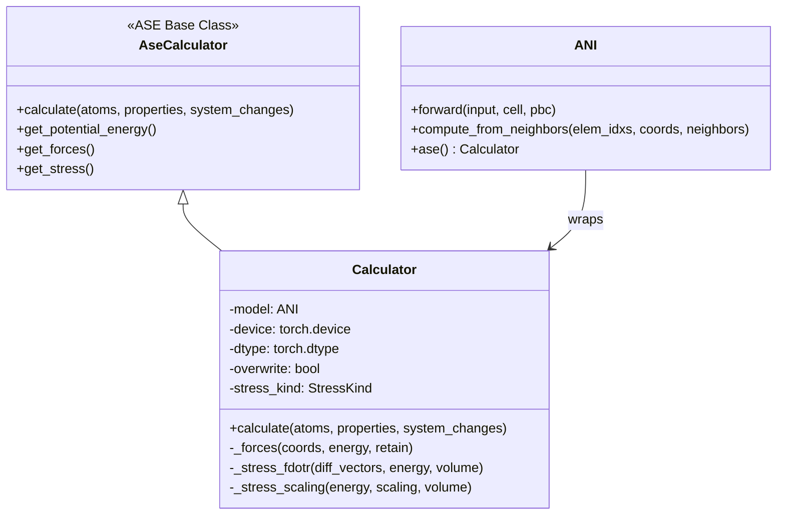
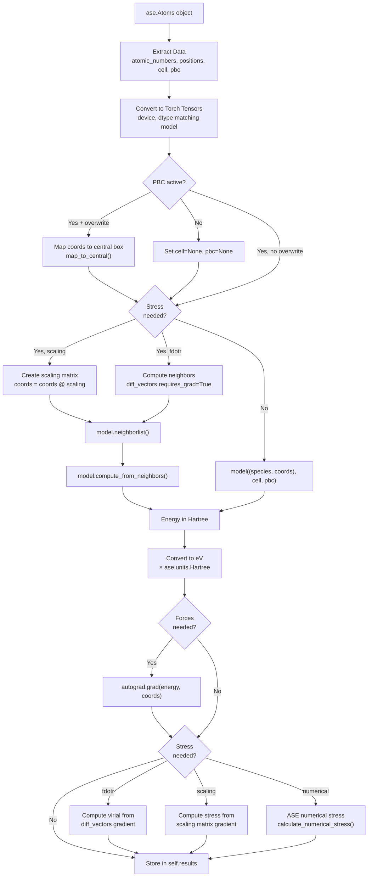
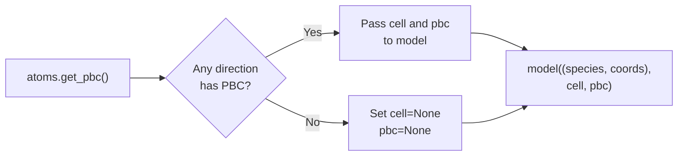
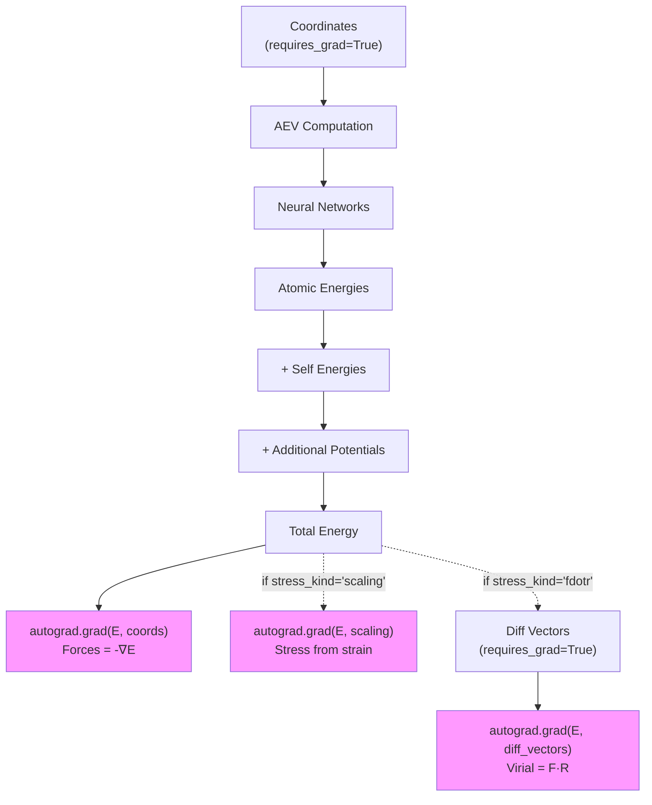

# ASE Calculator API

<details>
<summary>Relevant source files</summary>

The following files were used as context for generating this wiki page:

- [examples/fundamentals.py](examples/fundamentals.py)
- [tests/test_ase.py](tests/test_ase.py)
- [tests/test_cuaev.py](tests/test_cuaev.py)
- [torchani/__init__.py](torchani/__init__.py)
- [torchani/ase.py](torchani/ase.py)
- [torchani/neurochem.py](torchani/neurochem.py)

</details>


## Purpose and Scope

This page documents the TorchANI ASE Calculator interface, which enables TorchANI models to be used with the Atomic Simulation Environment (ASE) library for molecular dynamics, geometry optimization, and vibrational analysis. For information about using TorchANI models directly without ASE, see [Energy and Force Calculations](#5.2). For practical examples of ASE integration workflows, see [ASE Integration](#5.4).

---

## Overview

The `torchani.ase.Calculator` class is a subclass of `ase.calculators.calculator.Calculator` that wraps any TorchANI `ANI` or `ANIq` model for use with ASE. This integration allows TorchANI neural network potentials to be used seamlessly with ASE's extensive ecosystem of simulation tools.

### Calculator Class Hierarchy



**Sources:** [torchani/ase.py:32-174]()

---

## Creating a Calculator Instance

### Via Model's `.ase()` Method

The recommended way to create an ASE calculator is by calling the `.ase()` method on any TorchANI model:

```python
import torchani

model = torchani.models.ANI2x()
calculator = model.ase()
```

### Direct Instantiation

Alternatively, you can instantiate the calculator directly:

```python
from torchani.ase import Calculator

model = torchani.models.ANI1x()
calculator = Calculator(
    model=model,
    overwrite=False,
    stress_kind="scaling"
)
```

**Sources:** [torchani/ase.py:32-74](), [examples/fundamentals.py:61]()

---

## Constructor Parameters

| Parameter | Type | Default | Description |
|-----------|------|---------|-------------|
| `model` | `torchani.arch.ANI` | Required | Neural network potential model that converts coordinates into energies |
| `overwrite` | `bool` | `False` | Whether to replace original positions in `ase.Atoms` with wrapped positions after mapping to central box |
| `stress_kind` | `StressKind` | `"scaling"` | Strategy for stress calculation: `"fdotr"`, `"scaling"`, or `"numerical"` |

### Important Constraint

The model **must** have `periodic_table_index=True`. This is automatically set for all built-in models but must be specified when creating custom models:

```python
# This will raise ValueError
model = custom_model(periodic_table_index=False)
calculator = model.ase()  # ERROR

# Correct usage
model = custom_model(periodic_table_index=True)
calculator = model.ase()  # OK
```

**Sources:** [torchani/ase.py:58-73]()

---

## Implemented Properties

The calculator implements the following ASE properties:

| Property | Description | Units | ASE Method |
|----------|-------------|-------|------------|
| `"energy"` | Total molecular energy | Hartree → eV | `get_potential_energy()` |
| `"free_energy"` | Same as energy (for ASE compatibility) | Hartree → eV | `get_potential_energy(force_consistent=True)` |
| `"forces"` | Atomic forces | Hartree/Å → eV/Å | `get_forces()` |
| `"stress"` | Virial stress tensor | Hartree/ų → eV/ų | `get_stress()` |

**Note:** All energies and forces are automatically converted from TorchANI's internal Hartree units to ASE's eV units.

**Sources:** [torchani/ase.py:56](), [torchani/ase.py:136-157]()

---

## Calculation Pipeline



**Sources:** [torchani/ase.py:75-157]()

---

## Stress Calculation Strategies

The calculator supports three different strategies for computing stress, controlled by the `stress_kind` parameter:

### Comparison Table

| Strategy | Method | Requires Cell | Multi-GPU Support | Typical Use Case |
|----------|--------|---------------|-------------------|------------------|
| `"scaling"` | Strain derivative | Yes | No | Standard single-GPU NPT simulations |
| `"fdotr"` | Force-distance-outer-product | No | Yes | Multi-GPU domain decomposition |
| `"numerical"` | Finite differences | Yes | Yes | Validation and debugging |

### Strategy Details

#### 1. Scaling Method (Default)

The scaling method computes stress by taking the derivative of energy with respect to a strain matrix:

```
scaling = I₃ₓ₃  (with requires_grad=True)
coords_scaled = coords @ scaling
cell_scaled = cell @ scaling
stress = ∂E/∂scaling / volume
```

This is the most common approach but requires cell information and cannot be used with domain decomposition on multiple GPUs.

**Implementation:** [torchani/ase.py:111-115](), [torchani/ase.py:170-173]()

#### 2. Force-Distance-Outer-Product (fdotr)

The fdotr method computes the virial stress tensor directly from atomic forces and displacement vectors:

```
virial = (∂E/∂R)ᵀ @ R
stress = virial / volume
```

where `R` are the displacement vectors between atom pairs. This method:
- Does not require cell information
- Can work with domain decomposition on multi-GPUs
- Is the only option for distributed parallel simulations

**Implementation:** [torchani/ase.py:125-131](), [torchani/ase.py:164-168]()

#### 3. Numerical Method

Uses ASE's built-in numerical stress calculation via finite differences. Primarily used for validation purposes.

**Implementation:** [torchani/ase.py:152-153]()

**Sources:** [torchani/ase.py:50-53](), [torchani/ase.py:111-157](), [tests/test_ase.py:138-195]()

---

## Integration with ASE Modules

### Molecular Dynamics

The calculator can be used with any ASE molecular dynamics class:

```python
from ase.md.langevin import Langevin
from ase.lattice.cubic import Diamond

model = torchani.models.ANI1x()
atoms = Diamond(symbol="C", pbc=True)
atoms.calc = model.ase()

dyn = Langevin(
    atoms,
    timestep=0.5 * units.fs,
    temperature_K=300,
    friction=0.002
)
dyn.run(1000)
```

**Sources:** [tests/test_ase.py:119-125]()

### Geometry Optimization

The calculator works with all ASE optimizers:

```python
from ase.optimize import BFGS

atoms = ...  # Your system
atoms.calc = model.ase()

opt = BFGS(atoms)
opt.run(fmax=0.01)  # Optimize until max force < 0.01 eV/Å
```

**Sources:** [tests/test_ase.py:242-258]()

### Vibrational Analysis

The calculator supports ASE's vibrational analysis tools:

```python
from ase.vibrations import Vibrations

molecule = Atoms(...)
molecule.calc = model.ase()

vib = Vibrations(molecule)
vib.run()
frequencies = vib.get_frequencies()
vib.summary()
```

**Sources:** [tests/test_ase.py:205-221]()

### NPT Simulations

For constant pressure simulations, choose an appropriate stress calculation method:

```python
from ase.md.nptberendsen import NPTBerendsen

atoms.calc = model.ase(stress_kind="fdotr")  # or "scaling"

dyn = NPTBerendsen(
    atoms,
    timestep=0.1 * units.fs,
    temperature_K=300,
    taut=100 * units.fs,
    pressure_au=1.0 * units.bar,
    taup=1000 * units.fs,
    compressibility_au=4.57e-5 / units.bar
)
dyn.run(10000)
```

**Sources:** [tests/test_ase.py:179-195]()

---

## Periodic Boundary Conditions

### Coordinate Wrapping

When `overwrite=True` and periodic boundary conditions are active, the calculator will wrap coordinates into the central simulation box and update the ASE `Atoms` object:

```python
calculator = model.ase(overwrite=True)
atoms.calc = calculator

# After calculation, atoms.positions will be wrapped to central box
energy = atoms.get_potential_energy()
```

**Warning:** Setting `overwrite=True` will lose information about atoms crossing periodic boundaries. This is generally not recommended for trajectory analysis.

**Sources:** [torchani/ase.py:47-49](), [torchani/ase.py:102-105]()

### PBC Detection

The calculator automatically detects whether PBC should be used:



**Sources:** [torchani/ase.py:96-109]()

---

## Device and Dtype Management

The calculator automatically inherits the device and dtype from the wrapped model:

```python
# Model on CUDA with double precision
model = torchani.models.ANI2x(device="cuda", dtype=torch.float64)
calculator = model.ase()

# calculator.device == torch.device("cuda")
# calculator.dtype == torch.float64

# All inputs will be automatically moved to the correct device/dtype
```

**Important:** The ASE `Atoms` object uses NumPy arrays, but the calculator handles all conversions to/from PyTorch tensors internally.

**Sources:** [torchani/ase.py:66-68]()

---

## Force and Energy Gradients

### Force Computation

Forces are computed via automatic differentiation:

```python
forces = -torch.autograd.grad(
    energy.squeeze(),
    coords,
    retain_graph=needs_stress
)[0]
```

The `retain_graph` parameter is set to `True` when stress is also needed, allowing the computation graph to be reused.

**Sources:** [torchani/ase.py:160-162]()

### Gradient Flow Diagram



**Sources:** [torchani/ase.py:143-157]()

---

## API Reference

### Class: `torchani.ase.Calculator`

#### Constructor

```
Calculator(
    model: torchani.arch.ANI,
    overwrite: bool = False,
    stress_kind: StressKind = "scaling"
)
```

Creates an ASE calculator wrapping a TorchANI model.

**Raises:**
- `ValueError`: If model does not have `periodic_table_index=True`

#### Attributes

| Attribute | Type | Description |
|-----------|------|-------------|
| `model` | `ANI` | The wrapped TorchANI model |
| `device` | `torch.device` | Device of model parameters |
| `dtype` | `torch.dtype` | Dtype of model parameters |
| `overwrite` | `bool` | Whether to overwrite positions with wrapped coordinates |
| `stress_kind` | `StressKind` | Stress calculation strategy |
| `implemented_properties` | `List[str]` | `["energy", "free_energy", "forces", "stress"]` |

#### Methods

##### `calculate(atoms, properties, system_changes)`

Main calculation method called by ASE. Not typically called directly by users.

**Parameters:**
- `atoms` (`ase.Atoms` or `None`): Atomic system to calculate
- `properties` (`List[str]`): Properties to compute (default: `["energy"]`)
- `system_changes` (`List[str]`): What changed since last calculation

**Stores results in:** `self.results` dictionary

##### Static Methods

**`_forces(coords, energy, retain)`**

Computes forces via automatic differentiation.

**`_stress_fdotr(diff_vectors, energy, volume)`**

Computes stress using force-distance outer product method.

**`_stress_scaling(energy, scaling, volume)`**

Computes stress using scaling matrix method.

**Sources:** [torchani/ase.py:32-174]()

---

## Common Patterns and Best Practices

### Pattern 1: Standard MD Simulation

```python
model = torchani.models.ANI2x(device="cuda")
atoms.calc = model.ase()

from ase.md.velocitydistribution import MaxwellBoltzmannDistribution
MaxwellBoltzmannDistribution(atoms, temperature_K=300)

from ase.md.verlet import VelocityVerlet
dyn = VelocityVerlet(atoms, timestep=0.5 * units.fs)
dyn.run(10000)
```

### Pattern 2: NPT with Multi-GPU

```python
# Use fdotr for domain decomposition compatibility
calculator = model.ase(stress_kind="fdotr")
atoms.calc = calculator

dyn = NPTBerendsen(atoms, ...)
dyn.run(steps)
```

### Pattern 3: Validation

```python
# Compare analytical vs numerical stress
calc_analytical = model.ase(stress_kind="scaling")
calc_numerical = model.ase(stress_kind="numerical")

atoms.calc = calc_analytical
stress_analytical = atoms.get_stress()

atoms.calc = calc_numerical  
stress_numerical = atoms.get_stress()

# Should match within tolerance
```

**Sources:** [tests/test_ase.py:69-195]()

---

## Related Modules

The ASE calculator integrates with several other TorchANI components:

| Module | Purpose | Used By Calculator |
|--------|---------|-------------------|
| `torchani.arch.ANI` | Model architecture | Wrapped by calculator |
| `torchani.neighbors` | Neighborlist computation | For stress calculation with fdotr |
| `torchani.utils.map_to_central` | PBC coordinate wrapping | For `overwrite=True` mode |
| `torch.autograd.grad` | Automatic differentiation | Force and stress computation |

**Sources:** [torchani/ase.py:1-30]()

---