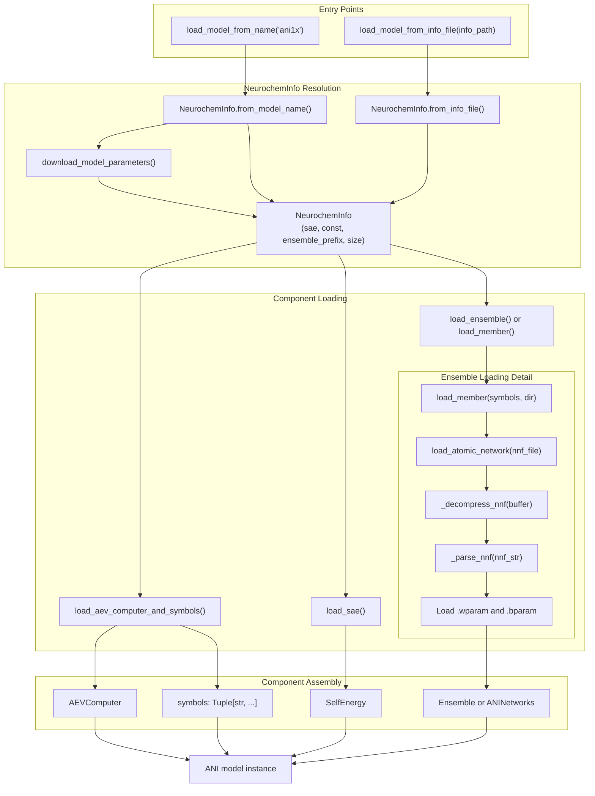
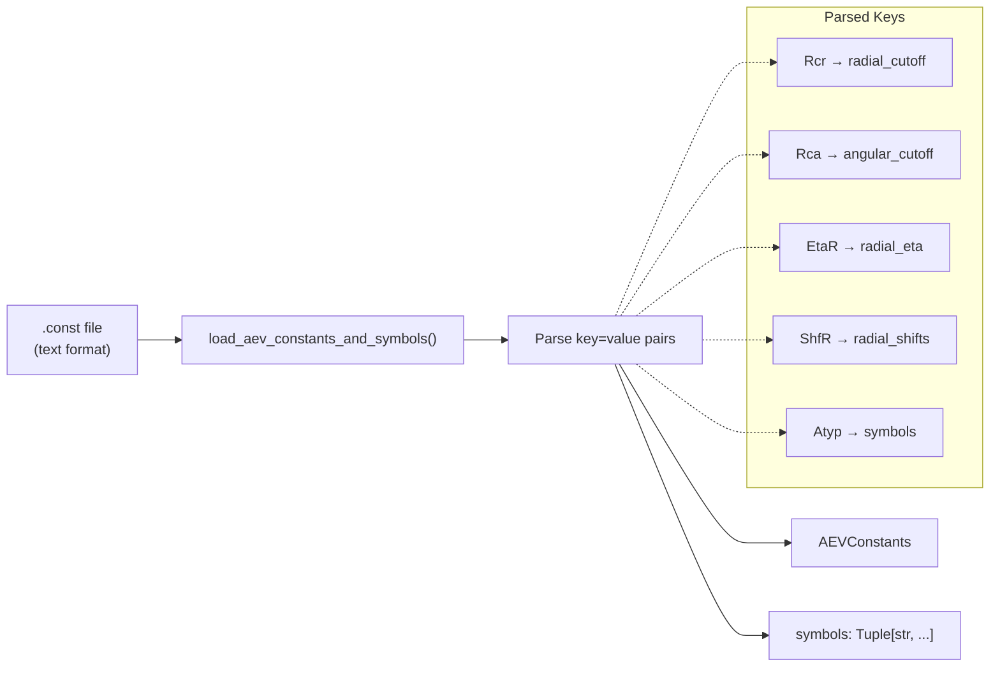
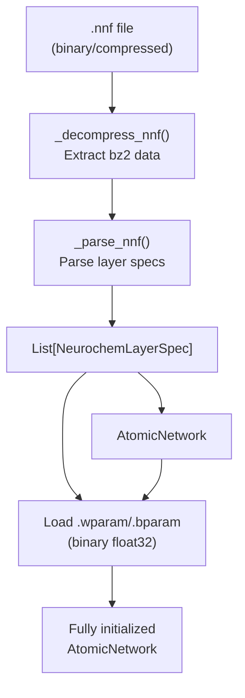

# Legacy NeuroChem API

<details>
<summary>Relevant source files</summary>

The following files were used as context for generating this wiki page:

- [examples/fundamentals.py](examples/fundamentals.py)
- [torchani/__init__.py](torchani/__init__.py)
- [torchani/models.py](torchani/models.py)
- [torchani/neurochem.py](torchani/neurochem.py)
- [torchani/utils.py](torchani/utils.py)

</details>


## Purpose and Scope

The Legacy NeuroChem API (`torchani.neurochem` module) provides backward compatibility for loading pre-trained ANI models stored in the original NeuroChem file format. This API should **only** be used when interfacing with legacy trained models; it is not recommended for new code. For loading modern pre-trained models, see [Model Factories](#9.2). For training custom models, see [Building Custom Models](#5.3).

The NeuroChem format was used in the original ANI paper and consists of multiple binary and text files storing network architectures, weights, AEV parameters, and self-atomic energies. This module parses these files and converts them into standard TorchANI components (`ANI`, `AEVComputer`, `ANINetworks`, `SelfEnergy`).

**Sources:** [torchani/neurochem.py:1-10]()

---

## NeuroChem File Format Structure

The NeuroChem format consists of several file types that together define a complete model:

| File Type | Extension | Content | Format |
|-----------|-----------|---------|--------|
| Info File | `.info` | Paths to other files and ensemble size | Text |
| Constants File | `.const` | AEV hyperparameters (cutoffs, eta, shifts, etc.) | Text (key=value) |
| Self-Energies | `.sae` | Atomic self-energies by element | Text (symbol,idx=energy) |
| Network Definition | `.nnf` | Layer architectures and parameter file paths | Compressed text |
| Weights | `.wparam` | Neural network weight matrices | Binary (float32) |
| Biases | `.bparam` | Neural network bias vectors | Binary (float32) |

**Directory Structure:**
```
model-root/
├── ani-1x_8x.info              # Info file pointing to other files
├── rHCNO-5.2R_16-3.5A_a4-8.params  # Constants file
├── sae_linfit.dat              # Self-atomic energies
├── train0/networks/            # Ensemble member 0
│   ├── ANN-H.nnf              # Network for H atoms
│   ├── ANN-H.wparam           # Weights for H network
│   ├── ANN-H.bparam           # Biases for H network
│   ├── ANN-C.nnf
│   └── ...
├── train1/networks/            # Ensemble member 1
└── ...
```

**Sources:** [torchani/neurochem.py:336-390](), [torchani/neurochem.py:339-356]()

---

## Model Loading Workflow



**Sources:** [torchani/neurochem.py:456-476](), [torchani/neurochem.py:478-497](), [torchani/neurochem.py:392-421]()

---

## Core Classes and Data Structures

### NeurochemInfo

Dataclass that encapsulates all file paths and metadata for a NeuroChem model.

```python
@dataclass
class NeurochemInfo:
    sae: Path                    # Path to .sae file
    const: Path                  # Path to .const file  
    ensemble_prefix: Path        # Prefix for ensemble directories
    ensemble_size: int           # Number of ensemble members
```

**Factory Methods:**

| Method | Purpose | Source |
|--------|---------|--------|
| `from_model_name(model_name)` | Load from supported model name ('ani1x', 'ani2x', 'ani1ccx') | [torchani/neurochem.py:358-370]() |
| `from_info_file(info_file_path)` | Load from .info file path | [torchani/neurochem.py:346-356]() |

**Sources:** [torchani/neurochem.py:339-371]()

---

### AEVConstants

Dataclass storing parsed AEV hyperparameters from `.const` file.

```python
@dataclass
class AEVConstants:
    radial_cutoff: float
    radial_eta: float
    radial_shifts: Tuple[float, ...]
    angular_cutoff: float
    angular_eta: float
    angular_zeta: float
    angular_shifts: Tuple[float, ...]
    sections: Tuple[float, ...]
```

**Sources:** [torchani/neurochem.py:94-104]()

---

### NeurochemLayerSpec

Dataclass representing a parsed layer from a `.nnf` file.

```python
@dataclass
class NeurochemLayerSpec:
    nodes: int              # Output dimension
    activation: int         # Activation function index
    kind: int              # Layer type
    blocksize: int         # Input dimension
    weights: str           # Path to .wparam file
    weight_numel: int      # Number of weight parameters
    biases: str            # Path to .bparam file
    bias_numel: int        # Number of bias parameters
    # ... other fields (dropout, norm, etc.)
```

**Sources:** [torchani/neurochem.py:49-67]()

---

## File Parsing Functions

### Constants File Parsing



**Key mapping:** The `.const` file uses NeuroChem-specific key names that are mapped to TorchANI naming conventions:

| NeuroChem Key | TorchANI Name | Type |
|---------------|---------------|------|
| `Rcr` | `radial_cutoff` | float |
| `Rca` | `angular_cutoff` | float |
| `EtaR` | `radial_eta` | float |
| `ShfR` | `radial_shifts` | tuple[float] |
| `EtaA` | `angular_eta` | float |
| `ShfA` | `angular_shifts` | tuple[float] |
| `Zeta` | `angular_zeta` | float |
| `ShfZ` | `sections` | tuple[float] |
| `Atyp` | N/A (returns as symbols) | tuple[str] |

**Sources:** [torchani/neurochem.py:106-159](), [torchani/neurochem.py:70-91]()

---

### Self-Atomic Energy File Parsing

```python
# Example .sae file content:
# H, 0 = -0.500607632585
# C, 1 = -37.8302333826
# N, 2 = -54.5680045287
# O, 3 = -75.0362229210
```

The `load_sae()` function parses this format and returns a `SelfEnergy` object.

**Sources:** [torchani/neurochem.py:161-180]()

---

### Neural Network File Parsing

The `.nnf` file format is a compressed text format containing layer specifications. The parsing pipeline:



**Decompression:** The `.nnf` file starts with a header, followed by bz2-compressed data. The decompression finds the start marker `=` and extracts the compressed payload.

**Parsing:** The decompressed text is transformed using string replacements to convert NeuroChem syntax into Python dict syntax, then `eval()`'d (safe for legacy files).

**Parameter Loading:** Weight and bias files are read as binary `float32` arrays using `struct.unpack()`.

**Sources:** [torchani/neurochem.py:226-303](), [torchani/neurochem.py:195-224]()

---

## API Functions

### High-Level Model Loading

| Function | Purpose | Returns |
|----------|---------|---------|
| `load_model_from_name(model_name, ...)` | Load complete ANI model from supported name | `ANI` |
| `load_model_from_info_file(info_file, ...)` | Load complete ANI model from .info file | `ANI` |

**Parameters:**
- `model_index: Optional[int]` - Load single ensemble member instead of full ensemble
- `strategy: str` - AEV computation strategy ('pyaev' or 'cuaev')
- `periodic_table_index: bool` - Use periodic table indexing

**Sources:** [torchani/neurochem.py:478-497](), [torchani/neurochem.py:456-476]()

---

### Component Loading Functions

| Function | Purpose | Returns |
|----------|---------|---------|
| `modules_from_model_name(model_name, ...)` | Load components from model name | `(AEVComputer, Container, SelfEnergy, symbols)` |
| `modules_from_info_file(info_file, ...)` | Load components from .info file | `(AEVComputer, Container, SelfEnergy, symbols)` |
| `load_aev_computer_and_symbols(consts_file, ...)` | Load AEV computer and symbols | `(AEVComputer, symbols)` |
| `load_sae(filename)` | Load self-atomic energies | `SelfEnergy` |
| `load_atomic_network(filename)` | Load single atomic network | `AtomicNetwork` |
| `load_member(symbols, model_dir)` | Load one ensemble member | `ANINetworks` |
| `load_ensemble(symbols, prefix, count)` | Load full ensemble | `Ensemble` |

**Sources:** [torchani/neurochem.py:423-453](), [torchani/neurochem.py:70-91](), [torchani/neurochem.py:161-180](), [torchani/neurochem.py:226-303](), [torchani/neurochem.py:305-318](), [torchani/neurochem.py:320-334]()

---

## Supported Pre-trained Models

The following models can be loaded using `load_model_from_name()`:

| Model Name | Elements | Training Level | Ensemble Size | Notes |
|------------|----------|----------------|---------------|-------|
| `'ani1x'` | H, C, N, O | wB97X/6-31G(d) | 8 | Active learning trained |
| `'ani1ccx'` | H, C, N, O | CCSD(T)*/CBS | 8 | Transfer learning |
| `'ani2x'` | H, C, N, O, S, F, Cl | wB97X/6-31G(d) | 8 | Extended elements |

**Note:** Modern code should use `torchani.models.ANI1x()`, `torchani.models.ANI1ccx()`, and `torchani.models.ANI2x()` instead, which provide the same models with better interfaces.

**Sources:** [torchani/neurochem.py:336-337](), [torchani/neurochem.py:358-370]()

---

## Model Download and Caching

Models are automatically downloaded on first use:

```python
def download_model_parameters(root: Optional[Path] = None, verbose: bool = True):
    """Downloads NeuroChem model files from GitHub release"""
    # Downloads from: github.com/aiqm/ani-model-zoo/archive/ani-2x.zip
    # Extracts to: neurochem_dir() by default
```

**Default Location:** Models are cached in `neurochem_dir()`, typically `~/.local/share/torchani/neurochem/` on Linux or `~/Library/Application Support/torchani/neurochem/` on macOS.

**Sources:** [torchani/neurochem.py:373-390]()

---

## Usage Examples

### Example 1: Loading Complete Model

```python
import torchani

# Load full ANI-1x ensemble (8 models)
model = torchani.neurochem.load_model_from_name('ani1x')

# Load single ensemble member
model_0 = torchani.neurochem.load_model_from_name('ani1x', model_index=0)

# Use CUDA accelerated AEV computation
model_cuda = torchani.neurochem.load_model_from_name(
    'ani1x',
    strategy='cuaev'
)
```

**Sources:** [torchani/neurochem.py:478-497]()

---

### Example 2: Loading Individual Components

```python
import torchani.neurochem as nc

# Get individual components
aev_computer, neural_networks, self_energy, symbols = \
    nc.modules_from_model_name('ani2x')

print(f"Symbols: {symbols}")
# Output: ('H', 'C', 'N', 'O', 'S', 'F', 'Cl')

print(f"Ensemble size: {len(neural_networks)}")
# Output: 8

# Manually construct ANI model
model = torchani.arch.ANI(
    symbols,
    aev_computer,
    neural_networks,
    self_energy,
    periodic_table_index=True
)
```

**Sources:** [torchani/neurochem.py:423-438]()

---

### Example 3: Loading from Custom .info File

```python
from pathlib import Path
import torchani.neurochem as nc

# Load from custom info file
info_path = Path('/path/to/custom-model.info')
model = nc.load_model_from_info_file(info_path)

# Or get components separately
aev, nn, sae, symbols = nc.modules_from_info_file(info_path)
```

**Sources:** [torchani/neurochem.py:440-454](), [torchani/neurochem.py:456-476]()

---

## Migration Guide: NeuroChem to Modern API

For new code, use the modern model factories instead of the NeuroChem API:

| Legacy NeuroChem | Modern Equivalent | Notes |
|------------------|-------------------|-------|
| `neurochem.load_model_from_name('ani1x')` | `torchani.models.ANI1x()` | Same weights, better interface |
| `neurochem.load_model_from_name('ani1ccx')` | `torchani.models.ANI1ccx()` | Same weights, better interface |
| `neurochem.load_model_from_name('ani2x')` | `torchani.models.ANI2x()` | Same weights, better interface |
| `neurochem.modules_from_model_name()` | Use `Assembler` to build custom | See [Building Custom Models](#5.3) |
| `load_sae()` | `SelfEnergy(symbols, energies)` | Direct construction |
| `load_aev_computer_and_symbols()` | `AEVComputer.from_constants()` | Direct construction |

**Key Differences:**
- Modern API uses PyTorch state dicts (`.pt` files) instead of NeuroChem binary format
- Modern models support `device` and `dtype` parameters at initialization
- Modern models have better documentation and type hints
- Modern models integrate seamlessly with `Assembler` for customization

**Sources:** [torchani/models.py:92-127](), [torchani/models.py:129-164](), [torchani/models.py:166-200]()

---

## Error Handling

The module defines a custom exception for parsing errors:

```python
class NeurochemParseError(RuntimeError):
    """Raised when NeuroChem file parsing fails"""
```

**Common Error Scenarios:**
- Corrupted or invalid `.nnf` file compression → `NeurochemParseError`
- Mismatched layer dimensions → `NeurochemParseError`
- Unsupported activation function index → `NeurochemParseError`
- Invalid model name → `ValueError`
- Missing model files → Triggers `download_model_parameters()`

**Sources:** [torchani/neurochem.py:45-47](), [torchani/neurochem.py:183-193]()

---

## Technical Details

### Activation Function Mapping

NeuroChem uses integer indices for activation functions. Only CELU is currently supported:

| Index | Activation | TorchANI Equivalent |
|-------|------------|---------------------|
| 9 | CELU | `TightCELU()` |
| 5 | Gaussian | Not supported |
| 6 | Linear (output) | No activation |

**Sources:** [torchani/neurochem.py:182-193]()

---

### Binary Parameter Format

Weight and bias files store parameters as sequences of 32-bit floats in little-endian format. They are read using `struct.unpack()` with format string `'{}f'.format(numel)`.

**Sources:** [torchani/neurochem.py:290-301]()

---

### Directory Naming Convention

Ensemble members are stored in directories following the pattern:
```
{prefix}0/networks/
{prefix}1/networks/
...
{prefix}N/networks/
```

The `model_dir_from_prefix()` function generates these paths.

**Sources:** [torchani/neurochem.py:40-43]()

---