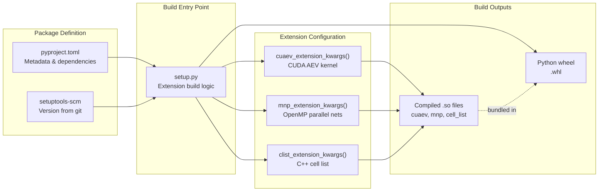
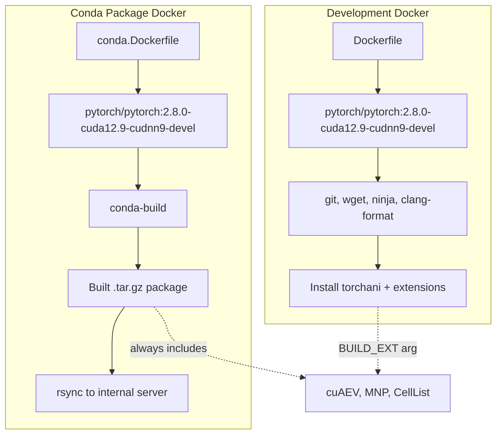
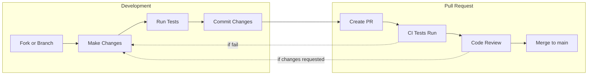
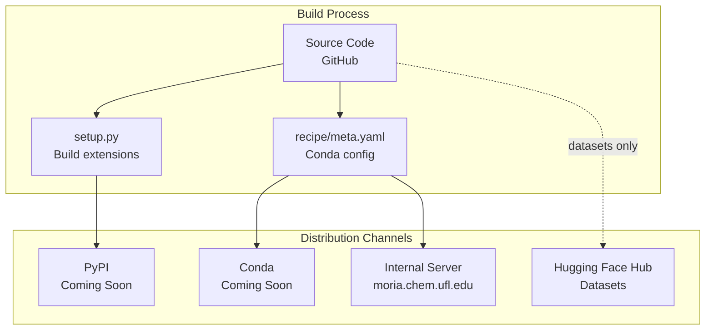
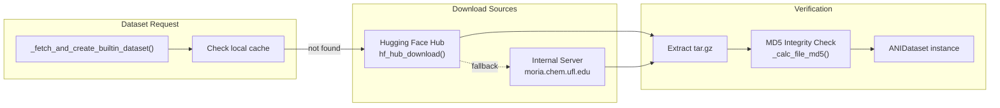

# Development Guide

<details>
<summary>Relevant source files</summary>

The following files were used as context for generating this wiki page:

- [.gitignore](.gitignore)
- [Dockerfile](Dockerfile)
- [README.md](README.md)
- [conda.Dockerfile](conda.Dockerfile)
- [dev_requirements.txt](dev_requirements.txt)
- [pyproject.toml](pyproject.toml)
- [recipe/conda_build_config.yaml](recipe/conda_build_config.yaml)
- [recipe/meta.yaml](recipe/meta.yaml)
- [setup.py](setup.py)
- [torchani/datasets/_utils.py](torchani/datasets/_utils.py)

</details>


## Purpose and Scope

This guide provides information for developers who want to contribute to the TorchANI codebase. It covers setting up a development environment, understanding the repository structure, building from source, running tests, and contributing code.

For detailed information about specific topics, see:
- Build system details and extension compilation: [Build System](#10.1)
- Testing infrastructure and adding tests: [Testing Guide](#10.2)
- Code contribution guidelines and PR process: [Contributing](#10.3)

**Sources:** [README.md:177-183]()

---

## Development Environment Setup

### Cloning the Repository

Clone the TorchANI repository and navigate to the project directory:

```bash
git clone https://github.com/aiqm/torchani.git
cd torchani
```

### Environment Creation

TorchANI can be developed using either a `conda` environment or a Python `venv`. The recommended approach uses `conda` with the provided `environment.yaml` file:

```bash
conda env create -f ./environment.yaml
conda activate torchani
```

The `environment.yaml` file includes many optional dependencies needed for:
- Building compiled C++/CUDA extensions
- Building documentation
- Running tests and benchmarking tools

Alternatively, create a Python virtual environment and install dependencies manually:

```bash
python -m venv venv
source venv/bin/activate
pip install -r dev_requirements.txt
```

### Installing TorchANI in Development Mode

**Without Extensions (faster, for pure Python development):**

```bash
pip install --no-deps -e .
```

**With Extensions (cuAEV and MNP):**

```bash
pip install --config-settings=--global-option=ext --no-build-isolation --no-deps -e .
```

The `-e` flag creates an editable installation, allowing code changes to take effect without reinstalling.

### Downloading Development Data

Some tests and documentation examples require additional data files:

```bash
bash ./download-dev-data.sh
```

**Sources:** [README.md:52-104](), [dev_requirements.txt:1-41]()

---

## Repository Structure

The TorchANI repository follows a standard Python package layout with additional directories for documentation, tests, and tooling:

```mermaid
graph TB
    Root["Repository Root"]
    
    subgraph "Source Code"
        TorchANI["torchani/<br/>Main package"]
        CSRC["torchani/csrc/<br/>C++/CUDA extensions"]
        Datasets["torchani/datasets/<br/>Dataset loaders"]
        ASE["torchani/ase/<br/>ASE integration"]
    end
    
    subgraph "Configuration"
        PyProject["pyproject.toml<br/>Package metadata"]
        Setup["setup.py<br/>Extension build"]
        Environment["environment.yaml<br/>Conda env"]
        DevReqs["dev_requirements.txt<br/>Optional deps"]
    end
    
    subgraph "Build & Deploy"
        Recipe["recipe/<br/>Conda package"]
        Docker["Dockerfile<br/>Dev environment"]
        CondaDocker["conda.Dockerfile<br/>Conda build"]
    end
    
    subgraph "Testing & Docs"
        Tests["tests/<br/>Unit tests"]
        Docs["docs/<br/>Sphinx docs"]
    end
    
    subgraph "Tooling"
        Tools["tools/<br/>Benchmarks, utils"]
        Examples["examples/<br/>Usage examples"]
    end
    
    Root --> TorchANI
    Root --> Configuration
    Root --> Build
    Root --> Testing
    Root --> Tooling
    
    TorchANI --> CSRC
    TorchANI --> Datasets
    TorchANI --> ASE
    
    Configuration --> PyProject
    Configuration --> Setup
    Configuration --> Environment
    Configuration --> DevReqs
    
    Build --> Recipe
    Build --> Docker
    Build --> CondaDocker
    
    Testing --> Tests
    Testing --> Docs
    
    Tooling --> Tools
    Tooling --> Examples
```



### Key Directories

| Directory | Purpose |
|-----------|---------|
| `torchani/` | Main Python package containing core functionality |
| `torchani/csrc/` | C++ and CUDA source files for compiled extensions |
| `torchani/datasets/` | Dataset loading utilities and built-in datasets |
| `torchani/ase/` | ASE calculator interface |
| `tests/` | pytest-based unit tests |
| `docs/` | Sphinx documentation source and build output |
| `tools/` | Benchmarking scripts and development utilities |
| `examples/` | Usage examples and tutorials |
| `recipe/` | Conda package recipe (`meta.yaml`) |

**Sources:** [pyproject.toml:49-51](), [.gitignore:1-88]()

---

## Build System Overview

TorchANI uses a modern Python build system based on `setuptools`, `setuptools-scm`, and `pyproject.toml`, with custom logic in `setup.py` for building optional C++/CUDA extensions.



### Extension Build Flags

The `setup.py` script accepts custom flags to control extension compilation:

| Flag | Purpose |
|------|---------|
| `ext` | Build extensions for auto-detected GPU architectures |
| `ext-all-sms` | Build extensions for all supported GPU compute capabilities (SM) |
| `ext-sm{XX}` | Build for specific SM (e.g., `ext-sm86` for RTX 3090) |
| `ext-debug` | Include debug symbols in compiled extensions |
| `ext-no-opt` | Disable optimizations like `-use_fast_math` |

These flags are passed via `pip`'s `--config-settings`:

```bash
pip install --config-settings=--global-option=ext --no-build-isolation -v .
```

### Supported GPU Architectures

```python
SUPPORTED_SMS = {"60", "61", "70", "75", "80", "86", "89", "100"}
```

| SM | Architecture | Example GPUs |
|----|--------------|--------------|
| 60, 61 | Pascal | Tesla P100, GTX 1080 |
| 70 | Volta | Tesla V100 |
| 75 | Turing | RTX 2080, T4 |
| 80, 86 | Ampere | A100, RTX 3090 |
| 89 | Ada Lovelace / Hopper | RTX 4090, H100 |
| 100 | Blackwell | B100 |

For complete build system details, see [Build System](#10.1).

**Sources:** [setup.py:1-289](), [pyproject.toml:1-64](), [README.md:74-84]()

---

## Docker Development Environments

TorchANI provides two Docker environments for reproducible builds and development:



### Development Dockerfile

The `Dockerfile` creates an environment for development and testing:

- Base image: `pytorch/pytorch:2.8.0-cuda12.9-cudnn9-devel`
- Installs development tools (`git`, `wget`, `ninja-build`, `clang-format`)
- Downloads test data via `download-dev-data.sh`
- Installs optional dependencies from `dev_requirements.txt`
- Optionally builds extensions based on `BUILD_EXT` argument

**Building the development image:**

```bash
# Without extensions
docker build -t torchani-dev .

# With extensions for all SMs
docker build --build-arg BUILD_EXT=all-sms -t torchani-dev .

# With extensions for specific SM
docker build --build-arg BUILD_EXT=sm86 -t torchani-dev .
```

### Conda Package Dockerfile

The `conda.Dockerfile` builds the conda package and optionally deploys it:

- Uses `conda-build` and `conda-verify`
- Creates package with all extensions enabled
- Can deploy to internal server via `rsync` (requires SSH key secret)
- Can deploy to anaconda.org (requires token secret)

**Sources:** [Dockerfile:1-56](), [conda.Dockerfile:1-71](), [README.md:206-231]()

---

## Testing Infrastructure

TorchANI uses `pytest` for unit testing with additional testing utilities:

### Test Organization

```
tests/
├── test_aev.py          # AEV computation tests
├── test_builtin_models.py # Pre-trained model tests
├── test_datasets.py     # Dataset loading tests
├── test_forces.py       # Gradient and force tests
├── test_neighborlist.py # Neighborlist algorithm tests
└── ...
```

### Running Tests

```bash
cd tests
pytest -v .
```

Individual test files can be run:

```bash
pytest -v test_aev.py
```

### Test Dependencies

The following packages are required for testing (listed in `dev_requirements.txt`):

- `pytest` - Test runner
- `parameterized` - Test parametrization
- `expecttest` - PyTorch testing utilities
- `pandas`, `pyarrow`, `zarr` - Additional data backend tests

### Continuous Integration

GitHub Actions runs tests automatically on:
- Pull requests
- Pushes to main branch

The CI workflow is defined in `.github/workflows/ci.yaml`.

For detailed testing guidelines, see [Testing Guide](#10.2).

**Sources:** [dev_requirements.txt:12-23](), [README.md:101-104]()

---

## Contributing Workflow

TorchANI follows a standard GitHub-based development workflow with branch protection and code review requirements.



### Key Guidelines

1. **Never commit directly to `main`**: All changes must go through pull requests
2. **Create feature branches**: Use descriptive branch names
3. **All CI tests must pass**: GitHub Actions runs tests automatically
4. **Code review required**: At least one reviewer must approve before merging
5. **Follow code style**: Use `flake8` for linting and `mypy` for type checking

### Development Tools

The following development tools are available in `dev_requirements.txt`:

| Tool | Purpose |
|------|---------|
| `flake8` | Python linting and style checking |
| `mypy` | Static type checking |
| `clang-format` | C++/CUDA code formatting |

### Mypy Configuration

Type checking configuration in `pyproject.toml`:

```python
[tool.mypy]
ignore_missing_imports = true
check_untyped_defs = true
exclude = "(build/.*|tests/.*|tools/.*|docs/src/examples_autogen/.*|docs/build/.*)"
```

For complete contribution guidelines, see [Contributing](#10.3).

**Sources:** [README.md:177-183](), [pyproject.toml:57-60](), [dev_requirements.txt:38-41]()

---

## Package Distribution

TorchANI can be distributed via multiple channels:



### Conda Package Build

The conda package includes:
- All core dependencies
- Compiled extensions (cuAEV, MNP, CellList)
- CLI entry point (`ani` command)

Build configuration in `recipe/conda_build_config.yaml`:

| Parameter | Value |
|-----------|-------|
| Python | 3.11 |
| PyTorch | 2.7.1 |
| CUDA | 12.9 |
| NumPy | 2.1 |
| C++ Compiler | GCC 12.2 |

**Build command:**

```bash
conda build -c pytorch -c nvidia -c conda-forge \
    --no-anaconda-upload \
    --output-folder ./conda-pkgs/ \
    ./recipe
```

### Conda Package Deployment

The `conda.Dockerfile` automates package building and deployment. GitHub Actions workflows handle:

1. **Build testing**: Runs on PRs with `conda` in branch name
2. **Daily deployment**: Runs at 00:00:00 UTC on main branch
3. **Manual deployment**: Runs on PRs with `conda` and `release` in branch name

**Sources:** [README.md:42-50](), [recipe/meta.yaml:1-52](), [recipe/conda_build_config.yaml:1-13](), [README.md:206-242]()

---

## Dataset Management for Development

During development, datasets are managed through a combination of internal servers and Hugging Face Hub:

### Dataset Download Flow



### Dataset Integrity Checking

The `_check_files_integrity()` function verifies:
1. All expected files are present
2. File names match specification
3. MD5 checksums match `md5s.csv`

This can be skipped during development with `skip_check=True`:

```python
dataset = ani1x(skip_check=True)
```

### Adding New Datasets

To add a new built-in dataset:

1. Update `builtin_datasets.json` with dataset metadata
2. Add file MD5 checksums to `md5s.csv`
3. Upload dataset to internal server or Hugging Face Hub
4. Update dataset factory functions

**Sources:** [torchani/datasets/_utils.py:1-191](), [README.md:94-97]()

---

## Version Management

TorchANI uses `setuptools-scm` for automatic version management from git tags:

- Version is derived from git repository state
- Version file is auto-generated: `torchani/_version.py`
- Fallback version: `0.0.0` (when not in git repository)

Configuration in `pyproject.toml`:

```toml
[tool.setuptools_scm]
version_file = "torchani/_version.py"
fallback_version="0.0.0"
```

In Docker builds, a dummy git repository is initialized with a version tag to enable `setuptools-scm`.

**Sources:** [pyproject.toml:53-55](), [Dockerfile:32-38](), [conda.Dockerfile:29-36]()

---

## macOS Development Notes

TorchANI has limited macOS support:

- **No CUDA support**: CUDA extensions cannot be built on macOS
- **Untested with Apple MPS**: Metal Performance Shaders backend is not tested
- **Environment modifications**: The `environment.yaml` requires modifications for macOS

macOS developers should install without extensions:

```bash
pip install --no-deps -e .
```

**Sources:** [README.md:134-140]()

---