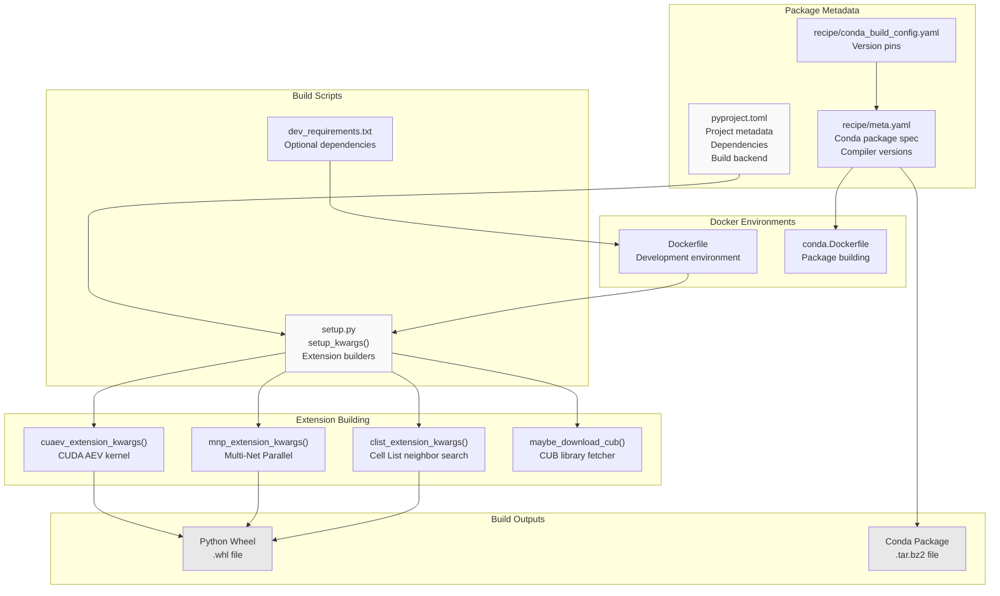
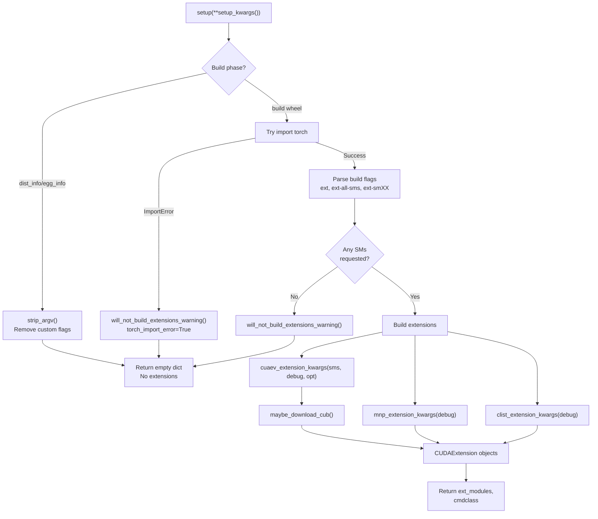
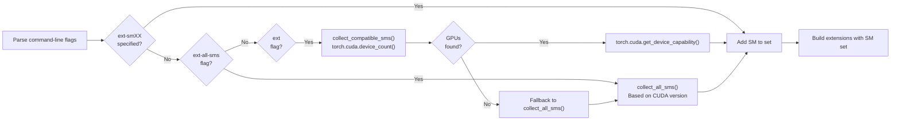
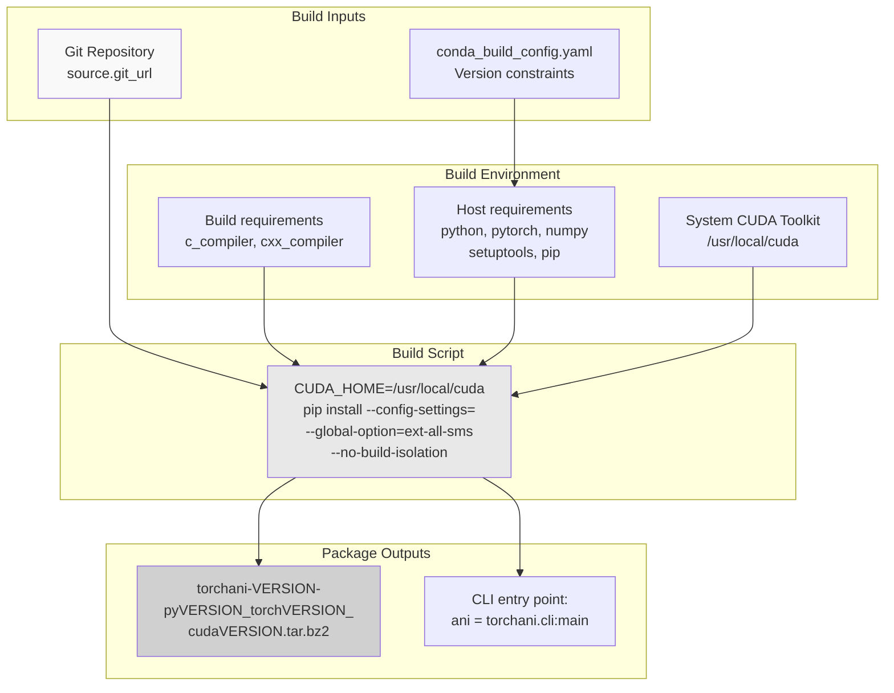
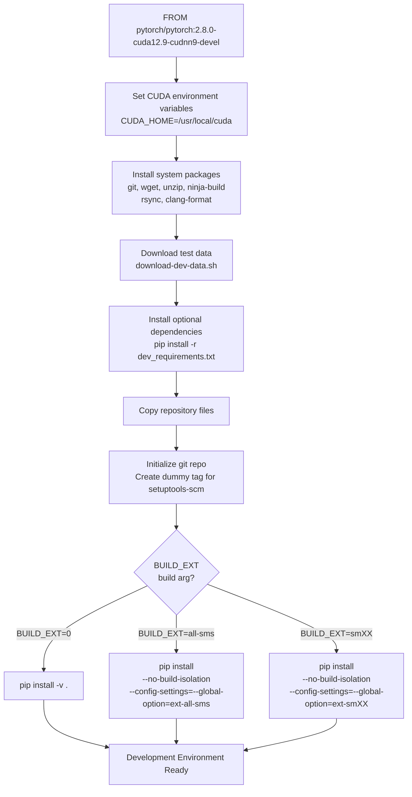
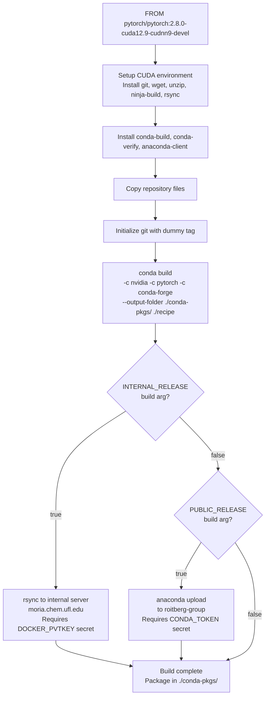

# Build System

<details>
<summary>Relevant source files</summary>

The following files were used as context for generating this wiki page:

- [.gitignore](.gitignore)
- [Dockerfile](Dockerfile)
- [README.md](README.md)
- [conda.Dockerfile](conda.Dockerfile)
- [dev_requirements.txt](dev_requirements.txt)
- [pyproject.toml](pyproject.toml)
- [recipe/conda_build_config.yaml](recipe/conda_build_config.yaml)
- [recipe/meta.yaml](recipe/meta.yaml)
- [setup.py](setup.py)
- [torchani/datasets/_utils.py](torchani/datasets/_utils.py)

</details>


This document describes TorchANI's build infrastructure, including package management via pip and conda, compilation of optional C++/CUDA extensions, and Docker-based build environments. For information about running tests, see [Testing Guide](#10.2). For general contribution guidelines, see [Contributing](#10.3).

## Overview

TorchANI uses a dual packaging approach supporting both pip (via `setuptools`) and conda. The build system handles:

- **Core package installation**: Pure Python components with standard dependencies
- **Optional extensions**: C++/CUDA accelerated modules (cuAEV, MNP, CellList)
- **Version management**: Git-based versioning via `setuptools-scm`
- **Containerized builds**: Docker environments for reproducible development and packaging

The build system is designed to work seamlessly whether extensions are compiled or not, making TorchANI accessible on systems without CUDA support while still providing significant performance gains when extensions are available.

## Build System Architecture



**Sources:** [pyproject.toml:1-64](), [setup.py:1-289](), [recipe/meta.yaml:1-52](), [Dockerfile:1-56](), [conda.Dockerfile:1-71]()

## Package Metadata and Dependencies

### pyproject.toml

The project metadata is defined in [pyproject.toml:1-64](). Key configuration:

| Section | Purpose | Key Values |
|---------|---------|------------|
| `[project]` | Package metadata | name="torchani", requires-python=">=3.9" |
| `[project.dependencies]` | Runtime requirements | torch, numpy, h5py, ase, pandas, etc. |
| `[build-system]` | Build backend | setuptools>=75.6, setuptools-scm>=8 |
| `[project.scripts]` | CLI entry point | ani = torchani.cli:main |
| `[tool.setuptools_scm]` | Version from git | version_file="torchani/_version.py" |

The build system requires `setuptools-scm` to extract version information from git tags. If building from a git repository, the version is determined automatically. A fallback version "0.0.0" is used when git is unavailable [pyproject.toml:54-55]().

### Dependency Management

Core dependencies are specified in [pyproject.toml:21-34]():
- **PyTorch**: `torch>=2.0,<=2.8` (GPU-enabled for CUDA support)
- **Numerical**: `numpy`, `h5py`
- **Data backends**: `pandas`, `pyarrow`, `zarr<3`
- **ASE integration**: `ase`
- **CLI utilities**: `typer`, `rich`, `tqdm`
- **Dataset downloads**: `huggingface_hub`

Optional development dependencies are in [dev_requirements.txt:1-41](), including testing frameworks, documentation builders, and linting tools.

**Sources:** [pyproject.toml:1-64](), [dev_requirements.txt:1-41]()

## Building with pip

### Setup.py Extension Builder

The [setup.py:1-289]() implements a sophisticated extension building system that conditionally compiles C++/CUDA modules based on command-line flags:



**Sources:** [setup.py:157-289]()

### Build Flags

TorchANI uses custom flags passed via `--config-settings=--global-option=FLAG`:

| Flag | Purpose | Example |
|------|---------|---------|
| `ext` | Build for detected GPUs | Auto-detects compute capability |
| `ext-all-sms` | Build for all supported SMs | SM 60, 61, 70, 75, 80, 86, 89, 100 |
| `ext-smXX` | Build for specific SM | `ext-sm86` for Ampere GPUs |
| `ext-debug` | Enable debug symbols | Adds `-DTORCHANI_DEBUG` |
| `ext-no-opt` | Disable optimizations | Removes `-use_fast_math` |

Supported Streaming Multiprocessor (SM) versions [setup.py:139-147]():

```python
SUPPORTED_SMS = {"60", "61", "70", "75", "80", "86", "89", "100"}
# Pascal: 60, 61
# Volta: 70 (1st gen TensorCore)
# Turing: 75 (2nd gen TensorCore)
# Ampere: 80, 86 (3rd gen TensorCore)
# Ada Lovelace, Hopper: 89 (4th gen TensorCore)
# Blackwell: 100 (5th gen TensorCore)
```

### Installation Examples

**Without extensions:**
```bash
pip install --no-deps -v .
```

**With extensions (auto-detect GPU):**
```bash
pip install --config-settings=--global-option=ext --no-build-isolation --no-deps -v .
```

**With extensions (all SMs):**
```bash
pip install --config-settings=--global-option=ext-all-sms --no-build-isolation --no-deps -v .
```

**With extensions (specific SM):**
```bash
pip install --config-settings=--global-option=ext-sm86 --no-build-isolation --no-deps -v .
```

The `--no-build-isolation` flag is required because torch must be imported during the build to access CUDA headers and determine GPU capabilities [README.md:83-84]().

**Sources:** [setup.py:138-289](), [README.md:56-108]()

## C++/CUDA Extension Compilation

### Extension Builders

Each extension has a dedicated builder function that returns kwargs for `torch.utils.cpp_extension.CUDAExtension`:

#### cuAEV Extension

The `cuaev_extension_kwargs()` function [setup.py:43-80]() builds the CUDA-accelerated AEV kernel:

| Configuration | Details |
|---------------|---------|
| **Sources** | `torchani/csrc/cuaev.cpp`, `torchani/csrc/aev.cu` |
| **NVCC flags** | `--expt-extended-lambda`, gencode for each SM |
| **CUB namespace** | Custom namespace to avoid conflicts |
| **Optimizations** | `-use_fast_math` (unless `ext-no-opt`) |
| **Debug** | `-DTORCHANI_DEBUG` (if `ext-debug`) |

The CUB library is required for CUDA < 12.8. The `maybe_download_cub()` function [setup.py:11-40]() searches PyTorch's include directories and downloads CUB from GitHub if not found.

#### MNP Extension

The `mnp_extension_kwargs()` function [setup.py:83-98]() builds the Multi-Net Parallel module:

| Configuration | Details |
|---------------|---------|
| **Sources** | `torchani/csrc/mnp.cpp` |
| **Flags** | `-std=c++17`, `-fopenmp` |
| **Purpose** | OpenMP parallelization across network ensembles |

#### CellList Extension

The `clist_extension_kwargs()` function [setup.py:101-116]() builds the cell list neighbor search:

| Configuration | Details |
|---------------|---------|
| **Sources** | `torchani/csrc/cell_list.cpp` |
| **Flags** | `-std=c++17`, `-fopenmp` |
| **Purpose** | Efficient O(N) neighbor finding for PBC systems |

**Sources:** [setup.py:43-116](), [README.md:149-153]()

### SM Detection and Selection



The `collect_compatible_sms()` function [setup.py:205-220]() queries PyTorch for visible CUDA devices and extracts their compute capabilities. The `collect_all_sms()` function [setup.py:189-203]() returns all SMs supported by the installed CUDA version.

**Sources:** [setup.py:189-235]()

## Conda Packaging

### Recipe Structure

The conda package is defined by [recipe/meta.yaml:1-52]() with version pinning in [recipe/conda_build_config.yaml:1-12]():



**Sources:** [recipe/meta.yaml:1-52](), [recipe/conda_build_config.yaml:1-12]()

### Version Constraints

The conda package pins specific versions for reproducibility [recipe/conda_build_config.yaml:1-12]():

| Component | Version | Purpose |
|-----------|---------|---------|
| C/C++ compiler | 12.2 | GCC version for C++17 support |
| PyTorch | 2.7.1 | Compatible with CUDA extensions |
| Python | 3.11 | Runtime interpreter |
| CUDA | 12.9 | GPU toolkit version |
| NumPy | 2.1 | Array library |

The package string is constructed as [recipe/meta.yaml:11]():
```
py{{ python }}_torch{{ pytorch }}_cuda{{ cuda }}
```

### Building Locally

To build the conda package [README.md:208-219]():

```bash
conda install conda-build conda-verify
mkdir ./conda-pkgs/
conda build \
    -c pytorch -c nvidia -c conda-forge \
    --no-anaconda-upload \
    --output-folder ./conda-pkgs/ \
    ./recipe
```

The recipe assumes system CUDA at `/usr/local/cuda`. If not available, additional dependencies must be added to the `host` environment [README.md:221-230]():
- `nvidia::cuda-libraries-dev={{ cuda }}`
- `nvidia::cuda-nvcc={{ cuda }}`
- `nvidia::cuda-cccl={{ cuda }}`

**Sources:** [recipe/meta.yaml:1-52](), [README.md:206-231]()

## Docker Build Environments

### Development Environment

The [Dockerfile:1-56]() creates a development environment based on PyTorch's official CUDA image:



The `BUILD_EXT` build argument controls extension compilation [Dockerfile:42-55]():
- `BUILD_EXT=0`: No extensions
- `BUILD_EXT=all-sms`: All SM versions
- `BUILD_EXT=sm86`: Specific SM (e.g., Ampere)

**Sources:** [Dockerfile:1-56]()

### Conda Package Builder

The [conda.Dockerfile:1-71]() builds and optionally deploys conda packages:



The Dockerfile supports two deployment targets [conda.Dockerfile:46-70]():

1. **Internal server**: `INTERNAL_RELEASE=1` with `DOCKER_PVTKEY` secret
   - Uploads to `moria.chem.ufl.edu:/data/conda-pkgs/`
   
2. **Anaconda.org**: `PUBLIC_RELEASE=1` with `CONDA_TOKEN` secret
   - Uploads to `roitberg-group` organization

**Sources:** [conda.Dockerfile:1-71]()

## CI/CD Integration

### GitHub Actions Workflows

The build system is tested via GitHub Actions [README.md:232-241]():

**Conda build workflow** triggers:
- Pull requests with `conda` in branch name (build only)
- Pull requests with `conda` AND `release` in branch name (build + deploy to internal server)
- Daily at 00:00:00 on default branch (scheduled builds)

The workflow badge is displayed in the README [README.md:13]():
```markdown
[]
```

### Reproducible Builds

Reproducibility is ensured through:

1. **Version pinning**: Exact versions in [recipe/conda_build_config.yaml:1-12]()
2. **Docker base images**: Tagged PyTorch CUDA images [Dockerfile:4]()
3. **Git-based versioning**: `setuptools-scm` extracts version from tags [pyproject.toml:53-55]()
4. **Dependency locking**: Specific compiler versions [recipe/conda_build_config.yaml:1-4]()

**Sources:** [README.md:232-241](), [recipe/conda_build_config.yaml:1-12](), [Dockerfile:1-4]()

## Build System Best Practices

### For Developers

1. **Use development Docker image**: Ensures consistent environment [Dockerfile:1-56]()
2. **Install with `-e` flag**: Editable install for development [README.md:86-87]()
3. **Build extensions with `ext`**: Auto-detects your GPU [setup.py:229-231]()
4. **Run tests after build**: Verify installation [README.md:101-104]()

### For Package Maintainers

1. **Pin versions in conda recipe**: Maintain reproducibility [recipe/conda_build_config.yaml:1-12]()
2. **Test both with and without extensions**: Ensure core works without CUDA [setup.py:252-254]()
3. **Update SUPPORTED_SMS**: Add new GPU architectures as PyTorch supports them [setup.py:145]()
4. **Verify MD5 checksums**: Prevent dataset corruption [torchani/datasets/_utils.py:25-30]()

### For Users

1. **Install from conda when available**: Pre-built extensions [README.md:44-46]()
2. **Use `--no-build-isolation`**: Required for extension builds [README.md:83]()
3. **Specify SM if auto-detect fails**: Explicitly set GPU architecture [setup.py:224-227]()
4. **Check CUDA compatibility**: Match PyTorch and CUDA Toolkit versions [README.md:141-146]()

**Sources:** [README.md:44-146](), [setup.py:145-254](), [recipe/conda_build_config.yaml:1-12](), [torchani/datasets/_utils.py:25-30]()

---