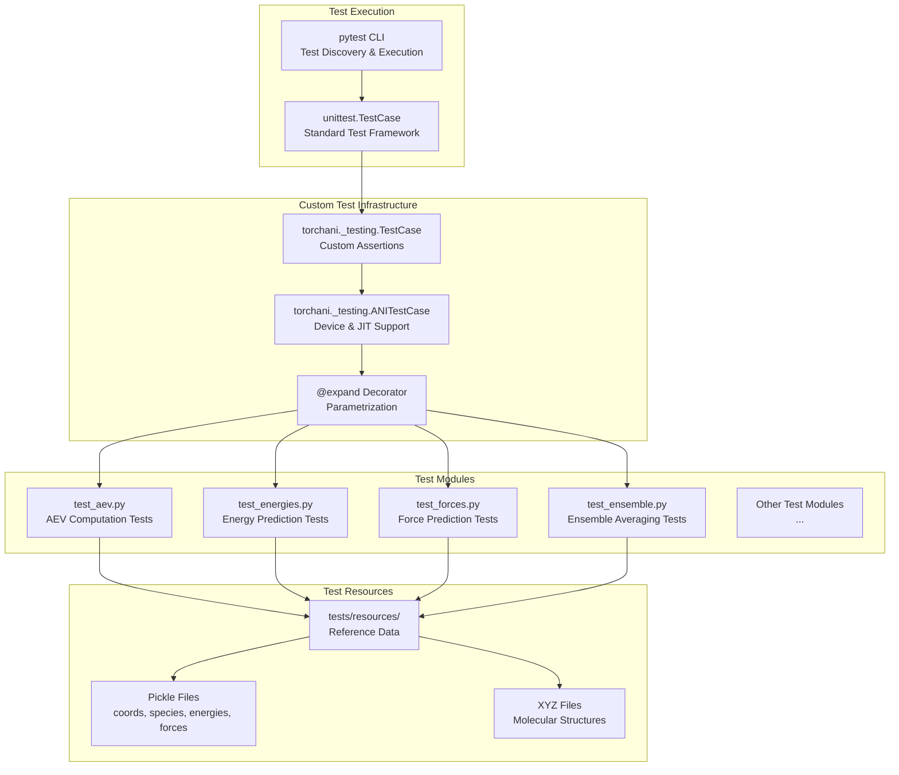
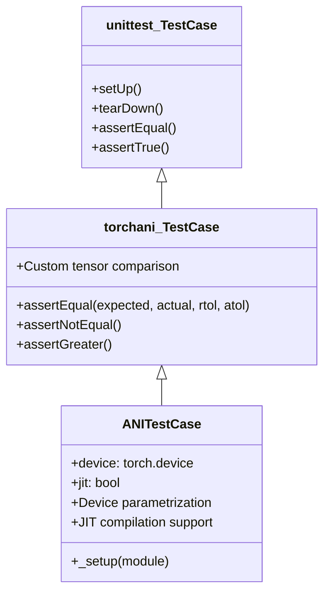
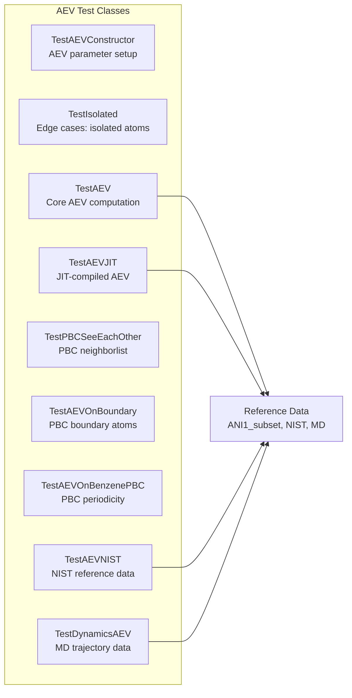
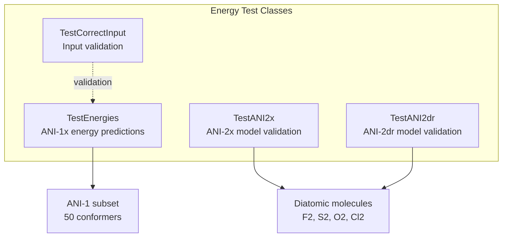
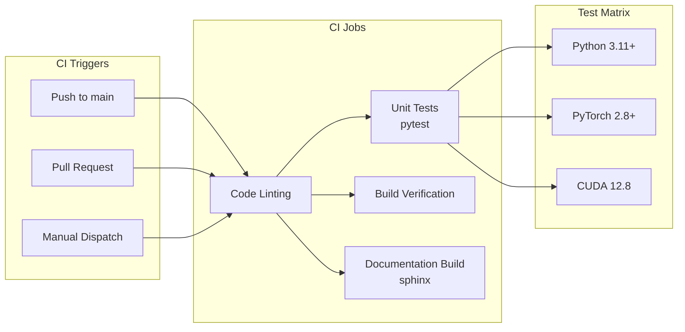

# Testing Guide

<details>
<summary>Relevant source files</summary>

The following files were used as context for generating this wiki page:

- [.gitignore](.gitignore)
- [README.md](README.md)
- [setup.py](setup.py)
- [tests/test_aev.py](tests/test_aev.py)
- [tests/test_energies.py](tests/test_energies.py)
- [tests/test_ensemble.py](tests/test_ensemble.py)
- [tests/test_forces.py](tests/test_forces.py)

</details>


## Purpose and Scope

This document describes the testing infrastructure in TorchANI, including how to run tests, understand test organization, write new tests, and debug test failures. For information about the build system and compilation, see [Build System](#10.1). For general contribution guidelines, see [Contributing](#10.3).

The TorchANI test suite uses pytest as the test runner with unittest-style test classes. Tests verify correctness of AEV computation, energy and force predictions, ensemble averaging, gradient calculations, and various edge cases including periodic boundary conditions and padding.

---

## Test Framework Architecture

The testing infrastructure combines pytest's test discovery and execution with unittest-style test classes, enhanced by custom base classes and decorators.



**Sources:** [tests/test_aev.py:1-533](), [tests/test_energies.py:1-165](), [tests/test_forces.py:1-60](), [tests/test_ensemble.py:1-42]()

---

## Running Tests Locally

### Prerequisites

Install development dependencies and download test data:

```bash
# Install TorchANI with development dependencies
pip install -r dev_requirements.txt
pip install -e .

# Download test resources (required for most tests)
bash ./download-dev-data.sh
```

**Sources:** [README.md:94-104]()

### Basic Test Execution

Run all tests from the tests directory:

```bash
cd tests
pytest -v .
```

Run specific test files:

```bash
pytest -v test_aev.py
pytest -v test_energies.py
pytest -v test_forces.py
```

Run specific test classes or methods:

```bash
pytest -v test_aev.py::TestAEV
pytest -v test_aev.py::TestAEV::testIsomers
```

**Sources:** [README.md:101-104]()

### Test Execution Options

| Option | Description |
|--------|-------------|
| `-v` or `--verbose` | Show detailed test names and results |
| `-s` | Show print statements during test execution |
| `-k PATTERN` | Run tests matching the pattern |
| `-x` | Stop after first failure |
| `--pdb` | Drop into debugger on failures |
| `--lf` | Run only last failed tests |

---

## Test Infrastructure Components

### Custom Base Classes



**Custom TestCase** [torchani/_testing.py]() provides enhanced tensor comparison with tolerance parameters:
- `assertEqual(expected, actual, rtol=1e-5, atol=1e-8)` - compares tensors with relative and absolute tolerances
- Automatically handles different tensor shapes and dtypes
- Used as base for most test classes

**ANITestCase** [torchani/_testing.py]() adds device and JIT parametrization:
- Automatically tests on both CPU and CUDA (if available)
- Tests both eager and JIT-compiled models
- `_setup(module)` method handles device transfer and optional JIT compilation
- Used in [tests/test_energies.py:14](), [tests/test_forces.py:14](), [tests/test_ensemble.py:13]()

**Sources:** [tests/test_aev.py:11-24](), [tests/test_energies.py:7-8](), [tests/test_forces.py:7-8]()

### The @expand Decorator

The `@expand()` decorator enables parametrized testing across multiple dimensions:

```python
@expand()  # Tests on cpu/cuda, with/without JIT
class TestEnergies(ANITestCase):
    def testIsomers(self):
        # Runs 4x: cpu eager, cpu jit, cuda eager, cuda jit
        pass

@expand(device="cpu", jit=False)  # Restricts parameters
class TestCorrectInput(ANITestCase):
    # Only runs on CPU without JIT
    pass
```

**Sources:** [tests/test_energies.py:13-14](), [tests/test_energies.py:70]()

---

## Test Data Management

### Resource Directory Structure

```
tests/resources/
├── ANI1_subset/           # 97 conformers for energy/force testing
│   ├── 0, 1, 2, ...      # Pickle files with coords, species, AEV, energies, forces
├── NIST/                  # NIST reference data
│   └── all               # Pickle file with NIST test cases
├── benzene-md/            # Benzene MD trajectory
│   ├── 2.dat, 8.dat      # Pickle files with PBC data
├── tripeptide-md/         # Tripeptide MD trajectory
│   ├── 0.dat, 1.dat, ... # 100 frames
└── benzene.xyz            # Benzene structure with cell/PBC
```

**Sources:** [tests/test_aev.py:20-21](), [tests/test_aev.py:167-182](), [tests/test_aev.py:441-452](), [tests/test_aev.py:456-506]()

### Reference Data Format

Test data is stored in pickle files containing tuples:

```python
# Format for ANI1_subset files
(coordinates,     # numpy array: (conformers, atoms, 3)
 species,         # numpy array: (atoms,) atomic numbers
 radial_aev,      # numpy array: expected radial AEV
 angular_aev,     # numpy array: expected angular AEV
 energies,        # numpy array: expected energies
 forces)          # numpy array: expected forces
```

**Sources:** [tests/test_aev.py:167-176](), [tests/test_energies.py:128-136]()

For PBC tests (benzene-md):

```python
# Format includes cell and pbc
(coordinates, species, radial_aev, angular_aev, _, _, cell, pbc)
```

**Sources:** [tests/test_aev.py:456-478]()

---

## Test Categories

### AEV Computation Tests

**Test Module:** [tests/test_aev.py:1-533]()



Key tests:
- **Constructor tests** [tests/test_aev.py:40-59](): Verify AEV parameters match ANI-1x and ANI-2x specifications
- **Isolated atom tests** [tests/test_aev.py:61-132](): Verify no IndexError when atoms are beyond cutoff radius
- **Gradient tests** [tests/test_aev.py:135-163](): Verify gradients are identical for batched vs. individual molecules
- **Reference data tests** [tests/test_aev.py:165-182](): Compare against 97 ANI-1 subset conformers
- **Padding tests** [tests/test_aev.py:202-225](): Verify batching with variable-size molecules
- **PBC tests** [tests/test_aev.py:234-437](): Verify periodic boundary conditions, translational invariance, and boundary handling
- **JIT tests** [tests/test_aev.py:228-232](): Verify TorchScript compilation produces identical results

**Sources:** [tests/test_aev.py:1-533]()

### Energy Prediction Tests

**Test Module:** [tests/test_energies.py:1-165]()



Key tests:
- **Diatomic molecule tests** [tests/test_energies.py:19-41](): Compare energies against reference values for simple systems
- **Periodic table index tests** [tests/test_energies.py:16-34](): Verify species conversion between PTI and internal indexing
- **Input validation** [tests/test_energies.py:79-116](): Verify errors for unknown species and mismatched shapes
- **Isomer tests** [tests/test_energies.py:126-136](): Compare predictions against 50 reference conformers
- **Padding tests** [tests/test_energies.py:138-160](): Verify batching with variable-size molecules

**Sources:** [tests/test_energies.py:1-165]()

### Force Prediction Tests

**Test Module:** [tests/test_forces.py:1-60]()

Force tests verify that automatic differentiation produces correct gradients:

```python
energies, forces_pred = energies_and_forces(model, species, coordinates)
# forces_pred = -grad(energies, coordinates)
```

Key tests:
- **Isomer force tests** [tests/test_forces.py:20-30](): Compare predicted forces against reference data for 50 conformers
- **Padding tests** [tests/test_forces.py:32-55](): Verify force computation with batched variable-size molecules

**Sources:** [tests/test_forces.py:1-60]()

### Ensemble Model Tests

**Test Module:** [tests/test_ensemble.py:1-42]()

Ensemble tests verify that the ensemble model correctly averages predictions from individual models:

```python
ensemble = ANI1x()  # 8 models
model_list = [ANI1x(model_index=i) for i in range(8)]

# Verify: ensemble.energies == mean([m.energies for m in model_list])
```

**Sources:** [tests/test_ensemble.py:13-37]()

---

## Writing New Tests

### Basic Test Structure

```python
import unittest
import torch
from torchani._testing import ANITestCase, expand

@expand()  # Parametrize across devices and JIT
class TestNewFeature(ANITestCase):
    def setUp(self):
        # Initialize models/components with device transfer
        self.model = self._setup(ANI1x(model_index=0))
    
    def testBasicBehavior(self):
        # Create test inputs on correct device
        species = torch.tensor([[1, 6, 8]], device=self.device)
        coords = torch.randn(1, 3, 3, device=self.device)
        
        # Run computation
        result = self.model((species, coords))
        
        # Assert expected behavior
        self.assertIsNotNone(result.energies)
        self.assertEqual(result.energies.shape, (1,))

if __name__ == "__main__":
    unittest.main(verbosity=2)
```

### Using Reference Data

```python
def testWithReferenceData(self):
    import pickle
    from pathlib import Path
    
    datafile = Path(__file__).parent / "resources/ANI1_subset/0"
    with open(datafile, "rb") as f:
        coords, species, _, _, energies_ref, _ = pickle.load(f)
        coords = torch.from_numpy(coords).to(self.device)
        species = torch.from_numpy(species).to(self.device)
        energies_ref = torch.from_numpy(energies_ref).to(self.device)
        
        energies = self.model((species, coords)).energies
        self.assertEqual(energies, energies_ref)
```

### Custom Assertion Methods

The custom `TestCase.assertEqual` supports tensor comparison with tolerances:

```python
# Default tolerances: rtol=1e-5, atol=1e-8
self.assertEqual(expected, actual)

# Custom tolerances
self.assertEqual(expected, actual, rtol=1e-4, atol=1e-6)

# Other assertions
self.assertGreater(actual, threshold)
self.assertTrue(condition)
self.assertFalse(condition)
```

**Sources:** [tests/test_aev.py:30-37](), [tests/test_aev.py:55-58]()

---

## Continuous Integration

### GitHub Actions Workflow

TorchANI uses GitHub Actions for continuous integration. The CI workflow is triggered on:

- Push to main branch
- Pull requests
- Manual workflow dispatch



### CI Requirements

All tests must pass before a pull request can be merged:

- All unit tests in `tests/` directory
- Code passes linting checks
- Documentation builds successfully
- Extensions build without errors (if applicable)

**Sources:** [README.md:12-13](), [README.md:179-182]()

### Conda Package Build CI

A separate workflow tests conda package building:

- Runs on PRs with `conda` in branch name
- Deploys to internal server on PRs with both `conda` and `release` in branch name
- Scheduled daily builds at 00:00:00

**Sources:** [README.md:232-241]()

---

## Debugging Failed Tests

### Running Individual Tests with Verbosity

```bash
# Run single test with maximum verbosity
pytest -vv tests/test_aev.py::TestAEV::testIsomers

# Show print statements
pytest -vvs tests/test_aev.py::TestAEV::testIsomers

# Drop into pdb on failure
pytest -vv --pdb tests/test_aev.py::TestAEV::testIsomers
```

### Using Debug Mode

The C++/CUDA extensions can be compiled with debug symbols:

```bash
# Build with debug information
pip install --config-settings=--global-option=ext \
            --config-settings=--global-option=ext-debug \
            --no-build-isolation --no-deps -e .
```

This enables the `TORCHANI_DEBUG` macro in [torchani/csrc/cuaev.cpp]() and [torchani/csrc/mnp.cpp]().

**Sources:** [setup.py:62-63](), [setup.py:87-89](), [setup.py:237-241]()

### Inspecting AEV Debug Output

The `_TestAEVBase` class includes a debug flag for AEV inspection:

```python
class _TestAEVBase(TestCase):
    def setUp(self):
        self.aev_computer = AEVComputer.like_1x()
        self._debug_aev = False  # Set to True for debug output
```

When enabled, the test prints expected vs. actual AEV values for specific atoms.

**Sources:** [tests/test_aev.py:24-37]()

### Common Test Failure Patterns

| Symptom | Likely Cause | Solution |
|---------|-------------|----------|
| `FileNotFoundError` for pickle files | Missing test data | Run `bash ./download-dev-data.sh` |
| `RuntimeError: CUDA out of memory` | Large batch sizes on GPU | Reduce batch size or use CPU |
| `AssertionError` with tolerance mismatch | Numerical precision differences | Check if using correct dtype (float vs. double) |
| `IndexError` in AEV computation | Atoms beyond cutoff radius | Verify cutoff handling in test case |
| Import errors for extensions | Extensions not built | Build extensions with `pip install --config-settings=--global-option=ext` |

---

## Test Output and Artifacts

### Test Output Directories

Tests may create output directories that are gitignored:

- `tests/runs/` - Training run outputs from test scripts
- `tests/.hypothesis/` - Hypothesis testing framework cache
- `.pytest_cache/` - Pytest cache

**Sources:** [.gitignore:45-47]()

### Coverage Reports

Code coverage can be measured using `coverage.py`:

```bash
# Run tests with coverage
coverage run -m pytest tests/

# Generate HTML report
coverage html

# View in browser
open htmlcov/index.html
```

Coverage reports are gitignored in `.coverage` and `htmlcov/`.

**Sources:** [.gitignore:38-39]()

---

## Best Practices for Testing

### Test Isolation

- Each test should be independent and not rely on execution order
- Use `setUp()` to initialize fresh state for each test
- Clean up resources in `tearDown()` if needed

### Gradient Verification

When testing differentiable operations, verify gradients:

```python
# Example from test_aev.py
coords = torch.randn(1, 3, 3, requires_grad=True)
aev = self.aev_computer(species, coords)
aev.backward(torch.ones_like(aev))
# Verify coords.grad is not None and has expected values
```

**Sources:** [tests/test_aev.py:144-152]()

### Testing Edge Cases

TorchANI tests systematically cover edge cases:

- **Isolated atoms** [tests/test_aev.py:61-132](): Atoms beyond cutoff radius
- **Superimposed atoms** [tests/test_aev.py:184-189](): No NaN in output
- **Single atoms** [tests/test_aev.py:122-131](): Lone atom systems
- **PBC boundaries** [tests/test_aev.py:335-388](): Atoms on cell boundaries
- **Variable-size batches** [tests/test_aev.py:202-225](): Padding with dummy atoms

### Parametrization Strategy

Use `@expand()` decorator to test across multiple configurations without duplicating code:

```python
@expand()  # Tests on cpu/cuda, eager/jit
class TestFeature(ANITestCase):
    pass

@expand(device="cuda")  # Only CUDA tests
class TestCUDAFeature(ANITestCase):
    pass

@expand(device="cpu", jit=False)  # Only CPU eager
class TestCPUFeature(ANITestCase):
    pass
```

**Sources:** [tests/test_energies.py:13](), [tests/test_energies.py:70](), [tests/test_forces.py:13](), [tests/test_ensemble.py:12]()

---