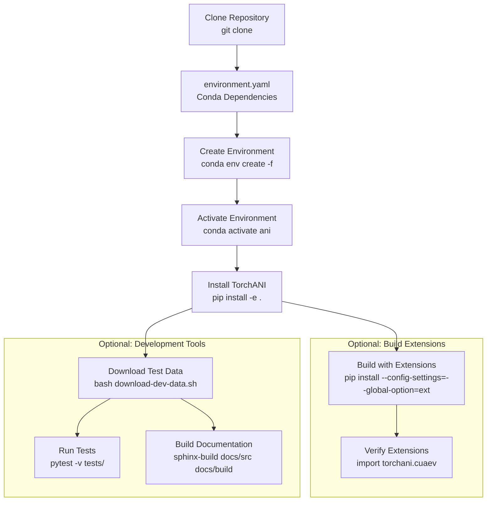
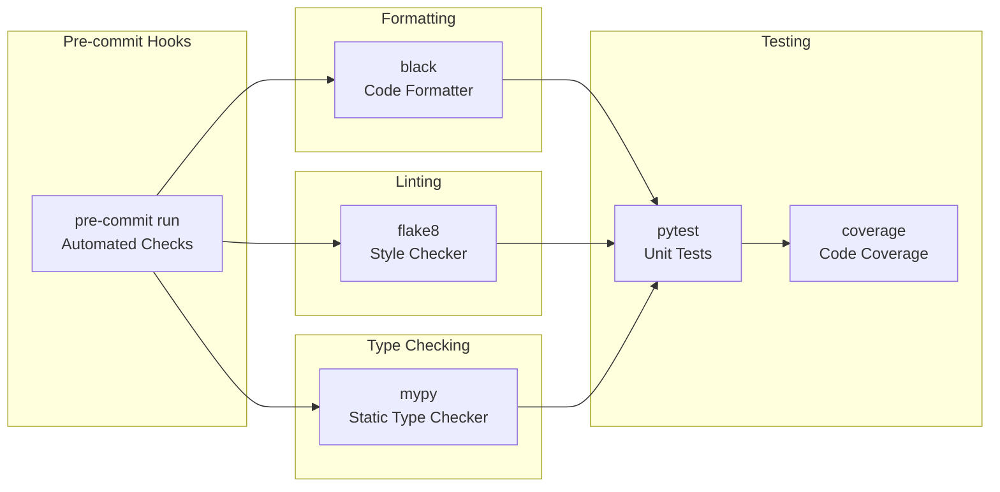
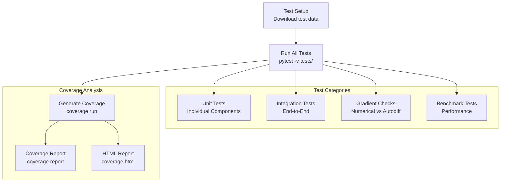
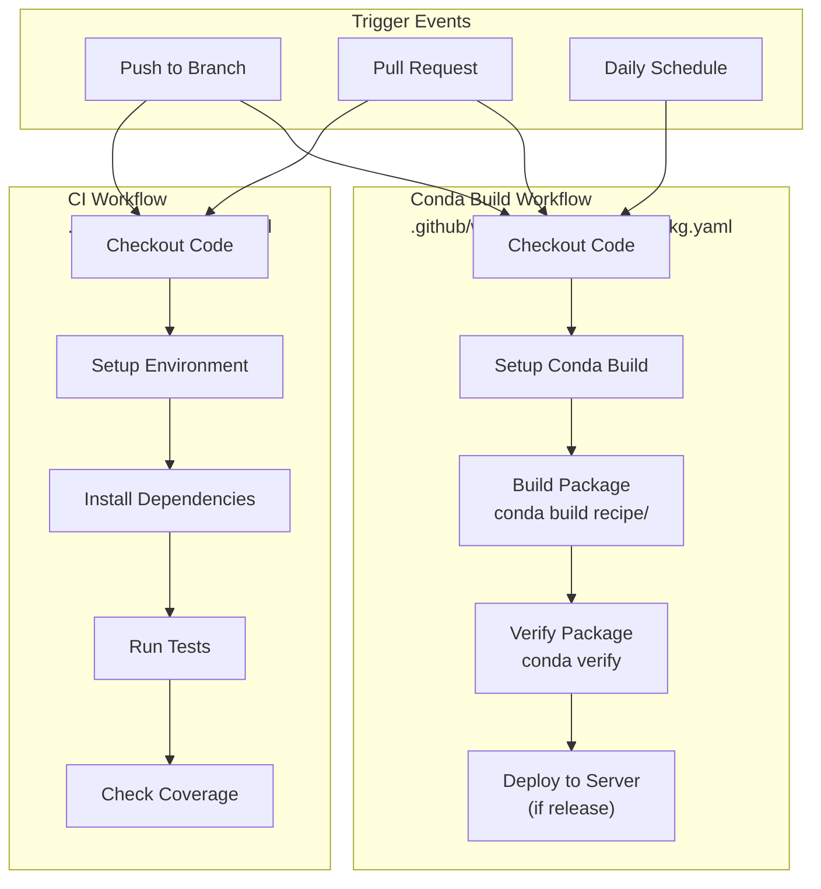
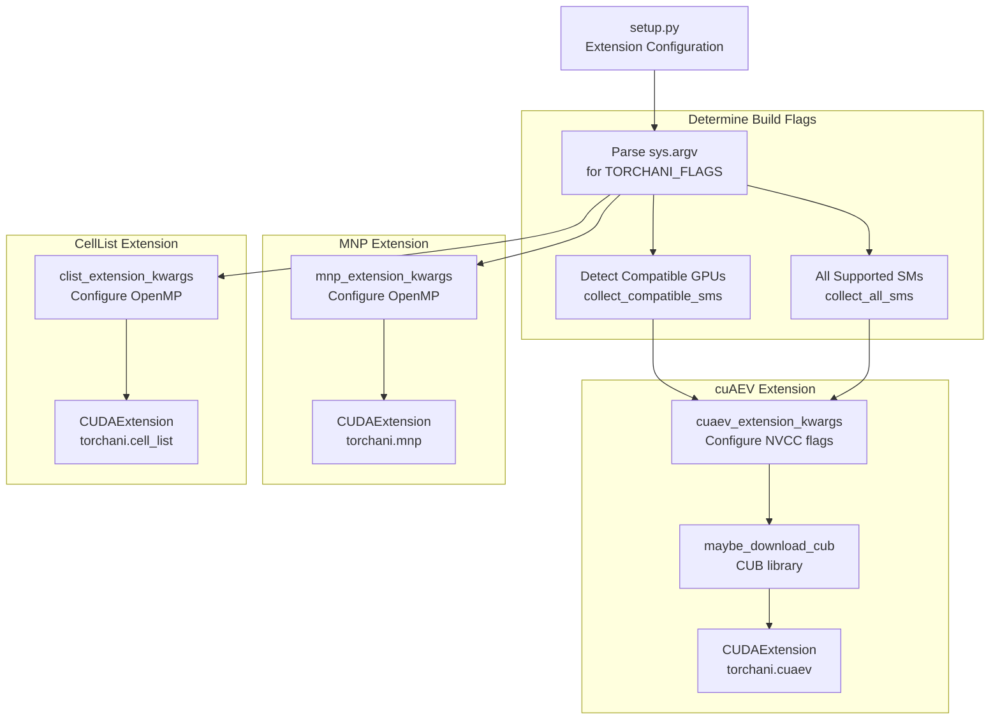

# Contributing

<details>
<summary>Relevant source files</summary>

The following files were used as context for generating this wiki page:

- [.gitignore](.gitignore)
- [README.md](README.md)
- [environment.yaml](environment.yaml)
- [setup.py](setup.py)

</details>


This page provides guidelines for contributing code, documentation, and bug reports to TorchANI. It covers the development workflow, code quality standards, testing requirements, and pull request process.

For information about the build system architecture, see [Build System](#10.1). For details on the testing infrastructure, see [Testing Guide](#10.2).

---

## Purpose and Scope

This document explains how to contribute to the TorchANI project, including:

- Setting up a development environment
- Code style and quality requirements
- Running tests and ensuring CI passes
- Submitting pull requests and the review process
- Building and testing C++/CUDA extensions
- Contributing to documentation

---

## Development Workflow

### Repository Access and Branching Strategy

**Development Workflow**

```mermaid
flowchart LR
    Fork["Fork Repository<br/>github.com/aiqm/torchani"]
    Clone["Clone Fork<br/>git clone"]
    Branch["Create Branch<br/>git checkout -b"]
    Develop["Make Changes<br/>Edit Code"]
    Commit["Commit Changes<br/>git commit"]
    Push["Push to Fork<br/>git push origin"]
    PR["Open Pull Request<br/>on GitHub"]
    CI["CI Tests Run<br/>GitHub Actions"]
    Review["Code Review<br/>Required"]
    Merge["Merge to main<br/>via GitHub"]
    
    Fork --> Clone
    Clone --> Branch
    Branch --> Develop
    Develop --> Commit
    Commit --> Push
    Push --> PR
    PR --> CI
    CI --> Review
    Review -->|Changes Requested| Develop
    Review -->|Approved + CI Pass| Merge
    
    style CI fill:#f0f0f0
    style Review fill:#f0f0f0
    style Merge fill:#f0f0f0
```


**Branch Protection Rules**

The `main` branch is protected. Direct commits to `main` are prohibited. All changes must go through the pull request process with the following requirements:

- All CI tests must pass
- Code review approval is required before merging
- The PR should have a clear description of changes

Sources: [README.md:177-183]()

### Special Branch Naming Conventions

Certain branch names trigger specific CI workflows:

| Branch Name Pattern | Triggered Workflow | Purpose |
|---------------------|-------------------|---------|
| Contains `conda` | Conda package build test | Tests that conda package builds correctly |
| Contains `conda` + `release` | Conda package deployment | Deploys to internal server |

Sources: [README.md:232-242]()

---

## Development Environment Setup

### Creating the Development Environment

**Environment Setup Diagram**


### Standard Installation (No Extensions)

```bash
# Clone the repository
git clone https://github.com/aiqm/torchani.git
cd torchani

# Create conda environment with all development dependencies
conda env create -f environment.yaml
conda activate ani

# Install TorchANI in editable mode (no compiled extensions)
pip install --no-deps -e -v .
```

The `-e` flag creates an editable installation, allowing you to modify code without reinstalling. The `--no-deps` flag prevents pip from reinstalling dependencies already installed by conda.

Sources: [README.md:54-77](), [environment.yaml:1-65]()

### Development Dependencies

The `environment.yaml` file categorizes dependencies:

| Category | Packages | Purpose |
|----------|----------|---------|
| **Core Runtime** | `python`, `numpy`, `h5py`, `tqdm`, `typer`, `rich`, `huggingface_hub` | Required to run TorchANI |
| **ASE Interface** | `ase` | Molecular dynamics and property calculations |
| **Extension Building** | `setuptools>=75.6`, `setuptools-scm>=8`, `gxx_linux-64`, `gcc_linux-64`, `cuda-toolkit` | Build C++/CUDA extensions |
| **Testing** | `pytest`, `coverage`, `black`, `flake8`, `mypy`, `parameterized`, `expecttest` | Code quality and testing |
| **Tools** | `matplotlib`, `nvidia-ml-py`, `jinja2` | Benchmarking and utilities |
| **Documentation** | `sphinx`, `sphinx-design`, `sphinx-gallery`, `pydata-sphinx-theme` | Build documentation |
| **Data Backends** | `pandas`, `pyarrow`, `zarr<3` | Additional dataset format support |

Sources: [environment.yaml:6-65]()

### macOS Considerations

TorchANI is **untested** with Apple Metal Performance Shaders (MPS). The `environment.yaml` file requires modifications for macOS:

1. Comment out the `cuda-toolkit` line ([environment.yaml:31-32]())
2. Remove the `--index-url` line for PyTorch CUDA wheels ([environment.yaml:62-63]())

Sources: [README.md:134-139](), [environment.yaml:30-63]()

---

## Code Quality Standards

### Code Quality Toolchain

**Quality Assurance Pipeline**


### Formatting with Black

TorchANI uses `black` for code formatting. Black enforces a consistent code style automatically:

```bash
# Format all Python files
black .

# Check formatting without making changes
black --check .
```

Black is included in the development dependencies and can be run through pre-commit hooks.

Sources: [environment.yaml:36]()

### Linting with Flake8

The `flake8` linter checks for style violations and potential errors:

```bash
# Run flake8 on the entire codebase
flake8 torchani/

# Run on specific files
flake8 path/to/file.py
```

Sources: [environment.yaml:37]()

### Type Checking with Mypy

TorchANI uses type hints throughout the codebase. The `mypy` static type checker verifies type correctness:

```bash
# Run mypy on the codebase
mypy torchani/
```

Type hints should be added to new code following Python's typing conventions. The `typing_extensions` package is available for advanced typing features.

Sources: [environment.yaml:38](), [environment.yaml:11]()

### Pre-commit Hooks

The repository includes pre-commit hooks for automated quality checks:

```bash
# Install pre-commit hooks
pre-commit install

# Run all hooks manually
pre-commit run --all-files
```

Sources: [environment.yaml:40]()

---

## Testing Requirements

### Running Tests

**Test Execution Workflow**


### Test Data

Before running tests, download the required test data:

```bash
bash download-dev-data.sh
```

This script downloads datasets and model files needed for testing.

Sources: [README.md:95-96]()

### Running the Test Suite

```bash
# Navigate to tests directory
cd tests/

# Run all tests with verbose output
pytest -v .

# Run specific test file
pytest -v test_specific_module.py

# Run with coverage
coverage run -m pytest -v .
coverage report
```

Test outputs are written to `tests/runs/` which is ignored by git.

Sources: [README.md:101-104](), [.gitignore:46]()

### Gradient Tests

TorchANI includes extensive gradient verification tests that compare automatic differentiation results against numerical gradients. These are critical for ensuring correctness of force and Hessian calculations.

Sources: [environment.yaml:42]()

### Parameterized Tests

The test suite uses `parameterized` for running tests with multiple parameter sets:

```python
from parameterized import parameterized

@parameterized.expand([
    ("test_case_1", param1, param2),
    ("test_case_2", param3, param4),
])
def test_something(self, name, param1, param2):
    # Test implementation
    pass
```

Sources: [environment.yaml:41]()

---

## Continuous Integration

### GitHub Actions Workflows

**CI/CD Pipeline**


### CI Requirements for Merging

All pull requests must pass the following CI checks before merging:

1. **Unit Tests**: All tests in the test suite must pass
2. **Code Quality**: Formatting, linting, and type checking must pass
3. **Build Verification**: Code must build successfully
4. **Conda Package** (if applicable): Package build must succeed for branches with `conda` in the name

Sources: [README.md:12-13](), [README.md:181-182]()

### Conda Package CI

The conda package build workflow runs:

- **On pull requests**: When branch name contains `conda`
- **On deployment**: When branch name contains both `conda` and `release`, or on scheduled daily builds at 00:00:00 on the main branch

The workflow uses the recipe in `recipe/meta.yaml` to build the conda package.

Sources: [README.md:232-242]()

---

## Building Extensions for Development

### Extension Build System

**Extension Compilation Flow**


### Build Flags

The `setup.py` script recognizes several custom flags for building extensions:

| Flag | Effect | Use Case |
|------|--------|----------|
| `ext` | Build for detected compatible GPUs | Development on local GPU |
| `ext-all-sms` | Build for all supported SM versions | Production/distribution |
| `ext-sm{XX}` | Build for specific SM version (e.g., `ext-sm80`) | Target specific GPU architecture |
| `ext-debug` | Include debug symbols | Debugging extensions |
| `ext-no-opt` | Disable optimizations | Debugging numerical issues |

Sources: [setup.py:138-148]()

### Supported GPU Architectures

TorchANI supports the following CUDA compute capabilities (SM versions):

| Architecture | SM Version | TensorCore Generation |
|--------------|------------|----------------------|
| Pascal | 60, 61 | None |
| Volta | 70 | 1st gen |
| Turing | 75 | 2nd gen |
| Ampere | 80, 86 | 3rd gen |
| Ada Lovelace, Hopper | 89 | 4th gen |
| Blackwell | 100 | 5th gen |

Sources: [setup.py:139-145]()

### Building Extensions for Development

**Build for detected GPUs** (fastest for local development):
```bash
pip install --config-settings=--global-option=ext --no-build-isolation --no-deps -e -v .
```

**Build for all supported GPUs** (for distribution):
```bash
pip install --config-settings=--global-option=ext-all-sms --no-build-isolation --no-deps -e -v .
```

**Build with debug symbols**:
```bash
pip install --config-settings=--global-option=ext --config-settings=--global-option=ext-debug --no-build-isolation --no-deps -e -v .
```

The `--no-build-isolation` flag is **required** because `setup.py` imports `torch` to detect GPU capabilities.

Sources: [README.md:79-84](), [setup.py:157-288]()

### Extension Build Requirements

Building extensions requires additional conda packages beyond the base TorchANI dependencies:

```yaml
- setuptools>=75.6
- setuptools-scm>=8
- gxx_linux-64=12.2
- gcc_linux-64=12.2
- nvidia::cuda-toolkit=12.9
```

The GCC/G++ compiler version is pinned to ensure C++17 support and reproducibility. The CUDA toolkit provides headers needed for compilation.

Sources: [README.md:184-204](), [environment.yaml:25-32]()

### CUB Library Dependency

For CUDA versions < 12.8, the cuAEV extension requires the CUB library. The `maybe_download_cub()` function automatically downloads CUB if not found bundled with PyTorch:

```python
def maybe_download_cub(torch_include_dirs: tp.Iterable[str]) -> str:
    # Downloads CUB from GitHub if needed
    # Returns path to include directory
```

Sources: [setup.py:11-40]()

### Extension Source Files

| Extension | Source Files | Purpose |
|-----------|--------------|---------|
| `torchani.cuaev` | `torchani/csrc/cuaev.cpp`, `torchani/csrc/aev.cu` | CUDA-accelerated AEV computation |
| `torchani.mnp` | `torchani/csrc/mnp.cpp` | Multi-network parallel inference with OpenMP |
| `torchani.cell_list` | `torchani/csrc/cell_list.cpp` | Optimized neighborlist with cell lists |

Sources: [setup.py:76-116]()

---

## Version Control Best Practices

### Files Ignored by Git

The `.gitignore` file excludes the following categories:

| Category | Patterns | Reason |
|----------|----------|--------|
| **Build Artifacts** | `build/`, `*.so`, `*.o`, `*.egg-info/` | Generated during compilation |
| **Python Cache** | `__pycache__/`, `*.pyc` | Runtime-generated cache |
| **Test Outputs** | `tests/runs/`, `tests/.hypothesis` | Test execution artifacts |
| **Documentation** | `docs/build/`, `docs/src/*_autogen/` | Generated documentation |
| **Data Files** | `*.h5`, `*.hdf5`, `*.pt`, `dev-data/hf-data/` | Large datasets |
| **Development Tools** | `.vscode/`, `.mypy_cache/`, `.pytest_cache/` | IDE and tool caches |
| **Extensions** | `include/`, `torchani/csrc/build/` | CUB and extension builds |
| **Profiling** | `*.qdrep`, `*.prof`, `mprofile_*` | Performance profiling outputs |

Sources: [.gitignore:1-88]()

### Committing Code

Best practices for commits:

1. **Small, focused commits**: Each commit should address one logical change
2. **Clear commit messages**: Use descriptive messages that explain what and why
3. **Run tests locally**: Ensure tests pass before pushing
4. **Format code**: Run `black` before committing
5. **Type hints**: Add type annotations to new functions and methods

---

## Pull Request Process

### Creating a Pull Request

1. **Create a feature branch** from `main`:
   ```bash
   git checkout -b feature/my-feature-name
   ```

2. **Make your changes** with clear, focused commits

3. **Push to your fork**:
   ```bash
   git push origin feature/my-feature-name
   ```

4. **Open a PR on GitHub** with:
   - Clear title describing the change
   - Description of what the PR does and why
   - References to related issues (if applicable)
   - Notes about any breaking changes

### PR Review Requirements

All PRs require:

- **Code review approval** from at least one maintainer
- **Passing CI tests** on GitHub Actions
- **No merge conflicts** with the main branch
- **Documentation updates** if adding new features or changing APIs

Sources: [README.md:177-183]()

### Special PR Naming

For testing conda package builds, include `conda` in the branch name. For deploying to the internal server, include both `conda` and `release`.

Sources: [README.md:235-242]()

---

## Documentation Contributions

### Building Documentation Locally

```bash
# Download documentation data
bash download-dev-data.sh

# Build HTML documentation
sphinx-build docs/src docs/build

# View in browser
open docs/build/index.html  # macOS
xdg-open docs/build/index.html  # Linux
```

Documentation is built with Sphinx and uses:
- `sphinx-design` for layout components
- `sphinx-gallery` for example galleries
- `pydata-sphinx-theme` for styling

Sources: [README.md:98-99](), [environment.yaml:54-58]()

### Documentation Structure

Documentation source files are in `docs/src/`, and generated files (autogen examples and API docs) are excluded from git.

Sources: [.gitignore:62-65]()

---

## Getting Help

If you encounter issues during development:

1. **Check the migration guide**: For upgrading from TorchANI 1.x, see the [migration documentation](https://aiqm.github.io/torchani/migrating-to-2.html)
2. **Open a GitHub issue**: For bugs, feature requests, or questions
3. **Review existing issues**: Someone may have encountered the same problem

The maintainers are here to help!

Sources: [README.md:20-25]()