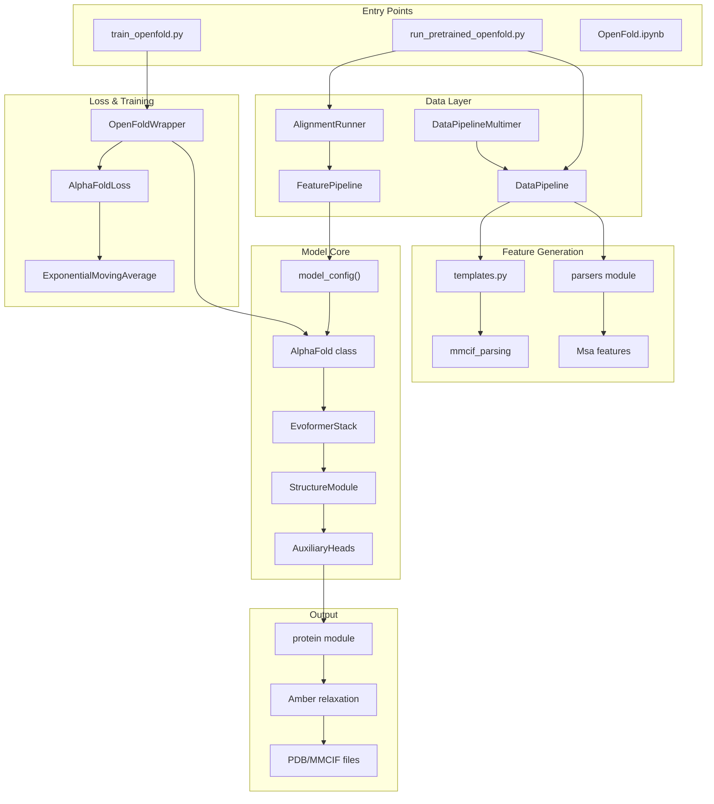
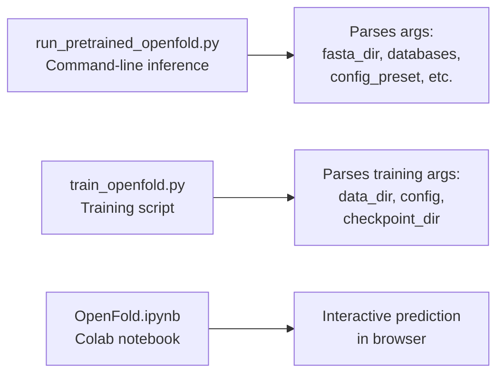
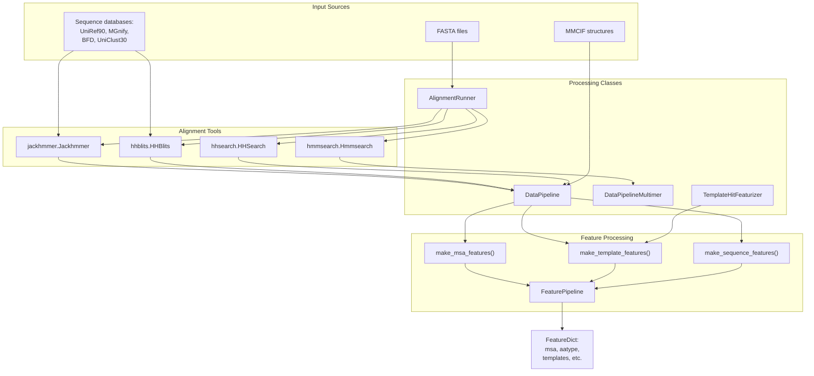
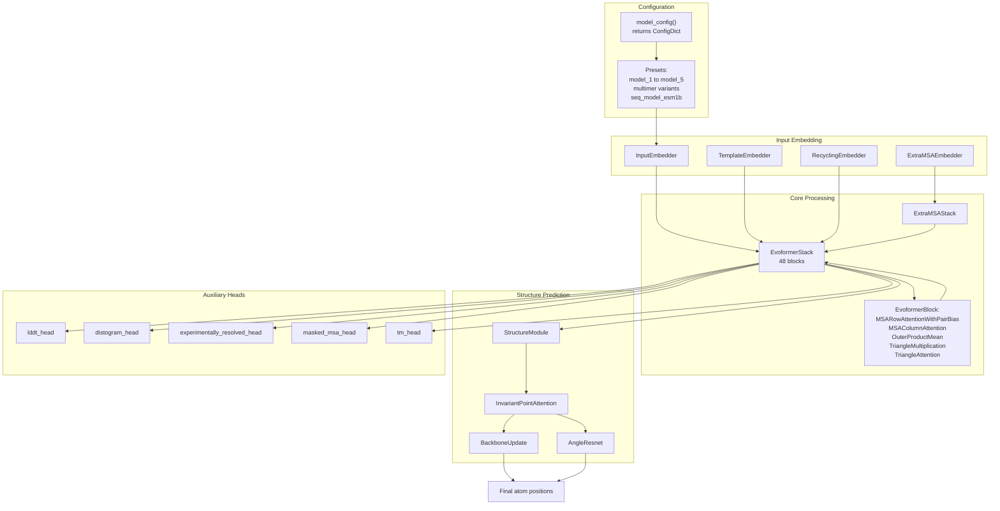
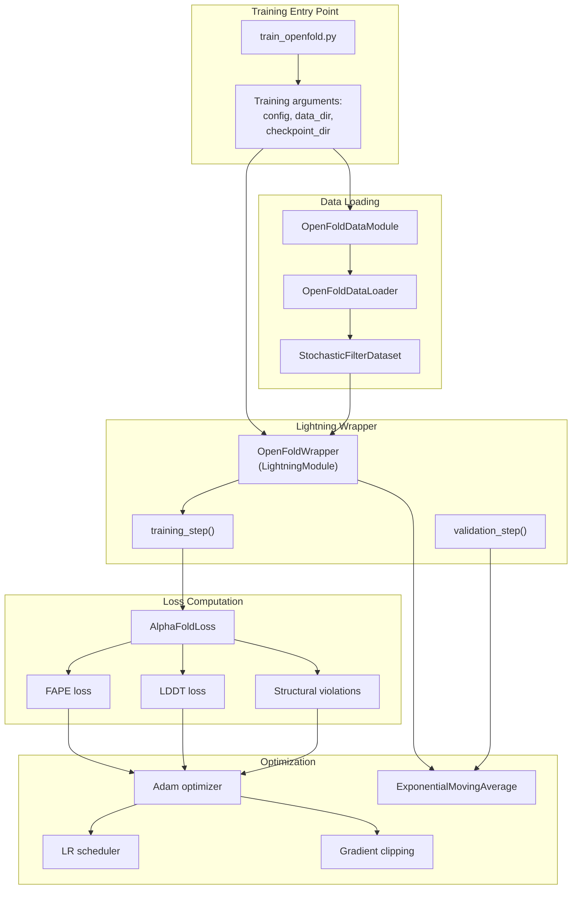
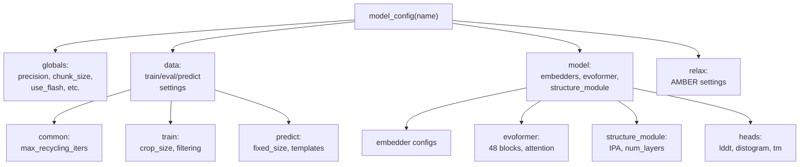
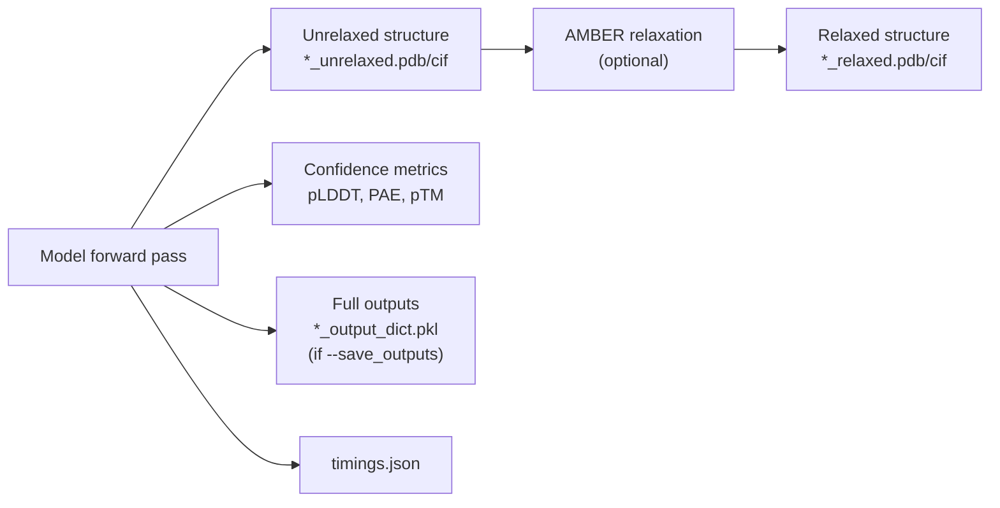

# OpenFold Overview

<details>
<summary>Relevant source files</summary>

The following files were used as context for generating this wiki page:

- [README.md](README.md)
- [docs/source/Inference.md](docs/source/Inference.md)
- [docs/source/Multimer_Inference.md](docs/source/Multimer_Inference.md)
- [docs/source/Single_Sequence_Inference.md](docs/source/Single_Sequence_Inference.md)
- [docs/source/conf.py](docs/source/conf.py)
- [openfold/data/data_pipeline.py](openfold/data/data_pipeline.py)
- [openfold/data/templates.py](openfold/data/templates.py)
- [run_pretrained_openfold.py](run_pretrained_openfold.py)
- [scripts/generate_mmcif_cache.py](scripts/generate_mmcif_cache.py)
- [scripts/precompute_alignments.py](scripts/precompute_alignments.py)
- [scripts/utils.py](scripts/utils.py)

</details>


This page provides a high-level introduction to OpenFold, its architecture, and its capabilities. For detailed setup instructions, see [Installation and Environment Setup](#2). For running predictions, see [Running Inference](#3). For training details, see [Training OpenFold](#4).

## What is OpenFold

OpenFold is a trainable, memory-efficient PyTorch reimplementation of DeepMind's AlphaFold 2, a deep learning system for protein structure prediction. Unlike the original JAX-based AlphaFold implementation, OpenFold provides:

- **Full trainability**: All components can be trained from scratch
- **PyTorch implementation**: Native integration with the PyTorch ecosystem
- **Memory optimizations**: Support for long sequences and limited GPU memory
- **Multiple inference modes**: Monomer, multimer, and single-sequence prediction
- **Reproducible training**: Open training pipeline and datasets (OpenProteinSet)

The project maintains compatibility with AlphaFold's model parameters while offering additional flexibility for research and development.

**Sources:** [README.md:1-57]()

## Key Capabilities

OpenFold supports three primary structure prediction modes:

| Mode | Description | Model Preset | Key Features |
|------|-------------|--------------|--------------|
| **Monomer** | Single-chain protein prediction | `model_1` through `model_5` | Template-based or template-free, pTM scoring |
| **Multimer** | Multi-chain complex prediction | `model_*_multimer_v3` | Chain pairing, interface prediction, AlphaFold-Multimer v2.3 |
| **SoloSeq** | MSA-free single sequence prediction | `seq_model_esm1b_ptm` | ESM-1b embeddings, fast inference without MSA generation |

All modes support:
- Configurable precision (FP32, TF32, FP16, BF16)
- Optimized attention kernels (DeepSpeed, FlashAttention, cuEquivariance)
- Optional AMBER relaxation
- TensorRT acceleration
- Long sequence inference strategies

**Sources:** [docs/source/Inference.md:1-195](), [docs/source/Multimer_Inference.md:1-78](), [docs/source/Single_Sequence_Inference.md:1-57]()

## System Architecture Overview



**System Architecture Diagram**: Core components and data flow from input to output

**Sources:** [run_pretrained_openfold.py:1-542](), [openfold/data/data_pipeline.py:1-1163]()

## Major System Components

### User Interfaces

OpenFold provides three primary interfaces for users:



**User Interface Entry Points**

The main inference script accepts FASTA files and produces PDB/MMCIF predictions:
- Handles monomer, multimer, and SoloSeq modes via `--config_preset`
- Manages alignment generation or loads precomputed alignments
- Supports various optimization flags for performance tuning

**Sources:** [run_pretrained_openfold.py:397-542](), [scripts/utils.py:13-66]()

### Data Processing Pipeline

The data processing system transforms raw biological data into model-ready features:



**Data Pipeline Components and Flow**

The `AlignmentRunner` class orchestrates sequence database searches:
- Runs Jackhmmer against UniRef90 and MGnify
- Runs HHBlits/Jackhmmer against BFD
- Performs template search with HHSearch (monomer) or HMMSearch (multimer)

The `DataPipeline` class parses alignment outputs and generates features:
- `process_fasta()` - Processes single-chain sequences
- `process_mmcif()` - Processes structure files for training
- `_parse_msa_data()` - Parses MSA files (Stockholm, A3M formats)
- `_parse_template_hit_files()` - Parses template search results

For multimer predictions, `DataPipelineMultimer` extends the monomer pipeline with chain pairing logic.

**Sources:** [openfold/data/data_pipeline.py:334-563](), [openfold/data/data_pipeline.py:706-914](), [openfold/data/data_pipeline.py:1006-1163]()

### Model Architecture



**Model Architecture: From Input to Structure Prediction**

The model follows this processing flow:

1. **Configuration**: `model_config()` function returns a configuration preset
2. **Input Embedders**: Convert raw features into latent representations (MSA, pair, and template embeddings)
3. **Recycling**: `RecyclingEmbedder` incorporates outputs from previous iterations
4. **Evoformer Processing**: 48 blocks of attention and geometric operations
5. **Structure Module**: Converts latent representations to 3D coordinates using invariant point attention
6. **Auxiliary Heads**: Predict confidence metrics (pLDDT, PAE, pTM)

Key model classes:
- `AlphaFold` - Main model class coordinating all components
- `EvoformerStack` - Core reasoning engine with MSA and pair tracks
- `StructureModule` - 3D coordinate prediction with geometric constraints
- `AuxiliaryHeads` - Confidence and quality predictions

**Sources:** [openfold/config.py:105-283](), [openfold/model/model.py:1-500]()

### Training System



**Training System Components**

The training system uses PyTorch Lightning for orchestration:

- `OpenFoldWrapper` - Lightning module wrapping the AlphaFold model
- `OpenFoldDataModule` - Handles dataset loading with stochastic filtering
- `AlphaFoldLoss` - Composite loss with FAPE, LDDT, and structural violation terms
- `ExponentialMovingAverage` - Smoothed weights for validation

Training features:
- Distributed training with DeepSpeed
- Gradient checkpointing for memory efficiency
- Recycling iterations during training
- Chunked processing for long sequences
- Stochastic data filtering by cluster size and sequence length

**Sources:** [train_openfold.py:1-200](), [openfold/utils/loss.py:1-500]()

## Feature Dictionary Structure

The `FeatureDict` is the central data structure passed through the system:

| Feature Key | Shape | Type | Description |
|-------------|-------|------|-------------|
| `aatype` | `[N_res]` or `[N_res, 21]` | int32/float32 | Amino acid type (one-hot or indices) |
| `msa` | `[N_seq, N_res]` | int32 | Multiple sequence alignment |
| `deletion_matrix_int` | `[N_seq, N_res]` | int32 | Deletion counts in MSA |
| `template_aatype` | `[N_templ, N_res, 22]` | float32 | Template amino acid types |
| `template_all_atom_positions` | `[N_templ, N_res, 37, 3]` | float32 | Template atomic coordinates |
| `template_all_atom_mask` | `[N_templ, N_res, 37]` | float32 | Template atom validity mask |
| `residue_index` | `[N_res]` | int32 | Residue position indices |
| `seq_length` | `[N_res]` | int32 | Sequence length (repeated) |
| `all_atom_positions` | `[N_res, 37, 3]` | float32 | Ground truth coordinates (training) |
| `all_atom_mask` | `[N_res, 37]` | float32 | Atom validity mask (training) |

For multimer predictions, additional features track chain identities:
- `asym_id` - Asymmetric chain ID
- `sym_id` - Symmetric chain ID  
- `entity_id` - Entity ID for grouping identical sequences

**Sources:** [openfold/data/data_pipeline.py:111-131](), [openfold/data/data_pipeline.py:224-261]()

## Configuration System

OpenFold uses `ml_collections.ConfigDict` for hierarchical configuration:



**Configuration Hierarchy**

Available presets include:
- `model_1` through `model_5` - Monomer models with/without templates
- `model_1_ptm` through `model_5_ptm` - Monomer models with pTM scoring
- `model_*_multimer_v3` - Multimer models
- `seq_model_esm1b_ptm` - SoloSeq model with ESM-1b embeddings

Configuration can be customized via:
- Command-line flags (e.g., `--long_sequence_inference`)
- JSON config file (`--experiment_config_json`)
- Direct modification of the config object

**Sources:** [openfold/config.py:1-283](), [run_pretrained_openfold.py:184-202]()

## Memory and Performance Optimizations

OpenFold includes several optimization strategies:

| Optimization | Enabled By | Effect | Use Case |
|--------------|-----------|--------|----------|
| **DeepSpeed Attention** | `--use_deepspeed_evoformer_attention` | 2-3x faster inference | General use |
| **FlashAttention** | `globals.use_flash=True` | Memory-efficient attention | Sequences < 1000 residues |
| **cuEquivariance kernels** | `--use_cuequivariance_attention` | 1.2-1.5x speedup | All sequence lengths |
| **TensorRT** | `--trt_mode=run` | Module-level optimization | Batch inference |
| **BF16 precision** | `--precision=bf16` | ~1.5x speedup vs TF32 | Ampere+ GPUs |
| **Low-memory attention** | `long_sequence_inference` | Reduced memory | Long sequences (>1000 residues) |
| **Template offloading** | `offload_templates=True` | Reduced memory | Many templates |
| **Gradient checkpointing** | Training default | Reduced memory | Training |
| **Model tracing** | `--trace_model` | Faster repeated inference | Batch jobs |

**Sources:** [docs/source/Inference.md:145-194](), [run_pretrained_openfold.py:184-196]()

## Output Files and Formats

The inference pipeline produces:



**Output Structure**

Default output directory structure:
```
output_dir/
├── alignments/
│   └── {sequence_name}/
│       ├── uniref90_hits.sto
│       ├── mgnify_hits.sto
│       ├── bfd_uniclust_hits.a3m
│       └── hhsearch_output.hhr (or hmmsearch_output.sto)
├── predictions/
│   ├── {sequence_name}_{preset}_unrelaxed.pdb
│   └── {sequence_name}_{preset}_relaxed.pdb
└── timings.json
```

PDB files include:
- Predicted atomic coordinates
- B-factors: pLDDT scores (or 100-pLDDT if `--subtract_plddt`)
- Metadata in header

**Sources:** [run_pretrained_openfold.py:356-395](), [openfold/np/protein.py:1-300]()

## Relation to AlphaFold

OpenFold maintains compatibility with AlphaFold parameters while providing enhancements:

| Aspect | AlphaFold 2 | OpenFold |
|--------|-------------|----------|
| **Framework** | JAX | PyTorch |
| **Trainability** | Limited | Full |
| **Parameters** | DeepMind pretrained | AlphaFold or OpenFold trained |
| **Memory** | Standard | Optimized (DeepSpeed, offloading) |
| **Kernels** | XLA optimizations | DeepSpeed, FlashAttention, cuEquivariance |
| **Licensing** | Parameters: CC BY 4.0 | Code: Apache 2.0, Parameters: CC BY 4.0 |
| **Training data** | Proprietary | OpenProteinSet (public) |

OpenFold can load and use AlphaFold's pretrained parameters directly via the `--jax_param_path` argument. The model architecture is functionally equivalent, ensuring predictions match AlphaFold 2 when using the same parameters and input features.

**Sources:** [README.md:4-20](), [openfold/utils/import_weights.py:1-200]()

## Getting Started

To begin using OpenFold:

1. **Installation**: Follow [Installation and Environment Setup](#2) to set up dependencies and download databases
2. **Inference**: See [Running Inference](#3) for structure prediction workflows
   - [Monomer Inference](#3.2) for single-chain predictions
   - [Multimer Inference](#3.3) for protein complexes
   - [Single Sequence Inference](#3.4) for fast MSA-free predictions
3. **Training**: See [Training OpenFold](#4) to train models from scratch
4. **Model Details**: Explore [Model Architecture](#5) for component-level documentation

For questions and issues, visit the [GitHub repository](https://github.com/aqlaboratory/openfold).

**Sources:** [README.md:1-57](), [docs/source/Inference.md:1-50]()

---