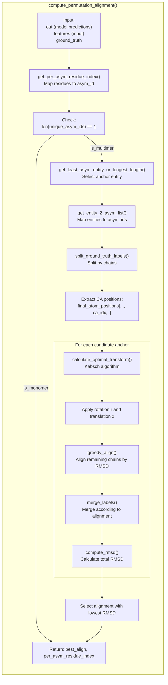
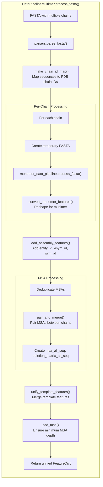

# Multimer Inference

<details>
<summary>Relevant source files</summary>

The following files were used as context for generating this wiki page:

- [README.md](README.md)
- [docs/source/Inference.md](docs/source/Inference.md)
- [docs/source/Multimer_Inference.md](docs/source/Multimer_Inference.md)
- [docs/source/Single_Sequence_Inference.md](docs/source/Single_Sequence_Inference.md)
- [docs/source/conf.py](docs/source/conf.py)
- [openfold/data/data_pipeline.py](openfold/data/data_pipeline.py)
- [openfold/data/templates.py](openfold/data/templates.py)
- [openfold/utils/multi_chain_permutation.py](openfold/utils/multi_chain_permutation.py)
- [run_pretrained_openfold.py](run_pretrained_openfold.py)
- [scripts/generate_mmcif_cache.py](scripts/generate_mmcif_cache.py)
- [scripts/precompute_alignments.py](scripts/precompute_alignments.py)
- [scripts/utils.py](scripts/utils.py)
- [tests/test_permutation.py](tests/test_permutation.py)

</details>


This page explains how to use OpenFold for predicting the structures of protein complexes (multimers) consisting of multiple chains. For single-chain protein structure prediction, see [Monomer Inference](#3.1). For inference without MSAs using ESM-1b embeddings, see [Single Sequence (SoloSeq) Inference](#3.3).

## Overview of Multimer Inference

Multimer inference predicts structures of protein complexes containing multiple chains. OpenFold's multimer mode is based on AlphaFold-Multimer and differs from monomer inference in several technical aspects:

- Uses `DataPipelineMultimer` class wrapping the monomer `DataPipeline`
- Employs `hmmsearch.Hmmsearch` for template searching instead of `hhsearch.HHSearch`
- Uses `HmmsearchHitFeaturizer` instead of `HhsearchHitFeaturizer` for template processing
- Implements chain permutation via `multi_chain_permutation_align()` to handle symmetric chains
- Requires AlphaFold-Multimer v2.3 parameters and additional databases (UniProt, PDB SeqRes)

The multimer mode is automatically activated when `config_preset` contains "multimer" and the input FASTA contains multiple sequences.

Sources: [run_pretrained_openfold.py:209](), [run_pretrained_openfold.py:76-86](), [openfold/data/data_pipeline.py:706-712](), [openfold/utils/multi_chain_permutation.py:515-543]()

## Prerequisites

Before running multimer inference, you'll need the following:

1. **AlphaFold-Multimer v2.3 Parameters**: These are specialized weights trained for protein complex prediction.
2. **Updated Sequence Databases**:
   - UniRef90
   - MGnify
   - BFD
   - UniRef30/UniClust30
   - UniProt
   - PDB SeqRes (replaces PDB70 used in monomer mode)
3. **Required Tools**:
   - Jackhmmer
   - HHBlits
   - HMMSearch (replaces HHSearch used in monomer mode)
   - HMMBuild
   - Kalign

Sources: [docs/source/Multimer_Inference.md:9-52](), [run_pretrained_openfold.py:386-440]()

## Multimer Inference Pipeline

The following diagram shows the complete multimer inference pipeline with actual code entities from the codebase:

```mermaid
flowchart TD
    subgraph "Input & Alignment"
        FASTA["FASTA Files\nMultiple sequences"]
        parse_fasta["parse_fasta()\nopenfold.utils.script_utils"]
        check_multimer["is_multimer check\n'multimer' in config_preset"]
        precompute_alignments["precompute_alignments()\nrun_pretrained_openfold.py:63-123"]
    end

    subgraph "Template Searching"
        Hmmsearch["hmmsearch.Hmmsearch\nopenfold.data.tools.hmmsearch"]
        Hmmbuild["hmmbuild_binary_path\nProfile building"]
        PDBSeqRes["pdb_seqres_database_path\nPDB sequence database"]
        HmmsearchFeaturizer["HmmsearchHitFeaturizer\nopenfold.data.templates"]
    end

    subgraph "Data Processing"
        DataPipelineMultimer["DataPipelineMultimer\nopenfold.data.data_pipeline:948-1078"]
        MonomerDataPipeline["DataPipeline.process_fasta()\nPer-chain processing"]
        add_assembly_features["add_assembly_features()\nAdd entity_id, asym_id, sym_id"]
        pair_and_merge["pair_and_merge()\nMSA pairing & feature merge"]
        generate_feature_dict["generate_feature_dict()\nrun_pretrained_openfold.py:129-170"]
        FeaturePipeline["FeaturePipeline.process_features()\nopenfold.data.feature_pipeline"]
    end

    subgraph "Model Execution"
        run_model["run_model()\nopenfold.utils.script_utils"]
        model_forward["model.forward()\nAlphaFold class"]
        multi_chain_permutation_align["multi_chain_permutation_align()\nopenfold.utils.multi_chain_permutation:515-543"]
    end

    subgraph "Output Generation"
        prep_output["prep_output()\nopenfold.utils.script_utils"]
        protein_to_pdb["protein.to_pdb()\nopenfold.np.protein"]
        relax_protein["relax_protein()\nAMBER relaxation"]
    end

    FASTA --> parse_fasta
    parse_fasta --> check_multimer
    check_multimer -->|"is_multimer=True"| precompute_alignments
    
    precompute_alignments --> Hmmsearch
    Hmmsearch --> Hmmbuild
    Hmmbuild --> PDBSeqRes
    PDBSeqRes --> HmmsearchFeaturizer
    
    HmmsearchFeaturizer --> DataPipelineMultimer
    precompute_alignments --> DataPipelineMultimer
    DataPipelineMultimer --> MonomerDataPipeline
    MonomerDataPipeline --> add_assembly_features
    add_assembly_features --> pair_and_merge
    pair_and_merge --> generate_feature_dict
    generate_feature_dict --> FeaturePipeline
    
    FeaturePipeline --> run_model
    run_model --> model_forward
    model_forward --> multi_chain_permutation_align
    multi_chain_permutation_align --> prep_output
    prep_output --> protein_to_pdb
    protein_to_pdb --> relax_protein
```



Sources: [run_pretrained_openfold.py:63-123](), [run_pretrained_openfold.py:129-170](), [run_pretrained_openfold.py:218-242](), [run_pretrained_openfold.py:297-395](), [openfold/data/data_pipeline.py:948-1078]()

## Input Format for Multimer Inference

For multimer inference, input FASTA files should contain multiple sequences, one for each chain in the complex:

```
>Chain_A
SEQUENCE_A
>Chain_B
SEQUENCE_B
...
```

Each FASTA file should represent one complex. The script will automatically detect multiple sequences and use the multimer pipeline if the `config_preset` includes "multimer".

Sources: [run_pretrained_openfold.py:251-270]()

## Running Multimer Inference

Execute multimer inference using `run_pretrained_openfold.py` with a multimer configuration preset:

```bash
python3 run_pretrained_openfold.py \
    fasta_dir \
    template_mmcif_dir \
    --config_preset "model_1_multimer_v3" \
    --model_device "cuda:0" \
    --output_dir ./output \
    --uniref90_database_path data/uniref90/uniref90.fasta \
    --mgnify_database_path data/mgnify/mgy_clusters_2022_05.fa \
    --pdb_seqres_database_path data/pdb_seqres/pdb_seqres.txt \
    --uniref30_database_path data/uniref30/UniRef30_2021_03 \
    --uniprot_database_path data/uniprot/uniprot.fasta \
    --bfd_database_path data/bfd/bfd_metaclust_clu_complete_id30_c90_final_seq.sorted_opt \
    --hmmsearch_binary_path path/to/hmmsearch \
    --hmmbuild_binary_path path/to/hmmbuild \
    --jackhmmer_binary_path path/to/jackhmmer \
    --hhblits_binary_path path/to/hhblits \
    --kalign_binary_path path/to/kalign
```

**Required Arguments for Multimer**

| Argument | Purpose | Notes |
|----------|---------|-------|
| `--config_preset` | Must contain "multimer" | e.g., "model_1_multimer_v3" |
| `--pdb_seqres_database_path` | PDB sequence database | Replaces `--pdb70_database_path` |
| `--uniprot_database_path` | UniProt database | Required for multimer MSA generation |
| `--hmmsearch_binary_path` | HMMSearch executable | Required for template search |
| `--hmmbuild_binary_path` | HMMBuild executable | Required for profile building |

**Optional Arguments**

| Argument | Default | Purpose |
|----------|---------|---------|
| `--multimer_ri_gap` | 200 | Residue index offset between chains |
| `--use_precomputed_alignments` | None | Path to precomputed alignment directory |
| `--skip_relaxation` | False | Skip AMBER relaxation |
| `--long_sequence_inference` | False | Enable memory optimizations for large complexes |

The script automatically detects multimer mode when:
1. `config_preset` contains "multimer", AND
2. Input FASTA contains multiple sequences

Sources: [docs/source/Multimer_Inference.md:53-78](), [run_pretrained_openfold.py:397-541](), [run_pretrained_openfold.py:209](), [run_pretrained_openfold.py:466-468]()

## Chain Permutation Algorithm

Multimer inference handles symmetric chains using a chain permutation algorithm that aligns predicted chains to ground truth chains. This is necessary because the model cannot be assumed to predict chains in the same order as the ground truth structure.

**Chain Permutation Algorithm Flow**



**Key Functions**

| Function | Purpose | Location |
|----------|---------|----------|
| `compute_permutation_alignment()` | Main permutation function | [openfold/utils/multi_chain_permutation.py:430-513]() |
| `get_least_asym_entity_or_longest_length()` | Select anchor entity (fewest copies or longest) | [openfold/utils/multi_chain_permutation.py:111-164]() |
| `calculate_optimal_transform()` | Compute Kabsch alignment between anchor chains | [openfold/utils/multi_chain_permutation.py:380-428]() |
| `kabsch_rotation()` | Calculate optimal rotation matrix via SVD | [openfold/utils/multi_chain_permutation.py:35-61]() |
| `greedy_align()` | Greedily align remaining chains by RMSD | [openfold/utils/multi_chain_permutation.py:167-228]() |
| `merge_labels()` | Reorder ground truth according to permutation | [openfold/utils/multi_chain_permutation.py:249-286]() |
| `split_ground_truth_labels()` | Split concatenated labels by chains | [openfold/utils/multi_chain_permutation.py:289-314]() |

**Algorithm Steps**

1. **Identify Chains**: Extract unique `asym_id` values from features
2. **Select Anchor**: Choose entity with fewest asymmetric units; if tied, select longest entity
3. **Kabsch Alignment**: For each candidate anchor, compute optimal rotation/translation using Kabsch algorithm
4. **Greedy Chain Matching**: Align remaining chains to ground truth by minimizing RMSD
5. **Permutation Selection**: Choose permutation with lowest overall RMSD
6. **Label Reordering**: Reorder ground truth labels according to optimal permutation

Sources: [openfold/utils/multi_chain_permutation.py:430-513](), [openfold/utils/multi_chain_permutation.py:111-164](), [openfold/utils/multi_chain_permutation.py:167-228](), [openfold/utils/multi_chain_permutation.py:35-61](), [tests/test_permutation.py:80-174]()

## Template Handling in Multimer Mode

Multimer inference uses different tools and databases for template searching compared to monomer mode:

| Feature | Monomer Inference | Multimer Inference |
|---------|------------------|-------------------|
| **Template Searcher Class** | `hhsearch.HHSearch` | `hmmsearch.Hmmsearch` |
| **Binary Tools** | `hhsearch_binary_path` | `hmmsearch_binary_path`<br>`hmmbuild_binary_path` |
| **Template Featurizer Class** | `HhsearchHitFeaturizer` | `HmmsearchHitFeaturizer` |
| **Database Argument** | `--pdb70_database_path` | `--pdb_seqres_database_path` |
| **Database Format** | HHSearch profiles | FASTA sequences |
| **Template Processing** | Direct alignment | Profile-based search |

**Code Locations**

```python
# Multimer template searcher initialization (run_pretrained_openfold.py:76-81)
if "multimer" in args.config_preset:
    template_searcher = hmmsearch.Hmmsearch(
        binary_path=args.hmmsearch_binary_path,
        hmmbuild_binary_path=args.hmmbuild_binary_path,
        database_path=args.pdb_seqres_database_path,
    )

# Multimer template featurizer (run_pretrained_openfold.py:218-226)
template_featurizer = templates.HmmsearchHitFeaturizer(
    mmcif_dir=args.template_mmcif_dir,
    max_template_date=args.max_template_date,
    max_hits=config.data.predict.max_templates,
    kalign_binary_path=args.kalign_binary_path,
    release_dates_path=args.release_dates_path,
    obsolete_pdbs_path=args.obsolete_pdbs_path
)
```

The `HmmsearchHitFeaturizer` processes template hits from HMMSearch and extracts template features including atom positions, masks, and alignments. These are then unified across chains using `unify_template_features()`.

Sources: [run_pretrained_openfold.py:76-86](), [run_pretrained_openfold.py:218-226](), [openfold/data/templates.py:1-57](), [openfold/data/data_pipeline.py:66-108]()

## Data Pipeline Differences

The `DataPipelineMultimer` class extends monomer processing to handle multiple chains:

**DataPipelineMultimer Architecture**



**Key Classes and Functions**

| Component | Purpose | Location |
|-----------|---------|----------|
| `DataPipelineMultimer` | Main multimer data pipeline class | [openfold/data/data_pipeline.py:948-1078]() |
| `DataPipeline` | Monomer pipeline (wrapped by multimer) | [openfold/data/data_pipeline.py:706-947]() |
| `convert_monomer_features()` | Reshape monomer features for multimer | [openfold/data/data_pipeline.py:600-624]() |
| `add_assembly_features()` | Add chain distinction features | [openfold/data/data_pipeline.py:649-691]() |
| `pair_and_merge()` | Pair MSAs and merge chain features | [openfold/data/msa_pairing.py]() |
| `unify_template_features()` | Merge templates across chains | [openfold/data/data_pipeline.py:66-108]() |
| `pad_msa()` | Pad MSA to minimum depth | [openfold/data/data_pipeline.py:694-703]() |

**Chain-Specific Features Added**

The multimer pipeline adds the following features to distinguish chains:
- `entity_id`: Unique identifier for each distinct sequence (same for identical chains)
- `asym_id`: Unique identifier for each chain instance
- `sym_id`: Symmetry identifier within an entity
- `auth_chain_id`: Original chain ID from the input

Sources: [openfold/data/data_pipeline.py:948-1078](), [openfold/data/data_pipeline.py:600-624](), [openfold/data/data_pipeline.py:649-691](), [openfold/data/data_pipeline.py:66-108]()

## Important Considerations and Limitations

**Parameter Compatibility**

OpenFold checkpoint files (`--openfold_checkpoint_path`) are not supported for multimer mode. Only AlphaFold JAX parameters (`--jax_param_path`) are available:

```python
# run_pretrained_openfold.py:286-288
if is_multimer and args.openfold_checkpoint_path:
    raise ValueError(
        '`openfold_checkpoint_path` was specified, but no OpenFold checkpoints are available for multimer mode')
```

**Memory and Performance**

| Factor | Impact | Solution |
|--------|--------|----------|
| Number of chains | Linear memory increase | Use `--long_sequence_inference` |
| Chain length | Quadratic memory increase (attention) | Reduce `max_templates` or use template-free preset |
| Template count | Linear memory increase | Set `config.data.predict.max_templates` lower |
| MSA depth | Linear memory increase | Reduce via data transforms |

**Residue Indexing**

The `--multimer_ri_gap` parameter (default 200) controls residue index spacing between chains. This prevents interference between chains in positional encodings:

```python
# Example: 3-chain complex with chains of length 100, 150, 200
# Chain A: residue_index = [0...99]
# Chain B: residue_index = [200...349]  # offset by multimer_ri_gap
# Chain C: residue_index = [400...599]  # offset by 2*multimer_ri_gap
```

**Technical Limitations**

- No hard limit on complex size, but performance degrades beyond ~1000 residues per chain
- Chain permutation algorithm complexity is O(n²) where n = number of chains with same sequence
- PDB/mmCIF output limited to 62 chains (PDB format limitation via `protein.PDB_CHAIN_IDS`)

Sources: [run_pretrained_openfold.py:286-288](), [run_pretrained_openfold.py:466-468](), [run_pretrained_openfold.py:481-483](), [openfold/data/data_pipeline.py:579-581]()

## Troubleshooting

Common issues with multimer inference:

| Issue | Possible Cause | Solution |
|-------|---------------|----------|
| "no OpenFold checkpoints are available for multimer mode" | Attempting to use OpenFold checkpoint with multimer | Use AlphaFold JAX parameters instead |
| Low prediction quality | Poor MSA coverage | Ensure your databases are up-to-date |
| Out of memory errors | Complex too large | Use `--long_sequence_inference` flag |
| Incorrect chain arrangement | Complex permutation issue | The algorithm should handle this automatically |
| Slow processing | Large complex or many templates | Reduce template count with `--config_preset model_3_multimer_v3` (template-free) |

Sources: [run_pretrained_openfold.py:276-278](), [docs/source/Multimer_Inference.md:53-72]()

## Available Configuration Presets

The following multimer configuration presets are available:

| Preset | Description | Use Case |
|--------|-------------|----------|
| model_1_multimer_v3 | Template-based model | General purpose, highest accuracy |
| model_2_multimer_v3 | Template-based model | Alternative model architecture |
| model_3_multimer_v3 | Template-free model | When templates are unavailable or poor quality |
| model_4_multimer_v3 | Template-free model | Alternative template-free architecture |
| model_5_multimer_v3 | Template-free model | Alternative template-free architecture |

Sources: [run_pretrained_openfold.py:419-421]()

---