# Data Pipeline and Feature Generation

<details>
<summary>Relevant source files</summary>

The following files were used as context for generating this wiki page:

- [README.md](README.md)
- [openfold/data/data_pipeline.py](openfold/data/data_pipeline.py)
- [openfold/data/templates.py](openfold/data/templates.py)
- [run_pretrained_openfold.py](run_pretrained_openfold.py)
- [scripts/generate_mmcif_cache.py](scripts/generate_mmcif_cache.py)
- [scripts/precompute_alignments.py](scripts/precompute_alignments.py)
- [scripts/utils.py](scripts/utils.py)

</details>


## Purpose and Scope

This page documents the data processing pipeline that converts raw biological inputs (FASTA sequences, mmCIF/PDB structures) into feature dictionaries suitable for model inference and training. The pipeline orchestrates MSA generation, template search, and feature extraction through the `DataPipeline` and `AlignmentRunner` classes.

For information about data transformations applied after feature generation (sampling, masking, cropping), see [Data Transforms and Augmentation](#6.2). For details on MSA generation tools and template search, see [MSA and Template Processing](#6.3). For multimer-specific processing including chain pairing, see [Multimer-Specific Processing](#6.4).

---

## System Overview

The data pipeline consists of three major stages:

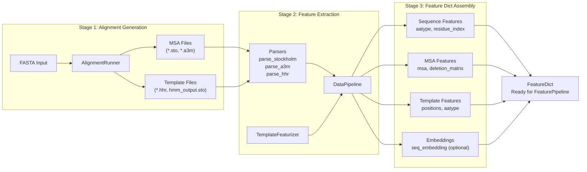

**Sources**: [openfold/data/data_pipeline.py:1-1161](), [run_pretrained_openfold.py:63-170]()

---

## DataPipeline Class

The `DataPipeline` class is the central orchestrator that converts alignment outputs and structural data into standardized feature dictionaries.

### Class Structure

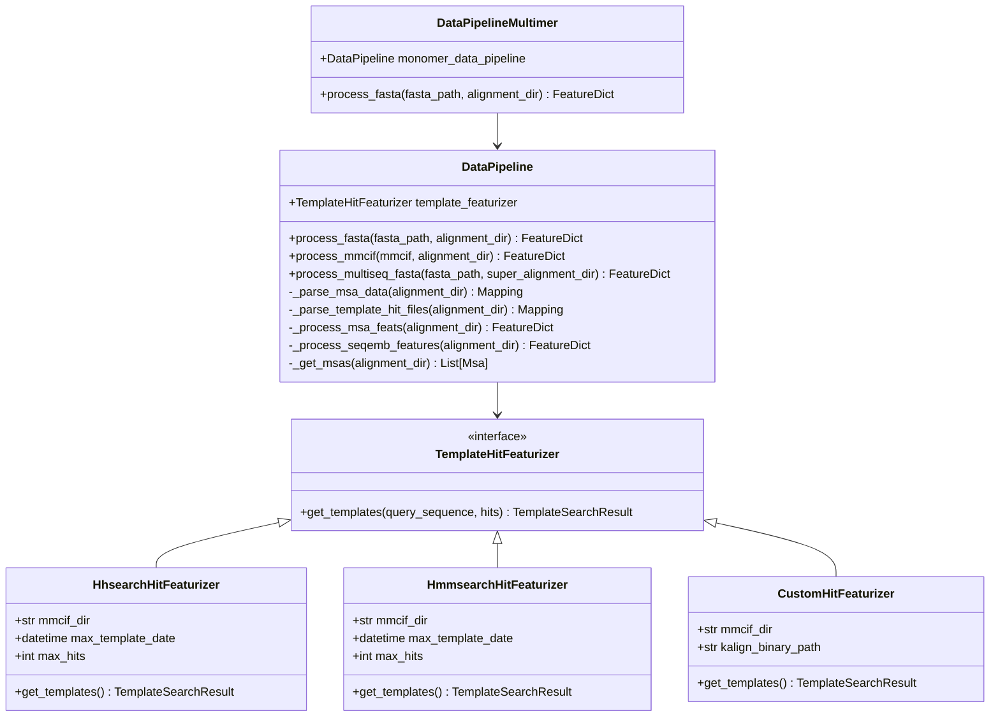

**Sources**: [openfold/data/data_pipeline.py:706-915](), [openfold/data/data_pipeline.py:916-1161](), [openfold/data/templates.py:930-1145]()

### Main Processing Methods

The `DataPipeline` class provides three main entry points:

| Method | Input | Purpose | Used For |
|--------|-------|---------|----------|
| `process_fasta()` | FASTA file + alignment directory | Process single-chain sequences | Monomer inference, SoloSeq mode |
| `process_mmcif()` | mmCIF object + alignment directory | Process structure with alignments | Training on PDB structures |
| `process_multiseq_fasta()` | Multi-sequence FASTA + alignments | Process multiple chains | Legacy multi-chain (pre-multimer) |

**Sources**: [openfold/data/data_pipeline.py:864-914](), [openfold/data/data_pipeline.py:916-999](), [openfold/data/data_pipeline.py:1001-1046]()

---

## AlignmentRunner

The `AlignmentRunner` class orchestrates external bioinformatics tools to generate MSAs and template search results.

### Tool Configuration

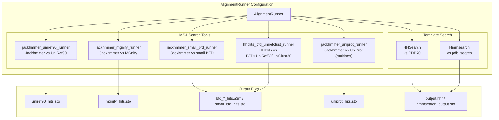

**Sources**: [openfold/data/data_pipeline.py:334-476]()

### AlignmentRunner.run() Workflow

The `run()` method executes the full alignment pipeline:

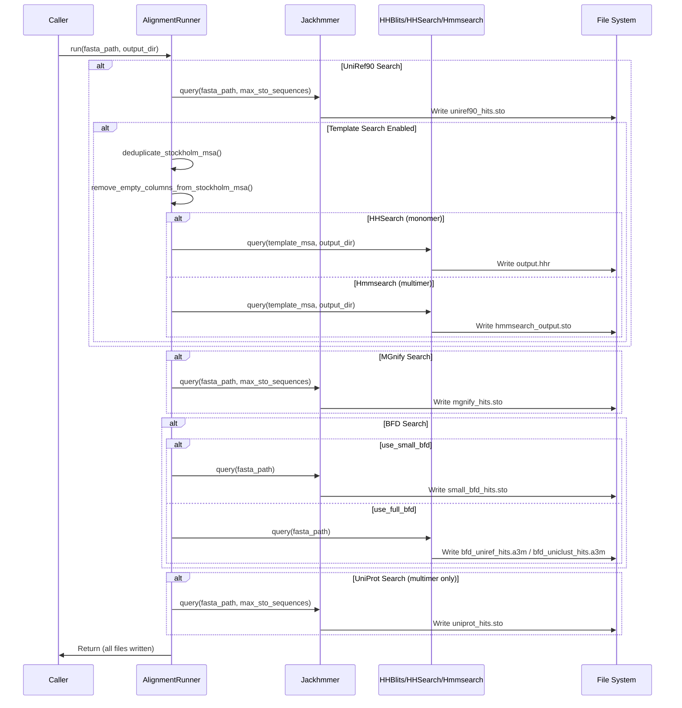

**Sources**: [openfold/data/data_pipeline.py:477-563]()

### Integration with Inference

In the inference script, alignment generation is handled by `precompute_alignments()`:

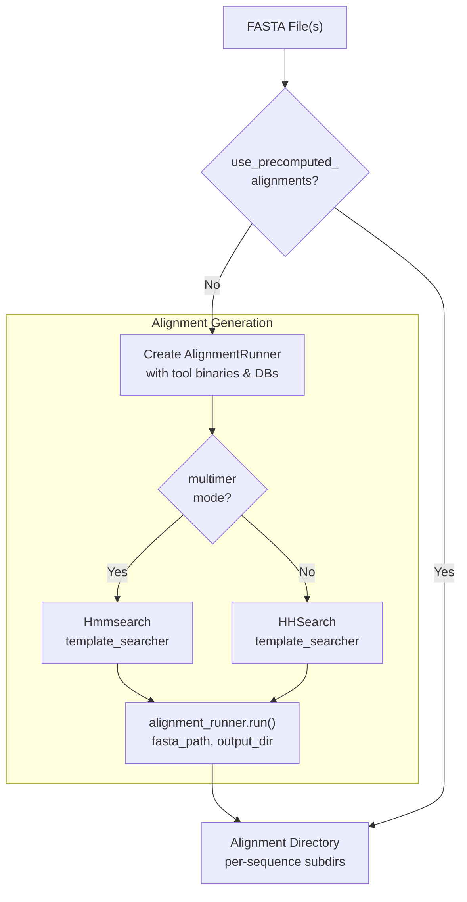

**Sources**: [run_pretrained_openfold.py:63-123]()

---

## Feature Generation Components

### Sequence Features

Basic sequence-level features are created by `make_sequence_features()`:

| Feature Name | Shape | Type | Description |
|--------------|-------|------|-------------|
| `aatype` | `(num_res, 21)` | `float32` | One-hot encoded amino acid types |
| `residue_index` | `(num_res,)` | `int32` | Residue indices (0 to num_res-1) |
| `seq_length` | `(num_res,)` | `int32` | Sequence length broadcast to all residues |
| `sequence` | `(1,)` | `object` | Raw amino acid sequence (encoded bytes) |
| `domain_name` | `(1,)` | `object` | Sequence description/ID (encoded bytes) |
| `between_segment_residues` | `(num_res,)` | `int32` | Zeros (used in multimer for chain breaks) |

**Sources**: [openfold/data/data_pipeline.py:111-130]()

### MSA Features

MSA features are constructed by `make_msa_features()` from parsed MSA objects:

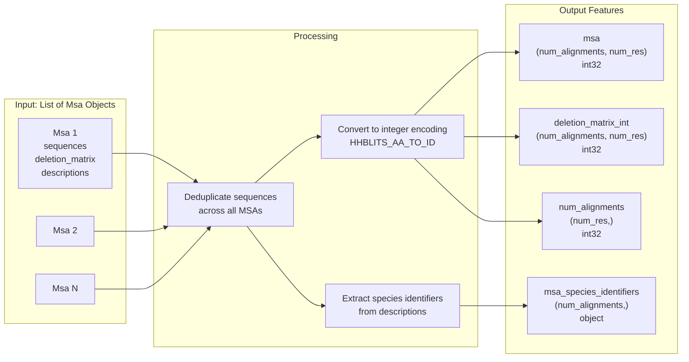

**Sources**: [openfold/data/data_pipeline.py:224-261]()

### Template Features

Template features are generated through a multi-step process involving alignment to query and extraction of structural information:

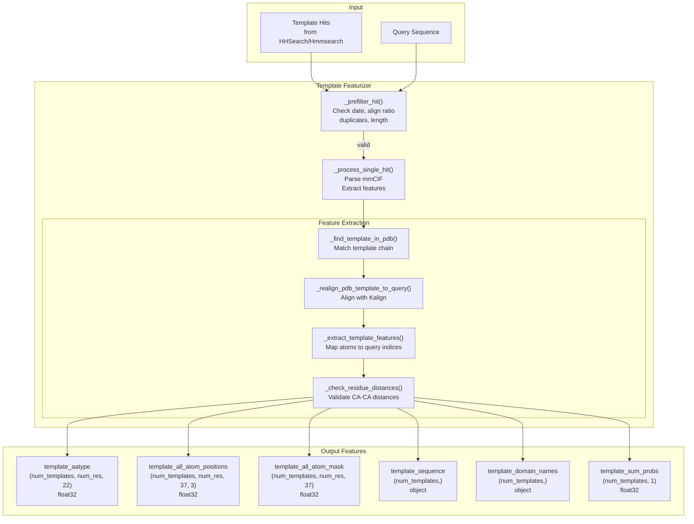

**Sources**: [openfold/data/templates.py:826-930](), [openfold/data/templates.py:548-706](), [openfold/data/templates.py:292-364]()

### Template Feature Details

Templates contain structural information extracted from mmCIF files:

| Feature Name | Shape | Type | Description |
|--------------|-------|------|-------------|
| `template_aatype` | `(num_templates, num_res, 22)` | `float32` | One-hot amino acid types (HHBLITS encoding) |
| `template_all_atom_positions` | `(num_templates, num_res, 37, 3)` | `float32` | Atom37 coordinates, aligned to query |
| `template_all_atom_mask` | `(num_templates, num_res, 37)` | `float32` | Mask indicating which atoms are present |
| `template_domain_names` | `(num_templates,)` | `object` | PDB_ID + chain ID (e.g., "4hhb_a") |
| `template_sequence` | `(num_templates,)` | `object` | Aligned template sequence |
| `template_sum_probs` | `(num_templates, 1)` | `float32` | HHSearch sum of probabilities score |

**Sources**: [openfold/data/templates.py:83-90](), [openfold/data/templates.py:93-108]()

### ESM-1b Embeddings (SoloSeq Mode)

When `seqemb_mode=True`, single-sequence embeddings replace MSA features:

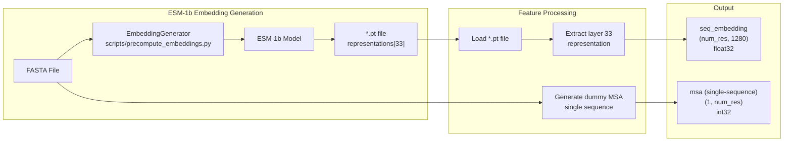

**Sources**: [openfold/data/data_pipeline.py:849-862](), [openfold/data/data_pipeline.py:284-294](), [run_pretrained_openfold.py:89-97]()

---

## Input Format Processing

### FASTA Processing

The `process_fasta()` method handles single-chain FASTA inputs:

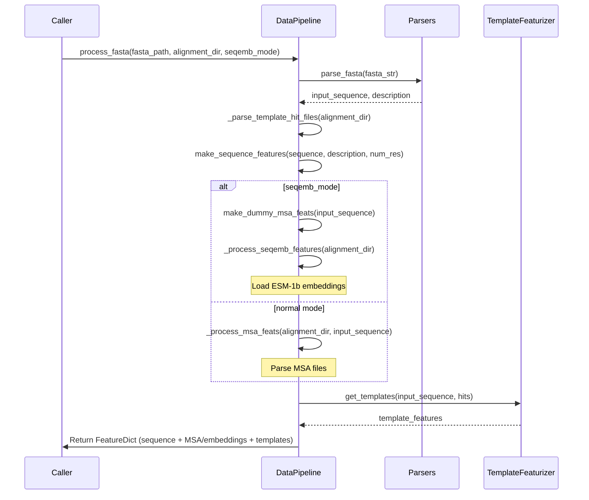

**Sources**: [openfold/data/data_pipeline.py:864-914]()

### mmCIF Processing

The `process_mmcif()` method processes structural data with alignments:

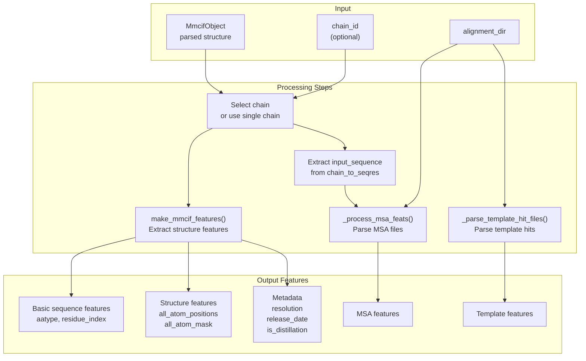

**Sources**: [openfold/data/data_pipeline.py:916-999](), [openfold/data/data_pipeline.py:133-166]()

### Custom Template Processing

For custom template inputs (using `--use_custom_template`), the pipeline uses `CustomHitFeaturizer`:

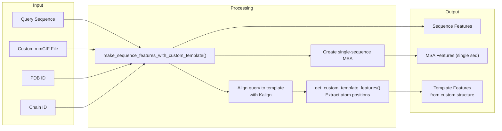

**Sources**: [openfold/data/data_pipeline.py:297-331](), [openfold/data/templates.py:1051-1145](), [run_pretrained_openfold.py:210-217]()

---

## Feature Dictionary Structure

The complete `FeatureDict` output contains the following feature groups:

### Complete Feature Set

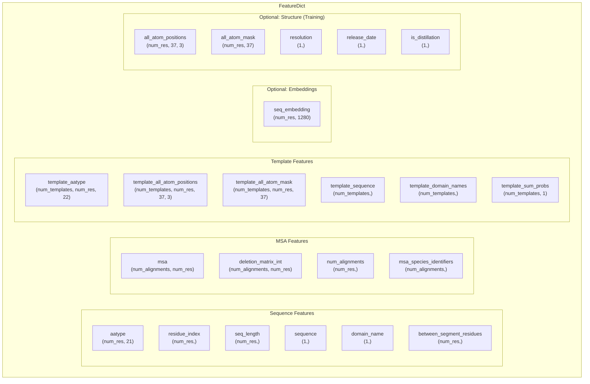

**Sources**: [openfold/data/data_pipeline.py:111-130](), [openfold/data/data_pipeline.py:224-261](), [openfold/data/templates.py:83-108](), [openfold/data/data_pipeline.py:133-166]()

### Feature Types by Use Case

| Use Case | Sequence | MSA | Templates | Embeddings | Structure |
|----------|----------|-----|-----------|------------|-----------|
| Standard Inference | ✓ | ✓ | ✓ | ✗ | ✗ |
| SoloSeq Inference | ✓ | ✓ (dummy) | ✓ | ✓ | ✗ |
| Custom Template | ✓ | ✓ (dummy) | ✓ | ✗ | ✗ |
| Training (mmCIF) | ✓ | ✓ | ✓ | ✗ | ✓ |
| Training (PDB) | ✓ | ✓ | ✓ | ✗ | ✓ |

---

## Monomer vs Multimer Pipeline

The pipeline has different implementations for monomer and multimer predictions:

```mermaid
graph TB
    subgraph "Monomer Pipeline"
        M_FASTA["Single-chain FASTA"]
        M_ALIGN["Per-sequence alignment<br/>directories"]
        M_DP["DataPipeline"]
        M_FEAT["FeatureDict<br/>single chain"]
    end
    
    subgraph "Multimer Pipeline"
        MM_FASTA["Multi-chain FASTA"]
        MM_ALIGN["Per-sequence alignment<br/>directories"]
        MM_DP["DataPipelineMultimer"]
        MM_MONO["monomer_data_pipeline<br/>DataPipeline"]
        MM_PROC["Process each chain"]
        MM_PAIR["Pair MSAs<br/>add_assembly_features()"]
        MM_FEAT["FeatureDict<br/>multiple chains"]
    end
    
    M_FASTA --> M_ALIGN
    M_ALIGN --> M_DP
    M_DP --> M_FEAT
    
    MM_FASTA --> MM_ALIGN
    MM_ALIGN --> MM_DP
    MM_DP --> MM_MONO
    MM_MONO --> MM_PROC
    MM_PROC --> MM_PAIR
    MM_PAIR --> MM_FEAT
```

**Sources**: [openfold/data/data_pipeline.py:706-915](), [openfold/data/data_pipeline.py:916-1161](), [run_pretrained_openfold.py:236-242]()

### Multimer-Specific Processing

The `DataPipelineMultimer` class extends the monomer pipeline:

1. **Per-Chain Processing**: Each chain is processed independently using `monomer_data_pipeline`
2. **Chain Feature Conversion**: `convert_monomer_features()` reshapes features for multimer models
3. **Assembly Features**: `add_assembly_features()` adds chain identity markers (`asym_id`, `sym_id`, `entity_id`)
4. **MSA Pairing**: Uses `pair_and_merge()` to create paired MSAs from UniProt hits

See [Multimer-Specific Processing](#6.4) for detailed information.

**Sources**: [openfold/data/data_pipeline.py:1048-1161](), [openfold/data/data_pipeline.py:600-624](), [openfold/data/data_pipeline.py:649-691]()

---

## Integration with Inference Script

The inference script (`run_pretrained_openfold.py`) orchestrates the data pipeline:

### Inference Workflow

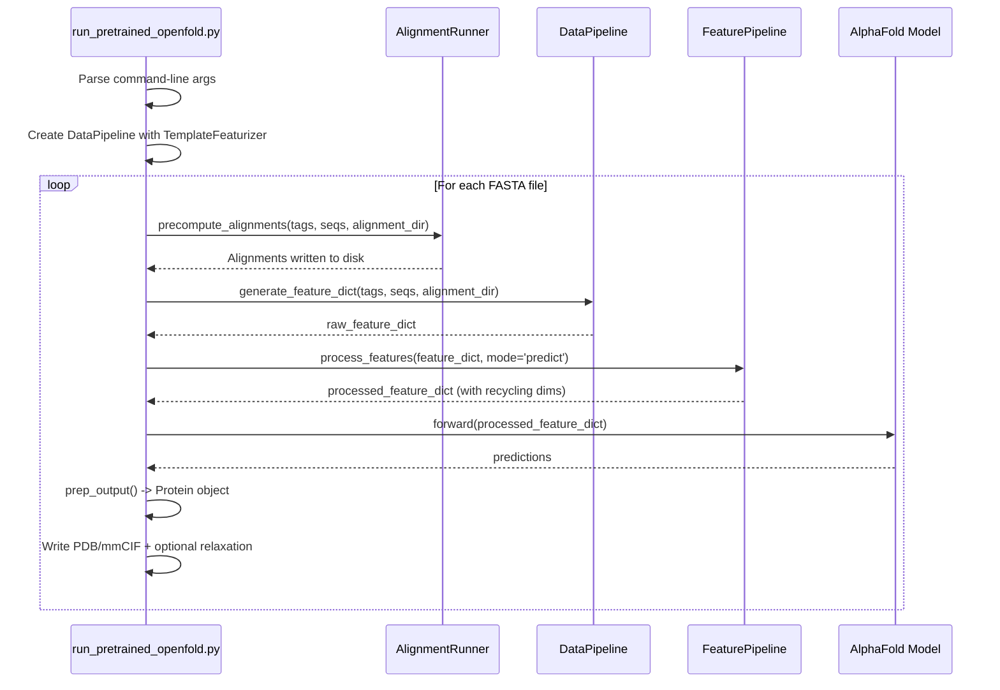

**Sources**: [run_pretrained_openfold.py:177-395]()

### Key Functions in Inference

| Function | Location | Purpose |
|----------|----------|---------|
| `precompute_alignments()` | [run_pretrained_openfold.py:63-123]() | Create or load MSA/template alignments |
| `generate_feature_dict()` | [run_pretrained_openfold.py:129-170]() | Call DataPipeline to create FeatureDict |
| `FeaturePipeline.process_features()` | Used via import | Apply data transforms and prepare for model |

---

## Parsing Infrastructure

The pipeline relies on specialized parsers for different file formats:

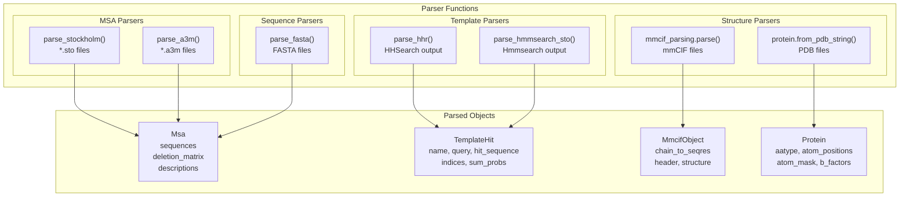

**Sources**: [openfold/data/parsers.py:1-500](), [openfold/data/mmcif_parsing.py:1-500]()

---

## Helper Scripts

Several utility scripts support the data pipeline:

### precompute_alignments.py

Batch precomputation of alignments for datasets:

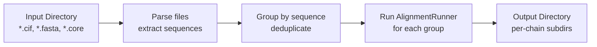

**Usage**: Precompute alignments for training datasets to avoid redundant alignment searches.

**Sources**: [scripts/precompute_alignments.py:1-268]()

### generate_mmcif_cache.py

Create metadata cache for mmCIF files:


**Usage**: Speed up dataset filtering by caching mmCIF metadata without parsing full structures every time.

**Sources**: [scripts/generate_mmcif_cache.py:1-108]()

---

## Error Handling and Edge Cases

The data pipeline includes extensive error handling:

### Template Processing Errors

| Error Class | Cause | Handling |
|-------------|-------|----------|
| `DateError` | Template released after cutoff | Filtered in prefilter, logged |
| `AlignRatioError` | Insufficient alignment coverage | Filtered in prefilter, logged |
| `DuplicateError` | Template is subsequence of query | Filtered in prefilter, logged |
| `LengthError` | Template too short (< 10 residues) | Filtered in prefilter, logged |
| `SequenceNotInTemplateError` | Chain not found in mmCIF | Triggers realignment attempt |
| `QueryToTemplateAlignError` | Realignment failed or < 90% identity | Template skipped, warning logged |
| `NoAtomDataInTemplateError` | Missing atom coordinates | Template skipped, warning logged |
| `TemplateAtomMaskAllZerosError` | All atoms masked | Template skipped, warning logged |

**Sources**: [openfold/data/templates.py:62-81](), [openfold/data/templates.py:220-289](), [openfold/data/templates.py:780-816]()

### Empty MSA Handling

When no MSA files are found, the pipeline creates a dummy single-sequence MSA:

```python
# If no MSAs found and input_sequence provided
msa_data["dummy"] = make_dummy_msa_obj(input_sequence)
```

**Sources**: [openfold/data/data_pipeline.py:813-830](), [openfold/data/data_pipeline.py:284-294]()

---

## Performance Considerations

### MSA Size Limits

The `AlignmentRunner` accepts parameters to limit MSA sizes:

- `uniref_max_hits`: Default 10,000 sequences
- `mgnify_max_hits`: Default 5,000 sequences  
- `uniprot_max_hits`: Default 50,000 sequences (multimer)

These limits prevent excessive MSA sizes that would slow down downstream processing.

**Sources**: [openfold/data/data_pipeline.py:349-351](), [openfold/data/data_pipeline.py:413-415]()

### Parallelization

The `AlignmentRunner` uses the `no_cpus` parameter to parallelize external tool execution (jackhmmer, hhblits). The `precompute_alignments.py` script further parallelizes across multiple sequences using threading.

**Sources**: [openfold/data/data_pipeline.py:418-420](), [scripts/precompute_alignments.py:223-231]()

### File Caching

The template extraction system uses `functools.lru_cache` on file reading operations to avoid redundant disk I/O when multiple hits reference the same mmCIF file:

```python
@functools.lru_cache(16, typed=False)
def _read_file(path):
    with open(path, 'r') as f:
        file_data = f.read()
    return file_data
```

**Sources**: [openfold/data/templates.py:818-823]()

---