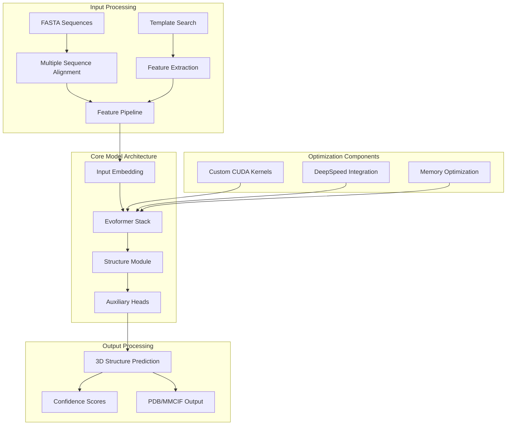

OpenFold is a faithful but trainable PyTorch reproduction of DeepMind's AlphaFold 2, representing a significant advancement in open-source protein structure prediction. This project provides researchers and developers with access to state-of-the-art protein folding capabilities while maintaining full compatibility with the original AlphaFold architecture.


## What is OpenFold?

OpenFold represents a complete reimplementation of AlphaFold 2 in PyTorch, designed to be both faithful to the original implementation and fully trainable from scratch. Unlike the original AlphaFold, which was primarily focused on inference, OpenFold enables researchers to train custom models, modify architectures, and contribute to the advancement of protein structure prediction technology.

The project aims to democratize access to cutting-edge protein folding technology while providing the flexibility needed for scientific innovation and research advancement.

Sources: [README.md](README.md#L1-L10), [docs/source/index.md](docs/source/index.md#L1-L10)

## Key Features and Advantages

OpenFold offers several significant advantages over the original AlphaFold implementation:

| Feature | Description | Benefit |
|---------|-------------|---------|
| **PyTorch Implementation** | Complete rewrite in PyTorch framework | Easier integration with existing ML workflows, better debugging capabilities |
| **Faster Inference** | Optimized GPU performance, up to 2x speedup | Reduced computation time and resource requirements |
| **Long Sequence Support** | Handles sequences >4000 residues on single A100 | Enables prediction of large protein complexes |
| **Memory Optimization** | Custom CUDA kernels and attention mechanisms | 4-5x less GPU memory usage than alternatives |
| **Training Capability** | Full training pipeline with various precision modes | Ability to train custom models on proprietary data |
| **DeepSpeed Integration** | Support for distributed training and inference | Scalable to multi-GPU and multi-node environments |
| **FlashAttention Support** | Optimized attention computation | Significant speed improvements for MSA processing |

Sources: [docs/source/index.md](docs/source/index.md#L18-L45), [setup.py](setup.py#L30-L137)

## Architecture Overview

OpenFollows the same core architectural principles as AlphaFold 2, consisting of several key components:



The architecture consists of three main phases:

1. **Input Processing**: Features are extracted from amino acid sequences through multiple sequence alignment (MSA) and template searches
2. **Core Model**: The Evoformer processes evolutionary information and the Structure Module generates 3D coordinates
3. **Output Processing**: Final predictions are refined and output with confidence metrics

Sources: [openfold/model/model.py](openfold/model/model.py#L1-L50), [openfold/model/evoformer.py](openfold/model/evoformer.py#L748-L754)

## Core Components

### Evoformer Stack
The heart of OpenFold is the Evoformer, which processes multiple sequence alignments and pair representations through sophisticated attention mechanisms:

- **MSA Processing**: Handles multiple sequence alignment data with row and column attention
- **Pair Representation**: Manages pairwise relationships between amino acids
- **Triangular Attention**: Implements efficient attention patterns for protein structure
- **Outer Product Mean**: Computes mean representations across MSA dimensions

Sources: [openfold/model/evoformer.py](openfold/model/evoformer.py#L748-L754)

### Structure Module
Transforms the processed features into 3D atomic coordinates using geometric reasoning and invariant transformations:

- **Invariant Point Attention**: Attention mechanism that respects 3D geometric constraints
- **Frame Updates**: Iterative refinement of protein backbone and side chain positions
- **Loss Functions**: Specialized losses for structure prediction quality

### Data Processing Pipeline
Comprehensive data handling system that supports various input formats and preprocessing requirements:

- **Feature Extraction**: Converts raw sequences into model-ready features
- **Template Integration**: Incorporates known structural information from PDB
- **MSA Generation**: Creates multiple sequence alignments using various tools

Sources: [run_pretrained_openfold.py](run_pretrained_openfold.py#L127-L173)

## Project Structure

The OpenFold repository is organized into several key directories:

```
openfold/
├── openfold/           # Core library code
│   ├── model/         # Neural network architectures
│   ├── data/          # Data processing pipelines
│   ├── utils/         # Utility functions and kernels
│   └── np/            # NumPy-based protein utilities
├── scripts/           # Training and inference scripts
├── examples/          # Example usage and configurations
├── docs/             # Documentation and guides
├── tests/            # Unit tests and validation
└── notebooks/        # Interactive tutorials
```

Sources: [openfold/__init__.py](openfold/__init__.py#L1-L8)

## Performance and Scalability

OpenFold introduces several performance optimizations that make it suitable for both research and production environments:

### Memory Efficiency
- **Custom CUDA Kernels**: Specialized attention kernels that reduce memory footprint by 4-5x
- **Low-Memory Attention**: Implements memory-efficient attention for long sequences
- **CPU Offloading**: Allows inference on very long sequences by offloading to CPU when needed

### Computational Speed
- **FlashAttention Integration**: Leverages optimized attention implementations
- **DeepSpeed DS4Sci_EvoformerAttention**: Specialized kernel for significant speedups
- **GPU Optimization**: Targets modern GPU architectures for maximum performance

> [!TIP]
> OpenFold's custom CUDA kernels can handle sequences with over 4000 residues on a single A100 GPU, making it suitable for large protein complexes that were previously intractable with standard implementations.

Sources: [docs/source/index.md](docs/source/index.md#L27-L35), [openfold/config.py](openfold/config.py#L1-L50)

## Getting Started with OpenFold

To begin using OpenFold, follow these logical steps:

1. **Installation**: Set up the environment and dependencies
2. **Database Configuration**: Download and configure required biological databases
3. **Basic Inference**: Run predictions with pretrained models
4. **Advanced Usage**: Explore training custom models and specialized features

For detailed instructions, proceed to the [Quick Start](2-quick-start) guide, which will walk you through the initial setup and first prediction.

## Next Steps

Based on your interests and requirements, consider exploring these specific areas:

- **Installation and Setup**: [System Requirements and Dependencies](3-system-requirements-and-dependencies)
- **Basic Usage**: [Running Inference with Pretrained Models](5-running-inference-with-pretrained-models)
- **Advanced Architecture**: [AlphaFold 2 Model Implementation](9-alphafold-2-model-implementation)
- **Performance Optimization**: [Memory Optimization Techniques](11-memory-optimization-techniques)
