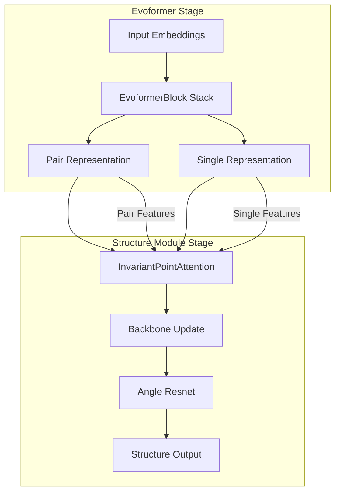

The Evoformer and Structure Module represent the core computational engine of OpenFold's AlphaFold 2 implementation, working in tandem to transform evolutionary and sequence information into precise 3D protein structures. These components implement the sophisticated attention mechanisms and geometric reasoning that enable accurate protein structure prediction.

## Architecture Overview

The Evoformer and Structure Module form a two-stage processing pipeline where evolutionary information is first refined through attention-based operations, then translated into 3D coordinates through geometric transformations.



This architecture reflects Algorithm 6 (Evoformer) and Algorithm 23 (Structure Module) from the AlphaFold 2 paper, with careful attention to computational efficiency and memory optimization.

## Evoformer Core Components

### EvoformerStack: The Main Trunk

The `EvoformerStack` serves as the primary processing engine, implementing Algorithm 6 with multiple blocks of attention and geometric transformations [evoformer.py#L748-L770]:

```python
class EvoformerStack(nn.Module):
    """
    Main Evoformer trunk.
    
    Implements Algorithm 6.
    """
```

Key architectural features include:

| Component | Purpose | Parameters |
|-----------|---------|------------|
| **MSA Processing** | Multi-sequence alignment attention | `c_m`, `no_heads_msa` |
| **Pair Processing** | Residue pair relationships | `c_z`, `no_heads_pair` |
| **Outer Product Mean** | MSA-to-pair information flow | `c_hidden_opm` |
| **Triangular Updates** | Geometric constraint propagation | `c_hidden_mul`, `c_hidden_pair_att` |

> [!TIP]
> The EvoformerStack supports both monomer and multimer modes, with configurable checkpointing (`blocks_per_ckpt`) for memory optimization during training large protein complexes.

### EvoformerBlock: Atomic Processing Unit

Each `EvoformerBlock` represents a complete processing cycle combining MSA and pair representations [evoformer.py#L377-L440]:

```python
class EvoformerBlock(MSABlock):
    def __init__(self,
        c_m: int,           # MSA channel dimension
        c_z: int,           # Pair channel dimension
        no_heads_msa: int,  # MSA attention heads
        no_heads_pair: int, # Pair attention heads
        no_column_attention: bool,  # Column attention toggle
        ...
    ):
```

The block architecture features:

1. **MSA Row Attention**: Processes sequences across alignment positions
2. **MSA Column Attention**: Processes positions across sequences (configurable)
3. **Outer Product Mean**: Converts MSA information to pair representations
4. **Triangular Attention**: Propagates geometric constraints through pair representations
5. **Transition Layers**: Non-linear transformations with configurable dropout

### ExtraMSAStack: Extended Evolutionary Information

For enhanced evolutionary modeling, the `ExtraMSAStack` processes additional MSA data using specialized blocks with GlobalAttention for column-wise processing [evoformer.py#L1028-L1050]:

```python
class ExtraMSAStack(nn.Module):
    """
    Implements Algorithm 18.
    """
```

This component enables deeper evolutionary context by processing additional MSA sequences that aren't included in the main Evoformer stack.

## Structure Module: Geometric Realization

The Structure Module translates the abstract representations from the Evoformer into concrete 3D coordinates through sophisticated geometric reasoning.

### StructureModule: Main Coordination

The `StructureModule` orchestrates the final structure prediction with support for both monomer and multimer protein structures [structure_module.py#L817-L880]:

```python
class StructureModule(nn.Module):
    def __init__(
        self,
        c_s,                    # Single representation channel dimension
        c_z,                    # Pair representation channel dimension
        c_ipa,                  # IPA hidden channel dimension
        no_heads_ipa,           # Number of IPA heads
        no_qk_points,           # Query/key points for IPA
        no_v_points,            # Value points for IPA
        no_blocks,              # Structure module blocks
        is_multimer=False,      # Multimer mode toggle
        **kwargs,
    ):
```

Key architectural decisions include:

| Parameter | Role | Impact |
|-----------|------|--------|
| **`no_qk_points`/`no_v_points`** | 3D attention resolution | Higher values capture finer geometric details |
| **`no_blocks`** | Iterative refinement | More blocks improve accuracy but increase compute |
| **`is_multimer`** | Chain handling | Specialized processing for multi-chain complexes |

### InvariantPointAttention: 3D Geometric Attention

The `InvariantPointAttention` (IPA) mechanism represents the core geometric reasoning component, implementing Algorithm 22 [structure_module.py#L209-L230]:

```python
class InvariantPointAttention(nn.Module):
    """
    Implements Algorithm 22.
    """
```

IPA operates by:

1. **Point Generation**: Converting single representations to 3D query/key/value points
2. **Rigid Transformation**: Applying current structure frame transformations
3. **Attention Computation**: Performing attention in 3D space with geometric awareness
4. **Invariant Aggregation**: Combining attention results while maintaining rotational/translational invariance

The multimer variant (`InvariantPointAttentionMultimer`) extends this for multi-chain complexes with specialized handling of inter-chain interactions [structure_module.py#L513-L525].

### Backbone Update and Angle Refinement

The final structure components work together to produce atomic coordinates:

- **BackboneUpdate**: Transforms single representations into backbone coordinate updates [structure_module.py#L736-L753]
- **AngleResnet**: Predicts torsion angles using residual networks (Algorithm 20, lines 11-14) [structure_module.py#L78-L117]
- **StructureModuleTransition**: Provides non-linear transformations between IPA blocks [structure_module.py#L791-L807]

## Integration Patterns and Data Flow

The Evoformer and Structure Module integrate through a carefully designed data flow in the main `AlphaFold` model [model.py#L124-L131]:

```python
self.evoformer = EvoformerStack(
    **self.config["evoformer_stack"],
)

self.structure_module = StructureModule(
    is_multimer=self.globals.is_multimer,
    **self.config["structure_module"],
)
```

### Key Integration Points

1. **Representation Transfer**: 
   - Single representations (`m`) and pair representations (`z`) flow from Evoformer to Structure Module
   - Recycling embeddings enable iterative refinement across multiple cycles

2. **Mask Propagation**:
   - Sequence masks and pair masks ensure proper attention computation
   - Multimer mode includes asymmetric chain masks for multi-chain processing

3. **Memory Optimization**:
   - Chunking support for both Evoformer and Structure Module operations
   - DeepSpeed integration for large-scale training
   - Configurable checkpointing to balance memory and computation

## Performance Optimization Features

### Memory Efficiency

Both modules implement several memory optimization strategies:

| Optimization | Evoformer | Structure Module | Benefit |
|--------------|-----------|------------------|---------|
| **Chunking** | ✓ | ✓ | Process large sequences in segments |
| **DeepSpeed Integration** | ✓ | ✓ | Distributed training optimization |
| **Flash Attention** | ✓ | ✓ | Memory-efficient attention computation |
| **Inplace Operations** | ✓ | ✓ | Reduce memory overhead |

### Computational Efficiency

The implementation includes several performance optimizations:

- **TorchScript Compatibility**: Critical components are TorchScript-friendly for deployment
- **Custom CUDA Kernels**: Specialized operations for maximum performance
- **Configurable Precision**: Support for mixed-precision training
- **Lazy Initialization**: Residue constants initialized on-demand to save memory

## Configuration and Usage

### Key Configuration Parameters

The modules expose numerous configuration options for tuning performance and accuracy:

```python
# EvoformerStack configuration
evoformer_config = {
    'no_blocks': 48,              # Number of Evoformer blocks
    'c_m': 256,                   # MSA channel dimension  
    'c_z': 128,                   # Pair channel dimension
    'no_heads_msa': 8,            # MSA attention heads
    'no_heads_pair': 4,           # Pair attention heads
    'blocks_per_ckpt': 1,         # Checkpointing frequency
}

# StructureModule configuration
structure_config = {
    'no_blocks': 8,               # Structure refinement iterations
    'c_ipa': 384,                 # IPA hidden dimension
    'no_heads_ipa': 12,           # IPA attention heads
    'no_qk_points': 4,            # 3D attention resolution
    'no_v_points': 8,             # 3D value resolution
    'no_angles': 7,               # Torsion angles per residue
}
```

### Mode Selection

The modules support different operational modes:

- **Monomer Mode**: Standard single-chain protein prediction
- **Multimer Mode**: Multi-chain protein complex prediction with specialized attention
- **Sequence Embedding Mode**: Direct embedding input without MSA processing
- **Inference Mode**: Optimized for prediction with memory constraints

## Next Steps

For a complete understanding of OpenFold's architecture, continue exploring:

- [AlphaFold 2 Model Implementation](9-alphafold-2-model-implementation) - Overview of the complete model architecture
- [Memory Optimization Techniques](11-memory-optimization-techniques) - Detailed strategies for handling large proteins
- [Custom CUDA Kernels and FlashAttention](17-custom-cuda-kernels-and-flashattention) - Performance optimization details
- [Multimer Protein Structure Prediction](18-multimer-protein-structure-prediction) - Specialized handling for protein complexes

The Evoformer and Structure Module represent the computational heart of OpenFold, combining evolutionary information processing with geometric reasoning to achieve state-of-the-art protein structure prediction. Their modular design and optimization features enable both research exploration and production deployment across a wide range of protein prediction tasks.
