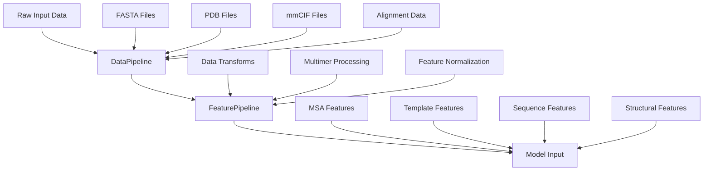

The feature extraction and processing pipeline in OpenFold transforms raw biological sequence data into structured neural network inputs through a sophisticated multi-stage architecture. This pipeline handles everything from sequence parsing to advanced multimer processing, enabling the AlphaFold 2 model to effectively learn from diverse protein data sources.

## Core Architecture Overview

The feature processing system is built around three primary components that work in concert to transform raw data into model-ready features:

### Data Pipeline Architecture



The `DataPipeline` class ([data_pipeline.py#L706-L1374](openfold/data/data_pipeline.py#L706)) serves as the primary interface, coordinating alignment parsing, template searching, and feature assembly. It processes various input formats including FASTA, PDB, and mmCIF files, extracting and consolidating biological information into standardized feature dictionaries.

### Feature Processing Pipeline

The `FeaturePipeline` class ([feature_pipeline.py#L132-L154](openfold/data/feature_pipeline.py#L132)) acts as the central processing coordinator, applying configuration-specific transformations and preparing features for model consumption:

```python
class FeaturePipeline:
    def __init__(self, config: ml_collections.ConfigDict):
        self.config = config

    def process_features(self, raw_features: FeatureDict, 
                        mode: str = "train", 
                        is_multimer: bool = False) -> FeatureDict:
        return np_example_to_features(
            np_example=raw_features,
            config=self.config,
            mode=mode,
            is_multimer=is_multimer,
        )
```

## Feature Extraction Components

### Sequence and MSA Feature Generation

The pipeline generates multiple types of sequence-related features essential for protein structure prediction:

#### Core Sequence Features
- **Amino acid encoding**: One-hot representation of residue types
- **Sequence masks**: Binary indicators for valid positions
- **Between-segment residues**: Domain break information
- **Profile features**: Position-specific scoring matrices from alignments

#### MSA Feature Processing
Multiple Sequence Alignment features are processed through sophisticated transformations in `make_msa_feat` ([data_transforms.py#L544-L593](openfold/data/data_transforms.py#L544)):

```python
def make_msa_feat(protein):
    """Create and concatenate MSA features."""
    msa_1hot = make_one_hot(protein["msa"], 23)
    has_deletion = torch.clip(protein["deletion_matrix"], 0.0, 1.0)
    deletion_value = torch.atan(protein["deletion_matrix"] / 3.0) * (2.0 / np.pi)
    
    msa_feat = [
        msa_1hot,  # 23-dimensional one-hot encoding
        torch.unsqueeze(has_deletion, dim=-1),    # deletion presence
        torch.unsqueeze(deletion_value, dim=-1),  # normalized deletion values
    ]
    
    if "cluster_profile" in protein:
        # Add cluster-based profile features
        deletion_mean_value = torch.atan(protein["cluster_deletion_mean"] / 3.0) * (2.0 / np.pi)
        msa_feat.extend([protein["cluster_profile"], 
                        torch.unsqueeze(deletion_mean_value, dim=-1)])
```

### Template Feature Integration

Template features incorporate structural information from homologous proteins, processed through specialized featurizers that convert PDB/mmCIF data into numerical representations:

| Template Feature Type | Dimensions | Description |
|------------------------|------------|-------------|
| Template coordinates | (num_templates, num_res, 37, 3) | Atomic positions from template structures |
| Template masks | (num_templates, num_res) | Validity indicators for template positions |
| Template unit vectors | (num_templates, num_res, num_res, 3) | Directional relationships between residues |
| Template pairwise distances | (num_templates, num_res, num_res) | Distance matrices for structural comparison |

### Structural Feature Derivation

The pipeline computes structural features from atomic coordinates, including pseudo-beta positions, torsion angles, and reference frames:

```python
def atom37_to_torsion_angles(protein, prefix=""):
    """Converts atom37 positions to torsion angles."""
    # Extract backbone frames and compute chi angles
    # Returns: angles, alt_angles, frames, mask
```

> [!TIP]
> Pseudo-beta features are critical for representing protein backbone geometry, using alpha-carbon positions for most residues and beta-carbon positions where available.

## Data Transformation and Normalization

### Feature Standardization

The `make_fixed_size` function ([data_transforms.py#L505-L540](openfold/data/data_transforms.py#L505)) ensures consistent tensor dimensions across different protein lengths and MSA depths:

```python
def make_fixed_size(protein, shape_schema, msa_cluster_size, 
                   extra_msa_size, num_res=0, num_templates=0):
    pad_size_map = {
        NUM_RES: num_res,
        NUM_MSA_SEQ: msa_cluster_size,
        NUM_EXTRA_SEQ: extra_msa_size,
        NUM_TEMPLATES: num_templates,
    }
    
    for k, v in protein.items():
        # Apply padding to match schema dimensions
        padding = [(0, p - v.shape[i]) for i, p in enumerate(pad_size)]
        protein[k] = torch.nn.functional.pad(v, padding)
```

### MSA Sampling and Processing

The pipeline implements sophisticated MSA processing strategies:

| Processing Method | Purpose | Configuration Parameter |
|-------------------|---------|-------------------------|
| Random sampling | Reduce MSA depth for training efficiency | `max_seq` |
| Cluster-based sampling | Preserve evolutionary information | `keep_extra` |
| Block deletion | Simulate incomplete alignment data | `block_delete_msa` |
| Masked MSA | Enable BERT-style pretraining | `replace_fraction` |

## Multimer Feature Processing

### Chain Pairing and Merging

For multimer prediction, the `pair_and_merge` function ([feature_processing_multimer.py#L50-L85](openfold/data/feature_processing_multimer.py#L50)) orchestrates complex inter-chain processing:

```python
def pair_and_merge(all_chain_features: MutableMapping[str, Mapping[str, np.ndarray]]):
    process_unmerged_features(all_chain_features)
    np_chains_list = list(all_chain_features.values())
    
    pair_msa_sequences = not _is_homomer_or_monomer(np_chains_list)
    
    if pair_msa_sequences:
        np_chains_list = msa_pairing.create_paired_features(chains=np_chains_list)
        np_chains_list = msa_pairing.deduplicate_unpaired_sequences(np_chains_list)
    
    np_chains_list = crop_chains(np_chains_list, msa_crop_size=MSA_CROP_SIZE,
                                pair_msa_sequences=pair_msa_sequences,
                                max_templates=MAX_TEMPLATES)
    
    return msa_pairing.merge_chain_features(np_chains_list=np_chains_list,
                                          pair_msa_sequences=pair_msa_sequences,
                                          max_templates=MAX_TEMPLATES)
```

### Multimer-Specific Features

Multimer processing generates additional features for inter-chain interactions:

- **Assembly features**: Chain connectivity and interface information
- **Pairing features**: Cross-chain MSA sequence relationships
- **Interface masks**: Residue-level interaction indicators
- **Chain mapping**: Correspondence between monomer and multimer indices

## Feature Configuration and Mode Handling

### Training vs Inference Modes

The pipeline adapts feature processing based on the operational mode:

| Mode | Key Differences | Features Added |
|------|-----------------|----------------|
| Training | Data augmentation, random cropping | `use_clamped_fape`, random masks |
| Inference | Full MSA, no augmentation | Standard features, no randomization |
| Evaluation | Balanced processing | Intermediate feature set |

### Configuration-Driven Processing

Feature processing is controlled through detailed configuration specifications that define:

- **Shape schemas**: Expected tensor dimensions for each feature
- **Processing flags**: Enable/disable specific transformations
- **Mode-specific settings**: Training vs inference parameters
- **Multimer configurations**: Chain processing parameters

> [!TIP]
> The configuration system enables flexible feature processing pipelines that can adapt to different model architectures, data availability scenarios, and computational constraints.

## Feature Quality and Validation

### Input Validation

The pipeline includes comprehensive validation checks:

- **Sequence validity**: Ensures proper amino acid encoding
- **Template consistency**: Validates template structure compatibility
- **MSA integrity**: Checks alignment quality and completeness
- **Dimension matching**: Verifies tensor shape consistency

### Feature Monitoring

Built-in monitoring capabilities track:

- **Feature coverage**: Percentage of valid positions
- **MSA depth statistics**: Alignment quality metrics
- **Template usage**: Structural information utilization
- **Processing time**: Computational efficiency metrics

This sophisticated feature extraction and processing architecture enables OpenFold to effectively transform diverse biological data sources into the structured inputs required for accurate protein structure prediction, supporting both monomer and multimer prediction scenarios with configurable processing pipelines.

For more details on specific aspects of the data processing pipeline, see [Multiple Sequence Alignment (MSA) Handling](13-multiple-sequence-alignment-msa-handling) and [Template Search and Integration](14-template-search-and-integration).