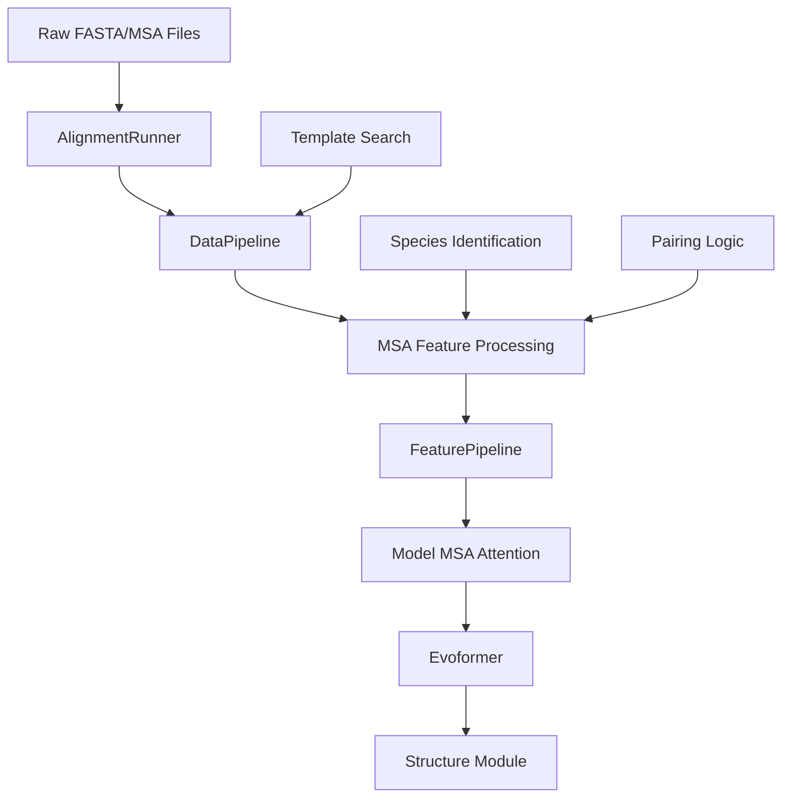

Multiple Sequence Alignment (MSA) processing forms the computational backbone of OpenFold's structure prediction pipeline, serving as the primary source of evolutionary information that enables accurate protein structure inference. This documentation explores the architectural patterns, implementation details, and optimization strategies that make MSA handling both efficient and scalable.

## MSA Architecture Overview
The MSA processing pipeline implements a sophisticated multi-stage architecture that transforms raw sequence alignments into rich feature representations suitable for deep learning models. The system supports both monomer and multimer protein prediction, with specialized handling for large-scale alignments and memory-constrained environments.



Sources: [data_pipeline.py](openfold/data/data_pipeline.py#L334-L482), [feature_pipeline.py](openfold/data/feature_pipeline.py#L132-L148)

## MSA Data Processing Pipeline
The core MSA processing begins with the `AlignmentRunner` class, which orchestrates multiple alignment tools and databases to generate comprehensive sequence alignments. This component supports various search strategies and database configurations to maximize coverage while maintaining computational efficiency.

### AlignmentRunner Architecture
The `AlignmentRunner` ([data_pipeline.py#L334](openfold/data/data_pipeline.py#L334)) serves as the primary interface for MSA generation, supporting multiple search algorithms:

| Search Tool | Database Support | Primary Use Case | Performance Characteristics |
|-------------|------------------|------------------|----------------------------|
| Jackhmmer | UniRef90, Mgnify, Small BFD, UniProt | General purpose alignment | High accuracy, moderate speed |
| HHblits | BFD + UniRef30/UniClust30 | Deep homology detection | Very fast, large database support |

```python
class AlignmentRunner:
    def __init__(
        self,
        jackhmmer_binary_path: Optional[str] = None,
        hhblits_binary_path: Optional[str] = None,
        uniref90_database_path: Optional[str] = None,
        mgnify_database_path: Optional[str] = None,
        bfd_database_path: Optional[str] = None,
        # ... additional parameters
    ):
```

Sources: [data_pipeline.py#L334-L482](openfold/data/data_pipeline.py#L334-L482)

### MSA Feature Construction
The `make_msa_features` function ([data_pipeline.py#L224](openfold/data/data_pipeline.py#L224)) transforms raw alignment data into structured feature arrays:

```python
def make_msa_features(msas: Sequence[parsers.Msa]) -> FeatureDict:
    """Constructs a feature dict of MSA features."""
    int_msa = []
    deletion_matrix = []
    species_ids = []
    seen_sequences = set()
    
    for msa_index, msa in enumerate(msas):
        for sequence_index, sequence in enumerate(msa.sequences):
            if sequence in seen_sequences:
                continue
            seen_sequences.add(sequence)
            int_msa.append(
                [residue_constants.HHBLITS_AA_TO_ID[res] for res in sequence]
            )
```

Key features generated include:
- **msa**: Integer-encoded amino acid sequences
- **deletion_matrix**: Gap/deletion information for each alignment position
- **msa_species_identifiers**: Taxonomic information for evolutionary analysis
- **num_alignments**: Total alignment count per residue position

> [!TIP]
> The deduplication logic in `make_msa_features` prevents redundant sequences from inflating the MSA, significantly reducing memory usage while preserving evolutionary diversity.

Sources: [data_pipeline.py#L224-L264](openfold/data/data_pipeline.py#L224-L264)

## MSA Feature Processing and Species Identification
Species identification provides critical evolutionary context for MSA processing, enabling sophisticated pairing and analysis strategies.

### Species Identifier Extraction
The `msa_identifiers` module ([msa_identifiers.py#L15](openfold/data/msa_identifiers.py#L15)) implements robust parsing of sequence metadata:

```python
_UNIPROT_PATTERN = re.compile(
    r"""
    ^
    # Database type (sp for Swiss-Prot, tr for TrEMBL)
    (?P<db_type>sp|tr)
    \|
    # Unique identifier (e.g., A0A146SKV9)
    (?P<unique_id>[A-Z0-9]{6,10})
    \|
    # Entry name (e.g., A0A146SKV9_FUNHE)
    (?P<entry_name>[A-Z0-9_]+)
    $
    """,
    re.VERBOSE,
)
```

This pattern recognition enables extraction of taxonomic information from UniProt-style identifiers, supporting evolutionary analysis across diverse sequence databases.

Sources: [msa_identifiers.py#L22-L28](openfold/data/msa_identifiers.py#L22-L28)

### Feature Pipeline Integration
The `FeaturePipeline` class ([feature_pipeline.py#L132](openfold/data/feature_pipeline.py#L132)) serves as the final processing stage before model input:

```python
class FeaturePipeline:
    def process_features(
        self,
        raw_features: FeatureDict,
        mode: str = "train",
        is_multimer: bool = False,
    ) -> FeatureDict:
        return np_example_to_features(
            raw_features, self.config, mode, is_multimer
        )
```

This pipeline handles data type conversions, configuration-driven feature selection, and mode-specific processing for training vs. inference.

Sources: [feature_pipeline.py#L132-L148](openfold/data/feature_pipeline.py#L132-L148)

## MSA Attention Mechanisms
OpenFold implements sophisticated attention mechanisms specifically designed for MSA data, enabling the model to capture complex evolutionary patterns across multiple sequence dimensions.

### MSA Attention Architecture
The `MSAAttention` class ([msa.py#L36](openfold/model/msa.py#L36)) provides the foundation for MSA-specific attention operations:

```python
class MSAAttention(nn.Module):
    def __init__(
        self,
        c_in,
        c_hidden,
        no_heads,
        pair_bias=False,
        c_z=None,
        inf=1e9,
    ):
        self.layer_norm_m = LayerNorm(self.c_in)
        self.mha = Attention(
            self.c_in, self.c_in, self.c_in, 
            self.c_hidden, self.no_heads,
        )
```

Key architectural components:
- **Multi-head attention** with configurable hidden dimensions
- **Pair bias support** for integrating structural information
- **Layer normalization** for stable training dynamics

> [!TIP]
> The MSA attention implementation supports multiple optimization strategies including DeepSpeed integration, FlashAttention, and memory-efficient kernels to handle large alignments.

Sources: [msa.py#L36-L100](openfold/model/msa.py#L36-L100)

### Specialized Attention Variants
OpenFold implements several specialized attention patterns for MSA data:

| Attention Type | Algorithm Reference | Primary Function | Key Features |
|----------------|---------------------|------------------|--------------|
| MSARowAttentionWithPairBias | Algorithm 7 | Row-wise attention with structural bias | Integrates pair embeddings, evolutionary context |
| MSAColumnAttention | Algorithm 8 | Column-wise attention | Captures positional patterns across sequences |
| MSAColumnGlobalAttention | - | Global column attention | Long-range dependency modeling |

```python
class MSARowAttentionWithPairBias(MSAAttention):
    """Implements Algorithm 7."""
    
class MSAColumnAttention(nn.Module):
    """Implements Algorithm 8."""
```

Sources: [msa.py#L295-L402](openfold/model/msa.py#L295-L402)

## Multimer MSA Pairing
For protein complex prediction, OpenFold implements sophisticated MSA pairing logic that ensures consistent evolutionary information across multiple chains.

### Pairing Algorithm
The `pair_sequences` function ([msa_pairing.py#L181](openfold/data/msa_pairing.py#L181)) implements the core pairing logic:

```python
def pair_sequences(
    examples: List[Mapping[str, np.ndarray]],
) -> Dict[int, np.ndarray]:
  """Returns indices for paired MSA sequences across chains."""
  
  all_chain_species_dict = []
  common_species = set()
  for chain_features in examples:
    msa_df = _make_msa_df(chain_features)
    species_dict = _create_species_dict(msa_df)
    all_chain_species_dict.append(species_dict)
    common_species.update(set(species_dict))
```

The pairing algorithm:
1. **Species identification** across all chains
2. **Common species detection** for pairing candidates
3. **Sequence similarity matching** within species groups
4. **Paired index generation** for model consumption

Sources: [msa_pairing.py#L181-L235](openfold/data/msa_pairing.py#L181-L235)

### Feature Merging Strategies
The `merge_chain_features` function ([msa_pairing.py#L432](openfold/data/msa_pairing.py#L432)) orchestrates the combination of paired and unpaired features:

```python
def merge_chain_features(np_chains_list: List[Mapping[str, np.ndarray]],
                         pair_msa_sequences: bool,
                         max_templates: int) -> Mapping[str, np.ndarray]:
    if pair_msa_sequences:
        paired_rows_dict = pair_sequences(np_chains_list)
        reordered_paired_rows = reorder_paired_rows(paired_rows_dict)
        # ... merging logic
```

Key merging strategies:
- **Paired sequences**: Evolutionarily related sequences across chains
- **Block diagonal arrangement**: Unpaired sequences maintain chain independence
- **Template integration**: Structural information preservation during merging

Sources: [msa_pairing.py#L432-L461](openfold/data/msa_pairing.py#L432-L461)

## Performance Optimization and Memory Management
OpenFold implements several optimization strategies to handle large MSA datasets efficiently, particularly important for long sequences and complex multimer predictions.

### Memory-Efficient Processing
The MSA attention modules support multiple optimization strategies:

| Optimization | Memory Benefit | Performance Impact | Use Case |
|--------------|----------------|-------------------|----------|
| Chunking | Significantly reduced memory usage | Moderate overhead | Large MSAs (>1000 sequences) |
| FlashAttention | Up to 3x memory reduction | Faster execution | GPU-based inference |
| DeepSpeed Integration | Distributed memory management | Minimal overhead | Multi-GPU training |

```python
@torch.jit.ignore
def _chunked_msa_attn(self,
    m: torch.Tensor,
    z: Optional[torch.Tensor],
    mask: Optional[torch.Tensor],
    chunk_logits: int,
    checkpoint: bool,
    inplace_safe: bool = False
) -> torch.Tensor:
    """MSA attention with training-time chunking."""
```

Sources: [msa.py#L171-L185](openfold/model/msa.py#L171-L185)

### Configuration-Driven Processing
The MSA pipeline supports flexible configuration through data-specific parameters:

```python
def make_data_config(
    config: ml_collections.ConfigDict,
    mode: str,
    num_res: int,
) -> Tuple[ml_collections.ConfigDict, List[str]]:
    """Creates data configuration with MSA-specific parameters."""
```

Key configuration options:
- **max_msa_clusters**: Controls MSA diversity sampling
- **num_extra_msa**: Additional sequences for model robustness
- **subsample_msa**: Downsampling strategies for large alignments

Sources: [feature_pipeline.py#L53-L78](openfold/data/feature_pipeline.py#L53-L78)

## Next Steps
For a complete understanding of OpenFold's data processing pipeline, continue exploring:

- **[Feature Extraction and Processing](12-feature-extraction-and-processing)**: Detailed examination of feature generation and transformation
- **[Template Search and Integration](14-template-search-and-integration)**: Structural template handling and integration with MSA data
- **[Multimer Protein Structure Prediction](18-multimer-protein-structure-prediction)**: Advanced multimer-specific MSA strategies
- **[AlphaFold 2 Model Implementation](9-alphafold-2-model-implementation)**: How MSA features integrate into the complete model architecture