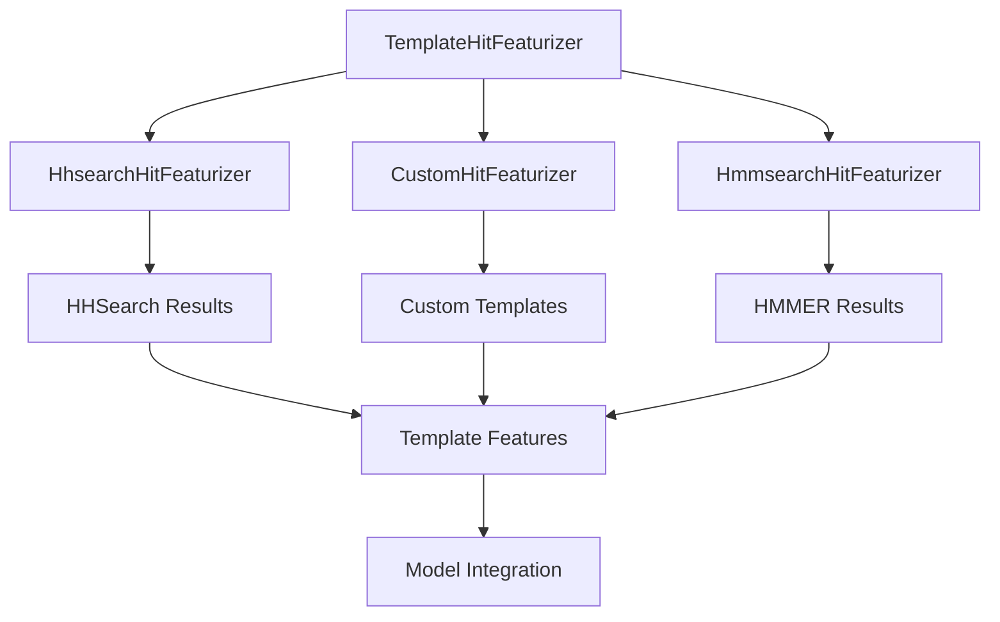
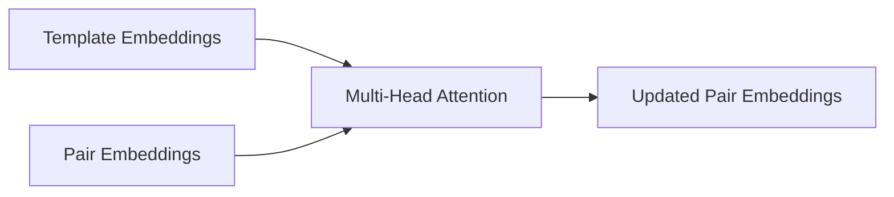

Template search and integration forms a critical component of OpenFold's protein structure prediction pipeline, enabling the model to leverage known structural information from homologous proteins to improve prediction accuracy. This system implements a sophisticated multi-stage process for identifying relevant template structures, extracting their features, and integrating them into the model's neural network architecture.

## Template Search Architecture

The template search system in OpenFold follows a hierarchical architecture with multiple featurizer classes designed to handle different template sources and search methods:



### Abstract Base Class: TemplateHitFeaturizer

The `TemplateHitFeaturizer` serves as the abstract base class for all template processing implementations ([openfold/data/templates.py#L1023-L1102](openfold/data/templates.py#L1023-L1102)). This class provides the foundational infrastructure for template search and processing:

- **Configuration Parameters**: Manages essential settings including mmCIF directory paths, maximum template dates, hit limits, and alignment tool paths
- **Date Filtering**: Implements temporal filtering to ensure templates don't exceed specified release date cutoffs
- **Obsolete PDB Handling**: Automatically maps obsolete PDB IDs to their current replacements
- **Error Handling**: Provides configurable strict error checking for template validation

The core initialization process validates the mmCIF directory structure and prepares release date and obsolete PDB mappings for efficient template filtering.

### Specialized Featurizer Implementations

#### HhsearchHitFeaturizer
The `HhsearchHitFeaturizer` specializes in processing HHSearch results, which is the primary template search method in OpenFold ([openfold/data/templates.py#L1105-L1207](openfold/data/templates.py#L1105-L1207)). This implementation:

- Processes HHSearch hit results containing sequence alignments and confidence scores
- Filters templates based on alignment quality, date constraints, and sequence similarity
- Extracts structural features from mmCIF files for valid template hits
- Handles template deduplication and quality assessment

#### CustomHitFeaturizer
The `CustomHitFeaturizer` supports user-provided template structures ([openfold/data/templates.py#L1208-L1224](openfold/data/templates.py#L1208-L1224)). This implementation:

- Processes custom template files provided by users
- Assumes the template chain is chain A with matching sequence length
- Enables integration of experimental or custom structural data

#### HmmsearchHitFeaturizer
The `HmmsearchHitFeaturizer` handles HMMER-based template search results ([openfold/data/templates.py#L1225-L1232](openfold/data/templates.py#L1225-L1232)), providing an alternative to HHSearch for template identification.

## Template Processing Pipeline

### Template Hit Parsing and Validation

Template hits undergo rigorous validation through multiple filtering stages ([openfold/data/templates.py#L220-L291](openfold/data/templates.py#L220-L291)):

```python
def _assess_hhsearch_hit(
    hit: parsers.TemplateHit,
    hit_pdb_code: str,
    query_sequence: str,
    release_dates: Mapping[str, datetime.datetime],
    release_date_cutoff: datetime.datetime,
    max_subsequence_ratio: float = 0.95,
    min_align_ratio: float = 0.1,
) -> bool:
```

The filtering process includes:

- **Date Validation**: Ensures template structures were released before the specified cutoff date
- **Alignment Quality**: Validates that templates have sufficient alignment coverage with the query sequence
- **Sequence Identity**: Prevents templates that are exact subsequences of the query
- **Length Requirements**: Enforces minimum template length requirements

### Feature Extraction and Processing

Valid template hits undergo comprehensive feature extraction to generate the neural network inputs ([openfold/data/templates.py#L548-L707](openfold/data/templates.py#L548-L707)):

```python
def _extract_template_features(
    mmcif_object: mmcif_parsing.MmcifObject,
    pdb_id: str,
    mapping: Mapping[int, int],
    template_sequence: str,
    query_sequence: str,
    template_chain_id: str,
    kalign_binary_path: str,
    _zero_center_positions: bool = True,
) -> Tuple[Dict[str, Any], Optional[str]]:
```

The extracted features include:

- **Template Aatype**: Amino acid type information for template residues
- **Template All Atom Positions**: 3D coordinates of all atoms in template structures
- **Template All Atom Mask**: Binary mask indicating valid atom positions
- **Template Domain Names**: Identifiers for template domains
- **Template Sequence**: Template sequence information
- **Template Sum Probabilities**: Confidence scores for template alignments

> [!TIP]
> Template feature extraction includes critical validation steps such as CA atom distance checks to ensure structural integrity, preventing the use of templates with unrealistic geometry that could degrade model performance.

## Model Integration Architecture

### Template Embedding Neural Network

The integrated template features are processed through specialized neural network modules designed for template information integration:

#### Template Pointwise Attention
The `TemplatePointwiseAttention` module implements Algorithm 17 from the AlphaFold paper ([openfold/model/template.py#L55-L148](openfold/model/template.py#L55-L148)):



This module enables information flow between template structures and the evolving pair representations, allowing the model to leverage template information for structural prediction.

#### Template Pair Stack
The `TemplatePairStack` implements Algorithm 16, providing a deep processing architecture for template embeddings ([openfold/model/template.py#L345-L471](openfold/model/template.py#L345-L471)):

- **Multiple Processing Blocks**: Contains configurable numbers of `TemplatePairStackBlock` units
- **Triangular Attention**: Implements row and column-wise attention for capturing long-range structural dependencies
- **Triangular Multiplication**: Applies multiplicative updates for local structural features
- **Memory Optimization**: Supports chunking and activation checkpointing for large template sets

### Memory Optimization Strategies

The template processing system includes sophisticated memory optimization techniques ([openfold/model/template.py#L472-L592](openfold/model/template.py#L472-L592)):

- **Template Offloading**: `embed_templates_offload` function processes templates in chunks to reduce memory usage
- **Template Averaging**: `embed_templates_average` function combines template features when memory constraints are severe
- **Chunked Processing**: Supports configurable chunk sizes for different processing stages
- **Activation Checkpointing**: Reduces memory usage during training by recomputing intermediate activations

## Template Feature Types

The template system generates a comprehensive set of features defined in `TEMPLATE_FEATURES` ([openfold/data/templates.py#L83-L110](openfold/data/templates.py#L83-L110)):

| Feature Name | Data Type | Dimensions | Description |
|-------------|-----------|------------|-------------|
| `template_aatype` | np.int64 | `[N_templates, N_res, 22]` | Amino acid types with gaps |
| `template_all_atom_mask` | np.float32 | `[N_templates, N_res, 37]` | Valid atom position indicators |
| `template_all_atom_positions` | np.float32 | `[N_templates, N_res, 37, 3]` | 3D atom coordinates |
| `template_domain_names` | object | `[N_templates]` | Template domain identifiers |
| `template_sequence` | object | `[N_templates]` | Template sequences |
| `template_sum_probs` | np.float32 | `[N_templates, 1]` | Template confidence scores |

## Template Integration in Data Pipeline

The template system integrates seamlessly with OpenFold's data processing pipeline through the `DataPipeline` class ([openfold/data/data_pipeline.py#L706-L1153](openfold/data/data_pipeline.py#L706-L1153)):

```python
def make_template_features(
    input_sequence: str,
    hits: Sequence[Any],
    template_featurizer: Any,
) -> FeatureDict:
```

This integration provides:

- **Unified Feature Processing**: Combines template features with MSA and sequence features
- **Multimer Support**: Handles template processing for multi-chain protein complexes
- **Flexible Input Sources**: Supports various input formats including FASTA, PDB, and mmCIF
- **Error Resilience**: Graceful handling of missing or invalid template data

## Performance Considerations

### Prefiltering Optimization

The template system implements efficient prefiltering to reduce computational overhead ([openfold/data/templates.py#L780-L836](openfold/data/templates.py#L780-L836)):

- **Early Rejection**: Invalid templates are filtered before expensive mmCIF parsing
- **Cached Metadata**: Release dates and obsolete PDB mappings are cached for rapid access
- **Parallel Processing**: Template processing can be parallelized across multiple hits

### Memory Management

The system includes sophisticated memory management strategies:

- **Chunked Processing**: Large template sets are processed in configurable chunks
- **Gradient Checkpointing**: Reduces memory usage during training
- **Feature Compression**: Template features are stored efficiently with appropriate data types

> [!TIP]
> The template processing system supports dynamic chunk size tuning through the `ChunkSizeTuner`, automatically optimizing memory usage based on available hardware resources and input characteristics.

## Next Steps

For comprehensive understanding of the OpenFold architecture, consider exploring:

- **[Feature Extraction and Processing](12-feature-extraction-and-processing)**: Learn about the broader data processing pipeline that integrates template features
- **[AlphaFold 2 Model Implementation](9-alphafold-2-model-implementation)**: Understand how template features are utilized within the complete neural network architecture
- **[Multiple Sequence Alignment (MSA) Handling](13-multiple-sequence-alignment-msa-handling)**: Explore how template search complements MSA-based evolutionary information

The template search and integration system represents a sophisticated component of OpenFold that significantly enhances prediction accuracy by leveraging known structural information while maintaining computational efficiency through careful optimization and memory management strategies.