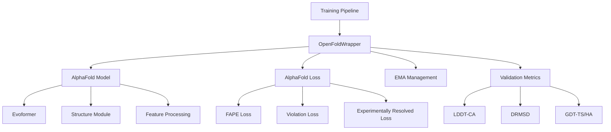
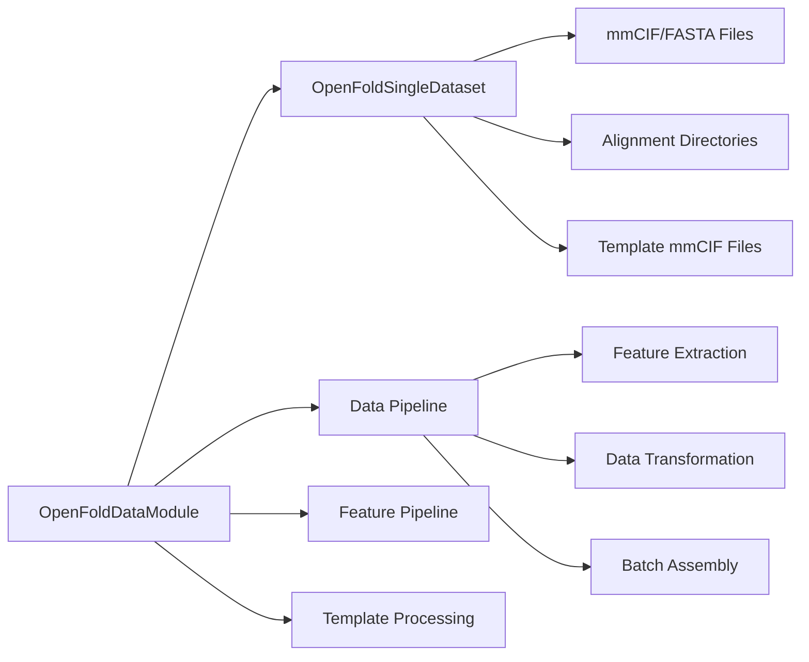

The OpenFold training pipeline provides a comprehensive framework for training AlphaFold 2 models with flexible configuration options, distributed training support, and advanced optimization techniques. This documentation covers the core architecture, configuration system, and advanced training capabilities.

## Core Training Architecture

OpenFold utilizes PyTorch Lightning as its training framework, providing a structured approach to model training with built-in support for distributed training, checkpointing, and experiment tracking. The training pipeline is centered around the `OpenFoldWrapper` class ([train_openfold.py#L29](train_openfold.py#L29)), which encapsulates the AlphaFold model, loss computation, and training logic.



### Key Components

**OpenFoldWrapper**: The main Lightning module that orchestrates training ([train_openfold.py#L29](train_openfold.py#L29)):
- Manages model initialization with configuration
- Handles training and validation steps
- Implements Exponential Moving Average (EMA) for model weights
- Computes and logs comprehensive validation metrics
- Integrates with PyTorch Lightning's distributed training framework

**Training Step Flow** ([train_openfold.py#L79](train_openfold.py#L79)):
1. Forward pass through AlphaFold model
2. Remove recycling dimension from batch
3. Apply multi-chain permutation alignment for multimer models
4. Compute loss and loss breakdown
5. Log metrics and validation scores

**Validation Strategy** ([train_openfold.py#L115](train_openfold.py#L115)):
- Uses EMA weights for validation while preserving training weights
- Computes structural metrics (LDDT-CA, DRMSD, GDT-TS, GDT-HA)
- Optional superimposition-based metrics for structural accuracy
- Automatic weight restoration after validation

## Configuration System

OpenFold provides a flexible configuration system with multiple presets and customization options. The configuration is managed through the `model_config` function ([config.py#L42](config.py#L42)).

### Training Presets

| Preset | Crop Size | Max Extra MSA | Max MSA Clusters | Template Enabled | Loss Weights | Use Case |
|--------|-----------|---------------|------------------|------------------|---------------|----------|
| `initial_training` | Default | Default | Default | Yes | Default | Initial model training |
| `finetuning` | 384 | 5120 | 512 | Yes | Violation: 1.0, Exp. Resolved: 0.01 | Fine-tuning pretrained models |
| `finetuning_ptm` | 384 | 5120 | 512 | Yes | + TM: 0.1 | Fine-tuning with pTM head |
| `finetuning_no_templ` | 384 | 5120 | 512 | No | Violation: 1.0, Exp. Resolved: 0.01 | Template-free fine-tuning |
| `finetuning_no_templ_ptm` | 384 | 5120 | 512 | No | + TM: 0.1 | Template-free with pTM |

### Configuration Loading Process

The configuration system supports multiple sources ([train_openfold.py#L387](train_openfold.py#L387)):
1. **Base Preset**: Load from predefined configurations
2. **JSON Override**: Custom configuration via `--experiment_config_json`
3. **Runtime Parameters**: Command-line arguments override specific settings

```python
config = model_config(
    args.config_preset, 
    train=True, 
    low_prec=is_low_precision,
) 
if args.experiment_config_json: 
    with open(args.experiment_config_json, 'r') as f:
        custom_config_dict = json.load(f)
    config.update_from_flattened_dict(custom_config_dict)
```

### Mutually Exclusive Configuration Options

The configuration system enforces constraints to prevent incompatible settings ([config.py#L25](config.py#L25)):
- Template averaging vs. template offloading
- Memory optimization techniques (LMA, FlashAttention, DeepSpeed EvoFormer)

> [!TIP]
> Configuration validation ensures that mutually exclusive optimization techniques cannot be enabled simultaneously, preventing runtime conflicts and ensuring stable training performance.

## Data Pipeline Integration

The training pipeline integrates with sophisticated data processing modules that handle protein structure data, multiple sequence alignments, and template information.

### Data Module Architecture



**Data Module Selection** ([train_openfold.py#L425](train_openfold.py#L425)):
- `OpenFoldDataModule`: Standard monomer training
- `OpenFoldMultimerDataModule`: Multi-chain protein complexes

**Dataset Configuration** ([data_modules.py#L13](data/data_modules.py#L13)):
- Multiple data sources (training, validation, distillation)
- Flexible alignment and template directories
- Configurable filtering and caching options
- Support for both mmCIF and FASTA formats

## Optimization and Learning Rate Scheduling

### Learning Rate Schedule

OpenFold implements the AlphaFold 2 learning rate schedule with linear warmup, plateau, and exponential decay phases ([lr_schedulers.py#L7](utils/lr_schedulers.py#L7)):

| Phase | Duration | Learning Rate Behavior |
|-------|----------|----------------------|
| Warmup | First 1000 steps | Linear increase from 0 to max_lr |
| Plateau | Steps 1000-50000 | Constant at max_lr (0.001) |
| Decay | After step 50000 | Exponential decay every 50000 steps (factor: 0.95) |

```python
class AlphaFoldLRScheduler:
    def get_lr(self):
        if(step_no <= self.warmup_no_steps):
            lr = self.base_lr + (step_no / self.warmup_no_steps) * self.max_lr
        elif(step_no > self.start_decay_after_n_steps):
            steps_since_decay = step_no - self.start_decay_after_n_steps
            exp = (steps_since_decay // self.decay_every_n_steps) + 1
            lr = self.max_lr * (self.decay_factor ** exp)
        else: # plateau
            lr = self.max_lr
```

### Exponential Moving Average (EMA)

The training pipeline includes EMA for model weights ([train_openfold.py#L42](train_openfold.py#L42)):
- Maintains smoothed version of model parameters
- Used during validation for better generalization
- Configurable decay rate (typically 0.999)
- Automatic state management during checkpointing

## Distributed Training and Performance Optimization

OpenFold supports multiple distributed training strategies with advanced memory optimization techniques.

### Training Strategies

| Strategy | Configuration | Use Case | Features |
|----------|---------------|----------|----------|
| Single GPU | `--gpus 1` | Development/testing | Basic single-GPU training |
| Multi-GPU DDP | `--gpus >1` | Multi-GPU training | Distributed data parallelism |
| DeepSpeed | `--deepspeed_config_path` | Large-scale training | Memory optimization, offloading |

### DeepSpeed Integration

The default DeepSpeed configuration ([deepspeed_config.json](deepspeed_config.json)) provides:
```json
{
  "bfloat16": {"enabled": true},
  "zero_optimization": {
    "stage": 2,
    "offload_optimizer": {"device": "cpu"},
    "contiguous_gradients": true
  },
  "activation_checkpointing": {
    "partition_activations": true,
    "cpu_checkpointing": false
  },
  "gradient_clipping": 0.1
}
```

**Key Features**:
- **Zero Stage 2**: Optimizer state partitioning and offloading
- **Activation Checkpointing**: Trade computation for memory
- **Mixed Precision**: BF16 support for modern hardware
- **Gradient Clipping**: Stable training with large batches

### MPI Support

For HPC environments, OpenFold supports MPI-based parallel processing ([train_openfold.py#L470](train_openfold.py#L470)):
- `--mpi_plugin`: Enable MPI environment integration
- Rank-based logging and checkpointing
- Optimized for large-scale cluster deployments

## Experiment Tracking and Monitoring

### Logging Integration

The training pipeline supports comprehensive experiment tracking:

**Weights & Biases Integration** ([train_openfold.py#L452](train_openfold.py#L452)):
- Experiment naming and project organization
- Automatic artifact logging (config, dependencies)
- Distributed training support with rank-based logging
- Performance metrics visualization

**Performance Monitoring** ([train_openfold.py#L435](train_openfold.py#L435)):
- Device statistics monitoring
- Learning rate tracking
- Custom performance logging callbacks
- Batch size and throughput metrics

### Callbacks and Checkpointing

**Checkpoint Strategies** ([train_openfold.py#L413](train_openfold.py#L413)):
- Epoch-based checkpointing (`--checkpoint_every_epoch`)
- Model weights only vs. full state restoration
- DeepSpeed checkpoint compatibility
- Automatic resume functionality

**Early Stopping** ([train_openfold.py#L423](train_openfold.py#L423)):
- Configurable patience and delta thresholds
- Monitors validation LDDT-CA scores
- Prevents overfitting with automatic stopping

## Advanced Training Scenarios

### Fine-tuning from Pretrained Models

OpenFold supports multiple fine-tuning approaches ([train_openfold.py#L329](train_openfold.py#L329)):
- **JAX Weights**: Load from original AlphaFold checkpoints
- **OpenFold Weights**: Resume from previous training runs
- **DeepSpeed Checkpoints**: Handle distributed checkpoint formats

```python
# Load JAX parameters
model_module.load_from_jax(args.resume_from_jax_params)

# Resume from checkpoint (full state)
trainer.fit(model_module, datamodule=data_module, ckpt_path=ckpt_path)

# Load model weights only
import_openfold_weights_(model=model_module, state_dict=sd)
```

### Multimer Training

Specialized configuration for multi-chain protein complexes ([config.py#L129](config.py#L129)):
- Custom data processing pipelines
- Multi-chain permutation alignment
- Specialized loss functions and metrics
- Template handling modifications

> [!TIP]
> Multimer training requires specialized data pipelines and loss computation to handle the complexity of protein-protein interactions and chain arrangements, making it distinct from monomer training scenarios.

## Configuration Best Practices

### Recommended Configurations

**Initial Training**:
```bash
--config_preset initial_training \
--gpus 4 --num_nodes 1 \
--deepspeed_config_path deepspeed_config.json \
--precision bf16 \
--max_epochs 100
```

**Fine-tuning**:
```bash
--config_preset finetuning_ptm \
--resume_from_ckpt /path/to/checkpoint \
--early_stopping --patience 5 \
--wandb --experiment_name "finetuning_experiment"
```

**Large-scale Training**:
```bash
--config_preset initial_training \
--gpus 8 --num_nodes 4 \
--mpi_plugin \
--deepspeed_config_path deepspeed_config.json \
--log_performance
```

### Performance Optimization Tips

1. **Memory Management**: Use DeepSpeed Stage 2 for large models
2. **Mixed Precision**: Enable BF16 for modern GPU architectures
3. **Batch Size**: Adjust based on available GPU memory
4. **Checkpoint Frequency**: Balance between storage and training continuity
5. **Validation Frequency**: Consider validation computational cost

For detailed information on specific training scenarios and advanced features, refer to the related documentation pages including [DeepSpeed Integration and Performance](16-deepspeed-integration-and-performance) and [Multimer Protein Structure Prediction](18-multimer-protein-structure-prediction).