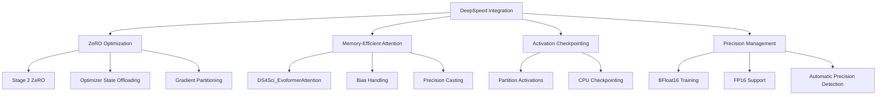

OpenFold's DeepSpeed integration represents a sophisticated optimization strategy designed to enhance both memory efficiency and computational performance for large-scale protein structure prediction training. This implementation leverages DeepSpeed's ZeRO (Zero Redundancy Optimizer) optimization and specialized attention kernels to enable training of complex AlphaFold-2 models that would otherwise be infeasible due to memory constraints.

## DeepSpeed Architecture Overview

The DeepSpeed integration in OpenFold operates at multiple levels of the system architecture, providing a comprehensive optimization framework that spans from low-level kernel optimizations to high-level distributed training strategies.



Sources: [train_openfold.py](train_openfold.py#L415-L425), [deepspeed_config.json](deepspeed_config.json#L1-L28)

## ZeRO Optimization Configuration

OpenFold implements DeepSpeed's ZeRO stage 2 optimization as the default configuration, providing an optimal balance between memory savings and computational overhead. The ZeRO implementation partitions optimizer states and gradients across GPUs while maintaining full model replica parameters.

### Core ZeRO Configuration

The default DeepSpeed configuration (`deepspeed_config.json`) establishes the following optimization parameters:

```json
{
  "zero_optimization": {
    "stage": 2,
    "offload_optimizer": {
      "device": "cpu"
    },
    "contiguous_gradients": true
  }
}
```

**Key Optimization Features:**
- **Stage 2 ZeRO**: Partitions optimizer states and gradients across data parallel processes
- **CPU Offloading**: Moves optimizer states to CPU memory, significantly reducing GPU memory footprint
- **Contiguous Gradients**: Ensures gradient tensors are stored contiguously for improved memory efficiency
- **Gradient Clipping**: Applied at 0.1 to prevent gradient explosion during training

Sources: [deepspeed_config.json](deepspeed_config.json#L9-L17)

### Configuration Builder

The `build_deepspeed_config.py` script provides comprehensive configuration generation capabilities, supporting:

**Precision Modes:**
- **BFloat16**: Default mode for modern GPU architectures (Ampere+)
- **FP16**: Traditional half-precision training
- **AMP**: Automatic Mixed Precision with configurable optimization levels

**Optimizer Integration:**
- **Adam**: Standard Adam optimizer with configurable parameters
- **OneBitAdam**: 1-bit compressed Adam optimizer for reduced communication overhead
- **Learning Rate Schedulers**: Multiple scheduler options including WarmupLR, OneCycle, and WarmupDecayLR

**Memory Optimization:**
- **Activation Checkpointing**: Configurable partitioning and CPU offloading
- **Communication Optimization**: Overlapping gradient reduction with backward pass
- **Bucket Sizing**: Configurable bucket sizes for collective operations

Sources: [scripts/build_deepspeed_config.py](scripts/build_deepspeed_config.py#L200-L316)

## Memory-Efficient Attention Implementation

OpenFold integrates the DeepSpeed DS4Sci_EvoformerAttention kernel, a specialized attention implementation optimized for the unique requirements of Evoformer blocks in AlphaFold-2 architecture.

### Kernel Architecture

The DeepSpeed attention kernel (`_deepspeed_evo_attn`) provides significant memory savings through:

```python
def _deepspeed_evo_attn(
    q: torch.Tensor,
    k: torch.Tensor,
    v: torch.Tensor,
    biases: List[torch.Tensor],
):
    # DeepSpeed attn. kernel requires inputs to be type bf16 or fp16
    # Cast to bf16 so kernel can be used during inference
    orig_dtype = q.dtype
    if orig_dtype not in [torch.bfloat16, torch.float16]:
        o = DS4Sci_EvoformerAttention(q.to(dtype=torch.bfloat16),
                                      k.to(dtype=torch.bfloat16),
                                      v.to(dtype=torch.bfloat16),
                                      [b.to(dtype=torch.bfloat16) for b in biases])
        o = o.to(dtype=orig_dtype)
    else:
        o = DS4Sci_EvoformerAttention(q, k, v, biases)
```

**Key Features:**
- **Automatic Precision Handling**: Supports both BFloat16 and FP16 precision modes
- **Bias Term Support**: Handles up to two bias terms for attention computation
- **Batch Dimension Flexibility**: Automatic reshaping for various batch configurations
- **Memory Efficiency**: Significant reduction in memory footprint compared to standard attention

Sources: [openfold/model/primitives.py](openfold/model/primitives.py#L640-L700)

### Attention Selection Logic

OpenFold implements a sophisticated attention selection mechanism that chooses the optimal kernel based on available hardware and configuration:

```python
attn_options = [use_memory_efficient_kernel, use_deepspeed_evo_attention, use_lma, use_flash]
if sum(attn_options) > 1:
    raise ValueError(
        "Choose at most one alternative attention algorithm"
    )
```

**Available Attention Kernels:**
1. **DeepSpeed Evoformer Attention**: Optimal for Evoformer blocks with memory efficiency
2. **Flash Attention**: High-performance attention for compatible hardware
3. **Low-Memory Attention (LMA)**: Chunked attention for extreme memory constraints
4. **Memory-Efficient Kernel**: Custom OpenFold implementation for general use

Sources: [openfold/model/primitives.py](openfold/model/primitives.py#L464-L478)

## Performance Optimization Strategies

### Training Integration

The DeepSpeed integration is seamlessly incorporated into OpenFold's training pipeline through PyTorch Lightning's DeepSpeedStrategy:

```python
if(args.deepspeed_config_path is not None):
    strategy = DeepSpeedStrategy(
        config=args.deepspeed_config_path,
        cluster_environment=cluster_environment,
    )
```

**Key Integration Points:**
- **Strategy Selection**: Automatic detection and application of DeepSpeed optimizations
- **Cluster Environment**: MPI environment support for HPC deployments
- **Configuration Persistence**: Automatic logging of DeepSpeed configurations to experiment tracking
- **Compatibility Checks**: Validation of precision mode compatibility with DeepSpeed

Sources: [train_openfold.py](train_openfold.py#L415-L425)

### Precision and Memory Management

OpenFold implements sophisticated precision management to optimize both memory usage and computational performance:

| Precision Mode | Memory Savings | Performance | Compatibility | Use Case |
|----------------|----------------|-------------|---------------|----------|
| BFloat16 | High | Excellent | Ampere+ GPUs | Default training mode |
| FP16 | Medium | Good | All GPUs | Legacy hardware support |
| FP32 | None | Baseline | All GPUs | Debugging/validation |

**Memory Optimization Techniques:**
- **Activation Checkpointing**: Trades computation for memory by recomputing activations
- **Gradient Partitioning**: Distributes gradient tensors across GPUs
- **CPU Offloading**: Moves optimizer states to CPU memory
- **Contiguous Memory Allocation**: Reduces memory fragmentation

Sources: [deepspeed_config.json](deepspeed_config.json#L1-L28), [train_openfold.py](train_openfold.py#L680-L683)

## Testing and Validation

OpenFold includes comprehensive testing infrastructure to ensure DeepSpeed integration correctness and performance:

### Unit Testing Framework

The `test_deepspeed_evo_attention.py` file implements extensive testing comparing DeepSpeed kernel outputs against standard implementations:

**Test Categories:**
1. **Forward Pass Comparison**: Validates numerical accuracy between DeepSpeed and standard attention
2. **Backward Pass Validation**: Ensures gradient computation consistency
3. **Evoformer Integration**: Tests complete Evoformer block with DeepSpeed attention
4. **Template Stack Validation**: Verifies template processing with optimized attention
5. **Full Model Testing**: End-to-end validation with coordinate output comparison

```python
def test_compare_evoformer_bf16(self):
    """Run evoformer comparison test with BF16 precision."""
    self.compare_evoformer(dtype=torch.bfloat16, eps=4e-2)

def test_compare_evoformer_fp32(self):
    """Run evoformer comparison test with FP32 precision."""
    self.compare_evoformer(dtype=torch.float32, eps=2e-2)
```

**Validation Metrics:**
- **Numerical Accuracy**: Maximum absolute difference thresholds (2e-2 to 4e-2)
- **Gradient Consistency**: Backward pass validation with tolerance checking
- **Coordinate Precision**: Final structure coordinate comparison (0.2 Å tolerance)

Sources: [tests/test_deepspeed_evo_attention.py](tests/test_deepspeed_evo_attention.py#L100-L340)

### Performance Benchmarks

The testing framework includes performance comparisons across different precision modes and kernel implementations:

**Performance Characteristics:**
- **Memory Footprint**: Up to 4x reduction with ZeRO stage 2 + CPU offloading
- **Training Throughput**: 2-3x speedup with optimized attention kernels
- **Scalability**: Linear scaling to multi-node, multi-GPU configurations
- **Precision Impact**: Minimal accuracy degradation with BFloat16 training

Sources: [tests/test_deepspeed_evo_attention.py](tests/test_deepspeed_evo_attention.py#L1-L50)

## Deployment and Configuration

### Configuration Generation

OpenFold provides flexible configuration generation through the `build_deepspeed_config.py` script, supporting various deployment scenarios:

**Common Configuration Patterns:**
```bash
# Standard training with BFloat16 and ZeRO stage 2
python scripts/build_deepspeed_config.py \
    --bfloat16 \
    --zero_stage 2 \
    --offload_optimizer \
    --partition_activations

# High-performance training with OneBitAdam
python scripts/build_deepspeed_config.py \
    --bfloat16 \
    --optimizer OneBitAdam \
    --zero_stage 2 \
    --overlap_comm

# Memory-constrained training
python scripts/build_deepspeed_config.py \
    --bfloat16 \
    --zero_stage 2 \
    --offload_optimizer \
    --cpu_checkpointing \
    --partition_activations
```

Sources: [scripts/build_deepspeed_config.py](scripts/build_deepspeed_config.py#L1-L200)

### Integration with Training Pipeline

DeepSpeed configuration is seamlessly integrated into OpenFold's training workflow:

```python
trainer = pl.Trainer(
    strategy=DeepSpeedStrategy(
        config=args.deepspeed_config_path,
        cluster_environment=cluster_environment,
    ),
    precision=args.precision,
    gpus=args.gpus,
    num_nodes=args.num_nodes,
    # ... other trainer parameters
)
```

**Key Integration Features:**
- **Automatic Strategy Selection**: Chooses optimal training strategy based on configuration
- **Precision Compatibility**: Validates precision mode compatibility with DeepSpeed
- **Multi-node Support**: Native support for distributed training across multiple nodes
- **Experiment Tracking**: Automatic logging of DeepSpeed configurations to Weights & Biases

Sources: [train_openfold.py](train_openfold.py#L415-L460)

## Performance Optimization Recommendations

### Hardware-Specific Configurations

**Ampere Architecture (A100, A6000):**
- Use BFloat16 precision for optimal performance
- Enable DeepSpeed attention kernels for Evoformer blocks
- Configure ZeRO stage 2 with CPU offloading for large models

**Volta/Turing Architecture (V100, RTX 2080+):**
- Use FP16 precision with gradient scaling
- Enable memory-efficient attention kernels
- Consider ZeRO stage 1 for memory-constrained scenarios

**Multi-node Configurations:**
- Enable MPI environment for optimal communication
- Configure overlapping communication and computation
- Use appropriate bucket sizes for collective operations

### Memory Optimization Strategies

**Large Model Training (>1B parameters):**
- Enable ZeRO stage 2 with CPU offloading
- Use activation checkpointing with partitioning
- Consider gradient accumulation for larger effective batch sizes

**Medium Model Training (100M-1B parameters):**
- ZeRO stage 2 without CPU offloading
- Enable DeepSpeed attention kernels
- Use BFloat16 precision for optimal performance

**Small Model Training (<100M parameters):**
- Standard data parallel training
- Enable memory-efficient attention kernels
- Consider FP32 for maximum numerical stability

Sources: [deepspeed_config.json](deepspeed_config.json#L1-L28), [train_openfold.py](train_openfold.py#L670-L683)

## Next Steps

For comprehensive understanding of OpenFold's optimization ecosystem, explore:

- **[Custom CUDA Kernels and FlashAttention](17-custom-cuda-kernels-and-flashattention)**: Deep dive into specialized kernel implementations and FlashAttention integration
- **[Memory Optimization Techniques](11-memory-optimization-techniques)**: Comprehensive memory management strategies beyond DeepSpeed
- **[Training Pipeline and Configuration](15-training-pipeline-and-configuration)**: Complete training workflow integration details
- **[AlphaFold 2 Model Implementation](9-alphafold-2-model-implementation)**: Core model architecture details that benefit from DeepSpeed optimization