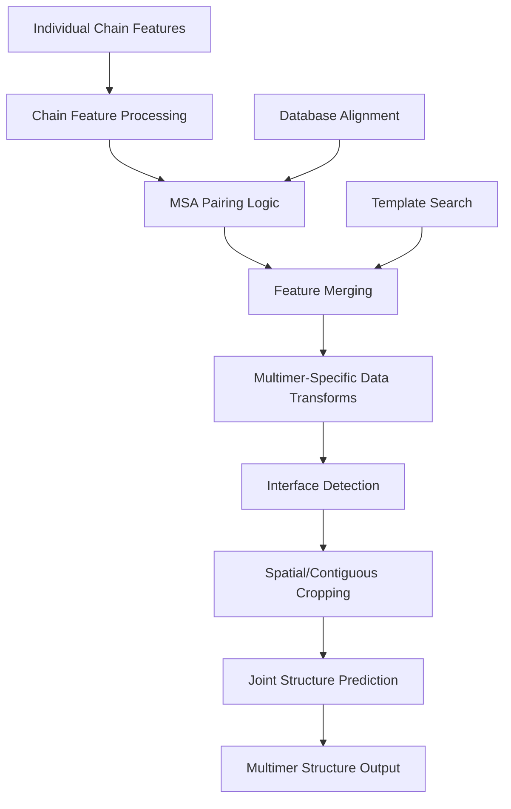
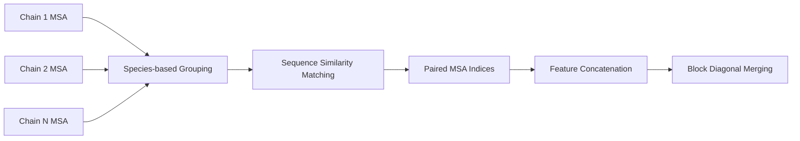

Multimer protein structure prediction extends OpenFold's capabilities to predict the 3D structures of protein complexes containing multiple chains. This specialized architecture handles the increased complexity of inter-chain interactions, symmetry considerations, and paired multiple sequence alignments that are essential for accurate multi-chain protein modeling.

## Architecture Overview

The multimer system builds upon OpenFold's core AlphaFold 2 implementation with specialized components designed for multi-chain processing. The architecture follows a sophisticated pipeline that transforms individual chain data into paired features suitable for joint structure prediction.



### Core Architecture Components

The multimer architecture introduces several specialized modules that work in concert to handle multi-chain complexity:

**Multimer Configuration System** ([config.py#L743-L924](openfold/config.py#L743-L924))
- Sets `is_multimer: True` flag to enable multimer-specific behavior
- Defines specialized feature shapes for multimer data including `asym_id`, `entity_id`, `sym_id`
- Configures MSA processing with `max_msa_clusters: 508` and `max_extra_msa: 2048`
- Enables chain-relative embeddings with `max_relative_chain: 2` and `use_chain_relative: True`

**Feature Processing Pipeline** ([feature_processing_multimer.py#L50-L90](openfold/data/feature_processing_multimer.py#L50-L90))
The core `pair_and_merge()` function orchestrates the multimer data pipeline:

```python
def pair_and_merge(all_chain_features):
    # Process unmerged features per chain
    process_unmerged_features(all_chain_features)
    
    # Determine if MSA pairing is needed
    pair_msa_sequences = not _is_homomer_or_monomer(np_chains_list)
    
    if pair_msa_sequences:
        # Create paired MSA features across chains
        np_chains_list = msa_pairing.create_paired_features(chains=np_chains_list)
        # Remove duplicate unpaired sequences
        np_chains_list = msa_pairing.deduplicate_unpaired_sequences(np_chains_list)
    
    # Apply cropping with multimer-specific parameters
    np_chains_list = crop_chains(np_chains_list, msa_crop_size=2048, ...)
    
    # Merge all chain features into single example
    np_example = msa_pairing.merge_chain_features(...)
    
    # Apply final processing steps
    return process_final(np_example)
```

## MSA Pairing and Chain Integration

### MSA Pairing Logic

The multimer system's most critical innovation is its sophisticated MSA pairing mechanism ([msa_pairing.py#L56-L90](openfold/data/msa_pairing.py#L56-L90)), which creates biologically meaningful connections between sequences across different chains:



The pairing process follows these key steps:

1. **Species-based Organization**: Groups MSA sequences by species identifiers to enable biologically relevant pairing
2. **Sequence Similarity Matching**: Uses configurable cutoffs (`SEQUENCE_SIMILARITY_CUTOFF = 0.9`) to identify evolutionarily related sequences across chains
3. **Index-based Pairing**: Creates mapping dictionaries that specify which sequences should be paired across chains
4. **Feature Concatenation**: Merges paired features while maintaining unpaired sequences in block-diagonal format

### Feature Merging Strategy

The `merge_chain_features()` function ([msa_pairing.py#L432-L461](openfold/data/msa_pairing.py#L432-L461)) implements a sophisticated merging strategy:

- **Paired Features**: Sequences identified as evolutionarily related across chains are concatenated horizontally
- **Unpaired Features**: Sequences unique to individual chains are arranged in block-diagonal format
- **Template Integration**: Handles template features with specialized padding for multi-chain scenarios
- **Feature Correction**: Post-merge processing ensures consistency in residue indexing and chain identifiers

## Multimer-Specific Data Transformations

### Interface-Aware Cropping

The multimer system implements intelligent cropping strategies that preserve biologically important inter-chain interactions ([data_transforms_multimer.py#L320-L428](openfold/data/data_transforms_multimer.py#L320-L428)):

**Spatial Cropping**: Focuses on interface regions between chains
- Identifies interface residues using distance thresholds (`interface_threshold`)
- Preserves spatial proximity between interacting chains
- Randomly selects crop centers around interface regions

**Contiguous Cropping**: Maintains sequence continuity within chains
- Preserves local structural contexts
- Applies within individual chain boundaries
- Uses configurable `crop_size` parameter (default: 640 for training)

```python
def get_interface_residues(positions, atom_mask, asym_id, interface_threshold):
    """Identify residues involved in inter-chain interfaces"""
    
def get_spatial_crop_idx(protein, crop_size, interface_threshold, generator):
    """Generate cropping indices focused on interface regions"""
```

### Multimer Feature Engineering

The system includes specialized feature transformations for multi-chain contexts:

- **Entity and Symmetry Features**: `entity_id`, `sym_id`, `asym_id` for tracking chain relationships
- **Interface Detection**: Binary masks identifying inter-chain contact regions
- **Chain Relative Embeddings**: Relative positional encodings between chains
- **Multi-chain Template Features**: Enhanced template processing for complex structures

## All-Atom Operations for Multimer Structures

### Coordinate System Conversions

The `all_atom_multimer.py` module ([all_atom_multimer.py#L35-L58](openfold/utils/all_atom_multimer.py#L35-L58)) provides specialized coordinate transformations for multi-chain structures:

```python
def atom14_to_atom37(atom14_data: torch.Tensor, aatype: torch.Tensor):
    """Convert atom14 to atom37 representation for multimer structures"""
    
def atom37_to_atom14(aatype, all_atom_pos, all_atom_mask):
    """Convert Atom37 positions to Atom14 positions with chain awareness"""
```

### Frame and Rigid Body Transformations

Multimer structures require sophisticated frame transformations:

- **Per-Chain Frames**: Individual coordinate systems for each chain
- **Global Frame Integration**: Combines chain-local frames into global coordinate system
- **Interface Frame Alignment**: Ensures proper geometric relationships at chain interfaces
- **Torsion Angle Processing**: Handles backbone and side-chain dihedral angles across chain boundaries

## Configuration and Model Parameters

### Multimer Configuration Profile

The multimer mode uses a specialized configuration that differs significantly from monomer mode:

| **Parameter Category** | **Monomer Setting** | **Multimer Setting** | **Purpose** |
|------------------------|---------------------|----------------------|-------------|
| **MSA Clusters** | 512 | 508 | Optimized for multi-chain MSA depth |
| **Extra MSA** | 1024 | 2048 | Increased capacity for evolutionary information |
| **Crop Size** | 384 | 640 | Larger crops to capture interface regions |
| **Spatial Crop Prob** | 0.0 | 0.5 | 50% chance of interface-focused cropping |
| **Interface Threshold** | N/A | 10.0 | Distance threshold for interface detection |
| **Chain Relative** | False | True | Enable chain-aware positional encoding |

### Loss Function Adaptations

The multimer system includes specialized loss components ([config.py#L870-L923](openfold/config.py#L870-L923)):

```python
"loss": {
    "fape": {
        "intra_chain_backbone": {"weight": 0.5},
        "interface_backbone": {"weight": 0.5, "clamp_distance": 30.0}
    },
    "tm": {
        "ptm_weight": 0.2,      # Per-chain TM score
        "iptm_weight": 0.8,     # Interface TM score
        "enabled": True
    },
    "chain_center_of_mass": {
        "weight": 0.05,
        "enabled": True
    }
}
```

## Database and Template Requirements

### Specialized Database Setup

Multimer inference requires updated databases specifically designed for multi-chain protein prediction:

| **Database** | **Purpose** | **Download Command** |
|--------------|-------------|----------------------|
| **UniProt** | Comprehensive protein sequences | `bash scripts/download_uniprot.sh data/` |
| **PDB SeqRes** | Template sequence database | `bash scripts/download_pdb_seqres.sh data/` |
| **PDB MMCIF** | Template coordinate database | `bash scripts/download_pdb_mmcif.sh data/` |
| **UniRef30** | Upgraded MSA database | `bash scripts/download_uniref30.sh data/` |
| **MGnify** | Enhanced metagenomic sequences | `bash scripts/download_mgnify.sh data/` |

### Template Search Modifications

The multimer pipeline uses different template search strategies compared to monomer mode:

- **Search Tool**: HMMSearch (replaces HHSearch)
- **Database**: PDB SeqRes (replaces PDB70)
- **Reason**: Better handling of multi-chain template structures and more comprehensive sequence coverage

## Running Multimer Inference

### Command Line Interface

Execute multimer inference using the specialized configuration preset:

```bash
python3 run_pretrained_openfold.py \
    fasta_dir \
    data/pdb_mmcif/mmcif_files/ \
    --uniref90_database_path data/uniref90/uniref90.fasta \
    --mgnify_database_path data/mgnify/mgy_clusters_2022_05.fa \
    --pdb_seqres_database_path data/pdb_seqres/pdb_seqres.txt \
    --uniref30_database_path data/uniref30/UniRef30_2021_03 \
    --uniprot_database_path data/uniprot/uniprot.fasta \
    --config_preset "model_1_multimer_v3" \
    --model_device "cuda:0" \
    --output_dir ./
```

### Key Differences from Monomer Mode

1. **Configuration Preset**: Uses `model_1_multimer_v3` instead of monomer presets
2. **Database Requirements**: Requires UniProt and PDB SeqRes databases
3. **Template Search**: Uses HMMSearch with PDB SeqRes instead of HHSearch with PDB70
4. **Parameter Weights**: Only AlphaFold Multimer v2.3 parameters are supported
5. **Memory Requirements**: Higher memory usage due to increased MSA depth and interface processing

## Performance Considerations

### Memory Optimization

The multimer system implements several memory optimization strategies:

- **MSA Cropping**: Reduces MSA depth from 2048 to manageable sizes
- **Interface-focused Processing**: Concentrates computational resources on biologically relevant regions
- **Chunked Processing**: Supports memory-efficient processing of large complexes

### Computational Complexity

| **Component** | **Monomer Complexity** | **Multimer Complexity** | **Scaling Factor** |
|---------------|----------------------|-------------------------|-------------------|
| **MSA Processing** | O(N×L) | O(N×L×C) | C (number of chains) |
| **Template Search** | O(T) | O(T×C²) | C² (chain pairs) |
| **Structure Module** | O(L²) | O((L×C)²) | C² (inter-chain interactions) |
| **Memory Usage** | Baseline | 2-4× baseline | Interface processing |

> [!TIP]
> The multimer system's MSA pairing algorithm is computationally intensive but essential for accurate prediction. The 508 MSA cluster limit represents a careful balance between evolutionary information capture and computational feasibility.

## Integration with Core OpenFold Architecture

The multimer system seamlessly integrates with OpenFold's core components while extending them for multi-chain scenarios:

- **Evoformer**: Handles paired MSA features with enhanced attention mechanisms
- **Structure Module**: Processes inter-chain distances and angles with specialized constraints
- **Template Module**: Integrates multi-chain template information with chain-aware processing
- **Loss Functions**: Combine intra-chain and inter-chain quality metrics

For detailed information about the core AlphaFold 2 implementation, see [AlphaFold 2 Model Implementation](9-alphafold-2-model-implementation). For memory optimization techniques that apply to multimer scenarios, refer to [Memory Optimization Techniques](11-memory-optimization-techniques).

## Next Steps

After mastering multimer protein structure prediction, consider exploring:

- [Long Sequence Inference](19-long-sequence-inference) for handling very large protein complexes
- [Single Sequence Mode and Embeddings](20-single-sequence-mode-and-embeddings) for alternative input strategies
- [Training Pipeline and Configuration](15-training-pipeline-and-configuration) for custom multimer model training