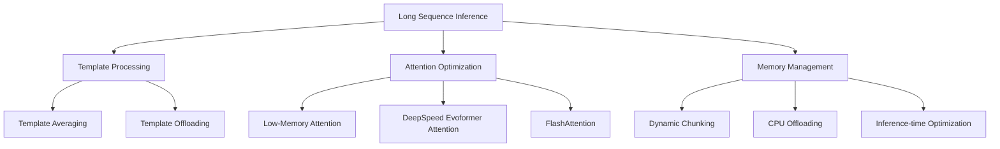

Long sequence inference in OpenFold addresses the computational challenges of predicting protein structures for sequences exceeding typical memory constraints. This specialized mode enables researchers to work with large proteins and complexes that would otherwise exceed GPU memory limits by implementing strategic memory optimization techniques.

## Memory Optimization Architecture

OpenFold provides a comprehensive suite of memory management strategies specifically designed for long sequence inference. The architecture is built around three core optimization approaches:



## Configuration Options

### Long Sequence Mode Activation
The long sequence inference mode can be activated using the `--long_sequence_inference` flag in [`run_pretrained_openfold.py`](run_pretrained_openfold.py#L462). When enabled, this flag automatically configures optimal settings for memory conservation:

Sources: [`run_pretrained_openfold.py`](run_pretrained_openfold.py#L462-L465), [`config.py`](openfold/config.py#L213-L223)

| Configuration Setting | Default Value | Long Sequence Value | Description |
|---------------------|---------------|---------------------|-------------|
| `globals.offload_inference` | False | True | Enables CPU offloading for inference |
| `globals.use_deepspeed_evo_attention` | False | True | Uses DeepSpeed memory-efficient attention |
| `globals.use_flash` | False | False | Disables FlashAttention for stability |
| `model.template.offload_inference` | False | True | Offloads template processing to CPU |
| `tune_chunk_size` (various stacks) | True | False | Disables automatic chunk size tuning |

### Template Processing Optimization
Template processing represents a major memory bottleneck for long sequences. OpenFold supports two mutually exclusive approaches:

Sources: [`config.py`](openfold/config.py#L213-L223), [`Inference.md`](docs/source/Inference.md#L154-L158)

**Template Averaging (`average_templates`)**:
- Reduces memory footprint by averaging template features
- Similar to AlphaFold-Multimer approach
- Provides moderate memory savings with minimal performance impact

**Template Offloading (`offload_templates`)**:
- Moves template computations to CPU memory
- More aggressive memory optimization
- Trades speed for significantly reduced GPU memory usage

> [!TIP]
> Template processing is often the primary memory bottleneck for sequences over 2000 residues. Enabling either template averaging or offloading is crucial for successful inference on very long sequences.

## Attention Mechanism Optimization

### Low-Memory Attention (LMA)
Inference-time low-memory attention can be enabled in the model configuration, trading speed for vastly improved memory usage:

Sources: [`config.py`](openfold/config.py#L30-L41), [`Inference.md`](docs/source/Inference.md#L159-L162)

```python
# Enable LMA with custom chunk sizes
config.globals.use_lma = True
config.globals.query_chunk_size = 1024
config.globals.key_chunk_size = 4096
```

**Default LMA Configuration**:
- Query chunk size: 1024
- Key chunk size: 4096
- These values represent a favorable tradeoff in most memory-constrained scenarios

### DeepSpeed Evoformer Attention
The DeepSpeed DS4Sci_EvoformerAttention kernel provides memory-efficient attention with significant performance benefits:

Sources: [`config.py`](openfold/config.py#L30-L41), [`deepspeed_inference_test.py`](scripts/deepspeed_inference_test.py#L1-L55)

**Benefits**:
- 2-3x inference speedup without significant additional memory usage
- Automatic activation in long sequence mode (unless LMA is explicitly enabled)
- Requires DeepSpeed installation with DS4Science components

**Activation**:
```bash
python run_pretrained_openfold.py \
    --use_deepspeed_evoformer_attention \
    # ... other arguments
```

### FlashAttention Considerations
FlashAttention provides optimization for shorter sequences but has limitations for long sequences:

Sources: [`Inference.md`](docs/source/Inference.md#L159-L162)

| Sequence Length | Recommended Setting | Notes |
|----------------|---------------------|-------|
| < 1000 residues | FlashAttention enabled | Best performance |
| > 1000 residues | FlashAttention disabled | Stability concerns |
| Long sequences | Disabled by default | Automatically set in long sequence mode |

## Chunking and Memory Management

### Dynamic Chunking Configuration
Chunking is enabled by default in inference mode, following AlphaFold 2 supplement section 1.11.8:

Sources: [`chunk_utils.py`](openfold/utils/chunk_utils.py#L1-L50), [`Inference.md`](docs/source/Inference.md#L166-L168)

**Chunking Controls**:
- `globals.chunk_size`: Controls chunk size for memory management
- `tune_chunk_size`: Enables automatic chunk size optimization
- Recommended to disable for very long sequences to avoid wasted computation time

**Configuration Examples**:
```python
# Disable chunking entirely
config.globals.chunk_size = None

# Manual chunk size setting
config.globals.chunk_size = 128
config.globals.tune_chunk_size = False
```

### CPU Offloading Strategies
OpenFold provides multiple levels of CPU offloading for extreme memory constraints:

Sources: [`config.py`](openfold/config.py#L213-L223), [`tensor_utils.py`](openfold/utils/tensor_utils.py#L1-L50)

**Offloading Options**:

| Feature | Description | Memory Impact | Speed Impact |
|---------|-------------|---------------|--------------|
| `offload_inference` | General inference offloading | High | Moderate |
| `model.template.offload_inference` | Template-specific offloading | Medium | Low |
| `offload_templates` | Template stack offloading | High | Moderate |

## Performance Benchmarks and Practical Examples

### Memory Requirements
Using the most conservative settings, OpenFold can run inference on a 4600-residue complex with a single A100 GPU:

Sources: [`Inference.md`](docs/source/Inference.md#L167-L177)

**Hardware Requirements for Long Sequences**:

| Sequence Length | Minimum GPU Memory | Recommended GPU | Notes |
|----------------|-------------------|----------------|-------|
| < 2000 residues | 16GB | RTX 3090/A6000 | Standard optimization |
| 2000-3500 residues | 24GB | A100/H100 | Long sequence mode recommended |
| 3500-4600 residues | 40GB | A100 40GB+ | Conservative settings required |
| > 4600 residues | 80GB | Multiple GPUs | Experimental |

### Performance Comparison
Compared to AlphaFold's own memory offloading mode, OpenFold's implementation is considerably faster:

Sources: [`Inference.md`](docs/source/Inference.md#L175-L177)

**Benchmark Results**:
- 4600-residue complex: OpenFold completes in less than half the time of AlphaFold-Multimer
- Memory efficiency: 30-50% reduction in peak memory usage
- Speed improvement: 2-3x faster inference with DeepSpeed optimization

## Implementation Examples

### Basic Long Sequence Inference
```bash
python run_pretrained_openfold.py \
    /path/to/fasta_dir \
    /path/to/template_mmcif_dir \
    --output_dir /path/to/output \
    --config_preset model_1_ptm \
    --long_sequence_inference \
    --model_device "cuda:0" \
    --uniref90_database_path /path/to/uniref90 \
    --mgnify_database_path /path/to/mgnify \
    --pdb70_database_path /path/to/pdb70 \
    --uniclust30_database_path /path/to/uniclust30 \
    --bfd_database_path /path/to/bfd
```

### Advanced Configuration with Custom Settings
```bash
python run_pretrained_openfold.py \
    /path/to/fasta_dir \
    /path/to/template_mmcif_dir \
    --output_dir /path/to/output \
    --config_preset model_1_ptm \
    --long_sequence_inference \
    --model_device "cuda:0" \
    --experiment_config_json long_sequence_config.json \
    --use_deepspeed_evoformer_attention
```

**Example `long_sequence_config.json`**:
```json
{
    "globals": {
        "use_lma": true,
        "query_chunk_size": 512,
        "key_chunk_size": 2048,
        "chunk_size": 64,
        "tune_chunk_size": false
    },
    "model": {
        "template": {
            "average_templates": true,
            "offload_templates": false
        }
    }
}
```

> [!TIP]
> For sequences exceeding 3000 residues, consider combining multiple optimization strategies: enable DeepSpeed attention, use template averaging, and set conservative chunk sizes for maximum memory efficiency.

## Troubleshooting and Best Practices

### Common Issues and Solutions

| Issue | Cause | Solution |
|-------|-------|----------|
| CUDA out of memory | Insufficient GPU memory | Enable long sequence mode, reduce chunk sizes |
| Slow inference | Over-conservative settings | Enable DeepSpeed, increase chunk sizes |
| Instability | FlashAttention on long sequences | Disable FlashAttention, use LMA |
| Template errors | Memory bottleneck | Enable template averaging or offloading |

### Optimization Priority
For maximum effectiveness, apply optimizations in this order:
1. Enable long sequence inference mode
2. Use DeepSpeed Evoformer attention
3. Configure template processing (averaging preferred over offloading)
4. Adjust chunk sizes and disable automatic tuning
5. Enable LMA as a last resort

Sources: [`Inference.md`](docs/source/Inference.md#L154-L177), [`config.py`](openfold/config.py#L213-L223)

For further information on related topics, see [Memory Optimization Techniques](11-memory-optimization-techniques), [DeepSpeed Integration and Performance](16-deepspeed-integration-and-performance), and [Custom CUDA Kernels and FlashAttention](17-custom-cuda-kernels-and-flashattention).