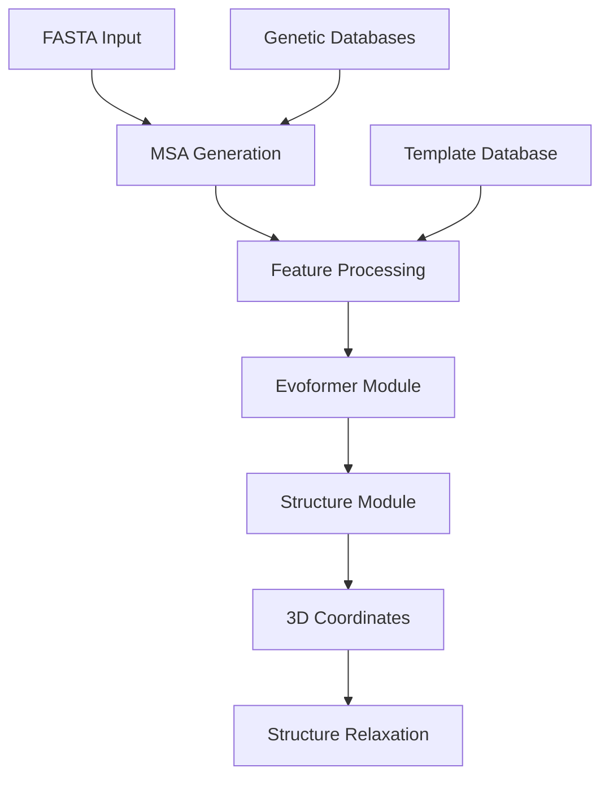

OpenFold is a faithful but trainable PyTorch reproduction of DeepMind's AlphaFold 2, enabling protein structure prediction with state-of-the-art accuracy. This guide provides the fastest path to running your first protein structure prediction using OpenFold's pretrained models.

## Architecture Overview
OpenFold follows the same architectural principles as AlphaFold 2, implementing the complete pipeline from sequence input to 3D structure output:



The system processes protein sequences through multiple sequence alignment (MSA) generation, feature extraction, and neural network inference to produce accurate 3D structural predictions.

## Prerequisites
Before getting started, ensure your system meets these requirements:

| Component | Requirement | Notes |
|-----------|-------------|-------|
| Operating System | Linux | Only Linux systems are supported |
| CUDA | Version 12 | Required for GPU acceleration |
| Python | 3.10 | Specified in environment configuration |
| GPU | NVIDIA Ampere or newer | Recommended for optimal performance |
| RAM | 32GB+ | Depends on protein sequence length |

## Installation Steps
Follow these steps to set up OpenFold in your environment:

### 1. Clone the Repository
```bash
git clone https://github.com/aqlaboratory/openfold.git
cd openfold
```

### 2. Create Conda Environment
Using Mamba (recommended for faster dependency resolution):
```bash
mamba env create -n openfold_env -f environment.yml
conda activate openfold_env
```

### 3. Install Third-Party Dependencies
```bash
scripts/install_third_party_dependencies.sh
```

### 4. Set Environment Variables
```bash
export LIBRARY_PATH=$CONDA_PREFIX/lib:$LIBRARY_PATH
export LD_LIBRARY_PATH=$CONDA_PREFIX/lib:$LD_LIBRARY_PATH
```

### 5. Download Model Parameters
Choose one of the following options:

**AlphaFold 2 parameters (DeepMind):**
```bash
./scripts/download_alphafold_params.sh openfold/resources
```

**OpenFold trained parameters:**
```bash
./scripts/download_openfold_params.sh openfold/resources
```

**OpenFold SoloSeq parameters:**
```bash
./scripts/download_openfold_soloseq_params.sh openfold/resources
```

> [!TIP]
> The default parameter directory `openfold/resources` is used by the inference scripts. If you choose a different location, use the `--jax_param_path` or `--openfold_checkpoint_path` arguments to specify the alternate path.

## Running Your First Prediction
OpenFold provides a complete example workflow in the `examples/monomer/` directory. Let's walk through running a prediction on the sample protein.

### Project Structure
```
examples/monomer/
├── alignments/           # Pre-computed MSAs
├── fasta_dir/           # Input sequences
├── inference.sh         # Example inference script
└── sample_predictions/  # Output structures
```

### Sample Input
The example includes a FASTA file for protein 6KWC ([examples/monomer/fasta_dir/6kwc.fasta](examples/monomer/fasta_dir/6kwc.fasta)):
```fasta
>6KWC_1
GSTIQPGTGYNNGYFYSYWNDGHGGVTYTNGPGGQFSVNWSNSGEFVGGKGWQPGTKNKVINFSGSYNPNGNSYLSVYGWSRNPLIEYYIVENFGTYNPSTGATKLGEVTSDGSVYDIYRTQRVNQPSIIGTATFYQYWSVRRNHRSSGSVNTANHFNAWAQQGLTLGTMDYQIVAVQGYFSSGSASITVS
```

### Running Inference
Execute the example inference script:

```bash
cd examples/monomer
./inference.sh
```

This script runs the following command:
```bash
python3 ../../run_pretrained_openfold.py ./fasta_dir \
  /mmcifs \
  --output_dir ./ \
  --config_preset model_1_ptm \
  --model_device "cuda:0" \
  --data_random_seed 42 \
  --use_precomputed_alignments ./alignments
```

### Understanding the Command
| Parameter | Value | Description |
|-----------|-------|-------------|
| `fasta_dir` | `./fasta_dir` | Directory containing input FASTA files |
| `mmcifs` | `/mmcifs` | Path to PDB mmCIF files for templates |
| `--output_dir` | `./` | Output directory for predictions |
| `--config_preset` | `model_1_ptm` | Model configuration (PTM = pTM + pLDDT) |
| `--model_device` | `"cuda:0"` | GPU device for inference |
| `--use_precomputed_alignments` | `./alignments` | Directory with pre-computed MSAs |

### Expected Output
The script generates two files in the `sample_predictions/` directory:

| File | Description |
|------|-------------|
| `6KWC_1_model_1_ptm_unrelaxed.pdb` | Raw predicted structure |
| `6KWC_1_model_1_ptm_relaxed.pdb` | Structure after Amber relaxation |

## Working with Your Own Sequences
To predict structures for your own proteins:

### 1. Prepare Input FASTA
Create a directory with your FASTA files:
```bash
mkdir my_proteins
echo ">MY_PROTEIN_1" > my_proteins/sequence.fasta
echo "MVLSEGEWQLVLHVWAKVEADVAGHGQDILIRLFKSHPETLEKFDRVKHLKTEAEMKASEDLKKHGVTVLTALGAILKKKGHHEAELKPLAQSHATKHKIPIKYLEFISEAIIHVLHSRHPGDFGADAQGAMNKALELFRKDIAAKYKELGYQG" >> my_proteins/sequence.fasta
```

### 2. Generate Alignments
Download and prepare genetic databases:
```bash
# Download AlphaFold databases
./scripts/download_alphafold_dbs.sh /path/to/databases

# Pre-compute alignments for your sequences
python3 scripts/precompute_alignments.py \
  --fasta_dir my_proteins \
  --output_dir my_alignments \
  --max_template_date 2023-01-01 \
  --database_dir /path/to/databases
```

### 3. Run Prediction
```bash
python3 run_pretrained_openfold.py my_proteins \
  /path/to/mmcifs \
  --output_dir my_results \
  --config_preset model_1_ptm \
  --model_device "cuda:0" \
  --use_precomputed_alignments my_alignments
```

## Available Model Presets
OpenFold offers several model configurations optimized for different use cases:

| Preset | Description | Use Case |
|--------|-------------|----------|
| `model_1` | Basic model | Standard monomer prediction |
| `model_1_ptm` | With pTM and pLDDT heads | Confidence score prediction |
| `model_2` | Larger model | Higher accuracy, more compute |
| `model_3` | Largest model | Best accuracy, most compute |
| `model_1_multimer` | Multimer-capable | Protein complex prediction |

## Next Steps
After successfully running your first prediction, explore these advanced topics:

- **[System Requirements and Dependencies](3-system-requirements-and-dependencies)**: Detailed hardware and software requirements for production use
- **[Database Setup and Configuration](4-database-setup-and-configuration)**: Complete guide to setting up genetic databases for MSA generation
- **[Running Inference with Pretrained Models](5-running-inference-with-pretrained-models)**: Advanced inference options and batch processing

> [!TIP]
> For production deployments, consider using the single sequence mode (`--use_single_seq_mode`) which uses pre-computed embeddings instead of MSA generation, significantly reducing runtime while maintaining reasonable accuracy for many proteins.

## Troubleshooting Common Issues

| Issue | Solution | Reference |
|-------|----------|-----------|
| CUDA out of memory | Use smaller model preset or reduce batch size | [Memory Optimization Techniques](11-memory-optimization-techniques) |
| Database download fails | Check internet connection and disk space | [Database Setup and Configuration](4-database-setup-and-configuration) |
| Import errors | Verify conda environment activation and LD_LIBRARY_PATH | [Installation](3-system-requirements-and-dependencies) |
| Slow inference | Enable GPU acceleration and use Flash Attention | [DeepSpeed Integration](16-deepspeed-integration-and-performance) |

