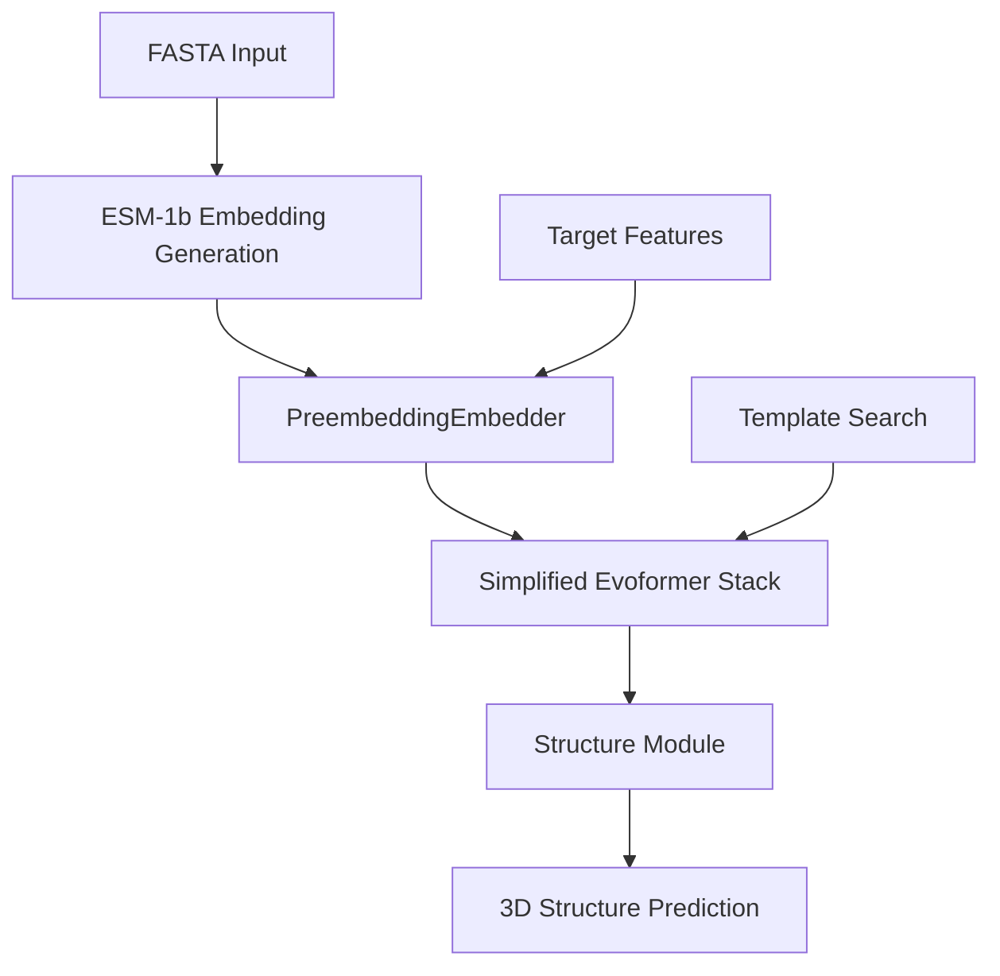
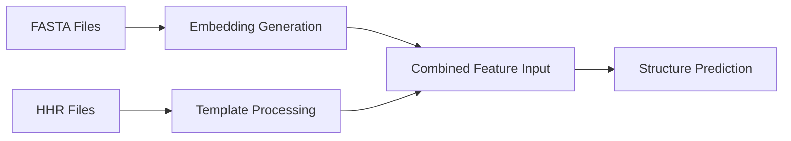

OpenFold's Single Sequence Mode represents a paradigm shift from traditional MSA-dependent protein structure prediction by leveraging precomputed protein language model embeddings. This approach eliminates the need for Multiple Sequence Alignment (MSA) generation, dramatically reducing computational overhead while maintaining competitive accuracy for many protein families.

## Architecture Overview

The Single Sequence Mode architecture utilizes a streamlined pipeline that replaces traditional MSA processing with ESM-1b embeddings. This fundamental change enables faster inference and reduces dependency on large sequence databases.



## Core Components

### PreembeddingEmbedder

The `PreembeddingEmbedder` ([embedders.py#L312-L405](openfold/model/embedders.py#L312-L405)) serves as the primary interface for sequence embeddings in single sequence mode. This specialized embedder processes ESM-1b embeddings alongside target features:

```python
class PreembeddingEmbedder(nn.Module):
    def __init__(
        self,
        tf_dim: int,              # Target features dimension
        preembedding_dim: int,   # ESM-1b embedding dimension (1280)
        c_z: int,                # Pair embedding dimension
        c_m: int,                # Single-sequence embedding dimension
        relpos_k: int,           # Relative position encoding window
    ):
```

The embedder performs three key transformations:
1. **Linear projection** of target features and pre-embeddings to match model dimensions
2. **Relative positional encoding** using residue index information
3. **Pair embedding construction** combining sequence information with spatial relationships

### Model Configuration

Single sequence mode is activated through specialized configuration presets. The `seq_mode_config` ([config.py#L924-L957](openfold/config.py#L924-L957)) defines the operational parameters:

```python
seq_mode_config = mlc.ConfigDict({
    "data": {
        "seqemb_mode": {
            "enabled": True,  # Enable sequence embedding mode
        },
    },
    "globals": {
        "seqemb_mode_enabled": True,
    },
    "model": {
        "preembedding_embedder": {
            "tf_dim": 22,
            "preembedding_dim": 1280,  # ESM-1b dimension
            "c_z": 128,
            "c_m": 256,
            "relpos_k": 32,
        },
        "extra_msa": {
            "enabled": False  # Disable Extra MSA Stack
        },
        "evoformer_stack": {
            "no_column_attention": True  # Disable column attention
        },
    }
})
```

> [!TIP]
> The configuration disables MSA-specific components (Extra MSA Stack, column attention) to optimize the architecture for single-sequence processing while maintaining the core Evoformer structure.

## Embedding Generation Pipeline

### Precompute Embeddings

OpenFold provides a dedicated script for bulk ESM-1b embedding generation:

```bash
python scripts/precompute_embeddings.py fasta_dir/ embeddings_output_dir/
```

The `EmbeddingGenerator` class ([precompute_embeddings.py#L62-L150](scripts/precompute_embeddings.py#L62-L150)) handles the embedding process:

1. **Sequence Loading**: Parses FASTA files and creates batched datasets
2. **ESM-1b Model Loading**: Downloads and initializes the ESM-1b model
3. **Batch Processing**: Generates embeddings with configurable token batch sizes
4. **Output Management**: Saves embeddings as `.pt` files in structured directories

### Runtime Embedding Generation

Alternatively, embeddings can be generated during inference without precomputation:

```bash
python run_pretrained_openfold.py \
    fasta_dir \
    data/pdb_mmcif/mmcif_files/ \
    --config_preset "seq_model_esm1b_ptm" \
    --openfold_checkpoint_path openfold/resources/openfold_soloseq_params/seq_model_esm1b_ptm.pt
```

The main inference script ([run_pretrained_openfold.py#L175-L250](run_pretrained_openfold.py#L175-L250)) automatically detects sequence mode based on configuration presets:

```python
if args.config_preset.startswith("seq"):
    args.use_single_seq_mode = True
```

## Integration with Main Model

The `AlphaFold` model ([model.py#L1-L100](openfold/model/model.py#L1-L100)) dynamically selects the appropriate embedder based on mode:

```python
if self.seqemb_mode:
    # Use PreembeddingEmbedder for single sequence mode
    self.input_embedder = PreembeddingEmbedder(
        **self.config["preembedding_embedder"],
    )
else:
    # Use traditional InputEmbedder for MSA mode
    self.input_embedder = InputEmbedder(
        **self.config["input_embedder"],
    )
```

## Performance Characteristics

### Memory and Computational Efficiency

| Feature | Traditional MSA Mode | Single Sequence Mode |
|---------|---------------------|---------------------|
| **Database Requirements** | Large (UniRef90, MGnify, etc.) | None (except optional templates) |
| **Preprocessing Time** | Hours to days | Minutes to hours |
| **GPU Memory Usage** | High (MSA tensors) | Moderate (single embeddings) |
| **Inference Speed** | Slower (MSA processing) | Faster (direct embedding use) |

### Sequence Limitations

> [!TIP]
> The ESM-1b model imposes a maximum sequence length of 1022 residues. Sequences exceeding this limit are automatically truncated, making the approach unsuitable for very large proteins without segmentation strategies.

## Usage Patterns

### Template Integration

Single sequence mode supports template information integration through `.hhr` files placed in the embedding output directories. This enables hybrid approaches combining language model embeddings with structural templates:



### Configuration Presets

OpenFold provides specialized presets for single sequence mode:

- `seq_model_esm1b_ptm`: Uses ESM-1b embeddings with pTM head for confidence estimation
- `seq_model_esm1b`: Basic ESM-1b model without pTM confidence scores

## Next Steps

For comprehensive understanding of the embedding ecosystem, explore [Feature Extraction and Processing](12-feature-extraction-and-processing). To understand how single sequence mode compares with traditional approaches, see [Multiple Sequence Alignment (MSA) Handling](13-multiple-sequence-alignment-msa-handling). For practical implementation details, refer to [Running Inference with Pretrained Models](5-running-inference-with-pretrained-models).