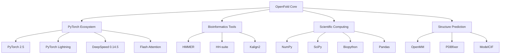

OpenFold is a computationally intensive protein structure prediction framework that requires specific hardware and software configurations. This page outlines the essential system requirements, dependencies, and setup considerations for successful installation and operation.

## Hardware Requirements

### GPU Requirements
OpenFold requires NVIDIA GPUs with CUDA support for optimal performance. The framework is designed to leverage GPU acceleration through CUDA kernels and custom implementations.

**Supported GPU Compute Capabilities:**
- **Compute Capability 5.2**: Titan X and older generation GPUs
- **Compute Capability 6.1**: GeForce 1000-series GPUs
- **Compute Capability 7.0**: Modern GPUs (default target)
- **Compute Capability 8.0**: Ampere architecture (CUDA 11+)
- **Compute Capability 9.0**: Hopper architecture

> [!TIP]
> The setup automatically detects your GPU's compute capability and compiles CUDA kernels accordingly. If you encounter compilation issues, ensure your GPU supports at least Compute Capability 5.2.

### Memory Requirements
- **GPU Memory**: Minimum 16GB VRAM recommended for standard protein inference
- **System RAM**: 32GB+ recommended for database operations and large protein sequences
- **Storage**: 100GB+ free space for databases, models, and temporary files

## Software Requirements

### Operating System
**Linux Only**: OpenFold is currently supported exclusively on Linux systems. The framework has been tested on:
- Ubuntu 20.04 LTS and 22.04 LTS
- CentOS/RHEL 8+
- Other Linux distributions with compatible toolchains

### Core Software Stack

| Component | Version | Purpose |
|-----------|---------|---------|
| **Python** | 3.10 | Core runtime environment |
| **CUDA** | 12.4 | GPU acceleration and compute |
| **GCC** | 12.4 | C++ compilation for CUDA extensions |
| **PyTorch** | 2.5 | Deep learning framework |
| **PyTorch CUDA** | 12.4 | PyTorch GPU acceleration |

Sources: [environment.yml](environment.yml#L1-L41), [setup.py](setup.py#L1-L137)

## Dependency Architecture

The OpenFold dependency stack is organized into several layers, each serving specific functions in the protein structure prediction pipeline:



Sources: [environment.yml](environment.yml#L15-L38), [setup.py](setup.py#L100-L137)

## Detailed Dependencies

### PyTorch Ecosystem
| Package | Version | Purpose |
|---------|---------|---------|
| PyTorch | 2.5 | Deep learning framework foundation |
| PyTorch Lightning | - | Training orchestration and scalability |
| DeepSpeed | 0.14.5 | Memory optimization and distributed training |
| Flash Attention | - | Optimized attention mechanisms |

### Bioinformatics Tools
| Tool | Purpose | Source |
|------|---------|--------|
| HMMER | Sequence homology searches | bioconda::hmmer |
| HH-suite | Remote homology detection | bioconda::hhsuite |
| Kalign2 | Multiple sequence alignment | bioconda::kalign2 |

### Scientific Computing Libraries
| Library | Purpose |
|---------|---------|
| NumPy | Numerical computing foundation |
| SciPy | Scientific algorithms |
| Biopython | Biological data manipulation |
| Pandas | Data processing and analysis |
| PyYAML | Configuration management |
| tqdm | Progress indicators |

### Structure Prediction Components
| Component | Purpose |
|-----------|---------|
| OpenMM | Molecular mechanics simulation |
| PDBfixer | PDB structure repair and preparation |
| ModelCIF | Structure format handling |

Sources: [environment.yml](environment.yml#L1-L41), [notebooks/environment.yml](notebooks/environment.yml#L1-L18)

## CUDA Extensions and Custom Kernels

OpenFold includes custom CUDA kernels for performance optimization:

### Custom CUDA Components
- **Attention Core**: Optimized softmax operations for attention mechanisms
- **Evoformer Kernels**: Specialized operations for evolutionary transformer layers
- **Memory Optimization**: Custom kernels to reduce memory footprint

### Compilation Requirements
The setup process compiles CUDA extensions with specific flags:
```bash
# CUDA compilation flags
extra_cuda_flags = [
    '-std=c++17',
    '-maxrregcount=50',
    '-U__CUDA_NO_HALF_OPERATORS__',
    '--expt-relaxed-constexpr',
    '--expt-extended-lambda'
]
```

Sources: [setup.py](setup.py#L20-L67)

## Environment Setup Options

### Option 1: Conda/Mamba Environment (Recommended)
```bash
# Create environment using Mamba (faster than conda)
mamba env create -n openfold_env -f environment.yml
conda activate openfold_env
```

### Option 2: Docker Container
The provided [Dockerfile](Dockerfile) creates a complete environment:
```dockerfile
FROM nvidia/cuda:12.1.1-cudnn8-devel-ubuntu22.04
# Includes all dependencies and OpenFold installation
```

### Option 3: Manual Installation
For advanced users who need custom configurations:
- Install CUDA 12.4 and cuDNN 8
- Set up Python 3.10 environment
- Install dependencies manually from environment.yml
- Compile CUDA extensions using setup.py

## Third-Party Dependencies Installation

The [`install_third_party_dependencies.sh`](scripts/install_third_party_dependencies.sh) script handles additional setup:

### Essential Components
1. **Folding Resources**: Stereo-chemical properties for structure validation
2. **CUTLASS**: NVIDIA template library for CUDA kernel development
3. **Test Data**: Sample features for validation

### Environment Configuration
```bash
# Set up environment variables
export LIBRARY_PATH=$CONDA_PREFIX/lib:$LIBRARY_PATH
export LD_LIBRARY_PATH=$CONDA_PREFIX/lib:$LD_LIBRARY_PATH
export CUTLASS_PATH=$PWD/cutlass
export KMP_AFFINITY=none
```

Sources: [scripts/install_third_party_dependencies.sh](scripts/install_third_party_dependencies.sh#L1-L25)

## Optional Dependencies

### MPI Support
For distributed computing across multiple nodes:
```bash
pip install mpi4py
```

### Development Dependencies
For documentation and testing:
- **Sphinx**: Documentation generation ([docs/environment.yml](docs/environment.yml))
- **Unit Testing Framework**: Built-in with Python unittest

### Database Tools
Various database download scripts are available in the `scripts/` directory:
- `download_alphafold_dbs.sh`
- `download_bfd.sh`
- `download_uniref90.sh`
- And many more specialized databases

## Common Setup Issues and Solutions

### CUDA Compatibility
**Issue**: CUDA version mismatch between PyTorch and system CUDA
**Solution**: Ensure CUDA 12.4 is installed and use PyTorch's CUDA 12.4 build

### Memory Issues
**Issue**: Insufficient GPU memory for large proteins
**Solution**: Use DeepSpeed optimization or reduce batch sizes

### Compilation Failures
**Issue**: CUDA kernel compilation errors
**Solution**: Verify GPU compute capability and CUDA toolkit installation

Sources: [docs/source/Installation.md](docs/source/Installation.md#L1-L69)

## Next Steps

After ensuring your system meets these requirements, proceed to [Database Setup and Configuration](4-database-setup-and-configuration) to prepare the biological databases needed for protein structure prediction. If you already have the required databases configured, you can skip directly to [Running Inference with Pretrained Models](5-running-inference-with-pretrained-models) for immediate usage.

For detailed installation instructions and troubleshooting, refer to the comprehensive [Installation guide](docs/source/Installation.md) in the documentation.