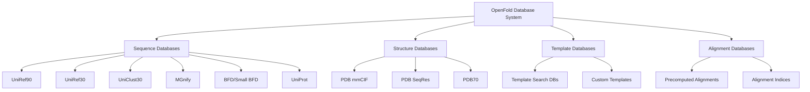
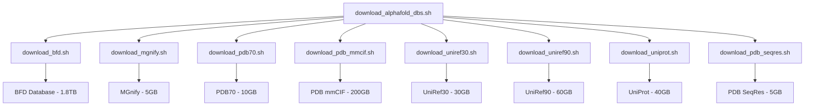

OpenFold requires multiple protein sequence and structure databases to function effectively for protein structure prediction. This guide provides a comprehensive overview of the database architecture, setup procedures, and configuration options for intermediate developers looking to deploy OpenFold in production or research environments.

## Database Architecture Overview

OpenFold utilizes a multi-layered database system designed to support different aspects of protein structure prediction, including sequence alignment, template searching, and feature generation. The architecture is designed to balance performance with storage requirements, offering both full and reduced database configurations.



## Core Database Components

### Sequence Databases

Sequence databases form the foundation for multiple sequence alignment (MSA) generation and evolutionary analysis. OpenFold supports several major sequence databases, each serving specific purposes in the prediction pipeline.

| Database | Size | Purpose | Download Mode |
|----------|------|---------|---------------|
| **UniRef90** | ~60GB | Comprehensive non-redundant sequence database | Full/Reduced |
| **UniRef30** | ~30GB | Clustered at 30% identity | Full/Reduced |
| **UniClust30** | ~20GB | Alternative clustering at 30% identity | Full/Reduced |
| **MGnify** | ~5GB | Metagenomic sequences | Full/Reduced |
| **BFD** | ~1.8TB | Big Fantastic Database (comprehensive) | Full only |
| **Small BFD** | ~100GB | Reduced version of BFD | Reduced only |
| **UniProt** | ~40GB | Reference proteome database | Full/Reduced |

> [!TIP]
> The choice between BFD and Small BFD represents the most significant storage and performance trade-off. Small BFD provides 95% of the coverage with 5% of the storage requirements.

### Structure Databases

Structure databases provide 3D coordinate information for template-based modeling and structural feature extraction.

| Database | Content | Size | Usage |
|----------|---------|------|-------|
| **PDB mmCIF** | Full PDB in mmCIF format | ~200GB | Template generation, feature extraction |
| **PDB SeqRes** | PDB sequences only | ~5GB | Sequence-based template search |
| **PDB70** | PDB clustered at 70% identity | ~10GB | Fast template searching |

## Database Setup Procedures

### Full Database Setup

For comprehensive protein structure prediction with maximum accuracy, use the full database configuration:

```bash
# Download all required databases
bash scripts/download_alphafold_dbs.sh /path/to/databases full_dbs
```

This command executes a coordinated download of all major databases through individual download scripts:



### Reduced Database Setup

For development, testing, or resource-constrained environments:

```bash
# Download reduced database set
bash scripts/download_alphafold_dbs.sh /path/to/databases reduced_dbs
```

This configuration replaces BFD with Small BFD and maintains core functionality while reducing storage requirements from ~2.2TB to ~400GB.

### MMseqs2 Database Setup

For MMseqs2-based alignment pipelines:

```bash
# Download MMseqs2 optimized databases
bash scripts/download_mmseqs_dbs.sh /path/to/databases
```

This setup includes:
- UniRef30 for sequence searches
- ColabFold's environmental database for enhanced coverage

## Database Configuration

### Path Configuration

Database paths must be configured in OpenFold's data pipeline. The `add_data_args` function in [`scripts/utils.py`](scripts/utils.py#L15-70) defines all required database paths:

```python
def add_data_args(parser: argparse.ArgumentParser):
    parser.add_argument('--uniref90_database_path', type=str, default=None)
    parser.add_argument('--mgnify_database_path', type=str, default=None)
    parser.add_argument('--pdb70_database_path', type=str, default=None)
    parser.add_argument('--pdb_seqres_database_path', type=str, default=None)
    parser.add_argument('--uniref30_database_path', type=str, default=None)
    parser.add_argument('--uniclust30_database_path', type=str, default=None)
    parser.add_argument('--uniprot_database_path', type=str, default=None)
    parser.add_argument('--bfd_database_path', type=str, default=None)
    # ... additional binary path configurations
```

### Binary Tool Configuration

OpenFold requires several external bioinformatics tools for database processing:

| Tool | Purpose | Configuration Parameter |
|------|---------|-------------------------|
| **jackhmmer** | Sequence homology search | `--jackhmmer_binary_path` |
| **hhblits** | Fast MSA generation | `--hhblits_binary_path` |
| **hhsearch** | Template searching | `--hhsearch_binary_path` |
| **hmmsearch** | Alternative template search | `--hmmsearch_binary_path` |
| **hmmbuild** | HMM construction | `--hmmbuild_binary_path` |
| **kalign** | Sequence alignment | `--kalign_binary_path` |

## Database Preprocessing

### mmCIF Cache Generation

Generate a searchable cache of PDB mmCIF files for efficient template retrieval:

```bash
python scripts/generate_mmcif_cache.py \
    /path/to/pdb_mmcif_dir \
    /path/to/output_cache.json \
    --no_workers 8 \
    --cluster_file /path/to/pdb_cluster_file
```

The [`generate_mmcif_cache.py`](scripts/generate_mmcif_cache.py#L1-108) script processes mmCIF files in parallel, extracting structural metadata and chain information for rapid template searching.

### Alignment Precomputation

Precompute alignments for protein sequences to accelerate inference:

```bash
python scripts/precompute_alignments.py \
    /path/to/input_sequences \
    /path/to/output_alignments \
    --uniref90_database_path /path/to/uniref90 \
    --mgnify_database_path /path/to/mgnify \
    --bfd_database_path /path/to/bfd \
    --pdb70_database_path /path/to/pdb70 \
    --cpus_per_task 16
```

The [`precompute_alignments.py`](scripts/precompute_alignments.py#L1-268) script supports multiple input formats (mmCIF, FASTA, ProteinNet) and creates alignment databases using the `AlignmentRunner` class.

### Alignment Database Creation

Create compact alignment databases for efficient storage and retrieval:

```bash
python scripts/alignment_db_scripts/create_alignment_db.py \
    /path/to/alignment_directory \
    /path/to/output_db_directory \
    alignment_db_name
```

The [`create_alignment_db.py`](scripts/alignment_db_scripts/create_alignment_db.py#L1-48) script consolidates alignment files into a single database file with a JSON index for rapid access.

## Advanced Configuration Options

### Database Sharding

For large-scale deployments, alignment databases can be sharded across multiple files:

```bash
python scripts/alignment_db_scripts/create_alignment_db_sharded.py \
    /path/to/alignment_directory \
    /path/to/output_db_directory \
    alignment_db_name \
    --num_shards 8
```

### Database Index Unification

Consolidate indices from multiple alignment databases:

```bash
python scripts/alignment_db_scripts/unify_alignment_db_indices.py \
    /path/to/db_directory \
    /path/to/unified_index.json
```

## Performance Optimization

### Storage Considerations

**Database Storage Requirements:**

| Configuration | Total Storage | SSD Recommended | HDD Acceptable |
|---------------|---------------|-----------------|----------------|
| **Full Setup** | ~2.2TB | Critical for performance | Suitable only for archives |
| **Reduced Setup** | ~400GB | Recommended | Acceptable for development |
| **MMseqs2 Setup** | ~100GB | Not required | Fully sufficient |

### Memory Configuration

**Recommended Memory Allocation:**

| Task | Minimum RAM | Recommended RAM | Notes |
|------|-------------|-----------------|-------|
| **Database Download** | 8GB | 16GB | Temporary usage |
| **Alignment Precomputation** | 32GB | 64GB | Scales with sequence count |
| **Template Search** | 16GB | 32GB | Depends on PDB size |
| **Full Pipeline** | 64GB | 128GB | For production workloads |

> [!TIP]
> Database preprocessing tasks benefit significantly from parallel processing. Use the `--no_workers` and `--cpus_per_task` parameters to optimize performance based on available CPU cores.

## Troubleshooting Database Issues

### Common Issues and Solutions

| Issue | Symptom | Solution |
|-------|---------|----------|
| **Missing aria2c** | Download scripts fail | Install aria2c: `sudo apt install aria2` |
| **Insufficient Space** | Download interrupts | Verify 2.2TB available for full setup |
| **Database Path Errors** | Pipeline fails to start | Verify all paths in `add_data_args` are correct |
| **Binary Path Issues** | Tool execution fails | Ensure conda environment is activated |
| **Permission Errors** | Cache generation fails | Check write permissions in output directories |

### Database Validation

Validate database installation:

```bash
# Check database files exist
ls -la /path/to/databases/

# Validate mmCIF cache
python -c "import json; json.load(open('/path/to/cache.json'))"

# Test alignment database access
python scripts/alignment_db_scripts/add_non_unique_to_alignment_db.py \
    /path/to/test_alignments \
    /path/to/db_directory \
    test_db
```

## Next Steps

After completing database setup and configuration, proceed to:

- **[System Requirements and Dependencies](3-system-requirements-and-dependencies)** - Ensure your system meets all hardware and software requirements
- **[Running Inference with Pretrained Models](5-running-inference-with-pretrained-models)** - Start using OpenFold with your configured databases
- **[Multiple Sequence Alignment (MSA) Handling](13-multiple-sequence-alignment-msa-handling)** - Deep dive into alignment processing techniques

The database setup forms the foundation for all OpenFold operations. Proper configuration ensures optimal performance and accuracy in protein structure prediction tasks.