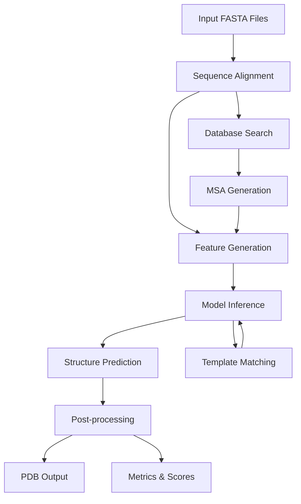
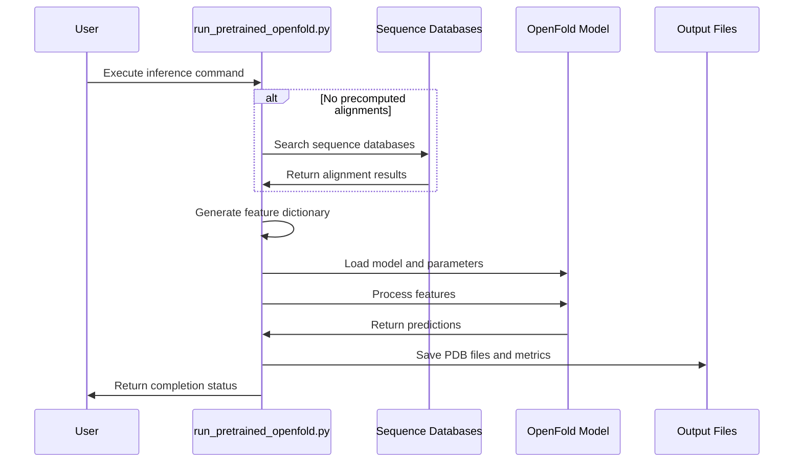

OpenFold provides a powerful and flexible inference system for predicting protein structures using pretrained models. This guide will walk you through the complete workflow, from setup to execution, with practical examples and configuration options for different use cases.

## Overview of Inference Architecture

OpenFold's inference pipeline follows a modular architecture that processes input sequences through multiple stages:



The inference system supports three main modes:
- **Monomer**: Single protein chain prediction
- **Multimer**: Multi-chain protein complex prediction  
- **Single Sequence**: Sequence embedding-based prediction without MSA

This guide focuses on monomer prediction, with references to [Multimer Protein Structure Prediction](18-multimer-protein-structure-prediction) and [Single Sequence Mode and Embeddings](20-single-sequence-mode-and-embeddings) for specialized use cases.

## Prerequisites and Setup

Before running inference, ensure you have the following components properly configured:

### Environment Requirements
- OpenFold Conda Environment (see [System Requirements and Dependencies](3-system-requirements-and-dependencies))
- Sequence databases for multiple sequence alignments
- GPU acceleration recommended for optimal performance

### Database Setup
Download the required sequence databases using the provided script:

```bash
bash scripts/download_alphafold_dbs.sh $BASE_DATA_DIR
```

This will download and configure:
- UniRef90 database for comprehensive sequence searches
- MGnify database for metagenomic sequences  
- BFD database for deep sequence coverage
- PDB70 for template matching
- UniClust30 for additional sequence diversity


## Model Parameter Selection

OpenFold supports both AlphaFold and OpenFold pretrained parameters. Choose based on your specific needs:

### Parameter Download Options

| Parameter Type | Download Command | Use Case |
|---|---|---|
| AlphaFold Parameters | `bash scripts/download_alphafold_params.sh $PARAMS_DIR` | Standard AlphaFold compatibility |
| OpenFold Parameters | `bash scripts/download_openfold_params.sh $PARAMS_DIR` | Enhanced OpenFold features |

### Configuration Presets

The `--config_preset` parameter determines the model architecture and capabilities:

| Setting | `config_preset` | AlphaFold Parameters | OpenFold Parameters | Features |
|---|---|---|---|---|
| With template, no pTM | `model_1`, `model_2` | `params_model_1.npz`, `params_model_2.npz` | `finetuning_[2-5].pt` | Template-based modeling |
| With template, with pTM | `model_1_ptm`, `model_2_ptm` | `params_model_1_ptm.npz`, `params_model_2_ptm.npz` | `finetuning_ptm_[1-2].pt` | Template + pTM scoring |
| Without template, no pTM | `model_3`, `model_4`, `model_5` | `params_model_[3-5].npz` | `finetuning_no_templ_[1-2].pt` | Template-free modeling |
| Without template, with pTM | `model_3_ptm`, `model_4_ptm`, `model_5_ptm` | `params_model_[3-5]_ptm.npz` | `finetuning_no_templ_ptm_1.pt` | Template-free + pTM |

> [!TIP]
> Place parameters in `openfold/resources` for automatic detection, or use `--jax_param_path`/`--openfold_checkpoint_path` to specify custom locations.

## Inference Workflow

### Step 1: Input Preparation

Prepare your input sequences as FASTA files in a dedicated directory. Each file should contain one sequence:

```
fasta_dir/
└── 6kwc.fasta
```

Example FASTA format:
```fasta
>6KWC_1
GSTIQPGTGYNNGYFYSYWNDGHGGVTYTNGPGGQFSVNWSNSGEFVGGKGWQPGTKNKVINFSGSYNPNGNSYLSVYGWSRNPLIEYYIVENFGTYNPSTGATKLGEVTSDGSVYDIYRTQRVNQPSIIGTATFYQYWSVRRNHRSSGSVNTANHFNAWAQQGLTLGTMDYQIVAVQGYFSSGSASITVS
```

### Step 2: Choose Inference Mode

#### Option A: Inference Without Pre-computed Alignments

Run the complete pipeline including sequence alignment:

```bash
python3 run_pretrained_openfold.py \
    $INPUT_FASTA_DIR \
    $TEMPLATE_MMCIF_DIR \
    --output_dir $OUTPUT_DIR \
    --config_preset model_1_ptm \
    --uniref90_database_path $BASE_DATA_DIR/uniref90/uniref90.fasta \
    --mgnify_database_path $BASE_DATA_DIR/mgnify/mgy_clusters_2018_12.fa \
    --pdb70_database_path $BASE_DATA_DIR/pdb70 \
    --uniclust30_database_path $BASE_DATA_DIR/uniclust30/uniclust30_2018_08/uniclust30_2018_08 \
    --bfd_database_path $BASE_DATA_DIR/bfd/bfd_metaclust_clu_complete_id30_c90_final_seq.sorted_opt \
    --model_device "cuda:0"
```

**Required Arguments:**
- `$INPUT_FASTA_DIR`: Directory containing query FASTA files
- `$TEMPLATE_MMCIF_DIR`: Directory for template MMCIF files (required even for template-free inference)
- `--output_dir`: Output directory for predictions
- `--config_preset`: Model configuration preset
- Database paths for sequence alignment
- `--model_device`: Computing device (e.g., "cuda:0" for GPU)

#### Option B: Inference With Pre-computed Alignments

Use existing alignments to skip the database search step:

```bash
python3 run_pretrained_openfold.py $INPUT_FASTA_DIR \
  $TEMPLATE_MMCIF_DIR \
  --output_dir $OUTPUT_DIR \
  --use_precomputed_alignments $PRECOMPUTED_ALIGNMENTS \
  --config_preset model_1_ptm \
  --model_device "cuda:0"
```

The precomputed alignments directory should have this structure:
```
alignments/
└── 6KWC_1/
    ├── bfd_uniref_hits.a3m
    ├── hhsearch_output.hhr
    ├── mgnify_hits.sto
    └── uniref90_hits.sto
```

### Step 3: Execution Flow



## Output Interpretation

The inference process generates several output files and directories:

### Output Structure
```
output_dir/
├── alignments/           # Generated sequence alignments
│   └── 6KWC_1/
├── predictions/          # Predicted structures
│   ├── 6KWC_1_model_1_ptm_unrelaxed.pdb
│   └── 6KWC_1_model_1_ptm_relaxed.pdb
└── timings.json         # Performance metrics
```

### Key Output Files
- **Unrelaxed PDB**: Direct model output without structural refinement
- **Relaxed PDB**: Structure after Amber relaxation for improved geometry
- **Timings JSON**: Performance metrics for inference and relaxation stages
- **Alignment files**: MSA and template search results for reproducibility

> [!TIP]
> The relaxed PDB files are generally recommended for downstream analysis as they have improved stereochemistry and physical plausibility.

## Advanced Configuration Options

### Performance Optimization

#### DeepSpeed Integration
For 2-3x speedup with minimal memory overhead:

```bash
python3 run_pretrained_openfold.py [...] \
    --use_deepspeed_evoformer_attention
```

#### FlashAttention
For sequences under 1000 residues:

```bash
python3 run_pretrained_openfold.py [...] \
    --experiment_config_json '{"globals.use_flash": true}'
```

#### Model Tracing
For large-scale batch processing:

```bash
python3 run_pretrained_openfold.py [...] \
    --trace_model
```

### Long Sequence Handling

For sequences exceeding typical memory limits:

```bash
python3 run_pretrained_openfold.py [...] \
    --long_sequence_inference \
    --experiment_config_json '{
        "globals.chunk_size": 64,
        "model.evoformer_stack.use_lma": true,
        "globals.tune_chunk_size": false
    }'
```

**Long Sequence Optimization Strategies:**
1. Enable low-memory attention (LMA) for reduced memory footprint
2. Disable chunk size tuning to save computation time
3. Use template averaging to reduce template stack memory
4. Consider CPU offloading as a last resort

### Custom Templates

Use specific structural templates:

```bash
python3 run_pretrained_openfold.py [...] \
    --use_custom_template
```

This uses all `.cif` files in `template_mmcif_dir` as templates, requiring chains to have identifier `_A` and match input sequence length.

## Troubleshooting and Common Issues

### Memory Management
| Issue | Solution | Command Example |
|---|---|---|
| Out of GPU memory | Enable long sequence mode | `--long_sequence_inference` |
| Large sequence processing | Reduce chunk size | `--experiment_config_json '{"globals.chunk_size": 32}'` |
| Memory optimization | Enable LMA | `--experiment_config_json '{"model.evoformer_stack.use_lma": true}'` |

### Performance Issues
| Issue | Solution | Command Example |
|---|---|---|
| Slow inference | Enable DeepSpeed | `--use_deepspeed_evoformer_attention` |
| Large batch jobs | Use model tracing | `--trace_model` |
| Database search speed | Use precomputed alignments | `--use_precomputed_alignments $ALIGN_DIR` |

### Configuration Conflicts
| Issue | Solution | Notes |
|---|---|---|
| Parameter mismatch | Ensure config preset matches parameters | Check `config_preset` vs parameter file |
| Template conflicts | Verify template file format | Use `.cif` format with proper chain IDs |
| Database path issues | Verify all database paths exist | Check absolute vs relative paths |

## Example: Complete Inference Workflow

Here's a complete example using the provided sample data:

```bash
#!/bin/bash
export FASTA_DIR=./fasta_dir
export OUTPUT_DIR=./
export PRECOMPUTED_ALIGNMENT_DIR=./alignments
export MMCIF_DIR=/path/to/mmcifs

python3 run_pretrained_openfold.py $FASTA_DIR \
  $MMCIF_DIR \
  --output_dir $OUTPUT_DIR \
  --config_preset model_1_ptm \
  --model_device "cuda:0" \
  --data_random_seed 42 \
  --use_precomputed_alignments $PRECOMPUTED_ALIGNMENT_DIR
```

This example demonstrates the typical workflow used in the [examples/monomer/](https://github.com/aqlaboratory/openfold/tree/main/examples/monomer) directory, which includes sample input data and expected outputs.

## Next Steps

After successfully running inference, you may want to explore:

- **Multimer Prediction**: Learn about [Multimer Protein Structure Prediction](18-multimer-protein-structure-prediction) for protein complexes
- **Training Pipeline**: Explore [Training Pipeline and Configuration](15-training-pipeline-and-configuration) for custom model training
- **Performance Optimization**: Dive into [DeepSpeed Integration and Performance](16-deepspeed-integration-and-performance) for large-scale deployments
- **Architecture Details**: Understand the [AlphaFold 2 Model Implementation](9-alphafold-2-model-implementation) for deeper technical insights
