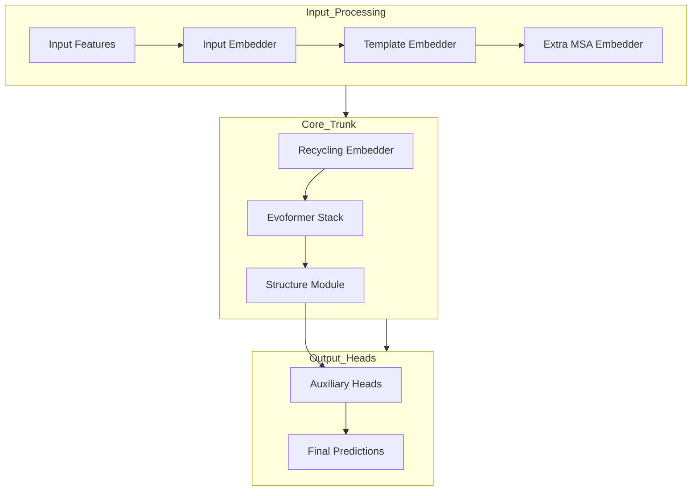

The AlphaFold 2 implementation in OpenFold represents a comprehensive PyTorch reimplementation of DeepMind's groundbreaking protein structure prediction model. This architecture leverages deep learning to predict protein 3D structures from amino acid sequences with remarkable accuracy.

## Core Architecture Overview

The AlphaFold 2 model follows the architectural design outlined in the original AlphaFold 2 paper, implementing the core algorithmic components as a modular neural network system. The primary model class [`AlphaFold`](openfold/model/model.py#L65) serves as the central orchestrator, coordinating between different functional modules that process input features and generate structural predictions.

## Model Initialization and Configuration

The model is initialized through a hierarchical configuration system that defines the architecture parameters and behavior modes. The [`__init__`](openfold/model/model.py#L72) method demonstrates the modular assembly of key components:

- **Input Embedding**: Selects between [`InputEmbedder`](openfold/model/embedders.py#L38), [`InputEmbedderMultimer`](openfold/model/embedders.py#L157), or [`PreembeddingEmbedder`](openfold/model/embedders.py#L312) based on use case
- **Template Processing**: Configures [`TemplateEmbedder`](openfold/model/embedders.py#L634) or [`TemplateEmbedderMultimer`](openfold/model/embedders.py#L873) for structural template integration
- **MSA Processing**: Sets up [`ExtraMSAEmbedder`](openfold/model/embedders.py#L595) and [`ExtraMSAStack`](openfold/model/evoformer.py#L1028) for additional sequence information
- **Core Processing**: Initializes [`EvoformerStack`](openfold/model/evoformer.py#L748) and [`StructureModule`](openfold/model/structure_module.py#L817) for feature extraction and structure generation

## Input Embedding Pipeline

The input embedding system transforms raw protein sequence features into rich numerical representations suitable for deep learning processing. The [`InputEmbedder`](openfold/model/embedders.py#L38) implements Algorithms 3 and 4 from the AlphaFold 2 paper, handling:

- **Target sequence features**: One-hot encoded amino acid sequences
- **MSA features**: Multiple sequence alignment representations  
- **Relative positions**: Sequential distance encoding via [`relpos`](openfold/model/embedders.py#L85) method

For multimer predictions, the [`InputEmbedderMultimer`](openfold/model/embedders.py#L157) extends this functionality with chain-aware relative positioning and specialized handling for multi-chain protein complexes.

## Recycling Mechanism

A key innovation in AlphaFold 2 is the iterative recycling mechanism that allows the model to refine its predictions through multiple passes. The [`iteration`](openfold/model/model.py#L209) method implements this refinement process:

1. **Feature preprocessing**: Converts input features to appropriate data types and extracts batch dimensions
2. **Embedding initialization**: Creates initial MSA (`m`) and pair (`z`) representations
3. **Recycling integration**: Combines current iteration outputs with previous iteration embeddings via [`RecyclingEmbedder`](openfold/model/embedders.py#L406)
4. **Progressive refinement**: Each iteration improves upon the previous predictions, with early stopping when convergence is detected

The [`forward`](openfold/model/model.py#L493) method orchestrates the complete recycling loop, managing gradient computation and memory optimization across iterations.

## Evoformer Core Processing

The [`EvoformerStack`](openfold/model/evoformer.py#L748) implements Algorithm 6, serving as the core feature extraction engine. It processes MSA and pair representations through a series of specialized blocks:

| Component | Function | Implementation |
|-----------|----------|----------------|
| **MSA Attention** | Row-wise attention over sequences | [`EvoformerBlock`](openfold/model/evoformer.py#L377) |
| **Outer Product Mean** | MSA to pair representation conversion | [`_compute_opm`](openfold/model/evoformer.py#L325) |
| **Pair Stack** | Pair representation processing | [`PairStack`](openfold/model/evoformer.py#L123) |
| **MSA Transition** | Feed-forward MSA processing | [`MSATransition`](openfold/model/evoformer.py#L48) |

The Evoformer employs advanced optimization techniques including activation checkpointing, chunked processing for memory efficiency, and specialized attention implementations.

## Structure Module

The [`StructureModule`](openfold/model/structure_module.py#L817) transforms the processed features into 3D atomic coordinates. This module implements the geometric reasoning components of AlphaFold 2:

- **Invariant Point Attention**: [`InvariantPointAttention`](openfold/model/structure_module.py#L209) performs 3D-aware attention on structural frames
- **Backbone Update**: [`BackboneUpdate`](openfold/model/structure_module.py#L736) generates coordinate updates
- **Angle Prediction**: [`AngleResnet`](openfold/model/structure_module.py#L78) predicts torsion angles
- **Frame Generation**: Converts predictions to 3D coordinates using rigid body transformations

The structure module supports both monomer and multimer modes, with specialized implementations for different use cases.

## Auxiliary Prediction Heads

The [`AuxiliaryHeads`](openfold/model/heads.py#L28) component generates additional predictions used during training and for confidence assessment:

| Head | Purpose | Output |
|------|---------|--------|
| **DistogramHead** | Distance predictions | Pairwise residue distances |
| **TMScoreHead** | Quality assessment | TM-score predictions |
| **PerResidueLDDTCaPredictor** | Local confidence | Per-residue lDDT scores |
| **MaskedMSAHead** | MSA reconstruction | Sequence conservation |
| **ExperimentallyResolvedHead** | Resolution prediction | Experimental data confidence |

## Configuration System

The model architecture is highly configurable through the [`config.py`](openfold/config.py) system, which defines:

- **Channel dimensions**: `c_m` (256), `c_z` (128), `c_s` (384) for different representation spaces
- **Architecture parameters**: Number of attention heads, blocks, and hidden dimensions
- **Optimization settings**: Chunk sizes, checkpointing strategies, precision modes
- **Feature flags**: Template usage, MSA processing modes, multimer support

> [!TIP]
> The modular design allows for flexible configuration between different use cases, from standard monomer prediction to multimer complexes and single-sequence embedding modes.

## Performance Optimizations

OpenFold's implementation includes several performance optimizations beyond the original AlphaFold 2:

- **Memory efficiency**: Chunked processing and activation checkpointing
- **GPU acceleration**: Custom CUDA kernels and optimized attention implementations
- **Mixed precision**: Support for FP16 training and inference
- **Distributed training**: DeepSpeed integration for large-scale training

The implementation maintains algorithmic fidelity with the original AlphaFold 2 while providing the flexibility and performance characteristics needed for production use and research applications.

Sources: [model.py](openfold/model/model.py#L65), [evoformer.py](openfold/model/evoformer.py#L748), [embedders.py](openfold/model/embedders.py#L38), [structure_module.py](openfold/model/structure_module.py#L817), [heads.py](openfold/model/heads.py#L28), [config.py](openfold/config.py#L61)

## Next Steps

For a deeper understanding of the core processing components, explore [Evoformer and Structure Module](10-evoformer-and-structure-module) to learn about the detailed implementation of these critical architectural elements. To understand how the model handles memory constraints and large proteins, see [Memory Optimization Techniques](11-memory-optimization-techniques).