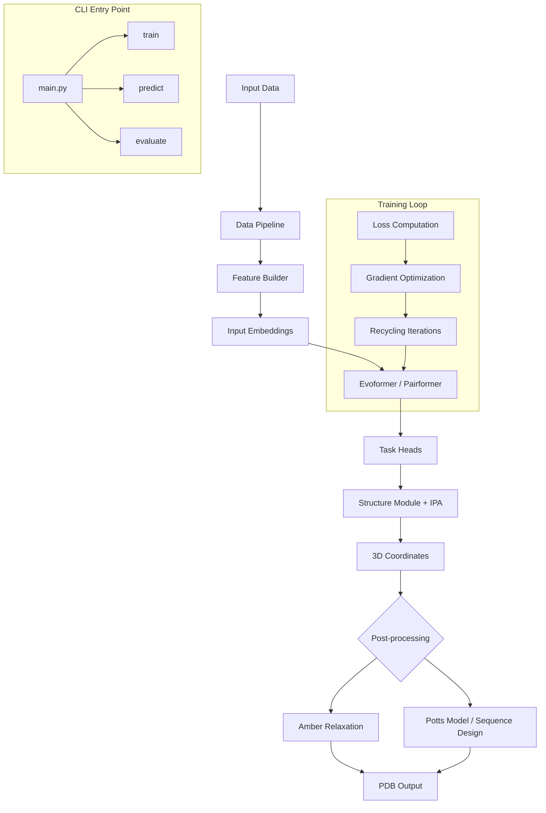

## What is ProFOLD2?

ProFOLD2 is a PyTorch-based protein 3D structure prediction application that re-implements and extends the AlphaFold2 architecture. Developed by Chungong Yu and Dongbo Bu, it provides an end-to-end framework covering data ingestion, model training, inference, structure relaxation, and even a web interface — all within a single, modular codebase released under the MIT license. The project is designed for both research experimentation and production deployment, with built-in support for distributed multi-node training via PyTorch's distributed backend and SLURM scheduler integration.

Sources: [README.md](README.md), [setup.py](setup.py#L1-L48)

## Architecture at a Glance

ProFOLD2 follows a pipeline architecture that transforms raw protein sequences and structural data into 3D atomic coordinates. The diagram below illustrates the high-level data flow from input to output:



The core model, `AlphaFold2`, lives in [profold2/model/alphafold2.py](profold2/model/alphafold2.py#L128-L321) and orchestrates the entire forward pass. It accepts a feature batch, runs it through input embeddings, the Evoformer trunk, multiple task-specific heads, and optionally a structure module for 3D coordinate prediction. A recycling wrapper, `AlphaFold2WithRecycling`, iterates this process to refine predictions across multiple passes [profold2/model/alphafold2.py](profold2/model/alphafold2.py#L323-L327).

Sources: [profold2/model/alphafold2.py](profold2/model/alphafold2.py#L128-L321), [profold2/command/main.py](profold2/command/main.py#L26-L29)

## Project Structure

The repository is organized into clearly separated concerns. Below is the directory layout with the purpose of each module:

```
ProFOLD2/
├── main.py                  # CLI entry point (delegates to profold2.command.main)
├── install_env.sh           # Conda + pip environment setup script
├── setup.py                 # Package installation with CUDA kernel extensions
│
├── profold2/                # Core library package
│   ├── command/             # CLI subcommands: train, predict, evaluate, relax
│   ├── common/              # Protein constants, utilities, residue definitions
│   ├── data/                # Dataset loading, feature pipelines, ESM embeddings
│   ├── model/               # Neural network modules (the heart of the system)
│   │   ├── alphafold2.py    #   Main AlphaFold2 model + recycling wrapper
│   │   ├── evoformer.py     #   Evoformer and Pairformer transformer blocks
│   │   ├── folding.py       #   Structure Module with Invariant Point Attention
│   │   ├── head.py          #   15+ prediction heads (distogram, folding, etc.)
│   │   ├── features.py      #   Feature transformation functions
│   │   ├── potts.py         #   Potts model for sequence design (MCMC sampling)
│   │   ├── sequence.py      #   ESM embedding integration
│   │   ├── kernel/          #   Custom CUDA kernels (FusedEvoformer, CUTLASS)
│   │   └── accelerator.py   #   GPU/MLU distributed training utilities
│   ├── relax/               # Amber-based structure relaxation
│   ├── tools/               # Energy and sampling utilities
│   └── utils.py             # Shared utility functions
│
├── examples/                # Configuration examples and SLURM job scripts
├── tools/                   # Standalone utilities (PDB ops, TM-score, etc.)
├── tests/                   # Unit tests and benchmarks
├── docker/                  # Dockerfile for containerized deployment
└── web/                     # Flask-based web interface for prediction
```

Sources: [main.py](main.py#L1-L12), [profold2/command/main.py](profold2/command/main.py#L26-L29)

## Key Capabilities

ProFOLD2 goes well beyond a basic AlphaFold2 reimplementation. The table below summarizes the core capabilities and where they are implemented:

| Capability | Description | Key Module |
|---|---|---|
| **Structure Prediction** | Predict 3D atomic coordinates from amino acid sequences using the AlphaFold2 architecture | [alphafold2.py](profold2/model/alphafold2.py#L128) |
| **Evoformer & Pairformer** | Dual-attention trunk with MSA row/column attention and pairwise attention; supports AlphaFold3-style Pairformer | [evoformer.py](profold2/model/evoformer.py#L199-L377) |
| **Structure Module (IPA)** | Iterative refinement of backbone frames using Invariant Point Attention | [folding.py](profold2/model/folding.py#L99-L213) |
| **15+ Prediction Heads** | Distogram, Folding, PLDDT, PAE, Contact, Coevolution, Pairing, TM-score, Fitness, Violation, and more | [head.py](profold2/model/head.py#L91-L1692) |
| **Sequence Design** | Potts model with Gibbs and DLMC MCMC samplers for inverse folding | [potts.py](profold2/model/potts.py#L12-L159) |
| **ESM Integration** | Pre-trained protein language model embeddings (ESM-1b, ESM-MSA1b) via Facebook Research | [sequence.py](profold2/model/sequence.py#L153-L254) |
| **Multi-Chain / Multimer** | Native support for multi-chain protein complexes with pseudo-linker augmentation | [dataset.py](profold2/data/dataset.py#L1540-L1750) |
| **Amber Relaxation** | Post-prediction structure refinement using OpenMM | [relax.py](profold2/relax/relax.py#L30-L89) |
| **Distributed Training** | Multi-node, multi-GPU training with PyTorch distributed, SLURM integration, and mixed-precision (AMP) | [trainer.py](profold2/command/trainer.py#L75-L467), [accelerator.py](profold2/model/accelerator.py#L61-L117) |
| **Custom CUDA Kernels** | CUTLASS-based fused kernels and FusedEvoformer for optimized attention | [kernel/](profold2/model/kernel/__init__.py) |
| **Web Interface** | Flask-based UI for submitting prediction jobs and browsing results | [web/app.py](web/app.py#L1-L241) |

Sources: [profold2/model/alphafold2.py](profold2/model/alphafold2.py#L128-L321), [profold2/model/head.py](profold2/model/head.py#L91-L1692), [profold2/model/potts.py](profold2/model/potts.py#L12-L159)

## How the Model Works — A Conceptual Walkthrough

At a high level, the `AlphaFold2` class implements the following forward pass:

1. **Input Embeddings**: Raw sequence tokens, pairwise features (e.g., distance histograms), and optional template features are projected into the model's hidden dimension via the `InputEmbeddings` module. This produces MSA representations (shape `B × M × N × C_msa`) and pairwise representations (shape `B × N × N × C_pair`).

2. **Evoformer Trunk**: The Evoformer — a stack of `EvoformerBlock` layers — iteratively refines these representations through a combination of MSA attention, pairwise attention, and cross-representation transitions. It can operate in two modes: the classic AlphaFold2 mode (with full MSA) and a Pairformer mode (MSA-free, AlphaFold3-style).

3. **Single Representation Extraction**: The first row of the MSA representation is projected into a compact single representation (shape `B × N × C_single`), which serves as the primary input to all prediction heads.

4. **Task Heads**: A configurable set of prediction heads operates on the single and pairwise representations. The `HeaderBuilder` dynamically assembles heads from a JSON configuration. Each head produces predictions and, during training, computes its own loss contribution.

5. **Recycling**: The `AlphaFold2WithRecycling` wrapper iterates the forward pass multiple times, feeding recycled representations (MSA first row, pairwise features, and optionally 3D coordinates and frames) back into the model to progressively refine predictions.

Sources: [profold2/model/alphafold2.py](profold2/model/alphafold2.py#L213-L320), [profold2/model/alphafold2.py](profold2/model/alphafold2.py#L323-L422)

## CLI Commands

The entry point is [main.py](main.py#L1-L12), which delegates to [profold2/command/main.py](profold2/command/main.py). Three primary commands are available:

| Command | Description | Module |
|---|---|---|
| `train` | Train a model from scratch or fine-tune an existing checkpoint | [trainer.py](profold2/command/trainer.py#L75-L467) |
| `predict` | Run inference on sequences (FASTA) or preprocessed data | [predictor.py](profold2/command/predictor.py#L1-L100) |
| `evaluate` | Evaluate model predictions against ground truth structures | [evaluator.py](profold2/command/evaluator.py) |

Example usage:

```bash
# Train with default settings
python main.py train --prefix=OUTPUT_DIR

# Predict from FASTA files
python main.py predict --models model_file.pt fasta_files/*.fasta

# Show all options
python main.py train -h
```

Sources: [profold2/command/main.py](profold2/command/main.py#L26-L29), [README.md](README.md#L27-L60)

## Technology Stack

| Component | Technology | Version |
|---|---|---|
| **Language** | Python | 3.9+ (recommended 3.11) |
| **Deep Learning** | PyTorch | ≥ 2.3.1 |
| **Molecular Dynamics** | OpenMM + PDBFixer | ≥ 8.0.0 |
| **Bioinformatics** | BioPython | latest |
| **Visualization** | TensorBoard | latest |
| **Mixed Precision** | torch.amp (AMP) | built-in |
| **CUDA Kernels** | CUTLASS | submodule |
| **Container** | Docker (NVIDIA CUDA 12.1) | [Dockerfile](docker/Dockerfile) |

Sources: [setup.py](setup.py#L21-L27), [requirements.txt](requirements.txt#L1-L9), [install_env.sh](install_env.sh#L1-L71), [docker/Dockerfile](docker/Dockerfile#L1-L57)

> [!TIP]
> The project uses git submodules for optimized CUDA kernels. After cloning, run `git submodule update --init` to fetch the CUTLASS and FusedEvoformer components. Without these, the model still runs in pure PyTorch mode but at reduced performance.

> [!TIP]
> All prediction heads and their hyperparameters are defined via JSON configuration files (see [examples/model_headers_150m.json](examples/model_headers_150m.json) and [examples/model_features_150m.json](examples/model_features_150m.json)). This makes it straightforward to swap heads, adjust loss weights, or experiment with different architectures without modifying Python code.

## Where to Go Next

This Overview has introduced you to ProFOLD2's purpose, structure, and capabilities. The recommended reading progression based on your experience level:

- **Ready to run the code?** → [Quick Start](2-quick-start) for environment setup and your first prediction
- **Prefer containers?** → [Docker Deployment](3-docker-deployment) for a one-command setup
- **Want the big picture first?** → [Architecture Overview](4-architecture-overview) for a deeper dive into the system design
- **Interested in the model internals?** → [AlphaFold2 Core Pipeline](5-alphafold2-core-pipeline) for how the neural network processes data
- **Need command-line details?** → [CLI Command Reference](21-cli-command-reference) for the complete parameter reference