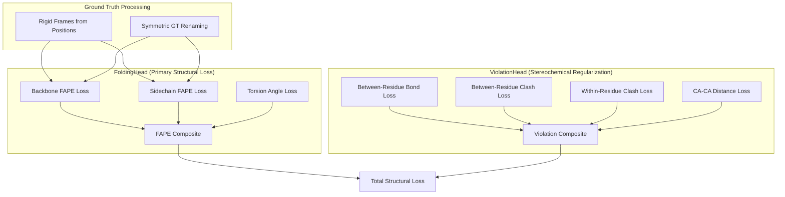

ProFOLD2's structural supervision is built around two complementary objectives: the **Frame Aligned Point Error (FAPE)** metric that drives the primary geometry learning through backbone and sidechain frame alignment, and a suite of **structural violation losses** that enforce stereochemical plausibility. Together, these losses compose the structural backbone of the training signal flowing through the [AlphaFold2 Core Pipeline](5-alphafold2-core-pipeline) into the [Structure Module and IPA](7-structure-module-and-ipa).

## Architectural Overview of Structural Losses



The two loss heads—`FoldingHead` and `ViolationHead`—operate at different levels of abstraction. `FoldingHead` manages the high-level geometric alignment through FAPE and torsion angle supervision, while `ViolationHead` operates as a pure regularizer that penalizes violations of known stereochemical constraints without requiring ground truth structures beyond atom positions and types.

Sources: [head.py](profold2/model/head.py#L403-L692), [head.py](profold2/model/head.py#L1605-L1659)

## Frame Aligned Point Error (FAPE)

FAPE is the central structural loss metric in ProFOLD2. Unlike RMSD, which requires global alignment before computing error, FAPE measures point displacement after aligning each point pair in the **local coordinate frames** of both the predicted and ground truth structures. This makes it inherently invariant to global rotations and translations, and—critically—sensitive to local structural quality.

Sources: [functional.py](profold2/model/functional.py#L858-L918)

### Mathematical Formulation

Given predicted frames `(R_pred, t_pred)`, ground truth frames `(R_true, t_true)`, predicted points `x_pred`, and ground truth points `x_true`, FAPE proceeds in three stages:

**1. Local coordinate transformation.** Each point pair is expressed in the local frame of every residue, effectively inverting the rigid body transformation:

```
x_pred_local = R_pred^T · (x_pred - t_pred)
x_true_local = R_true^T · (x_true - t_true)
```

This is implemented via the `to_local` closure inside `fape()` using an Einstein summation `einsum('...jw,...wh -> ...jh', points - t, R)` that broadcasts the rotation matrix across all frames and points simultaneously [functional.py](profold2/model/functional.py#L886-L888).

**2. Pairwise distance computation.** The error for each frame-point pair is computed as the Euclidean distance between their local coordinates:

```
d_ij = || x_pred_local_i - x_true_local_j ||
```

The result is a tensor of shape `(batch, num_frames, num_points)`—every frame evaluated against every point.

**3. Clamping and masking.** Raw distances are clamped to prevent outlier frames from dominating the gradient. ProFOLD2 implements a **smooth clamping** mechanism via the `clamp_ratio` parameter that interpolates between raw and clamped distances:

```
d_clamped = (1 - λ) · d_ij + λ · min(d_ij, d_max)
```

Where `λ` is the clamp ratio. When `λ = 1.0`, this degrades to hard clamping; when `λ < 1.0`, it creates a soft transition that preserves gradient information even for distant misalignments. The final loss is the mean over all valid frame-point pairs, optionally weighted by confidence or inter-residue importance weights.

Sources: [functional.py](profold2/model/functional.py#L858-L918)

### FAPE Parameters

| Parameter | Default | Description |
|-----------|---------|-------------|
| `fape_max` | 15.0 Å | Hard clamp distance for frame-point errors |
| `fape_z` | 15.0 | Normalization denominator for the final loss |
| `fape_backbone_clamp_ratio` | 1.0 | Smooth clamping ratio for backbone FAPE (1.0 = hard clamp) |
| `fape_sidechain_clamp_ratio` | 1.0 | Smooth clamping ratio for sidechain FAPE |
| `sidechain_w` | 0.5 | Weight blending backbone and sidechain FAPE (0–1) |
| `angle_norm_w` | 0.01 | Weight for unit-norm torsion angle regularization |
| `angle_pred_w` | 0.5 | Weight for predicted vs. ground truth torsion angle loss |

Sources: [head.py](profold2/model/head.py#L406-L439)

## Backbone FAPE Loss

The backbone FAPE loss evaluates how well the predicted backbone frames align with the ground truth. It operates on the trajectory of predictions across all structure module iterations, averaging the FAPE error uniformly across all timesteps. This ensures that intermediate structural refinements contribute equally to the gradient signal.

Sources: [head.py](profold2/model/head.py#L456-L500)

### Confidence-Weighted Distance Masking

A distinguishing feature of ProFOLD2's backbone FAPE is optional **confidence-weighted masking**. When `coord_plddt` is present in the batch (typically from teacher forcing with ground truth confidence), the pairwise distance weight `d_ij` is set to the minimum of the pLDDT scores of the CA atoms of the two residues in the pair. This upweights the learning signal toward well-resolved regions of the structure [head.py](profold2/model/head.py#L460-L465).

Additionally, a per-residue inter-weight matrix `loss.folding.w` can be injected from the batch to further modulate which residue pairs contribute to the loss, enabling curriculum learning strategies or cross-chain weighting in multimer contexts.

### Chain-Aware Clamping

For multimer predictions, the backbone clamp ratio is made **chain-aware**: clamping is only applied to residue pairs within the same chain (`seq_color` equality), while inter-chain pairs receive a clamp ratio of 0.0 (no clamping). This prevents the loss from artificially saturating on distant inter-chain contacts where large frame-point distances are expected and informative.

Sources: [head.py](profold2/model/head.py#L476-L498)

## Sidechain FAPE Loss

The sidechain FAPE loss extends the frame alignment concept from single backbone frames to the full set of **8 rigid groups per residue** defined in AlphaFold's stereochemical model. Each rigid group (backbone frame, chi-1 group through chi-4 group, plus proline-specific groups) defines its own local coordinate frame, and sidechain atoms are evaluated against all applicable group frames.

Sources: [head.py](profold2/model/head.py#L502-L559)

### Shape Transformations

Sidechain FAPE requires reshaping tensors from the grouped structure `(batch, num_res, 8_groups, 3_atoms/1_trans, 3/14_coords)` into the flat form expected by the generic `fape()` function:

- **Frames**: rotations `(batch, num_res*8, 3, 3)` and translations `(batch, num_res*8, 3)`
- **Points**: atom coordinates `(batch, num_res*14, 3)`
- **Masks**: group existence masks `(batch, num_res*8)` and atom masks `(batch, num_res*14)`

The `frames_to_fape_shape`, `points_to_fape_shape`, and `mask_to_fape_shape` closures handle these rearrangements via `rearrange` from einops [head.py](profold2/model/head.py#L505-L516).

### Sidechain Confidence Weighting

Sidechain confidence weighting uses a more sophisticated scheme than backbone: the per-rigid-group pLDDT is computed by finding the minimum pLDDT across all atoms belonging to each rigid group (via a one-hot atom-to-group mapping using `restype_rigid_group_atom14_idx`). The pairwise weight is then the minimum between the frame-group confidence and the point-atom confidence [head.py](profold2/model/head.py#L519-L537).

## Composite FAPE Loss Assembly

The `fape_loss` inner function assembles the full structural loss through a precise sequence of ground truth preparation, symmetric renaming, and weighted combination [head.py](profold2/model/head.py#L561-L633):

**1. Ground truth frame extraction.** Backbone affine frames and masks are obtained from the batch. If not explicitly provided, the backbone mask is derived by checking that N, CA, and C atoms all have valid coordinates.

**2. Backbone FAPE accumulation.** The backbone FAPE is computed by iterating over all trajectory timesteps (all structure module layers) and averaging the per-timestep FAPE errors uniformly.

**3. Symmetric ground truth renaming.** For residues with ambiguous stereochemistry (e.g., flipped symmetric sidechains in residues like ASP, GLU, PHE, TYR, ARG, etc.), ProFOLD2 uses `symmetric_ground_truth_find_optimal` to determine whether the original or alternative ground truth frame produces a better alignment with the predicted coordinates. If the alternative is better, all ground truth data (frames, coordinates, masks) are swapped accordingly. This is critical for avoiding conflicting gradients on symmetric residues. (See [Symmetric Ground Truth Handling](17-symmetric-ground-truth-handling) for full details.)

**4. Final weighted sum.** The composite FAPE is `(1 - sidechain_w) * backbone_loss + sidechain_w * sidechain_loss`, with the default `sidechain_w = 0.5` giving equal weight.

Sources: [head.py](profold2/model/head.py#L561-L633)

## Torsion Angle Loss

The torsion angle loss serves as an auxiliary regularization signal alongside FAPE, operating directly on the predicted torsion angle vectors rather than on 3D coordinates. It comprises two sub-components [head.py](profold2/model/head.py#L635-L686):

**1. Angle norm loss** (weight `angle_norm_w = 0.01`). Since torsion angles are represented as unit vectors `v = (sin θ, cos θ)`, this loss penalizes deviations from unit magnitude: `||v|| - 1|`. It acts as a soft normalization constraint across all trajectory timesteps.

**2. Angle prediction loss** (weight `angle_pred_w = 0.5`). This computes the MSE between predicted torsion angles (after L2 normalization) and the ground truth, restricted to chi angles only (the first 3 backbone angles `φ, ψ, ω` are masked to zero in `angles_mask[..., :3] = 0`). When symmetric alternatives exist for the ground truth torsion angles, the loss takes the minimum over both alternatives via `torch.minimum`, ensuring the model is not penalized for correct predictions that happen to match the alternate naming convention.

Sources: [head.py](profold2/model/head.py#L635-L686)

## Structural Violation Losses

The `ViolationHead` provides a set of **supplementary regularization losses** that enforce stereochemical plausibility. Unlike FAPE, which requires aligned frames and thus ground truth structure data, these losses operate purely on predicted coordinates and known chemical constraints. They are summed into a single violation loss term that is added to the total training objective.

Sources: [head.py](profold2/model/head.py#L1605-L1659)

### Between-Residue Bond Loss

This loss penalizes deviations from ideal bond lengths and angles between consecutive residues, focusing on three specific stereochemical measurements [functional.py](profold2/model/functional.py#L943-L1052):

| Measurement | Ground Truth | Special Cases |
|-------------|-------------|---------------|
| C–N peptide bond length | Standard or proline-adjusted | Proline C–N has different reference length and stddev |
| CA–C–N bond angle | Cosine angle from stereochemical constants | — |
| C–N–CA bond angle | Cosine angle from stereochemical constants | — |

Each measurement uses a **tolerance-scaled loss** `ReLU(|pred - gt| - τ · stddev)` where `τ = 12.0` is the tolerance factor. This means errors within `τ` standard deviations of the mean incur zero loss, creating a dead zone that prevents the optimizer from over-fitting to minor structural fluctuations. Bond angles are computed via dot products of unit vectors along the bonds rather than explicit arccos operations, providing numerically stable gradients.

The per-residue violation is computed by averaging the loss from each bond across its two neighboring residues (via `F.pad` to shift and sum), ensuring each residue's violation score reflects its local stereochemical environment.

Sources: [functional.py](profold2/model/functional.py#L943-L1052)

### CA-CA Distance Loss

A lightweight loss that penalizes anomalous Cα–Cα distances between consecutive residues. The expected distance is the trans-configuration value of `3.802 Å` (from `residue_constants.ca_ca`), and violations are flagged when the distance exceeds this by more than `τ = 1.5 Å`. A gap mask ensures that only truly consecutive residues (residue index difference of exactly 1) are evaluated, preventing false positives across chain breaks or missing residues.

Sources: [functional.py](profold2/model/functional.py#L920-L940), [residue_constants.py](profold2/common/residue_constants.py#L34)

### Between-Residue Clash Loss

This loss detects and penalizes **steric clashes between atoms of different residues** using a Van der Waals radius-based approach [functional.py](profold2/model/functional.py#L1054-L1145):

The algorithm constructs an all-pairs distance matrix between atoms of different residues (strict upper triangular masking to avoid double-counting). For each atom pair, the sum of their Van der Waals radii defines a lower bound on the allowed distance. A tolerance parameter `τ = 1.5 Å` softens this boundary, and atoms violating `distance < (radius_i + radius_j - τ)` contribute a ReLU penalty.

Two important exclusions are applied to the mask: **backbone C–N bonds** between consecutive residues are exempted (they are handled by the bond loss), and **disulfide bridges** between cysteine SG atoms are exempted. The loss normalizes by the total number of valid atom pairs, and per-atom clash masks are computed for downstream violation reporting.

Sources: [functional.py](profold2/model/functional.py#L1054-L1145)

### Within-Residue Clash Loss

The within-residue counterpart operates on atom pairs **within the same residue**, using precomputed stereochemical bounds rather than generic Van der Waals radii [functional.py](profold2/model/functional.py#L1146-L1207):

The function `make_atom14_dists_bounds` from residue constants generates both lower and upper distance bounds for every atom pair within each residue type, accounting for bonded atoms (which must be close), angle-constrained atoms (which have a specific range), and non-interacting atoms (which have only a steric lower bound). The loss penalizes both lower bound violations (overlapping atoms) and upper bound violations (overly stretched bonds), parameterized by `τ1 = 1.5` (overlap tolerance) and `τ2 = 15` (bond length tolerance factor).

This dual-bound approach is essential because within-residue atom pairs span a much wider range of acceptable distances than between-residue pairs—from covalently bonded atoms (upper bound enforced) to atoms on opposite sides of a ring system (lower bound enforced).

Sources: [functional.py](profold2/model/functional.py#L1146-L1207)

## Violation Loss Aggregation

The `ViolationHead.loss()` method computes the total violation loss as a simple sum of five components [head.py](profold2/model/head.py#L1644-L1659):

| Loss Component | Key in `value` dict |
|---------------|---------------------|
| C–N peptide bond length | `c_n_bond_loss` |
| CA–C–N bond angle | `ca_c_n_angle_loss` |
| C–N–CA bond angle | `c_n_ca_angle_loss` |
| Between-residue steric clashes | `between_residue_clash_loss` |
| Within-residue steric clashes | `within_residue_clash_loss` |

Importantly, the CA-CA distance error (`ca_ca_distance_error`) is computed but **not included** in the violation loss summation. It serves purely as a monitoring metric during training, logged for diagnostics but not contributing gradient signal. The violation head applies a protein-only mask (`seq >= prot_from_idx and seq <= prot_to_idx`), meaning nucleic acid residues are excluded from violation computation entirely.

Sources: [head.py](profold2/model/head.py#L1612-L1659)

## Rigid Body Frame Construction

The foundation for FAPE computation is the construction of ground truth rigid body frames from atomic coordinates, implemented in `rigids_from_positions()` [functional.py](profold2/model/functional.py#L637-L707):

For each residue, **8 rigid groups** are defined by their constituent atom14 indices (via `restype_rigid_group_atom14_idx`). Each group's frame is computed from 3 reference points using Gram-Schmidt orthogonalization of two direction vectors, with the second point serving as the translation origin. The backbone frame (group 0) is then mirrored along the x and z axes to conform to AlphaFold's historical convention.

For **ambiguous residues** (those with symmetric sidechain configurations such as ASP, GLU, PHE, TYR, ARG, and VAL), an alternative frame is generated by rotating the last chi-group's frame by 180° around the x-axis. This alternative frame is stored alongside the primary frame in the batch data as `atom_affine_alt`, enabling the symmetric ground truth renaming logic in `FoldingHead.loss()` to select the better-fitting frame at each training step.

Sources: [functional.py](profold2/model/functional.py#L637-L707)

> [!TIP]
> The **chain-aware clamping** in backbone FAPE (`clamp_ratio = 0.0` for inter-chain pairs) is a critical design choice for multimer training. Without it, large-but-correct inter-chain distances would be clamped to the same ceiling as small intrachain errors, washing out the gradient signal needed to learn correct chain packing orientation.

> [!TIP]
> The **symmetric ground truth renaming** mechanism resolves a fundamental ambiguity in structure learning: for residues with symmetric sidechains, both naming conventions produce identical physical structures but different coordinate representations. By dynamically selecting the convention that best matches the prediction (via LDDT maximization in `symmetric_ground_truth_find_optimal`), ProFOLD2 avoids the scenario where the model receives contradictory loss signals depending on which naming convention the ground truth PDB file happens to use.

## Loss Composition Summary

The complete structural loss as computed during a single forward pass is:

```
L_structural = L_fape + L_torsion + L_violation

where:
  L_fape = (1 - 0.5) · mean_over_timesteps(backbone_fape) + 0.5 · sidechain_fape
  L_torsion = 0.01 · norm_angle_loss + 0.5 · chi_angle_pred_loss
  L_violation = Σ (c_n_bond + ca_c_n_angle + c_n_ca_angle + between_clash + within_clash)
```

All three terms are returned as separate head losses through the `HeaderBuilder` registry and combined at the training loop level. For details on how these individual head losses are weighted and optimized together, see [Distributed Training Infrastructure](19-distributed-training-infrastructure). For the confidence metrics derived from the structure module outputs, see [Confidence Metrics](11-confidence-metrics).