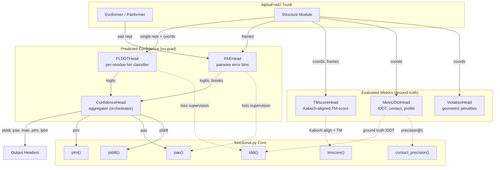

ProFOLD2 implements a multi-layered confidence estimation framework that spans both predicted and evaluated structural quality metrics. The system is architected around three distinct operational modes — **train-time loss supervision**, **inference-time predicted confidence**, and **evaluation-time ground-truth comparison** — unified through a shared header registry and a central orchestrator. Understanding this decomposition is essential for anyone extending the confidence pipeline, customizing metric aggregation, or interpreting model outputs in production deployments.

## Architectural Overview

The confidence subsystem is composed of five cooperating head modules, each registered through `HeaderBuilder._headers`, and orchestrated by a lightweight aggregator. The following diagram illustrates the data flow from the main model trunk through each head to the final metric outputs:

Sources: [head.py](profold2/model/head.py#L1662-L1692), [alphafold2.py](profold2/model/alphafold2.py#L273-L302)

## ConfidenceHead: The Aggregator

`ConfidenceHead` is a stateless orchestrator that consumes the outputs of `PLDDTHead` and `PAEHead` to produce the final suite of predicted confidence metrics. Critically, it operates entirely under `torch.no_grad()`, meaning it introduces zero gradient overhead during both training and inference. This design choice enforces a clean separation: the trainable heads (`PLDDTHead`, `PAEHead`) learn to produce informative logits, while `ConfidenceHead` merely post-processes those logits into human-readable scores.

The aggregator conditionally produces five metrics depending on what headers are present in the model output:

| Metric | Key | Source Header | Description |
|--------|-----|---------------|-------------|
| pLDDT | `plddt` | `headers['lddt']['logits']` | Per-residue predicted lDDT (0–100 scale) |
| Mean pLDDT | `loss` | Derived from `plddt` | Masked mean across residues, used as ranking score |
| PAE | `pae` | `headers['pae']['logits']` | Predicted aligned error matrix (Å) |
| MAE | `mae` | `headers['pae']['logits']` | Maximum aligned error (upper bin center) |
| PTM | `ptm` | `headers['pae']['logits']` | Predicted TM-score (intra-chain) |
| ipTM | `iptm` | `headers['pae']['logits']` | Predicted TM-score (inter-chain, `seq_color`-gated) |

Sources: [head.py](profold2/model/head.py#L91-L120)

## PLDDTHead: Per-Residue Confidence via lDDT Binning

`PLDDTHead` formulates per-residue confidence as a **50-class binning problem** over the continuous lDDT score. During the forward pass, it takes either the structure module's single representation (`headers['folding']['act']`) or the trunk's single representation (`representations['single']`) and passes it through a three-layer MLP (`LayerNorm → Linear → ReLU → Linear → ReLU → Linear`) to produce logits over 50 equal-width bins spanning [0, 1].

The **training loss** is the key design element: the head computes the *actual* lDDT between predicted Cα coordinates and ground truth Cα coordinates, bins that lDDT value into one of 50 discrete labels, and then applies softmax cross-entropy. This binning approach provides a smoother gradient signal than regression while maintaining interpretability through the `plddt()` function, which converts logits back to a continuous score by computing a weighted average of bin centers.

A critical detail is the **molecule-type-aware cutoff**: protein residues use a 15 Å inclusion radius while nucleic acid residues use 30 Å, reflecting the larger spatial extent of RNA/DNA structures. This is computed via `lddt_cutoff()`, which dispatches on residue type using `prot_from_idx` and `prot_to_idx` sentinel values.

Additionally, the head supports **resolution filtering** through `min_resolution` and `max_resolution` parameters. Only structures within the specified resolution range contribute to the loss, allowing training configurations that exclude low-resolution experimental structures.

Sources: [head.py](profold2/model/head.py#L695-L794), [functional.py](profold2/model/functional.py#L346-L399), [head.py](profold2/model/head.py#L77-L81)

### pLDDT Score Computation

The `plddt()` function in [functional.py](profold2/model/functional.py#L389-L399) converts bin logits into a continuous per-residue score. It creates 50 equally-spaced bin centers at positions `0.5/c, 1.5/c, ..., 49.5/c` (where `c = 50`), computes the softmax over logits, and returns the dot product of bin centers with probabilities. The `ConfidenceHead` multiplies this by 100 to produce the familiar 0–100 pLDDT scale used in PDB B-factor coloring.

## PAEHead: Pairwise Aligned Error

`PAEHead` predicts the **predicted aligned error (PAE)** between all pairs of residues — a square matrix indicating how far the predicted position of residue *i* would need to move to align with residue *j*'s predicted frame. This is the confidence metric visualized in AlphaFold's PAE plots.

The head operates on the pair representation (`representations['pair']`) and produces logits over **64 bins** defined by linearly spaced breaks from 0 Å to 31 Å. Unlike `PLDDTHead` which uses a multi-layer MLP, `PAEHead` applies a simpler `LayerNorm → Linear(bias=False)` projection directly to the pair features.

During training, the loss is computed by comparing predicted backbone frames against ground truth backbone frames. The squared alignment error between each pair of frames is computed via a `to_local()` helper that converts affine transformations to local coordinate displacements. These squared errors are then discretized into the 64 bins based on the squared breakpoints, and softmax cross-entropy is applied. As with `PLDDTHead`, resolution-based masking filters the training signal.

The `pae()` function computes the expected aligned error as a weighted average of bin centers using softmax probabilities. When `return_mae=True`, it also returns the center of the last bin, which serves as the **maximum aligned error (MAE)** upper bound.

Sources: [head.py](profold2/model/head.py#L795-L891), [functional.py](profold2/model/functional.py#L410-L424)

## PTM and ipTM: Chain-Level Quality Estimates

The `ptm()` function transforms PAE logits into a **predicted TM-score**, providing a single scalar estimate of global structure quality. It implements the TM-score normalization formula from Yang & Skolnick (2004), where the distance tolerance `d₀` is computed as `1.24 × (n - 15)^(1/3) - 1.8` and `n` is clamped to a minimum of 19 residues to avoid undefined values for short chains.

The TM contribution per PAE bin is `1 / (1 + (bin_center / d₀)²)`, which is contracted with the softmax probabilities via `torch.einsum`. The final PTM score is the maximum over per-alignment averages, representing the best-case single-chain alignment quality.

**ipTM (interface PTM)** extends this concept to multimer predictions. When `seq_color` is provided (indicating chain membership), a `pair_color` mask identifies inter-chain residue pairs. The PTM computation is then restricted to only these inter-chain pairs, producing a metric specifically sensitive to domain-domain or chain-chain interaction quality. This gating is applied by multiplying the pair mask with the boolean condition `seq_color[..., :, None] != seq_color[..., None, :]`.

Sources: [functional.py](profold2/model/functional.py#L426-L466)

## TMscoreHead: Ground Truth TM-Score Evaluation

Unlike the predicted metrics above, `TMscoreHead` computes the **actual TM-score** between predicted and ground truth structures during evaluation. It operates on the first 3 backbone atoms (N, Cα, C) by default, reshaping coordinates from `(batch, length, atoms, 3)` to `(batch, length × atoms, 3)`.

The computation follows a rigorous pipeline: predicted and true coordinates are first aligned via **Kabsch alignment** (`kabsch_align()`), which finds the optimal rotation minimizing RMSD. The aligned coordinates are then passed to `tmscore()`, which applies the standard TM-score formula with `d₀ = 1.24 × (n - 15)^(1/3) - 1.8` (clamped to `n ≥ 21`). Missing atoms are masked via the `coord_mask`, and results are zeroed for completely invalid residues.

Sources: [head.py](profold2/model/head.py#L1568-L1595), [functional.py](profold2/model/functional.py#L1448-L1484)

## MetricDictHead: Comprehensive Evaluation Suite

`MetricDictHead` is the evaluation-time counterpart to `ConfidenceHead`, computing a broad set of **ground-truth-anchored metrics** that are tracked but do not produce gradients. It uses the custom `MetricDict` subclass which extends Python's `dict` with element-wise `__add__`, `__mul__`, and `__truediv__` operators, enabling clean accumulation across batches.

The head conditionally computes the following metric categories:

| Category | Metrics | Conditions |
|----------|---------|------------|
| **Contact Precision** | `P@L` at ratios [1, 0.5, 0.2, 0.1] for sequence separation ranges [(6,12), (12,24), (24,∞)] | `distogram` header + `pseudo_beta` in batch |
| **Sequence Profile** | Cosine similarity between predicted and true profiles | `profile` or `coevolution` header + `sequence_profile` in batch |
| **MSA Coevolution** | Cosine similarity, identity, perplexity | `coevolution` header + `msa` in batch |
| **lDDT** | Mean lDDT over Cα distances (with molecule-type-aware cutoffs) | `folding` header with `coords` + ground truth `coord` |
| **Violations** | Cα-Cα distance error, bond angle violations, inter/intra-residue clashes | `folding` header + `coord_mask`/`coord_exists` |

The contact precision computation is particularly nuanced: it evaluates how many of the top-L (or top-L/2, top-L/5, top-L/10) predicted contacts are true contacts at 8 Å, stratified by sequence separation range. The key `[24,inf)_1` (P@L for long-range contacts) is the primary model selection metric, logged at debug level and surfaced in the evaluator's output.

Sources: [head.py](profold2/model/head.py#L1042-L1230), [head.py](profold2/model/head.py#L1042-L1063)

## ViolationHead: Structural Plausibility

`ViolationHead` computes **structure violation metrics** that serve as proxy indicators of local geometric quality. Unlike distance-based metrics, violations detect chemically implausible configurations: bond length outliers, steric clashes, and angle distortions. The head is protein-only — the point mask is explicitly gated to protein residue types via `prot_from_idx`/`prot_to_idx`.

The head emits four specific violation types, each computed by dedicated functions in `functional.py`:

- **`ca_ca_distance_error`**: Penalty for Cα-Cα distances deviating from the expected 3.8 Å norm, computed via `between_ca_ca_distance_loss()`
- **`per_residue_violation_mask`**: Bond geometry violations (C-N bond length, C-N-Cα and N-Cα-C angles), from `between_residue_bond_loss()`
- **`between_residue_per_atom_clash_mask`**: Inter-residue steric clashes exceeding tolerance `τ = 1.5`, from `between_residue_clash_loss()`
- **`within_residue_per_atom_clash_mask`**: Intra-residue clashes with separate tolerance `τ₂ = 15`, from `within_residue_clash_loss()`

During training, the loss aggregates the bond geometry and clash violation terms. During evaluation, each violation type is reported independently as a masked mean, enabling fine-grained diagnosis of structural defects.

Sources: [head.py](profold2/model/head.py#L1605-L1660), [functional.py](profold2/model/functional.py#L920-L1150)

## Integration with Training and Inference Pipelines

The header execution order is governed by the `headers` configuration list within the model constructor. In [alphafold2.py](profold2/model/alphafold2.py#L273-L302), each registered header's `forward()` is called sequentially, with intermediate results accumulated in the `ret.headers` dictionary. This ordering matters because `ConfidenceHead` depends on outputs from `PLDDTHead` (keyed as `lddt`) and `PAEHead` (keyed as `pae`), which must execute first.

During training with recycling (`AlphaFold2WithRecycling`), confidence metrics are logged at debug level after each recycle step and after the final pass. The confidence score (mean pLDDT) serves as the primary model ranking signal in the predictor pipeline, stored in `ranking_debug.json` alongside the model order. During evaluation, the same confidence score is extracted and reported per-prediction.

> [!TIP]
> The `ConfidenceHead` uses `r.headers['confidence']['loss']` as the **model ranking key**. In [predictor.py](profold2/command/predictor.py#L238-L242), this value (`plddt` at index 0) is stored in `ranking_scores` and used to sort output PDBs. If you modify the metric computation, ensure the `loss` key remains a scalar suitable for ranking.

Sources: [alphafold2.py](profold2/model/alphafold2.py#L382-L406), [predictor.py](profold2/command/predictor.py#L238-L242), [evaluator.py](profold2/command/evaluator.py#L100-L105)

## lDDT: The Core Distance-Based Quality Function

The `lddt()` function in [functional.py](profold2/model/functional.py#L346-L387) implements the Local Distance Difference Test (Mariani et al., 2013) with two variants controlled by the `smooth` parameter. The standard variant uses hard thresholds at 0.5, 1.0, 2.0, and 4.0 Å, counting the fraction of distance differences below each threshold and averaging. The smooth variant replaces the hard step function with sigmoid functions for differentiable training.

The function accepts a `cutoff` parameter (dispatched via `lddt_cutoff()` per residue type) that defines the inclusion radius: only residue pairs with ground truth distance below the cutoff are scored. The `lddt_mask()` helper constructs the pairwise mask while explicitly zeroing the diagonal to exclude self-interactions, a subtle but important correctness detail.

Sources: [functional.py](profold2/model/functional.py#L346-L387), [head.py](profold2/model/head.py#L84-L88)

## Metric Summary Reference

| Metric | Type | Scope | Output Shape | Used For |
|--------|------|-------|--------------|----------|
| pLDDT | Predicted | Per-residue | `(B, L)` | Local quality, B-factor coloring, model ranking |
| PAE | Predicted | Pairwise | `(B, L, L)` | Error matrix visualization |
| PTM | Predicted | Per-chain | `(B,)` | Global chain quality |
| ipTM | Predicted | Per-complex | `(B,)` | Interface quality in multimers |
| MAE | Predicted | Per-complex | `(B,)` | Max aligned error upper bound |
| TM-score | Evaluated | Per-complex | `(B,)` | Ground truth structure quality |
| lDDT | Evaluated | Per-residue | `(B, L)` | Training supervision, evaluation |
| P@L | Evaluated | Per-range | scalar | Long-range contact accuracy |
| Violations | Evaluated | Per-residue | `(B, L)` | Geometric plausibility diagnostics |

---

For a deeper understanding of how confidence metrics are generated from the model's internal representations, see [Prediction Heads](9-prediction-heads). The structural losses that supervise the confidence heads are detailed in [FAPE and Structural Losses](10-fape-and-structural-losses). To understand how the input features (including resolution, which gates training losses) are prepared, refer to [Feature Engineering](12-feature-engineering).