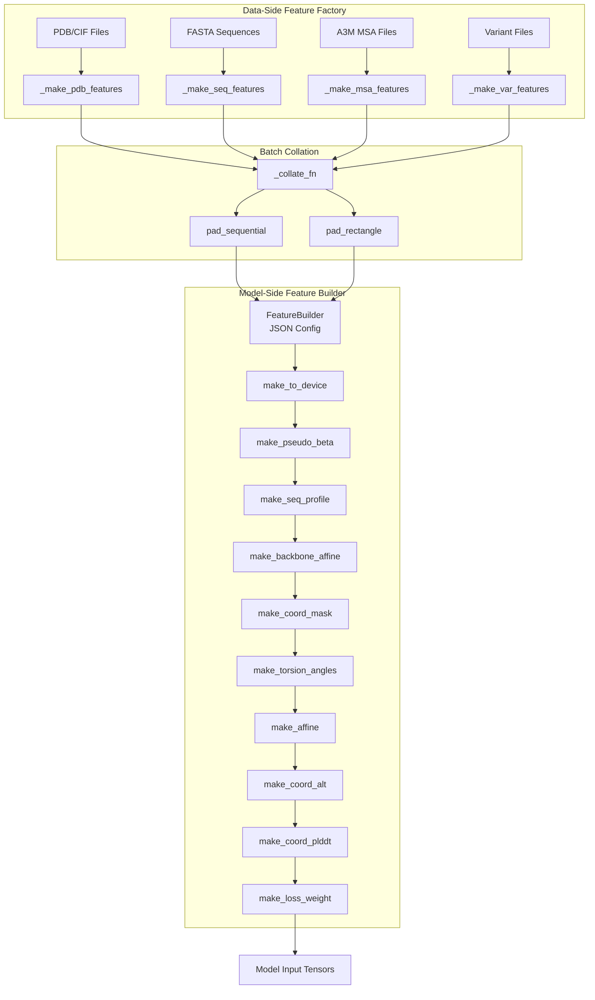
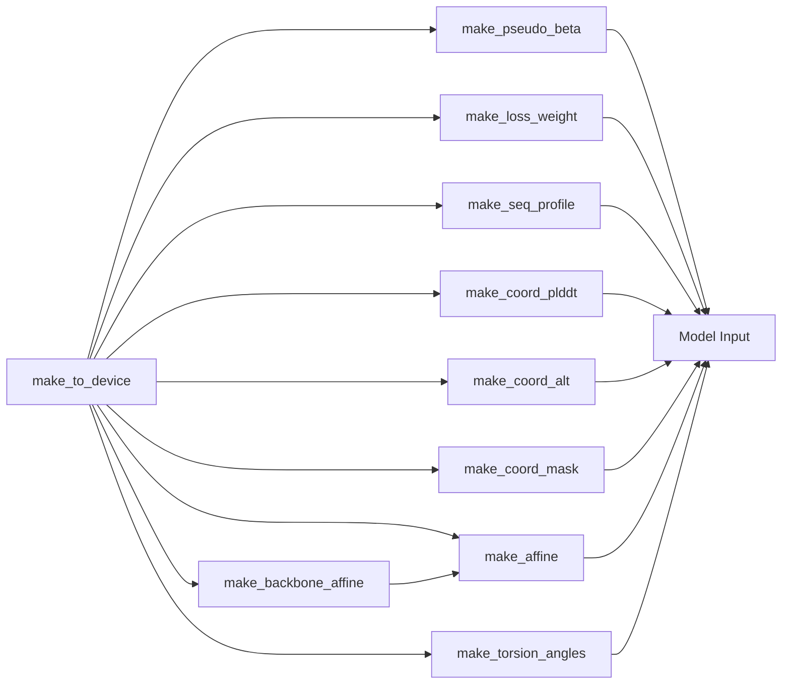

ProFOLD2's feature engineering pipeline transforms raw biological data — PDB structures, amino acid sequences, MSA alignments, and pre-trained language model embeddings — into the precise tensor representations consumed by the AlphaFold2-derived architecture. This system is deliberately split into two stages: a **data-side** feature factory that constructs raw features from files, and a **model-side** transformer chain that derives geometric, structural, and learned features just before they enter the network.

## Pipeline Architecture Overview

The feature engineering system follows a clear separation of concerns. Raw data ingestion lives in the dataset layer (`profold2/data/dataset.py`), while derived feature computation is orchestrated by the `FeatureBuilder` class (`profold2/model/features.py`) using a declarative, config-driven approach.



## Feature Flag System

The dataset layer uses a bitmask system to control which feature categories are materialized, enabling lightweight inference paths that skip expensive MSA and variant processing.

| Flag Constant | Hex Value | Feature Category | Description |
|---|---|---|---|
| `FEAT_PDB` | `0x01` | Structure | 3D coordinates, coordinate masks, B-factors |
| `FEAT_MSA` | `0x02` | Multiple Sequence Alignment | MSA matrices, deletion matrices, MSA masks |
| `FEAT_VAR` | `0x04` | Sequence Variants | Variant sequences, task masks, labels |
| `FEAT_ALL` | `0xFF` | All Features | Full feature set for training |

Sources: [dataset.py](profold2/data/dataset.py#L39-L42)

## Data-Side: Raw Feature Construction

### Sequence Features

The `_make_seq_features` function is the most fundamental feature constructor, invoked for every chain whether loaded from structure or sequence alone. It converts a character-level amino acid sequence into the integer-encoded tensor representation used throughout the model.

The function produces a dictionary containing `seq` (integer-encoded residue types via one-hot argmax over the 21 standard amino acids plus X), `seq_index` (residue position indices, optionally parsed from PDB metadata), `seq_color` and `seq_entity` (chain identification for multimer assembly), `seq_sym` (symmetry group identifiers), `str_seq` (the original string sequence), and `mask` (a uniform-True boolean mask marking valid residues). The encoding uses `residue_constants.restype_order_with_x` as the mapping, with unknown residues mapped to X. All tensors are truncated to `max_seq_len` if provided.

Sources: [dataset.py](profold2/data/dataset.py#L434-L483)

### Structure Features

The `_make_pdb_features` function extends the sequence feature dict with 3D structural information parsed from PDB or mmCIF format files. It uses BioPython's `PDBParser` or `MMCIFParser` to extract per-residue atomic coordinates mapped into the 14-atom representation defined by `restype_name_to_atom14_names`.

For each residue, it constructs a label array of shape `(14, 3)` for coordinates and a boolean mask of shape `(14,)` indicating which atoms are present. Atom names are normalized through `fix_atom_id` and `fix_coord` to handle PDB format inconsistencies. B-factors are extracted and scaled by dividing by 100, producing `coord_plddt` — which during inference will be populated by model-predicted confidence scores. The function also detects domain boundaries (contiguous residue segments) by tracking gaps in residue numbering, encoding these in the description string.

Sources: [dataset.py](profold2/data/dataset.py#L548-L660)

### MSA Features

The `_make_msa_features` function processes A3M-format multiple sequence alignments into integer tensors. The A3M format uses lowercase letters to represent insertions (relative to the query) that should be deleted for alignment purposes — this is handled by a two-step parse: first extracting a deletion matrix by counting consecutive lowercase characters, then stripping all lowercase characters to produce the aligned sequence.

The aligned sequences are then converted to integer residue types using a composite mapping: `HHBLITS_AA_TO_ID` followed by `MAP_HHBLITS_AATYPE_TO_OUR_AATYPE`, which normalizes the external HHblits numbering scheme into ProFOLD2's internal representation. When `msa_idx` is specified, a particular MSA entry is promoted to position 1 (the query slot), and if `max_msa_depth` is set, the remaining MSA rows are randomly subsampled without replacement. The output includes `msa` (integer tensor), `msa_mask` (uniform-True boolean), `del_msa` (deletion counts), `str_msa` (string sequences for ESM embedding extraction), and `num_msa` (original depth before clipping).

Sources: [dataset.py](profold2/data/dataset.py#L216-L270)

### Variant Features

The `_make_var_features` function mirrors the MSA construction logic but adds weighted sampling for selecting which variants to include when `max_var_depth` is exceeded. Variant weights are determined through a three-tier priority system: first, an explicit `weight=` annotation in the variant description header; second, a lookup in an attribute dictionary keyed by protein-chain identifier; and third, a default uniform weight. The `softmax`-normalized weights then drive `np.random.choice` for non-replacement sampling.

Variant features additionally produce `variant_pid` (protein-chain identifiers for each variant), `variant_mask` (boolean mask excluding gap-only positions using the gap index from `restypes_with_x_and_gap`), and `variant_task_mask` which can encode multi-task learning objectives. Labels and label masks are parsed separately via `_make_label_features`, which supports both attribute-dict lookup and inline JSON annotations in description strings using `label=` and `label_mask=` prefixes.

Sources: [dataset.py](profold2/data/dataset.py#L322-L408)

## Batch Collation and Padding

Before features reach the model, the `_collate_fn` function assembles variable-length protein entries into fixed-shape batch tensors. It uses two padding strategies from `profold2/data/padding.py`, each suited to different tensor geometries.

### Padding Strategies

| Strategy | Function | Use Case | Padding Dimensions |
|---|---|---|---|
| **Sequential** | `pad_sequential` | 1D per-residue features (`seq`, `mask`, `coord`) | Pads along dim 0 to `max_batch_len` |
| **Rectangular** | `pad_rectangle` | 2D MSA/variant features (`msa`, `variant`) | Pads both depth and length dimensions |

The `pad_sequential` function auto-detects dtype and shape from the first non-None item in the batch, then fills shorter sequences with a specified padding value. For sequence features, unknown residues use `residue_constants.unk_restype_index`, while coordinate padding uses 1.0 for `coord_plddt` (signaling full confidence in padded positions). The `pad_rectangle` function handles the jagged MSA case by independently determining the maximum MSA depth across the batch and padding both dimensions — depth (rows) and sequence length (columns) — to a shared rectangle shape.

A `feat_flags` bitmask controls which feature groups the collation function processes, allowing inference to skip MSA and variant padding entirely.

Sources: [padding.py](profold2/data/padding.py#L6-L59), [dataset.py](profold2/data/dataset.py#L2024-L2105)

## Model-Side: The FeatureBuilder Chain

The `FeatureBuilder` class in `profold2/model/features.py` implements a declarative pipeline where feature transformations are specified as a list of `(function_name, kwargs)` tuples in a JSON configuration file. Each function is decorated with `@take1st`, which converts it from `fn(protein, **kwargs)` into a curried `lambda x: fn(x, **kwargs)`, enabling composition into a sequential processing chain.

### Configuration Format

The pipeline is driven by JSON config files — for example, `examples/model_features_150m.json` for the 150M parameter model:

```json
[
  ["make_to_device", {
      "fields":["seq", "seq_index", "mask", "coord", "coord_mask", ...],
      "device":"%(device)s"}],
  ["make_pseudo_beta", {}],
  ["make_loss_weight", {"distogram_w": 0.5, "folding_w": 0.1}],
  ["make_seq_profile", {"mask":"-", "density":true}],
  ["make_backbone_affine", {}],
  ["make_coord_plddt", {"threshold":0.5, "use_weighted_mask": true}],
  ["make_coord_alt", {}],
  ["make_coord_mask", {}],
  ["make_affine", {}],
  ["make_torsion_angles", {}]
]
```

The `FeatureBuilder.build()` method iterates through this list, looking up each function name in the internal `_feats_fn` registry populated by the `@take1st` decorator, and applies them sequentially to the protein dictionary. The `is_training` flag is threaded through to every function, enabling training-only feature construction (like ground truth derivations) to be silently skipped during inference.

Sources: [features.py](profold2/model/features.py#L1-L20), [features.py](profold2/model/features.py#L355-L383), [model_features_150m.json](examples/model_features_150m.json#L1-L15)

### Feature Function Catalog

The following table documents each feature function registered in the `_feats_fn` registry, its inputs, outputs, and training/inference behavior.

| Function | Training Only | Key Outputs | Purpose |
|---|---|---|---|
| `make_to_device` | No | (moves specified fields to GPU) | Device placement for all tensor fields |
| `make_seq_mask` | No | `mask` (bool tensor) | Boolean mask where `seq != padding_id` |
| `make_coord_mask` | No | `coord_exists` | Per-residue atom14 existence mask from `restype_atom14_mask` |
| `make_pseudo_beta` | No | `pseudo_beta`, `pseudo_beta_mask` | Cβ-equivalent coordinates for glycine (AlphaFold or RoseTTAFold method) |
| `make_seq_profile` | No | `sequence_profile` | Frequency profile from MSA or one-hot from sequence |
| `make_bert_mask` | Yes | `bert_mask`, `true_seq` | Random/SpanBERT masking for masked language modeling |
| `make_esm_embedd` | No | `embedds` (or custom field) | Pre-trained ESM language model embeddings |
| `make_backbone_affine` | Yes | `backbone_affine`, `backbone_affine_mask` | Rigid body frames from N-CA-C atoms |
| `make_affine` | Yes | Multiple rigid frames | Full rigid transformations from all backbone and sidechain atoms |
| `make_torsion_angles` | Yes | `phi`, `psi`, `omega`, `chi` angles | Backbone and sidechain torsion angle features |
| `make_loss_weight` | Yes | `loss.distogram.w`, `loss.folding.w` | Per-residue loss weighting between distogram and folding objectives |
| `make_coord_plddt` | Yes | `plddt_mean`, modified `coord_plddt` | Thresholded and gamma-scaled confidence scores |
| `make_coord_alt` | Yes | `coord_alt`, `coord_alt_mask` | Alternative atom permutations for symmetric residue handling |
| `make_delete_fields` | No | (removes specified keys) | Memory cleanup before model forward pass |

Sources: [features.py](profold2/model/features.py#L28-L354)

### Pseudo Beta Construction

ProFOLD2 supports two pseudo-β calculation methods, selectable via the `type` parameter. The **AlphaFold** method (`pseudo_beta_alphafold`) delegates to `functional.pseudo_beta_fn`, which places the pseudo-β at the Cα position for glycine and at the actual Cβ for all other residues, with a mask indicating validity. The **RoseTTAFold** method (`pseudo_beta_rosetta`) computes a synthetic Cβ-equivalent for glycine using a fixed linear combination of backbone vectors: `−0.583a + 0.568b − 0.541c + CA`, where `a = CA − N`, `b = C − CA`, and `c = a × b`. The mask requires all three backbone atoms (N, CA, C) to be present.

### Sequence Profile

The `make_seq_profile` function constructs a per-residue amino acid frequency vector. When an MSA is present, it one-hot encodes every MSA row and sums across the depth dimension, optionally weighted by `msa_mask`. When only a single sequence is available, it falls back to a one-hot encoding of `seq`. The `mask` parameter (typically `"-"`) filters out gap contributions, and the `density` flag normalizes the profile to sum to 1 per position. This profile serves as the model's evolutionary information signal, encoding conservation patterns from the MSA.

Sources: [features.py](profold2/model/features.py#L133-L176)

### Backbone Affine and Rigid Frames

The `make_backbone_affine` function constructs rigid body transformations from three backbone atoms — C, CA, and N (in that order) — using `functional.rigids_from_3x3`. This Gram-Schmidt orthogonalization produces a rotation matrix and translation vector defining the local coordinate frame of each residue. The `backbone_affine_mask` requires all three atoms to be present. The more comprehensive `make_affine` function calls `functional.rigids_from_positions`, which creates up to 8 rigid frames per residue covering backbone and sidechain reference atoms, providing the full set of local frames used by the structure module.

Sources: [features.py](profold2/model/features.py#L253-L287), [functional.py](profold2/model/functional.py#L495-L519)

### Confidence Score Processing

During training, `make_coord_plddt` transforms experimental B-factors into normalized confidence targets. It computes the per-residue mean confidence from Cα atoms, then applies an optional gamma scaling (`exp(γ * (plddt - 1))`) and a binary threshold mask that zeros out positions below the specified threshold (default 0.5). The `use_weighted_mask` flag controls whether this confidence information modulates the FAPE loss weighting. During inference, since ground truth coordinates are absent, this function is a no-op.

### Loss Weight Configuration

The `make_loss_weight` function computes per-residue loss weights that balance the distogram and folding objectives. The `distogram_w` and `folding_w` parameters (summing to at most 1.0) set minimum weights for their respective losses, while the query sequence row in the MSA (identified by `msa_idx == 0` and optionally `var_idx == 0`) receives the complementary weight `(1.0 - w)`, giving it higher influence on the loss. This ensures that the query sequence — which represents the target structure — contributes more heavily to gradient computation than homologous MSA sequences.

Sources: [features.py](profold2/model/features.py#L100-L116)

## ESM Embedding Integration

The `make_esm_embedd` feature function integrates pre-trained protein language model embeddings from Meta's ESM family. It instantiates an `ESMEmbeddingExtractor` (with singleton caching via `.get()`), extracts per-residue representations at a specified layer (`repr_layer`), and stores them in the protein dict under a configurable field name (default `"embedds"`). Input sequences are truncated to `max_seq_len` if specified, and the extraction is performed on the specified device. The output is reshaped to 4D `(batch, 1, length, channels)` to maintain compatibility with the MSA embedding pathway, enabling the model to substitute or supplement evolutionary MSA information with learned sequence representations.

> [!TIP]
> The ESM embedding function is one of the few feature functions that executes during both training and inference (`del is_training`). This is intentional — ESM embeddings serve as a drop-in replacement for MSA features when alignments are unavailable, making them critical for the single-sequence prediction path. See [ESM Embedding Integration](14-esm-embedding-integration) for extraction details and supported model variants.

Sources: [features.py](profold2/model/features.py#L319-L345)

## BERT-Style Masking

The `make_bert_mask` function implements optional masked language modeling on the input sequence. Two masking strategies are supported: **vanilla BERT masking** with a uniform `fraction` parameter that independently masks each residue with the specified probability, and **SpanBERT-style masking** that generates a Poisson-distributed number of contiguous span(s) defined by `span_mean`, `span_min`, and `span_max`. Masked positions are filled with the unknown residue type index (`residue_constants.unk_restype_index`), and the original sequence is preserved in `true_seq` for loss computation. Both strategies respect the residue mask, ensuring padding positions are never selected for masking.

> [!TIP]
> BERT masking is exclusively a training-time feature (gated by `is_training`). During inference, the function passes through the protein dict unchanged, making it transparent to the prediction pipeline. The masking probability and span parameters should be tuned relative to the overall training loss weighting to avoid destabilizing structure learning.

Sources: [features.py](profold2/model/features.py#L178-L216)

## Feature Dependency Graph

The order of functions in the config file matters — some features depend on outputs of earlier functions. The typical dependency chain enforced by the 150M model config follows this partial order:



All functions depend on `make_to_device` executing first, since they operate on GPU tensors. The `make_backbone_affine` output feeds into `make_affine` (which builds upon the backbone frames). The `make_coord_alt` function must precede `make_coord_mask` to ensure alternative coordinates are available when the coordinate mask is computed.

## Next Steps

- **[Dataset Loading and Cropping](13-dataset-loading-and-cropping)** — How the `ProteinStructureDataset` and `ProteinSequenceDataset` classes orchestrate feature loading, and how cropping strategies interact with the feature pipeline.
- **[ESM Embedding Integration](14-esm-embedding-integration)** — Deep dive into the `ESMEmbeddingExtractor` singleton, supported ESM model variants, and layer selection strategies.
- **[Multi-Chain and Multimer Handling](15-multi-chain-and-multimer-handling)** — How `seq_color`, `seq_entity`, and `seq_sym` features enable the assembly of multi-chain complexes from individual chain features.