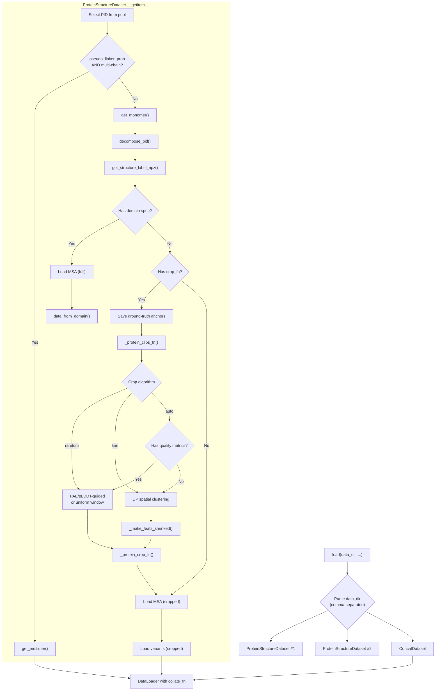

ProFOLD2's data pipeline bridges raw structural biology files — FASTA sequences, PDB/mmCIF coordinates, NPZ structure labels, and MSA profiles — into the tensor feature dictionaries consumed by the model. This subsystem is engineered around two core concerns: **deterministic feature construction** from heterogeneous file formats, and **stochastic cropping** that maintains structural coherence while managing sequence length variance during training. Every protein entering the Evoformer or folding pipeline passes through this gate, making it the single most impactful point for both data quality and training efficiency.

Sources: [dataset.py](profold2/data/dataset.py#L1-L42)

## Data Source Abstraction: FileSystem and FoldcompDB

The loading layer abstracts away whether protein data lives in a plain directory, inside a ZIP archive, or within a Foldcomp compressed database. The `FileSystem` class provides a unified context-manager interface over both `pathlib.Path` and `zipfile.ZipFile` backends, routing `open()`, `exists()`, and `abspath()` calls to the appropriate underlying implementation. This means a single dataset configuration can reference local development directories during debugging and switch to compressed archives for production without any code change in the feature construction logic.

Sources: [dataset.py](profold2/data/dataset.py#L1066-L1120)

For legacy or space-constrained setups, `FoldcompDB` wraps the Foldcomp compressed structure format. It lazily opens the database on first access (`__getitem__` triggers `open()` if the handle is `None`), and uses a pre-built `pdb_idx` dictionary (loaded from a pickled index file) to resolve protein IDs to integer offsets within the Foldcomp archive. The class also supports serialization through `__getstate__`/`__setstate__`, ensuring that dataset pickling for distributed training workers correctly re-opens the database handle on the remote process.

Sources: [dataset.py](profold2/data/dataset.py#L1121-L1164)

## ProteinStructureDataset: The Central Dataset Class

`ProteinStructureDataset` is the primary `torch.utils.data.Dataset` implementation for structure-aware training. During initialization, it performs a thorough index-loading phase that reads multiple index files from the data directory to build in-memory lookup tables. This index phase is the entire upfront cost — subsequent `__getitem__` calls perform only lightweight lookups against these dictionaries.

The initialization loads four optional index files that progressively enrich the dataset's capabilities:

| Index File | Default Name | Purpose |
|---|---|---|
| Protein index | `name.idx` | **Required**. Each non-comment, non-empty line defines one or more protein IDs. Multiple IDs per line create a random-access pool for that index slot. |
| Mapping index | `mapping.idx` | Maps cluster member IDs to their representative key (e.g., CATH superfamily representative), enabling shared structure labels across homologous entries. |
| Chain index | `chain.idx` | Lists available chain combinations per protein, enabling multimer/heteromer training via pseudo-linker assembly. |
| Attribute index | `attr.idx` | JSON-encoded per-protein metadata, including `task_def` for multimer task definitions. |
| Resolution index | `resolu.idx` | Experimental resolution values used for confidence-weighted sampling. |

Sources: [dataset.py](profold2/data/dataset.py#L1286-L1362)

The `__getitem__` method implements a stochastic branching strategy. For each index slot, it randomly selects one protein ID from the pool (or uses a caller-specified key). If `pseudo_linker_prob` is active and the protein has multiple chains available, it routes to `get_multimer()` for heteromer assembly; otherwise, it falls through to `get_monomer()`. This branching is the mechanism by which a dataset containing both monomeric and multimeric proteins can train the model on chain complexes without requiring separate data pipelines.

Sources: [dataset.py](profold2/data/dataset.py#L1374-L1398)

## Monomer Feature Construction

The `get_monomer` method orchestrates the full feature extraction pipeline for single-chain proteins. It begins by decomposing the protein ID to extract optional domain specifications (CATH-style `1abcA1-100` format), then delegates to `get_structure_label_npz` for the heavy lifting of reading sequence and coordinate data from the filesystem.

Sources: [dataset.py](profold2/data/dataset.py#L1440-L1510)

### Sequence Features (`_make_seq_features`)

This function converts a raw amino acid or nucleotide sequence string into the core tensor features required by every downstream module. It produces a dictionary containing `seq` (integer-encoded residues), `seq_index` (PDB residue numbering extracted from the description line), `seq_color` (chain identification), `seq_entity` (biological assembly grouping), `seq_sym` (symmetry group index), `seq_type` (protein/RNA/DNA integer constant), `str_seq` (the cleaned string sequence), and a binary `mask`.

The `parse_seq_index` utility processes description fields that may contain explicit residue index ranges (e.g., `mol:protein 1-50`), overriding the default sequential numbering. This is essential for correctly preserving the original PDB residue numbering when the input is a domain extract rather than a full chain.

Sources: [dataset.py](profold2/data/dataset.py#L434-L483), [data/utils.py](profold2/data/utils.py#L123-L148)

### Structure Label Loading (`get_structure_label_npz`)

This is the primary method for loading ground-truth structural data. It follows a priority cascade: first check for a pre-computed NPZ file (the preferred training format containing `coord`, `coord_mask`, and optional `bfactor` arrays), then fall back to raw PDB/CIF files parsed through BioPython, and finally attempt the Foldcomp database. The NPZ path includes an important compatibility fix — it dynamically pads or truncates the atom dimension to exactly `atom14_type_num` (14 atoms per residue), ensuring consistency whether the source data uses atom14 or atom37 representations.

Sources: [dataset.py](profold2/data/dataset.py#L1893-L2015)

When NPZ files are absent, the pipeline invokes `_make_pdb_features`, which uses BioPython's `PDBParser` or `MMCIFParser` to extract per-residue atom coordinates. It iterates through residues, skipping hetero-atoms and insertion codes, maps 3-letter residue codes to the 1-letter alphabet via `residue_constants`, and constructs atom14 label arrays. Coordination data is cleaned through `fix_coord` to handle missing atoms and standardize geometry. For RNA structures, a separate `bpseq` file path loads base-pairing annotations into a `sta` (secondary structure) tensor.

Sources: [dataset.py](profold2/data/dataset.py#L548-L661)

### Anchor Feature Generation

When cropping is applied (see below), the pipeline generates anchor features that let the model understand the relationship between the cropped subregion and the original full-length structure. `_make_anchor_features` counts how many chain colors and entities from the pre-crop ground truth survive into the cropped region, storing this in `seq_anchor` and related fields. This is particularly important for RNA duplex prediction, where cropping may remove one strand of a duplex.

Sources: [dataset.py](profold2/data/dataset.py#L663-L716)

## The Cropping System

Cropping is the most architecturally significant augmentation in the data pipeline. Rather than simply slicing sequences, ProFOLD2 implements three distinct cropping algorithms — each producing clip descriptors that encode the mapping between the cropped and original coordinate frames. The cropping decision is deferred until after structure labels are loaded, so the algorithm can condition on actual structural quality metrics.

### Clip Descriptor Format

A clip is a dictionary describing how to extract a subregion from a protein feature dict. Two formats exist:

- **Sequential clips**: `{'i': int, 'j': int, 'd': [i..j], 'l': n}` — a contiguous span from residue `i` to `j` in the original protein of length `n`. Used by `random` and `auto` samplers.
- **Discontinuous clips**: `{'d': [idx_list], 'c': center_idx, 'l': n}` — an ordered list of residue indices (not necessarily contiguous), with `c` indicating the spatial center residue. Used by the `knn` sampler.

After cropping, the clip is formatted for batch serialization via `_protein_crop_fmt`, converting index lists to human-readable range strings.

Sources: [dataset.py](profold2/data/dataset.py#L929-L975)

### Crop Length Determination

The `_crop_length` helper resolves the target crop size based on `min_crop_len`, `max_crop_len`, and whether this particular sample should be cropped at all (governed by `crop_probability`). When `min_crop_len` and `max_crop_len` define a range, the actual length is sampled uniformly from `[min_crop_len, min(n, max_crop_len)]`. If only `max_crop_len` is set and the protein is shorter, no cropping occurs — the clip function returns `None` upstream.

Sources: [dataset.py](profold2/data/dataset.py#L790-L797)

### Random Sampler

The default sampler selects a contiguous window of the target length at a uniformly random start position. It includes two intelligence-boosting modes:

- **PAE-guided** (`min_crop_pae=True`): Computes a cumulative sum matrix from the pre-computed `coord_pae` (predicted aligned error) tensor, then derives per-position weights proportional to the inverse average PAE within the window. Positions with lower predicted error receive higher sampling probability, biasing crops toward well-structured regions.
- **pLDDT-guided** (`max_crop_plddt=True`): Uses a sliding-window cumulative sum over per-residue `coord_plddt` (per-atom confidence) to prefer regions with higher local confidence. The weight is raised to the power of 2.0 for sharper discrimination.

A rejection loop ensures that cropped regions contain at least one valid atom (checked via `coord_mask`), preventing degenerate crops from entirely unmodelled regions.

Sources: [dataset.py](profold2/data/dataset.py#L799-L858)

### KNN Sampler

The KNN (k-nearest-neighbor) sampler is the most sophisticated cropping strategy, designed to produce spatially coherent crops even when the underlying sequence ordering does not reflect the 3D fold. It operates in three phases:

1. **Seed selection**: Chooses a random residue as the spatial seed. With probability `crop_spatial_interface_ratio`, it instead selects a residue at a chain-chain interface (identified by `seq_color` differences within a distance cutoff of 15Å).
2. **Dynamic programming optimization**: Builds an `opt_h[i][j]` table representing the maximum spatial density achievable by selecting `j` residues from the first `i` residues (ordered by distance from the seed). The reward function is `1/(dist² + ε)`, and a gamma penalty discourages overly short contiguous segments.
3. **Traceback**: Recovers the optimal residue set by backtracking through the DP table, enforcing a minimum segment length constraint of 32 residues.

The result is a discontinuous clip that selects residues forming a spatially compact cluster around the seed point, even if they are distant in sequence space. This is particularly valuable for proteins with long loops or domain-swapped architectures.

Sources: [dataset.py](profold2/data/dataset.py#L860-L917)

### Auto Sampler

The `auto` algorithm dispatches between `random` and `knn` based on available metadata. If PAE or pLDDT quality metrics are present in the protein features, it uses `random` (to leverage those quality signals). If the protein length exceeds the configurable threshold `profold2_data_knn_sampler_max_length` (default 65536), it also falls back to `random` for computational efficiency. Otherwise, it uses `knn` for spatially-aware cropping. When structural coordinates are missing entirely (e.g., during inference on novel sequences), it automatically downgrades to `random`.

Sources: [dataset.py](profold2/data/dataset.py#L919-L927)

### Applying Crops: `_protein_crop_fn` and `_make_feats_shrinked`

Once a clip is determined, two distinct code paths apply it:

- **Sequential clips** (`i`/`j` based): `_protein_crop_fn` performs direct slice operations on every tensor field in the protein dict. It handles the special case of `coord_pae` (a square matrix that must be sliced on both axes), `sta` (pairwise secondary structure that requires index remapping through one-hot conversion), and MSA/variant tensors (sliced along the residue dimension).
- **Discontinuous clips** (`d` list based): `_make_feats_shrinked` uses `torch.index_select` to reorder and subset tensors according to the arbitrary index list. It shares the same `sta` remapping logic but applies it via index selection rather than slicing.

Both paths update string-based features (`str_seq`, `str_msa`, `str_var`) by character-level reindexing. The `coord_pae` tensor receives special treatment: for discontinuous crops, it is indexed on both dimensions with the same `new_order`, preserving pairwise error relationships among the selected residues.

Sources: [dataset.py](profold2/data/dataset.py#L717-L760), [dataset.py](profold2/data/dataset.py#L929-L975)

> [!TIP]
> The cropping system interacts critically with the MSA loading path. When `feat_flags & FEAT_MSA` is active, MSA features are loaded *after* cropping (if no domain specification exists), passing the clip descriptor to `get_msa_features_new` so that alignment columns are filtered to match the cropped residue set. However, if a domain specification is present in the protein ID, MSA features are loaded before domain extraction and cropping is applied afterward via `data_from_domain`. This ordering difference means domain-based extraction crops both sequence and MSA simultaneously, while random/knn cropping loads the full MSA then filters — a potentially expensive operation for deep alignments.

## The `load` Function: Unified Entry Point

The module-level `load()` function is the single entry point for constructing a training-ready `DataLoader`. It handles multi-directory concatenation (the `data_dir` parameter accepts comma-separated paths, creating one `ProteinStructureDataset` per path wrapped in a `ConcatDataset`), sampler configuration (supporting `WeightedRandomSampler` for resolution-weighted sampling and `DistributedSampler` for multi-GPU training), and automatic crop function construction via `functools.partial`.

Several parameters accept environment variable overrides through the `env()` utility, enabling configuration without code changes:

| Parameter | Environment Variable | Default | Effect |
|---|---|---|---|
| `crop_spatial_interface_ratio` | `profold2_data_crop_spatial_interface_ratio` | 0.0 | Probability of interface-guided KNN seeding |
| `crop_spatial_interface_cutoff` | `profold2_data_crop_spatial_interface_cutoff` | 15 | Distance cutoff (Å) for chain-chain interface detection |
| `max_msa_depth` | (direct parameter) | 128 | Maximum number of MSA sequences per sample |
| `max_var_depth` | (direct parameter) | 1024 | Maximum number of variant sequences per sample |
| `feat_flags` | (direct parameter) | `FEAT_ALL & (~FEAT_MSA)` | Bitmask controlling which feature groups are loaded |

The `feat_flags` bitmask controls which expensive feature groups are activated. The default excludes MSA features (`FEAT_ALL & ~FEAT_MSA`), which is appropriate for inference and fine-tuning scenarios where MSA data is unavailable. Setting `FEAT_ALL` activates all feature groups including PDB coordinates, MSA profiles, and variant sequences.

Sources: [dataset.py](profold2/data/dataset.py#L2107-L2226)

## Batch Collation and Padding

The static `collate_fn` transforms a list of variable-length protein dicts into padded, batched tensors. It uses two padding strategies from the companion `padding` module: `pad_sequential` for 1D sequence-level features (padded to `max_batch_len` along dimension 0), and `pad_rectangle` for 2D alignment features (padded to both `max_batch_len` on the residue axis and the maximum alignment depth on the sequence axis).

Feature-specific padding values are semantically meaningful rather than zero-filled: sequence tokens pad with `unk_restype_index` (the unknown amino acid), alignment positions pad with the gap character index, and pLDDT values pad with 1.0 (high confidence) to avoid penalizing the model for missing structure in padded regions.

The collation function is feature-flag-aware — it skips entire feature groups when the corresponding flag is not set, and uses `_any(field)` checks to handle batches where some proteins lack optional features (e.g., `coord_plddt` may be absent for predicted structures without confidence scores).

Sources: [dataset.py](profold2/data/dataset.py#L2024-L2106), [padding.py](profold2/data/padding.py#L6-L59)

## Multimer Assembly Pipeline

When `get_multimer` is invoked (triggered by the pseudo-linker mechanism or explicit chain selection), the dataset concatenates features from multiple chains into a single unified sample. For each chain in the shuffled chain list, it calls `get_monomer` to extract per-chain features, then uses `concat_seq_feats`, `concat_coord_feats`, and `concat_msa_feats` to merge them along the residue dimension. The `seq_index` field uses a configurable `seq_index_gap` (default 128) between chains to prevent residue numbering collisions. Chain-specific features like `seq_color` and `seq_entity` are assigned distinct integer values to let the model distinguish between chains during both Evoformer attention and structure module inference.

Sources: [dataset.py](profold2/data/dataset.py#L1540-L1560), [dataset.py](profold2/data/dataset.py#L978-L1065)

## Feature Flag Bitmask System

The feature loading system is controlled by a bitmask that determines which feature groups are constructed and returned:

| Flag Constant | Value | Feature Group |
|---|---|---|
| `FEAT_PDB` | `0x01` | 3D coordinates (`coord`, `coord_mask`, `coord_plddt`, `coord_pae`) |
| `FEAT_MSA` | `0x02` | Multiple sequence alignments (`msa`, `msa_mask`, `del_msa`, `str_msa`) |
| `FEAT_VAR` | `0x04` | Variant sequences (`variant`, `variant_mask`, `del_var`, `variant_task_mask`) |
| `FEAT_ALL` | `0xff` | All features enabled |

The bitmask flows from `load()` through to `ProteinStructureDataset.__init__()`, and is consulted at every point where expensive I/O or computation would be required — most notably in `get_structure_label_npz` (NPZ coordinate loading is gated by `FEAT_PDB`), and in the post-crop MSA/variant loading paths. This design means that disabling unused feature groups eliminates both disk I/O and tensor allocation, which is critical for inference throughput.

Sources: [dataset.py](profold2/data/dataset.py#L39-L42)

## Next Steps

This page covered how raw files become tensor batches and how cropping maintains structural coherence. To understand what features these tensors encode and how they map to model inputs, see [Feature Engineering](12-feature-engineering). For the complementary embedding pathway that enriches sequence features with protein language model representations, see [ESM Embedding Integration](14-esm-embedding-integration). To understand how multiple chains are assembled into training complexes, see [Multi-Chain and Multimer Handling](15-multi-chain-and-multimer-handling).