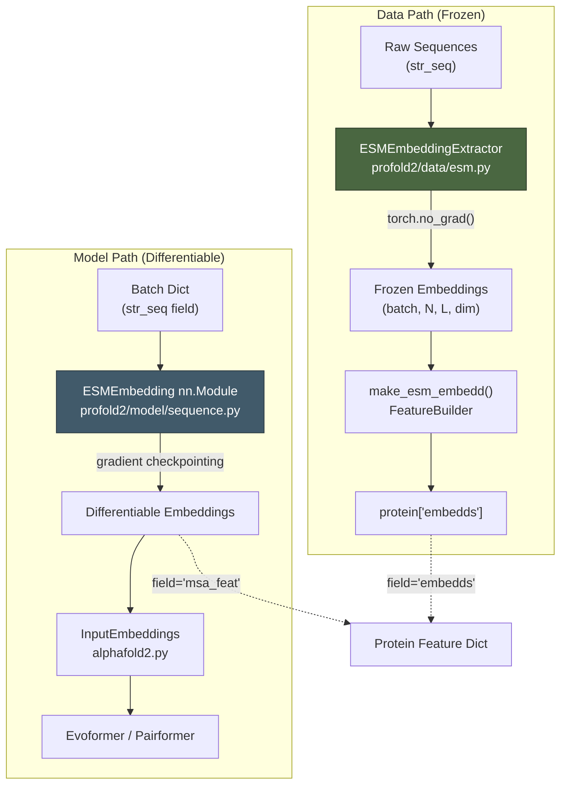
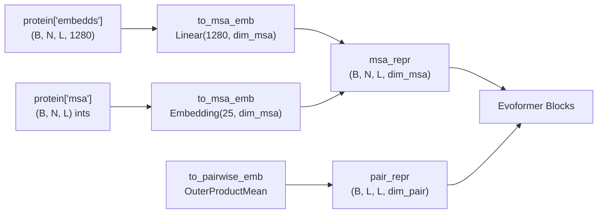

ProFOLD2 leverages Meta's Evolutionary Scale Modeling (ESM) protein language models to inject pre-trained single-sequence representations into its structure prediction pipeline. This integration replaces or supplements traditional MSA-derived features, enabling high-quality predictions even when evolutionary information is sparse. The system supports two ESM variants—ESM-1b for single sequences and ESM-MSA for multiple sequence alignments—each with a dedicated code path for data preprocessing and a separate path for differentiable model training.

## Supported ESM Models

ProFOLD2 embeds two ESM model variants, each serving a distinct role in the feature pipeline. The constants defining these models are declared in both the data extraction layer and the model layer to ensure consistency across offline preprocessing and runtime inference.

| Property | ESM-1b | ESM-MSA |
|---|---|---|
| **Model ID** | `esm1b_t33_650M_UR50S` | `esm_msa1b_t12_100M_UR50S` |
| **Repository** | `facebookresearch/esm:main` | `facebookresearch/esm:main` |
| **Extraction Layer** | 33 (final) | 12 (final) |
| **Embedding Dimension** | 1280 | 768 |
| **Parameter Count** | ~650M | ~100M |
| **Input Type** | Single sequence | Multiple sequence alignment |
| **Output Rank** | `(batch, L, 1280)` | `(batch, N, L, 768)` where N = MSA depth |

These constants are mirrored in two locations: [`profold2/data/esm.py`](profold2/data/esm.py#L7-L13) for the data-pipeline extractor and [`profold2/model/sequence.py`](profold2/model/sequence.py#L14-L20) for the trainable `nn.Module`. The extraction layer is always the final transformer layer of each model, which has been shown to capture the richest residue-level representations.

Sources: [esm.py](profold2/data/esm.py#L7-L13), [sequence.py](profold2/model/sequence.py#L14-L20)

## Architecture: Two-Path Integration

The ESM integration follows a dual-path architecture. The **data path** (`ESMEmbeddingExtractor`) runs offline or at the start of a training step with `torch.no_grad()`, producing frozen embeddings stored in the protein feature dictionary. The **model path** (`ESMEmbedding` as `nn.Module`) is a differentiable wrapper that participates in the computational graph, enabling gradient flow through the ESM backbone during training. Both paths share the same sliding-window strategy for long sequences but differ fundamentally in their autograd behavior.



The choice between paths depends on the training configuration. When `make_esm_embedd` is listed in the feature pipeline (see `model_features_*.json`), the data path executes during dataset loading or feature building. When the model's `InputEmbeddings` receives `msa_feat` with ESM-derived dimensions, the model path activates. Both can coexist: frozen embeddings provide a baseline signal, while differentiable ones allow end-to-end fine-tuning.

Sources: [esm.py](profold2/data/esm.py#L20-L82), [sequence.py](profold2/model/sequence.py#L153-L254), [features.py](profold2/model/features.py#L296-L317)

## Data Path: ESMEmbeddingExtractor

The `ESMEmbeddingExtractor` class in [`profold2/data/esm.py`](profold2/data/esm.py#L20-L82) is a stateless, callable wrapper around ESM's `torch.hub` models. It is designed for inference and data preprocessing—no gradients are computed, making it lightweight and suitable for CPU or single-GPU offline embedding generation.

### Singleton Pattern with `get()`

Extractors are managed through a module-level singleton registry `_extractor_dict` keyed by `(repo_or_dir, model)` tuples. The static method `ESMEmbeddingExtractor.get()` ensures only one instance of each ESM model exists per process, avoiding redundant 650M-parameter model loads across data workers.

```python
# profold2/data/esm.py
_extractor_dict = {}

class ESMEmbeddingExtractor:
    @staticmethod
    def get(repo_or_dir, model, device=None):
        global _extractor_dict
        if (repo_or_dir, model) not in _extractor_dict:
            obj = ESMEmbeddingExtractor(repo_or_dir, model)
            if exists(device):
                obj.model.to(device=device)
            _extractor_dict[(repo_or_dir, model)] = obj
        return _extractor_dict[(repo_or_dir, model)]
```

### Sliding Window for Long Sequences

ESM models have a hard positional embedding limit (`max_input_len = 1022` for ESM-1b). The extractor implements a sliding-window strategy with a half-window step (`max_step_len = 511`) and overlap trimming to produce seamless embeddings for sequences of arbitrary length. The window logic handles three cases: (1) the initial window starts at position 0, (2) subsequent windows advance by `max_step_len` with the first `delta` positions trimmed due to positional encoding offset, and (3) the final window snaps backward when the remaining tail is shorter than a full window.

> [!TIP]
> The overlap between consecutive windows is exactly `max_input_len - max_step_len` positions. Representations from overlapping regions are reconciled by symmetrically trimming from both the trailing edge of the previous chunk and the leading edge of the current chunk: `delta = max_input_len - max_step_len` tokens are skipped from the current chunk's start, and `p = delta // 2` tokens are trimmed from the previous chunk's end. This ensures a smooth, non-repeating concatenation.

### Input/Output Contract

The `extract()` method accepts sequences in the format `[(label, sequence_string), ...]` and returns a tensor of shape `(batch, L, embed_dim)` for ESM-1b or `(batch, N, L, embed_dim)` for ESM-MSA. Optionally, when `return_contacts=True` and the sequence fits within `max_input_len`, it also returns an attention-derived contact map of shape `(batch, L, L)`.

Sources: [esm.py](profold2/data/esm.py#L20-L93)

## Model Path: ESMEmbedding Module

The `ESMEmbedding` class in [`profold2/model/sequence.py`](profold2/model/sequence.py#L153-L254) is a PyTorch `nn.Module` that wraps the ESM model for use within a training computational graph. Its key distinction from the data-path extractor is **gradient support via activation checkpointing**, which allows the 33-layer ESM-1b transformer to backpropagate through its full depth without exhausting GPU memory.

### Monkey-Patched Forward Pass

Rather than calling ESM's built-in `forward()` method directly, ProFOLD2 replaces two internal methods on the loaded ESM model instance. The function `_esm_lookup()` ([`sequence.py`](profold2/model/sequence.py#L25-L68)) overrides the standard embedding lookup to support **pseudo-positional encoding** via a `clips` mechanism. This is critical for the sliding-window approach: when a subsequence starts at position `i > 0`, the function constructs a pseudo-token sequence with `i` unknown tokens prepended, computes positional embeddings on this extended sequence, then slices away the prefix—ensuring each residue receives the correct absolute positional encoding even when processed in isolation.

```python
def _esm_lookup(self, alphabet, tokens, clips=None):
    # Standard embedding
    x = self.embed_scale * self.embed_tokens(tokens)
    # For each batch element, construct pseudo-tokens to get correct position encoding
    if pos_idx > 0:
        unks = torch.full((1, pos_idx) + tokens.shape[2:], alphabet.unk_idx, ...)
        pseudo_tokens = torch.cat((tokens[b:b+1, :1], unks, tokens[b:b+1, 1:]), dim=1)
        pseudo_pos_embed = self.embed_positions(pseudo_tokens)
        # Slice away the pseudo-prefix
        return torch.cat((pseudo_pos_embed[:, :1], pseudo_pos_embed[:, pos_idx+1:]), dim=1)
```

Similarly, `_esm_forward()` ([`sequence.py`](profold2/model/sequence.py#L71-L151)) replaces ESM's forward pass to use the custom `_esm_lookup` for embeddings while preserving the standard transformer layer iteration and output head logic.

### Gradient Checkpointing

The `forward_()` method wraps the ESM forward pass in `torch.utils.checkpoint.checkpoint()` when gradients are enabled. This trades computation for memory: instead of caching all 33 intermediate layer activations, only the input and output of the entire ESM stack are stored, with intermediate activations recomputed during the backward pass.

> [!TIP]
> During training (`self.training=True`), the model uses the full-sequence path without sliding windows—input sequences are expected to be pre-cropped to fit within `max_input_len`. During inference (`not self.training`), the sliding-window path activates, processing sequences in chunks and concatenating results. This design choice reflects the assumption that training sequences are already cropped by the dataset pipeline's cropping functions.

Sources: [sequence.py](profold2/model/sequence.py#L25-L254)

## Feature Builder Integration

The bridge between ESM extraction and the model's feature pipeline is the `make_esm_embedd()` function in [`profold2/model/features.py`](profold2/model/features.py#L296-L317). This function is registered as a feature builder step and invoked by the `FeatureBuilder` class when listed in the model's feature configuration JSON.

```python
@take1st
def make_esm_embedd(protein, model, repr_layer, max_seq_len=None,
                    device=None, field='embedds', is_training=True):
    esm_extractor = ESMEmbeddingExtractor.get(*model, device=device)
    data_in = list(zip(protein['pid'], map(lambda x: x[:max_seq_len], protein['str_seq'])))
    data_out = esm_extractor.extract(data_in, repr_layer=repr_layer, device=device)
    if len(data_out.shape) == 3:
        data_out = rearrange(data_out, '... l c -> ... () l c')
    protein[field] = data_out
```

Key design decisions in this function: (1) it uses the **data-path extractor** (`ESMEmbeddingExtractor`), not the model-path `ESMEmbedding`, ensuring this step is non-differentiable and runs under `torch.no_grad()`; (2) it automatically adds a singleton dimension (`N=1`) when the output is 3D (ESM-1b case), normalizing the tensor to the expected 4D shape `(batch, N, L, dim)`; (3) the `field` parameter defaults to `'embedds'`, which is the key consumed downstream by `InputEmbeddings`.

To activate ESM embedding in the feature pipeline, add the following entry to the model features JSON (e.g., `model_features_150m.json`):

```json
["make_esm_embedd", {
    "model": ["facebookresearch/esm:main", "esm1b_t33_650M_UR50S"],
    "repr_layer": 33,
    "max_seq_len": 1022,
    "field": "embedds"
}]
```

Sources: [features.py](profold2/model/features.py#L296-L317), [model_features_150m.json](examples/model_features_150m.json#L1-L15)

## Flow into InputEmbeddings and the Evoformer

Once ESM embeddings reside in the protein feature dictionary under the `embedds` (or custom `field`) key, they flow into the model's `InputEmbeddings` module defined in [`profold2/model/alphafold2.py`](profold2/model/alphafold2.py#L62-L100). The `InputEmbeddings.__init__()` constructor accepts a `num_msa_tokens` parameter that, when set to the ESM embedding dimension (1280 or 768), configures `self.to_msa_emb` as an `nn.Linear` projection layer that maps raw ESM features into the model's MSA representation dimension (`dim_msa`).



When `num_msa_tokens > 0` (the ESM embedding dimension), the `to_msa_emb` is a `nn.Linear` that projects continuous ESM vectors. When `num_msa_tokens = 0` (the default MSA-only path), it is `None` and the standard integer embedding is used instead. The pairwise representation is then derived from the projected MSA features through an outer product mean, feeding into the Evoformer's alternating MSA-pair update cycle.

Sources: [alphafold2.py](profold2/model/alphafold2.py#L62-L100), [evoformer.py](profold2/model/evoformer.py#L199-L303)

## Usage Patterns and Configuration

### Pattern 1: Frozen ESM Features (Data Path Only)

This is the simplest integration. ESM embeddings are precomputed and stored as tensors in the dataset, analogous to precomputed MSA features. No ESM parameters participate in training.

1. Add `make_esm_embedd` to the feature pipeline JSON
2. Set `num_msa_tokens = 1280` (or 768 for ESM-MSA) in the model configuration
3. The `FeatureBuilder` calls `ESMEmbeddingExtractor.get()` lazily on first access

### Pattern 2: Differentiable ESM (Model Path)

For end-to-end fine-tuning of ESM representations alongside the structure model:

1. Instantiate `ESMEmbedding` as part of the model
2. During the forward pass, feed raw string sequences through the `ESMEmbedding` module
3. The resulting tensors (with gradients) are projected by `to_msa_emb` and enter the Evoformer
4. Gradient checkpointing in `ESMEmbedding.forward_()` manages memory

### Pattern 3: Hybrid (Both Paths)

Both paths can be active simultaneously. The data-path extractor produces frozen baseline embeddings stored in `protein['embedds']`, while the model-path module produces differentiable embeddings that override or augment them during training.

> [!TIP]
> The `ESMEmbeddingExtractor` singleton caches models globally via `_extractor_dict`. In multi-process training (e.g., DistributedDataParallel with multiple data workers), each worker process will independently load the ESM model on first access. Pre-allocate GPU memory or pin the extractor to a specific device to avoid out-of-memory errors when multiple workers initialize simultaneously.

## Testing

The test suite in [`tests/test_esm_extractor.py`](tests/test_esm_extractor.py#L7-L72) validates all core extraction behaviors across four test cases:

| Test | What It Validates | Key Assertion |
|---|---|---|
| `test_esm_extractor` | ESM-1b with contacts on short sequences | Shape `(B, L, 1280)` and contacts `(B, L, L)` |
| `test_esm_extractor2` | ESM-1b sliding window on a 1026-residue sequence | Correct shape despite exceeding `max_input_len` |
| `test_esm_extractor_tokens` | ESM-1b token embedding mode (`repr_layer=None`) | Uses `embed_tokens` instead of transformer layers |
| `test_msa_extractor` | ESM-MSA with 3-sequence MSA input | Shape `(1, 3, 65, 768)` — batch=1, N=3, L=65 |
