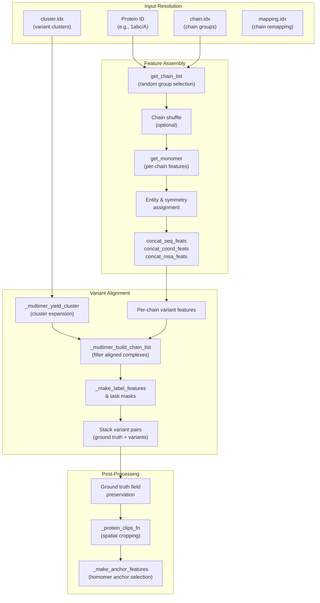

ProFOLD2's multi-chain and multimer infrastructure transforms independent protein chains into unified complex representations, enabling training and inference on heterogeneous oligomeric assemblies. This system encompasses chain resolution, feature concatenation, entity-aware labeling, variant alignment, and spatial cropping — all orchestrated through a hierarchical pipeline that bridges raw PDB data with the AlphaFold2-compatible model input format.

## Architectural Overview

The multimer system rests on a layered design: a **chain resolution layer** discovers which chains belong together in a complex; a **feature assembly layer** concatenates per-chain features into a single flat representation; and a **variant alignment layer** constructs paired complexes for contrastive co-evolutionary learning. These layers operate inside `ProteinStructureDataset.get_multimer`, which is the single entry point for constructing multimer training examples from the filesystem.



## Chain Resolution and Group Discovery

The foundation of multimer construction is `get_chain_list`, which reads from `chain.idx` — a configuration file that defines groups of chains known to form biologically relevant complexes. Each protein ID (PDB identifier) maps to one or more chain groups, and a single group is randomly selected per training step. The group must contain the "selected chain" (the chain specified in the protein ID), ensuring every example includes the originally requested chain alongside its interaction partners.

```python
# From profold2/data/dataset.py — chain group selection with random permutation
def get_chain_list(self, protein_id):
    pid, chain = decompose_pid(protein_id)
    if pid in self.chain_list:
        chain_group = self.chain_list[pid]
        for idx in np.random.permutation(len(chain_group)):
            g = chain_group[idx]
            if chain in g:
                return list(g)
    return None
```

The optional `mapping.idx` file provides chain ID remapping, allowing the same physical chain stored under one identifier to participate as a different logical chain in a complex — a critical capability when PDB chain IDs conflict or when dataset normalization requires consistent naming across entries. The `cluster.idx` file extends this further by defining equivalence classes of chains that share the same sequence but may appear under different PDB IDs, enabling cross-PDB variant mining during multimer construction.

Sources: [dataset.py](profold2/data/dataset.py#L1751-L1770), [dataset.py](profold2/data/dataset.py#L1510-L1514), [utils.py](profold2/data/utils.py#L13-L40)

## Per-Chain Feature Extraction with Context Suppression

For each chain in the assembled group, `get_multimer` calls `get_monomer` — the same single-chain feature loader used for monomeric training — but with a critical twist: the `_setattr` context manager temporarily overrides several dataset parameters to suppress context that would be inappropriate for multi-chain assemblies.

| Parameter | Monomer Value | Multimer Value (non-selected chains) | Rationale |
|---|---|---|---|
| `msa_as_seq_prob` | Configured value | **0** | Prevents MSA-to-sequence conversion for non-query chains, keeping the query chain's MSA as the primary co-evolution signal |
| `max_var_depth` | Configured value | **None** (unlimited) | Allows all variants to be collected for cross-chain alignment |
| `var_as_seq_prob` | Configured value | **0** | Disables variant-to-sequence augmentation on non-query chains |
| `attr_list` | Configured value | **None** | Removes attribute-based filtering for auxiliary chains |

The selected chain (the one specified in the original protein ID) retains its full MSA and variant configuration, while all other chains are loaded with their sequence, structure coordinates, and variant data but without independent MSA expansion. This asymmetry is deliberate: the query chain's MSA drives the primary co-evolutionary signal, while auxiliary chains contribute structural and sequential context.

Sources: [dataset.py](profold2/data/dataset.py#L1557-L1570), [dataset.py](profold2/data/dataset.py#L1440-L1510)

## Sequential Feature Concatenation

Once all per-chain features are extracted, three dedicated concatenation functions assemble them into a single flat tensor sequence. Each function handles a distinct feature class with chain-specific padding semantics.

**`concat_seq_feats`** concatenates sequence-level features (`seq`, `seq_index`, `seq_color`, `seq_entity`, `seq_sym`, `mask`) along the residue dimension. The `seq_index` field receives a cumulative offset plus a configurable gap (`seq_index_gap=128`) between chains, ensuring residue indices from different chains remain non-overlapping — essential for the model's pairwise attention to distinguish inter-chain from intra-chain residue pairs.

**`concat_coord_feats`** concatenates 3D coordinate tensors (`coord`, `coord_mask`, `coord_plddt`) along the residue dimension. If `coord_plddt` is absent for a chain (common for chains without experimental B-factors), it defaults to an all-ones tensor, giving those residues maximum confidence weighting by default.

**`concat_msa_feats`** aligns MSA depths across chains with asymmetric gap padding. When chains have different MSA depths, the shorter MSA is padded with gap tokens at the sequence level — but crucially, only on the *shorter* chain's columns, not across all residues. The maximum `msa_idx` and `num_msa` are tracked globally, and the final MSA tensor has shape `[max_msa_depth, total_residues]`.

Sources: [dataset.py](profold2/data/dataset.py#L978-L1064)

## Entity and Symmetry Assignment

As chains are concatenated, ProFOLD2 maintains two parallel labeling systems that encode quaternary structure semantics.

**`seq_color`** is a 1-indexed integer assigned to each chain in order of concatenation. Chain A receives `seq_color=1`, chain B receives `seq_color=2`, and so on. This field persists throughout the pipeline and is the primary mechanism by which the model distinguishes chains at inference time.

**`seq_entity`** groups chains by sequence identity. When multiple chains share identical sequences (homomers), they receive the same `seq_entity` value. This is tracked via a `seq_entity_map` dictionary that maps unique sequences to monotonically increasing entity IDs. The entity system is critical for the model's symmetry-aware loss computation and structure module behavior.

**`seq_sym`** counts how many times a given sequence has been encountered during the current multimer assembly. This provides a lightweight symmetry multiplicity signal without requiring expensive structural alignment.

```python
# Entity assignment during multimer assembly
seq_entity_map, seq_sym_map = defaultdict(int), defaultdict(int)
for idx, chain in enumerate(chains):
    feat = self.get_monomer(compose_pid(pid, chain), seq_color=idx + 1)
    if feat['str_seq'] not in seq_entity_map:
        seq_entity_map[feat['str_seq']] = len(seq_entity_map) + 1
    seq_sym_map[feat['str_seq']] += 1
    feat['seq_entity'] = torch.ones_like(feat['seq_entity']) * seq_entity_map[feat['str_seq']]
    feat['seq_sym'] = torch.ones_like(feat['seq_sym']) * seq_sym_map[feat['str_seq']]
```

The resulting composed PID follows the format `1abc/A,B,C` where `1abc` is the PDB identifier and the comma-separated chain list records the assembly composition. If MSA indices are involved, chains may be annotated as `A@3` to indicate the third MSA depth was selected.

Sources: [dataset.py](profold2/data/dataset.py#L1541-L1576)

## Variant Alignment and Cross-Chain Complex Mining

The variant system is where ProFOLD2's multimer handling diverges most sharply from AlphaFold-Multimer. Rather than simply concatenating paired MSAs, ProFOLD2 mines *cross-complex variants* — structural variants from other PDB entries that involve the same set of chains — and constructs paired (ground truth, variant) examples for contrastive learning.

The process begins with `_multimer_yield_cluster`, which expands a variant protein ID through the `cluster.idx` equivalence classes, yielding all `(pid, chain)` pairs that belong to the same sequence cluster. Then `_multimer_build_chain_list` filters these candidates through a strict alignment check: a candidate complex is accepted only if *every* chain in the target complex has a corresponding chain in the candidate, verified via `get_chain_list` with set intersection. This ensures structural compatibility — a heterodimer variant cannot be paired with a homodimer ground truth.

The LRU cache on `_multimer_build_chain_list` (`profold2_data_build_chain_lru_maxsize`, default 0) is a significant performance optimization: chain group membership is deterministic for a given `(protein_id, var_list)` pair, so repeated lookups during variant enumeration avoid redundant filesystem I/O and set operations.

Accepted variant complexes are then processed into a unified tensor stack. For each variant, every chain in the target complex is matched to its counterpart in the variant complex. Chains with no matching variant receive a gap-filled placeholder (all-gap sequence, zero mask). The resulting tensors have shape `[num_variants, total_residues]` for `variant`, `variant_mask`, and `del_var`.

Sources: [dataset.py](profold2/data/dataset.py#L1510-L1540), [dataset.py](profold2/data/dataset.py#L1628-L1708), [dataset.py](profold2/data/dataset.py#L1516-L1518)

## Task Masks and Label Features

ProFOLD2 supports multi-task training where different chains in a complex may be associated with different prediction tasks (e.g., binding site prediction on chain A, folding on chain B). This is governed by the optional `task_def` attribute, loaded from `attr.idx`, which maps chain names to sets of task indices.

The `_make_task_mask` function constructs a tensor of shape `[total_residues, task_num]` where each column is a binary mask indicating which residues participate in which task. Without `task_def`, all residues participate in all tasks (the mask is broadcast). With `task_def`, chain-specific masks are concatenated, and chains not assigned to a given task receive all-zero masks for that task column. This enables loss computation to be selectively applied per-chain and per-task.

Variant labels are constructed by `_make_label_features`, which parses `label=` and `label_mask=` annotations from variant descriptions. These labels propagate through the variant stack, with the first row always being `[1, ..., 1]` (the ground truth self-pair) and subsequent rows reflecting the variant's label assignments. The `variant_label_mask` field distinguishes real annotations from default values.

Sources: [dataset.py](profold2/data/dataset.py#L410-L433), [dataset.py](profold2/data/dataset.py#L272-L312)

## Spatial Cropping for Multimer Assemblies

After feature assembly, the optional `_protein_clips_fn` cropping system can reduce the assembled complex to a spatially contiguous subset. For multimer assemblies, this is particularly important because the full complex may exceed `max_crop_len` and because interface-focused cropping improves the model's ability to learn inter-chain interaction geometry.

The cropping system offers three algorithms, selected via `crop_algorithm`:

| Algorithm | Strategy | Requires Coordinates | Interface-Aware |
|---|---|---|---|
| `random` | Uniform random window over residue sequence | No | No |
| `knn` | Dynamic programming selection maximizing spatial density | **Yes** | Optional |
| `auto` | Selects `knn` when coordinates and quality signals are available, falls back to `random` | Conditional | Optional |

The KNN sampler is the most sophisticated: it computes pairwise CA distance matrices, optionally biases selection toward residues at chain interfaces (`crop_spatial_interface_ratio`), and solves an O(n·max_len) dynamic programming problem that finds the contiguous window maximizing a kernel density estimate over the distance field. The `seq_color` field (chain identity) is used directly to identify inter-chain spatial contacts for interface-aware sampling, where residues with higher cross-chain contact counts receive higher selection probability.

After cropping, ground truth fields (`seq_index`, `seq_color`, `seq_entity`, `coord`, `coord_mask`) are preserved under `_fgt` suffixes via the `_make_anchor_features` mechanism, which is essential for homomer training where the anchor chain must be identifiable after sub-sampling.

Sources: [dataset.py](profold2/data/dataset.py#L764-L928), [dataset.py](profold2/data/dataset.py#L1711-L1726)

## Homomer Anchor Selection

For homomeric assemblies (complexes where multiple chains share the same sequence), ProFOLD2 implements an anchor selection mechanism through `_make_anchor_features`. After cropping, this function identifies the entity with the highest multiplicity (most chain copies), selects one chain color from that entity as the "anchor," and stores it as `seq_anchor`.

The selection follows a hierarchical filtering strategy: first filter entities by count (keeping only those with the maximum number of copies), then by sequence length (keeping only the longest), then randomly break ties. The anchor chain's color ID propagates through the feature dict and is used by the model's symmetric ground truth handling system to define the reference frame for symmetry-aware loss computation.

> [!TIP]
> The `seq_anchor` field is only meaningful after cropping. In uncropped homomer assemblies, all chains remain intact and the anchor is set to 0 (disabled). The anchor mechanism interacts with the `_fgt` ground truth fields — both are populated together in `get_multimer` to ensure the model can recover full-complex symmetry information even from a cropped subset.

Sources: [dataset.py](profold2/data/dataset.py#L663-L716), [dataset.py](profold2/data/dataset.py#L1722-L1726)

## Data Loading Entry Point

The `load` function in [dataset.py](profold2/data/dataset.py#L2107) is the top-level entry point that assembles all multimer-related parameters. It accepts a comma-separated `data_dir` for multi-source training, parallel `chain_idx` and `attr_idx` files, and delegates to `ProteinStructureDataset` which implements the full multimer pipeline. The `pseudo_linker_prob` parameter (default 0) controls the probability of shuffling chain order during multimer assembly, which acts as a data augmentation strategy by presenting chains in different sequential orders to the model. The `pseudo_linker_shuffle` flag determines whether this shuffling is random or deterministic.

Sources: [dataset.py](profold2/data/dataset.py#L2107-L2226)

## Feature Flow Summary

The complete multimer feature dict, as produced by `get_multimer`, contains the following key fields organized by their role in the downstream model:

| Field Group | Fields | Shape Semantics |
|---|---|---|
| **Sequence identity** | `seq`, `str_seq`, `seq_index`, `seq_color`, `seq_entity`, `seq_sym` | `[total_res]` per-chain concatenated |
| **Structure** | `coord`, `coord_mask`, `coord_plddt` | `[total_res, 14, 3]`, `[total_res, 14]` |
| **MSA** | `msa`, `msa_mask`, `del_msa`, `num_msa` | `[max_msa_depth, total_res]` |
| **Variants** | `variant`, `variant_mask`, `variant_label`, `variant_task_mask` | `[num_var, total_res]`, `[num_var, total_res, task_num]` |
| **Metadata** | `pid`, `resolu`, `clip`, `seq_anchor`, `msa_idx`, `var_idx` | Scalar or None |
| **Ground truth** | `seq_index_fgt`, `seq_color_fgt`, `seq_entity_fgt`, `coord_fgt`, `coord_mask_fgt` | `[total_res]` (pre-crop values) |

For the complete picture of how these features flow into the model's Evoformer and structure module, see [AlphaFold2 Core Pipeline](5-alphafold2-core-pipeline). The entity and color semantics described here directly feed into the model's residue-type embedding and attention bias computations.

---

To continue exploring the data pipeline, see [Dataset Loading and Cropping](13-dataset-loading-and-cropping) for monomeric cropping strategies, or [Symmetric Ground Truth Handling](17-symmetric-ground-truth-handling) for how the anchor and entity fields are consumed during loss computation. For the model-side interpretation of multimer features, proceed to [Evoformer and Pairformer Blocks](6-evoformer-and-pairformer-blocks).