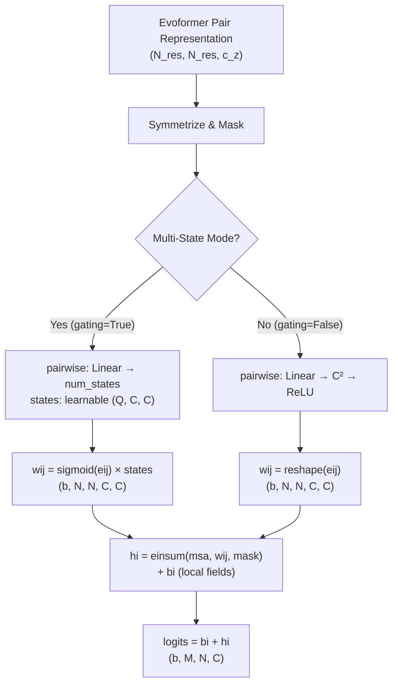
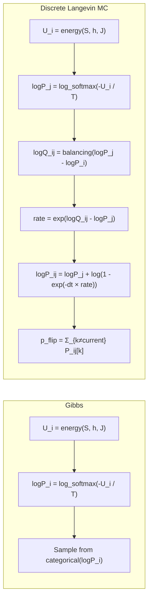
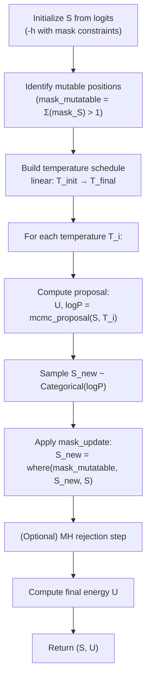

ProFOLD2 embeds a statistical Potts model as a first-class architectural component, enabling both inverse folding (sequence design from structure) and forward fitness prediction. The system extracts coupling matrices from learned pair representations, then applies MCMC sampling under complexity penalties to generate biophysically plausible sequences. This page traces the complete data flow from model inference through Potts extraction, energy computation, and sequence generation.

## Potts Model Energy Function

The foundational energy computation lives in `potts.energy()`, implementing the pairwise Potts Hamiltonian over discrete amino acid states. For a sequence **S** of length *L* with alphabet size *q*, the energy decomposes into local field terms *h_i(s_i)* and pairwise coupling terms *J_{ij}(s_i, s_j)* [Sources: [potts.py](profold2/model/potts.py#L12-L36)]:

```python
def energy(S, h, J, mask):
    S = F.one_hot(S.long(), num_classes=h.shape[-1]).float() * mask[..., None]
    J_i = torch.einsum('b m j d,b i j c d -> b m i c', S, J)
    U_i = h[..., None, :, :] + J_i
    U = torch.sum((U_i - 0.5 * J_i) * S, dim=(-1, -2))
    return U, U_i
```

The critical implementation detail is the **double-counting correction** at line 34: the raw local energy `U_i` includes each coupling twice (once from the perspective of each residue), so the total energy subtracts `0.5 * J_i` before summation. The function returns both the scalar total energy `U` with shape `(num_batch,)` and the per-position, per-state energy matrix `U_i` with shape `(num_batch, num_seqs, num_nodes, num_states)` — the latter is essential for MCMC proposals, as it provides the conditional energy landscape at each position.

Tensor dimensions follow a consistent convention throughout: `b` for batch, `m` for sequences (within a batch), `i/j` for residue positions, and `c/d` for amino acid states (22 classes including gaps and unknowns from `residue_constants.restypes_with_x_and_gap`).

Sources: [potts.py](profold2/model/potts.py#L12-L36)

## CoevolutionHead: Potts Parameter Extraction

The `CoevolutionHead` class bridges ProFOLD2's learned representations to the Potts model by projecting pair representations onto coupling matrices and single representations onto field vectors [Sources: [head.py](profold2/model/head.py#L185-L293)].



The head supports two distinct architectural modes. In **multi-state Potts mode** (`gating=True`), the pairwise output is compressed to a `num_states`-dimensional scalar per residue pair via a linear projection, then multiplied through a learnable state-mixing matrix `self.states` of shape `(num_states, C, C)` that is explicitly symmetrized at forward time. This factorization dramatically reduces parameter count — from O(N²C²) to O(N²Q + QC²) — while preserving expressive coupling patterns. The scalar coupling `eij` passes through a sigmoid activation, producing values in [0, 1] that act as coupling strengths, bounded and non-negative by construction.

In **native Potts mode** (`gating=False`), the pairwise network directly outputs a C²-dimensional vector per residue pair, reshaped into the full coupling matrix without the bottleneck. The optional **Average Product Correction** (`apc=True`) is applied via `functional.apc()` to remove background noise from the raw couplings — a standard technique in direct coupling analysis that subtracts the product of row/column averages to suppress phylogenetic bias.

The final logits are computed as: `logits[i, c] = bi[i, c] + Σ_j Σ_d wij[i, j, c, d] × msa[j, d]`, which is precisely the local conditional energy for position *i* given the current sequence context. During training, this is supervised with softmax cross-entropy against the true MSA sequences [Sources: [head.py](profold2/model/head.py#L295-L320)].

Sources: [head.py](profold2/model/head.py#L185-L320)

## MCMC Proposal Mechanisms

ProFOLD2 implements two MCMC proposal strategies for Potts sampling, dispatched through `mcmc_proposal()` [Sources: [potts.py](profold2/model/potts.py#L127-L158)]:



**Gibbs sampling** (`_proposal_gibbs`) computes the local conditional distribution `logP_i = log_softmax(-U_i / T)` and returns it directly as a categorical distribution from which to sample. This is the simplest correct sampler — each position is updated by drawing from its exact conditional given all other positions — but it can exhibit slow mixing in rugged energy landscapes.

**Discrete Langevin Monte Carlo** (`_proposal_dlmc`) implements the method from Sun et al. (2023), which uses a Langevin-like diffusion on the discrete state space. The key distinction from Gibbs is the computation of **transition log-probabilities** rather than equilibrium probabilities. For each position *i* currently in state *k*, the transition probability to state *l* is:

`log P_ij = log P_j + log(1 - exp(-dt × rate))`

where `rate = exp(logQ_ij - logP_j)` and `logQ_ij` is a balancing function of the energy gap. Two balancing functions are available: `sqrt` computes a geometric mean (`(logP_j - logP_i) × 0.5`), while `sigmoid` uses `logsigmoid(logP_j - logP_i)` to produce smoother transitions. The `dt` parameter (default 0.1) controls the transition rate — smaller values yield more conservative moves. The self-transition probability `P_ii = 1 - p_flip` is computed as the complement of the total flip probability, ensuring the transition matrix is properly normalized [Sources: [potts.py](profold2/model/potts.py#L69-L124)].

Both proposal mechanisms support an optional **penalty function** that adjusts the energy landscape. When `differentiable_penalty=True`, the gradient of the penalty with respect to the one-hot sequence encoding is computed via `torch.autograd.grad()` and injected into `U_i` as a per-position adjustment. For the DLMC proposal, this gradient is additionally mean-centered (`U_i_adjustment - Σ_d U_i_adjustment × O_d`) to preserve the relative ordering of states rather than adding a uniform shift. This gradient-injection approach enables the penalty to guide proposals toward favorable regions without hard constraints [Sources: [potts.py](profold2/model/potts.py#L39-L66)].

Sources: [potts.py](profold2/model/potts.py#L39-L158)

## Masked and Constrained Sampling

The `init_masks()` function in `profold2/model/sampler.py` implements a sophisticated masking system that supports three distinct sampling constraints [Sources: [sampler.py](profold2/model/sampler.py#L18-L72)]:

| Constraint Type | `mask_sample` Shape | Behavior |
|---|---|---|
| **Unconstrained** | `None` | All positions and all amino acids are free |
| **Position-restricted** | `(b, n)` | Binary mask per position — either all states are allowed or the initial state is locked |
| **Mutation-restricted** | `(b, n, C)` | Per-position, per-amino-acid binary mask — fine-grained control over allowed mutations |
| **Global ban** | — via `ban_S` | Amino acid indices banned at all positions |

When `mask_sample` has the same dimensionality as the logits tensor `(b, m, n, C)`, the sampler operates in **mutation-restricted** mode: at each position, only the amino acids with `mask_sample=1` are allowed, and positions where `mask_sample` is all-zero fall back to the initial sequence's amino acid. When `mask_sample` is one rank lower `(b, n)`, the sampler operates in **position-restricted** mode: positions with `mask=0` are completely frozen, while positions with `mask=1` allow any amino acid. The banned amino acids from `ban_S` are applied globally on top of whichever mask mode is active.

Initial sequences are sampled from a categorical distribution constructed by adding a large constant (1000) to the allowed-state logits, effectively zeroing out disallowed states via logit masking. The sign convention is notable: `init_masks` receives `-h` as the logit input, since lower Potts energy should correspond to higher sampling probability [Sources: [sampler.py](profold2/model/sampler.py#L138)].

Sources: [sampler.py](profold2/model/sampler.py#L18-L72)

## Temperature Annealing and Sampling Loop

The `from_potts()` function orchestrates the complete MCMC sampling pipeline with simulated annealing [Sources: [sampler.py](profold2/model/sampler.py#L75-L181)]:



Temperature annealing follows a linear schedule from `temperature_init` (default 1.0) to `temperature` (default 0.1) over the first `annealing_fraction` (default 0.8) of all sweeps, then holds at the target temperature for the remaining sweeps. This default schedule means 80 sweeps of gradual cooling followed by 20 sweeps of focused exploration at low temperature, balancing broad exploration with fine-tuning.

At each sweep, the mutation mask `mask_mutatable` ensures that positions with only one allowed state are never modified — an optimization that prevents wasted computation on locked positions. The `rejection_step` parameter (currently unimplemented) would enable Metropolis-Hastings acceptance/rejection for the DLMC proposal, which is otherwise not guaranteed to satisfy detailed balance.

Sources: [sampler.py](profold2/model/sampler.py#L75-L181)

## Local Composition Complexity Penalty

Sequence design requires more than just low Potts energy — it must also avoid low-complexity regions that are biophysically unrealistic. The `complexity_lcp()` function in `profold2/model/complexity.py` implements a **Local Composition Perplexity** penalty that discourages sequences with degenerate amino acid neighborhoods [Sources: [complexity.py](profold2/model/complexity.py#L78-L141)].

The penalty operates in three stages. First, `compositions()` computes local amino acid counts within a sliding window of size `w` (default 30), respecting chain boundaries — neighborhoods do not span across chains. For each window center, a histogram of amino acid counts `N` and normalized frequencies `P` are produced. Second, `estimate_entropy()` applies the **Chao-Shen** estimator to compute entropy from these counts, which corrects for sample bias by estimating unseen species coverage using singleton counts — a critical improvement over naive plug-in estimators for the small sample sizes typical of local windows. Third, the perplexity penalty is computed as `U = clamp(exp(H) - exp(entropy_min), max=0)²`, where `entropy_min = 2.32` (corresponding to approximately 10.2 effective amino acid types). Windows with coverage below `min_coverage` (default 0.9) are masked out entirely.

The differentiable variant computes a straight-through estimator: the forward pass uses the detached penalty, while the backward pass uses a linearized approximation based on how each position's amino acid contributes to the perplexity of its neighboring windows. This gradient flows through the MCMC proposal as a `penalty_func`, biasing sampling toward diverse local compositions.

Sources: [complexity.py](profold2/model/complexity.py#L33-L141)

## FitnessHead: Variant Effect Prediction

The `FitnessHead` consumes the coevolution output to predict variant fitness, implementing a learned Elo-like scoring system [Sources: [head.py](profold2/model/head.py#L1231-L1514)].

The forward pass computes per-position Potts energies for variant sequences using the same Hamiltonian as the sampler, then aggregates via summation or mean pooling across positions. The core parameter is `sigma`, a learnable weight (optionally constrained positive via softplus) that scales the energy difference between variant and reference sequences into a probability via sigmoid: `elo_score = σ(σ_param × ΔU)`. The `log_softmax` option normalizes the per-position logits before aggregation, converting raw energies into log-probabilities that sum to 1 at each position — this is appropriate when the model should predict relative amino acid preferences rather than absolute fitness.

The loss function implements **pairwise logistic regression**: for each variant-reference pair, the logit difference `Δlogit = logit_variant - logit_reference` is predicted, and the label is constructed as `sign(label_variant - label_reference)`, clamped to [0, 1]. This framing naturally handles ordinal fitness measurements. Multi-task learning is supported through the MMoE (Multi-gate Mixture-of-Experts) architecture, where a gating network produces per-task weights on the single representation [Sources: [head.py](profold2/model/head.py#L1327-L1514)].

Sources: [head.py](profold2/model/head.py#L1231-L1514)

## CLI Tools: Sequence Sampling and Energy Evaluation

Two standalone CLI tools expose the Potts model for practical sequence design workflows.

### Sampler Tool (`profold2/tools/sampler.py`)

The sampler tool loads a trained Potts model (from `.pkl` or `.pth` format) and generates novel sequences via MCMC [Sources: [sampler.py](profold2/tools/sampler.py#L52-L133)].

| Parameter | Flag | Default | Description |
|---|---|---|---|
| Model files | positional | — | Path(s) to `.pkl` or `.pth` Potts model files |
| Model type | `--model_type` | `pkl` | Format of the model file |
| Num sequences | `-n` | 1 | Sequences to design per model |
| Chunk size | `--chunksize` | = `num_seqs` | Split sequences into processing chunks |
| Mask | `-m` | `None` | Amino acids to ban (e.g., `C` to design cysteine-free) |
| Initial sequence | `-s` | `None` | Seed sequence for guided design |
| Sweeps | `--num_sweeps` | 100 | MCMC sweep iterations |
| Final temperature | `--temperature` | 0.1 | Target sampling temperature |
| Initial temperature | `--temperature_init` | 1.0 | Starting temperature for annealing |

The tool automatically applies the LCP complexity penalty during sampling. The output is FASTA format with energy annotations in the header line. Notably, sequences are sorted by energy within each batch before output, and the Potts parameters are **negated** (`-bi`, `-wij`) when passed to the sampler to align the energy convention between the head (lower = better) and the sampler (lower = better for negated parameters) [Sources: [sampler.py](profold2/tools/sampler.py#L108-L119)].

### Energy Tool (`profold2/tools/energy.py`)

The energy tool evaluates Potts energy of existing sequences (from `.a3m` files), optionally augmented with a fitness checkpoint for Elo scoring [Sources: [energy.py](profold2/tools/energy.py#L79-L176)].

| Parameter | Flag | Default | Description |
|---|---|---|---|
| A3M files | positional | — | Path(s) to sequence files |
| Potts model | `--model_file` | `None` | Fitness model file (`.pkl`) |
| Checkpoint | `--model_ckpt` | `None` | ProFOLD2 model checkpoint (`.pth`) for Elo |
| Task definition | `--task_def` | `None` | JSON task mask definition |
| Chunk size | `--chunksize` | all | Sequences per processing batch |
| Mask | `-m` | `-` | Amino acids to mask |

When a checkpoint is provided, the first sequence in each chunk is treated as the reference, and all other sequences are scored relative to it. The `gating` tensor from the Potts model weights per-position contributions. Output includes raw energy `U`, exponential energy `X`, and optionally the Elo score [Sources: [energy.py](profold2/tools/energy.py#L127-L144)].

Sources: [sampler.py](profold2/tools/sampler.py#L52-L194), [energy.py](profold2/tools/energy.py#L79-L221)

## Model Serialization Format

Potts models are serialized in two formats, both storing the same core parameters under a `coevolution` key:

| Format | Key | Tensor | Shape |
|---|---|---|---|
| `.pkl` | `coevolution.wij` | Coupling matrix | `(b, N, N, C, C)` or `(b, N, N, Q)` |
| `.pkl` | `coevolution.bi` | Local fields | `(b, N, C)` |
| `.pkl` | `coevolution.wab` | State mixing | `(Q, C, C)` (optional, multi-state only) |
| `.pth` | Same keys, stored in `headers['coevolution']` | — | — |

When `wab` is present (multi-state mode), the coupling matrix is reconstructed via `wij = einsum('b i j q,q c d -> b i j c d', wij, wab)`, expanding the compressed representation into the full pairwise coupling tensor. The amino acid mask (from `--mask`) is applied elementwise: `wij = einsum('b i j c d,d -> b i j c d', wij, mask)`, zeroing out disallowed amino acid dimensions in the coupling matrix [Sources: [sampler.py](profold2/tools/sampler.py#L22-L49), [energy.py](profold2/tools/energy.py#L41-L62)].

Sources: [sampler.py](profold2/tools/sampler.py#L22-L49), [energy.py](profold2/tools/energy.py#L41-L62)

## Integration with the ProFOLD2 Pipeline

The Potts model system connects to the broader ProFOLD2 architecture through the header system managed by `HeaderBuilder`. When the training configuration includes a `coevolution` or `fitness` header, the corresponding head is instantiated and its output is stored in the model's header dictionary during the forward pass. During sequence design, the stored `coevolution` header (containing `wij`, `bi`, and optionally `wab`) is extracted from a saved checkpoint and fed directly into the sampler — no full model forward pass is required, enabling efficient inference on CPU for design tasks.

> [!TIP]
> The sign convention for Potts parameters is critical: the `CoevolutionHead` produces fields `bi` and couplings `wij` such that **higher** logits correspond to more probable amino acids. The sampler tool negates these (`-bi`, `-wij`) before passing to `from_potts()`, which internally uses `-h` for initialization logits. This double negation ensures that the MCMC sampler's energy minimization aligns with the coevolution model's likelihood maximization.

> [!TIP]
> For multi-chain protein design, the complexity penalty in `complexity_lcp()` automatically respects chain boundaries through the chain map `C` — sliding windows do not span across chains. This prevents artificially inflating local diversity by mixing amino acids from different chain contexts. When designing single-chain proteins, pass `C = torch.ones(b, n)` to treat the entire sequence as one chain.

## Next Steps

- [Prediction Heads](9-prediction-heads) — How the CoevolutionHead fits alongside other prediction heads in the full header system
- [Evoformer and Pairformer Blocks](6-evoformer-and-pairformer-blocks) — The pair representations from which Potts couplings are extracted
- [Confidence Metrics](11-confidence-metrics) — Relating Potts energy to structure prediction confidence
- [CLI Command Reference](21-cli-command-reference) — Complete CLI interface including sampler and energy subcommands