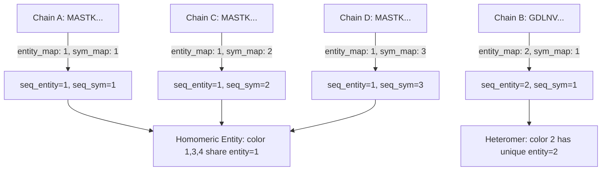
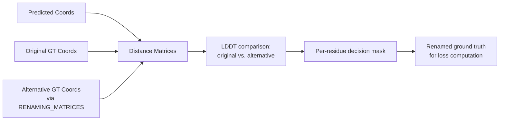
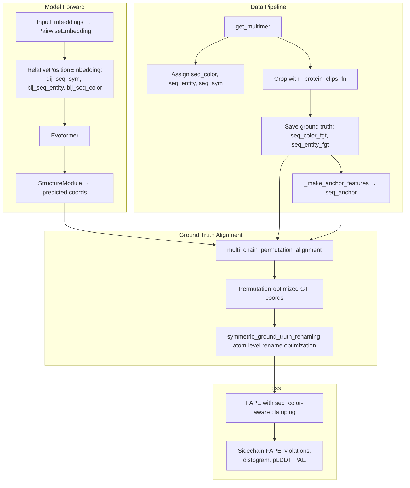

Protein complexes frequently exhibit internal symmetry — homodimers, homotrimers, and higher-order homomers compose a significant fraction of known structures. In these systems, each symmetric copy is chemically identical, creating a fundamental ambiguity: the ground truth coordinates can be "renamed" by permuting the symmetric copies, or by swapping ambiguous atom labels within a single residue, without changing the physical structure. ProFOLD2 resolves this ambiguity through a multi-layered strategy spanning the data pipeline, relative position encoding, loss computation, and post-prediction alignment. This page traces the full arc from metadata annotation to optimal ground truth selection at inference time.

## Symmetry Metadata Annotation

The foundation of all symmetry handling is three per-residue integer features constructed during data loading. In [`_make_seq_features`](profold2/data/dataset.py#L434-L497), every residue receives a **`seq_color`** (chain identifier, starting at 1), a **`seq_entity`** (unique sequence identifier, shared across chains with identical sequences), and a **`seq_sym`** (symmetry index within an entity, starting at 1). These tensors propagate through every stage of the pipeline and into the model's attention machinery.

When [`get_multimer`](profold2/data/dataset.py#L1540-L1639) concatenates multiple chains into a single batch, it maintains two bookkeeping maps. `seq_entity_map` assigns a unique entity ID to each distinct amino acid sequence (first encountered gets ID 1, the next novel sequence gets ID 2, etc.). `seq_sym_map` counts how many times each sequence has appeared so far. Every residue in chain *k* carrying sequence *s* receives `seq_entity = seq_entity_map[s]` and `seq_sym = seq_sym_map[s]` — meaning the third copy of the same homomer chain gets `seq_sym = 3`. This creates the critical invariant: residues sharing the same `seq_entity` but different `seq_sym` values are symmetric copies of one another.



Sources: [dataset.py](profold2/data/dataset.py#L434-L497), [dataset.py](profold2/data/dataset.py#L1540-L1639)

## Symmetry-Aware Relative Position Embedding

The three metadata fields are consumed directly by [`RelativePositionEmbedding`](profold2/model/commons.py#L1180-L1265) to construct a multi-dimensional positional signal that distinguishes intra-chain, inter-chain, and inter-symmetric-copy relationships. When `s_max` is configured (non-None), the embedding computes a concatenation of one-hot and binary features rather than a simple learned lookup:

| Feature | Computation | Purpose |
|---|---|---|
| `dij_seq_index` | Clamped residue index difference; set to `2*r_max+1` when chains differ | Local structure signal within chains |
| `bij_seq_color` | Boolean: same chain or not | Chain boundary detection |
| `bij_seq_entity` | Boolean: same entity or not | Symmetric copy detection |
| `dij_token_index` | Clamped token difference (only within same chain) | Within-chain fine-grained position |
| `dij_seq_sym` | Clamped `seq_sym` difference (only within same entity) | Symmetry ordering between copies |

The `dij_seq_sym` feature is particularly important: for two residues belonging to the same homomeric entity, it encodes *which* copies they come from (e.g., copy 1 vs. copy 3 gives a difference of ±2, clamped to `s_max`). This allows the Evoformer's pair representation to learn that certain inter-residue relationships should be invariant under copy permutation — the model sees the same embedding pattern regardless of which specific copies are compared.

These features are concatenated into a single vector and projected through a linear layer into the pairwise embedding dimension, then added to the residue-type outer product in [`PairwiseEmbedding.forward`](profold2/model/commons.py#L1280-L1315).

Sources: [commons.py](profold2/model/commons.py#L1180-L1315)

## Anchor Selection for Cropped Homomers

During training with random cropping ([`_protein_clips_fn`](profold2/data/dataset.py#L764-L928)), a contiguous crop may span residues from multiple symmetric copies. To correctly evaluate the loss against ground truth, the system must identify which symmetric copy in the ground truth best corresponds to the crop. [`_make_anchor_features`](profold2/data/dataset.py#L663-L714) solves this by selecting a single **anchor chain** through a deterministic filtering cascade:

1. **Count filter**: Only entities appearing more than once (homomers) are candidates.
2. **Length filter**: Among remaining entities, only those with the maximum chain length survive.
3. **Color filter**: Among remaining chains in the qualifying entity, only those with the maximum length are kept.
4. **Random selection**: If multiple candidates remain after filtering, one is chosen uniformly at random.

The anchor's `seq_color` value is stored as `seq_anchor` in the batch. During loss computation, this anchor identifies the ground truth chain to align against, while `seq_crop_candidate` finds all other chains in the same entity for permutation search.

Sources: [dataset.py](profold2/data/dataset.py#L663-L714), [dataset.py](profold2/data/dataset.py#L764-L928)

## Ambiguous Atom Naming and Symmetric Renaming

Beyond copy-level permutation ambiguity, individual residues can exhibit **internal symmetry**: certain side-chain atoms are chemically interchangeable. ProFOLD2 handles this through a pre-computed `RENAMING_MATRICES` tensor from [`residue_constants`](profold2/common/residue_constants.py), which defines permutation matrices mapping original atom14 indices to alternative indices.

[`symmetric_ground_truth_create_alt`](profold2/model/functional.py#L1208-L1234) generates the alternative coordinate set by applying these renaming transforms:

```python
renaming_transform = batched_gather(residue_constants.RENAMING_MATRICES, seq)
coord_alt = torch.einsum('... m d,... m n->... n d', coord, renaming_transform)
```

The function also produces a **`coord_is_symmetric`** boolean mask per residue, indicating whether that residue type has any ambiguous atoms at all. This mask is derived from the identity component of the renaming matrices — if a residue's renaming matrix is the identity, it has no ambiguous atoms.

Sources: [functional.py](profold2/model/functional.py#L1208-L1234)

## Optimal Ground Truth Selection

The core decision — whether to use original or alternative atom naming for each residue — is made by [`symmetric_ground_truth_find_optimal`](profold2/model/functional.py#L1235-L1293). This function computes an LDDT-based comparison between the predicted coordinates and both ground truth variants:

1. **Distance matrices** are computed for predictions, original ground truth, and alternative ground truth — each of shape `(N, N, 14, 14)` representing all atom-pair distances between all residue pairs.
2. **Per-residue LDDT terms** are computed by comparing prediction distances against both GT variants.
3. A **masked aggregation** sums LDDT terms only between *ambiguous* atoms (rows) and *unambiguous* atoms (columns), ensuring the comparison is sensitive to the naming decision without confounding from fully symmetric regions.
4. The function returns a boolean mask: `True` where alternative naming yields a better LDDT score.

The full renaming pipeline in [`symmetric_ground_truth_renaming`](profold2/model/functional.py#L1294-L1330) applies this decision, selectively swapping coordinates from the alternative set where the mask indicates improvement.



Sources: [functional.py](profold2/model/functional.py#L1235-L1330)

## Multi-Chain Permutation Alignment

For homomeric complexes, the chain-to-ground-truth assignment ambiguity is resolved by [`multi_chain_permutation_alignment`](profold2/model/functional.py#L1571-L1677), which is invoked at the end of the [`FoldingHead.forward`](profold2/model/head.py#L441-L454) pass in [`AlphaFold2.forward`](profold2/model/alphafold2.py#L213-L322). The function is called **only during training** (when `compute_loss=True`) and operates per-batch-element:

For each predicted chain `seq_color_i`, the algorithm:
1. Finds which ground truth residues correspond via [`seq_crop_mask`](profold2/model/functional.py#L1510-L1519) (matching residue indices between the crop and ground truth anchor).
2. Enumerates all candidate ground truth chains sharing the same entity via [`seq_crop_candidate`](profold2/model/functional.py#L1524-L1529).
3. Computes Cα RMSD between the predicted chain and each unassigned candidate.
4. Assigns the best-matching (lowest RMSD) candidate to this predicted chain.
5. Permuting the ground truth coordinates accordingly.

The assignment uses a **greedy one-to-one matching** — once a ground truth chain is assigned, it is removed from the candidate pool. The resulting permutation is applied to the ground truth coordinates and masks in the batch before loss computation begins.

> [!TIP]
> The multi-chain permutation alignment is invoked as a post-folding step (`batch = folding.multi_chain_permutation_alignment(ret.headers['folding'], batch)`) in the forward pass, meaning it operates on the *final* predicted coordinates rather than intermediate trajectories. This ensures the ground truth is optimally aligned before any loss (FAPE, sidechain, violations) is computed.

Sources: [functional.py](profold2/model/functional.py#L1510-L1577), [alphafold2.py](profold2/model/alphafold2.py#L295-L296)

## Symmetry-Aware FAPE Loss Conditioning

The [`FoldingHead.loss`](profold2/model/head.py#L455-L693) method incorporates symmetry awareness through two mechanisms that modulate how FAPE is computed across chain boundaries:

**Backbone clamping.** The backbone FAPE loss accepts a `fape_backbone_clamp_ratio` parameter (default 1.0, meaning full clamping). When `seq_color` is present in the batch, the ratio is conditionally set to **0.0 for inter-chain pairs** (where `seq_color` differs between residues i and j). This effectively disables the clamping distance for cross-chain backbone frame comparisons, allowing larger inter-chain errors without artificial truncation:

```python
if 'seq_color' in batch:
    clamp_ratio = torch.where(
        batch['seq_color'][..., :, None] == batch['seq_color'][..., None, :],
        clamp_ratio, 0.
    )
```

**Per-residue weight masking.** Both backbone and sidechain FAPE losses accept `dij_weight` derived from `coord_plddt`. For homomeric complexes where the same chain appears multiple times, the `loss.folding.w` batch field provides a pairwise weight matrix that can further down-weight or zero-out specific inter-residue pairs.

Sources: [head.py](profold2/model/head.py#L467-L481), [head.py](profold2/model/head.py#L455-L693)

## End-to-End Symmetry Data Flow

The following diagram summarizes the complete symmetry handling pipeline from data loading through loss computation:



| Stage | Component | Symmetry Mechanism |
|---|---|---|
| Data loading | `get_multimer` | Entity/symmetry metadata assignment |
| Cropping | `_make_anchor_features` | Anchor chain selection for homomers |
| Input encoding | `RelativePositionEmbedding` | `dij_seq_sym`, `bij_seq_entity` features |
| Post-folding | `multi_chain_permutation_alignment` | Greedy chain-to-GT matching by Cα RMSD |
| Atom renaming | `symmetric_ground_truth_renaming` | Per-residue LDDT-optimal atom selection |
| Backbone loss | `FoldingHead.loss` | Inter-chain clamp ratio → 0 |
| Sidechain loss | `FoldingHead.loss` | pLDDT-weighted dij per rigid group |

## Configuration and Environment Variables

The symmetry-aware behavior is controlled by several environment variables and configuration parameters:

| Variable / Parameter | Location | Default | Effect |
|---|---|---|---|
| `profold2_relative_pos_s_max` | [`AlphaFold2.__init__`](profold2/model/alphafold2.py#L139) | `None` (disabled) | Maximum `seq_sym` difference for embedding; enables symmetry features when set |
| `seq_anchor` | `_make_anchor_features` | `0` (no anchor) | Ground truth chain index for permutation alignment |
| `fape_backbone_clamp_ratio` | [`FoldingHead.__init__`](profold2/model/head.py#L416) | `1.0` | Clamped to 0 for inter-chain pairs when `seq_color` present |
| `pseudo_linker_shuffle` | [`get_multimer`](profold2/data/dataset.py#L1543) | `True` | Randomizes chain order to prevent ordering bias |

> [!TIP]
> Setting `profold2_relative_pos_s_max` to a positive integer (e.g., 8) is essential for training on homomeric complexes. Without it, `RelativePositionEmbedding` falls back to a simple `r_max`-only lookup table, and the model loses the ability to distinguish between different symmetric copies — effectively treating all copies as a single chain with discontinuous residue numbering.

Sources: [alphafold2.py](profold2/model/alphafold2.py#L139), [head.py](profold2/model/head.py#L416), [dataset.py](profold2/data/dataset.py#L1543)

## Relationship to Broader Architecture

Symmetric ground truth handling is deeply intertwined with several other subsystems. The metadata fields (`seq_color`, `seq_entity`, `seq_sym`) originate in the [Dataset Loading and Cropping](13-dataset-loading-and-cropping) pipeline and flow through the [AlphaFold2 Core Pipeline](5-alphafold2-core-pipeline) into the Evoformer's attention bias. The chain permutation and atom renaming mechanisms directly modulate the [FAPE and Structural Losses](10-fape-and-structural-losses). The anchor selection logic operates exclusively during training with cropping, while the inference path bypasses ground truth alignment entirely. For details on how the Structure Module generates the predicted coordinates that drive these comparisons, see [Structure Module and IPA](7-structure-module-and-ipa).