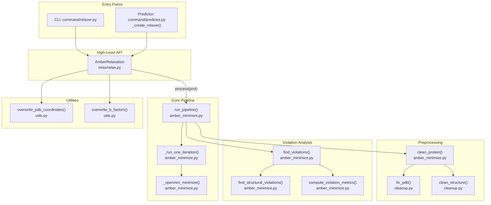
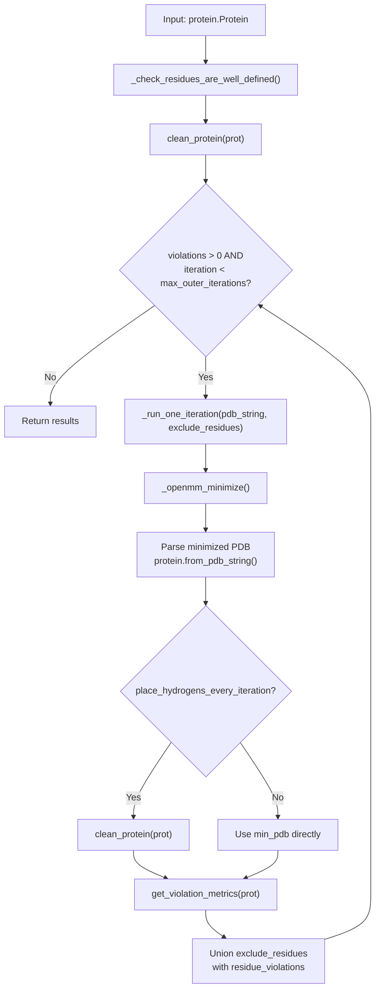

ProFOLD2's Amber relaxation subsystem bridges the gap between neural network prediction outputs and physically plausible protein structures. By applying restrained Amber force field minimization through OpenMM, it resolves steric clashes, corrects bond geometry violations, and adds missing hydrogens—transforming raw model predictions into structures suitable for downstream molecular modeling. This document dissects the four-module architecture, the iterative violation-informed relaxation loop, and the integration points within the broader prediction pipeline.

## System Architecture

The relaxation subsystem resides in `profold2/relax/` and comprises four tightly coupled modules, each with a distinct responsibility in the minimization pipeline. A fifth module—`profold2/command/relaxer.py`—provides standalone CLI access, while the predictor command integrates relaxation as an optional post-processing step.

Sources: [relax/__init__.py](profold2/relax/__init__.py#L1-L15), [command/relaxer.py](profold2/command/relaxer.py#L1-L68)



### Module Responsibilities

| Module | File | Role |
|---|---|---|
| **High-level API** | `relax/relax.py` | Exposes `AmberRelaxation` class; orchestrates pipeline call and result post-processing |
| **Core minimization** | `relax/amber_minimize.py` | Implements the full iterative relaxation pipeline, OpenMM simulation setup, violation detection, and atom14 mapping |
| **PDB cleanup** | `relax/cleanup.py` | Prepares structures via pdbfixer—replaces nonstandard residues, removes heterogens, adds missing atoms/hydrogens |
| **PDB utilities** | `relax/utils.py` | Coordinate and B-factor overwrite helpers; atom mask consistency assertions |
| **CLI entry** | `command/relaxer.py` | Standalone batch relaxation of PDB files with glob support and GPU toggle |

Sources: [relax.py](profold2/relax/relax.py#L22-L89), [amber_minimize.py](profold2/relax/amber_minimize.py#L14-L520), [cleanup.py](profold2/relax/cleanup.py#L14-L125), [utils.py](profold2/relax/utils.py#L14-L85)

## The AmberRelaxation Facade

`AmberRelaxation` is the sole public class, parameterized by module-level constants that define the default minimization behavior. Its constructor accepts six keyword-only parameters controlling the physics and iteration strategy, while the `process()` method accepts a `protein.Protein` instance and returns a triple: the relaxed PDB string, debug diagnostics, and a per-residue violation mask.

Sources: [relax.py](profold2/relax/relax.py#L22-L89)

```python
# Default configuration constants
RELAX_MAX_ITERATIONS = 0          # No L-BFGS iteration limit
RELAX_ENERGY_TOLERANCE = 3.39     # kcal/mol convergence threshold
RELAX_STIFFNESS = 10.0            # kcal/mol/Ų harmonic restraint spring constant
RELAX_EXCLUDE_RESIDUES = []       # Zero-indexed residues excluded from restraints
RELAX_MAX_OUTER_ITERATIONS = 3    # Max violation-informed relaxation cycles
```

The `process()` method delegates entirely to `amber_minimize.run_pipeline()` with `checks=False`, then reconstructs the final PDB by overwriting cleaned coordinates and restoring original B-factors. The RMSD between initial and minimized positions is computed and included in the returned `debug_data` dictionary alongside initial/final energies and minimization attempt count.

Sources: [relax.py](profold2/relax/relax.py#L60-L89)

> [!TIP]
> The `checks=False` flag passed to `run_pipeline` skips both atom mask ideal validation and coordinate integrity checks after cleaning. This trade-off favors throughput over strictness, which is appropriate for high-volume prediction workflows but may mask edge-case structural issues during development.

## Iterative Violation-Informed Relaxation Pipeline

The core algorithm in `run_pipeline()` implements an outer loop that alternates between Amber minimization and structural violation analysis. This design—borrowed from AlphaFold2's post-processing—progressively releases restraints on problematic residues, allowing the force field to resolve local clashes that the initial restrained minimization cannot address.

Sources: [amber_minimize.py](profold2/relax/amber_minimize.py#L507-L589)



### Initialization and Pre-Flight Checks

Before entering the iterative loop, the pipeline performs two critical validations. First, `_check_residues_are_well_defined()` ensures every residue contains at least one atom—proteins with empty residues cannot be minimized. Second, `clean_protein()` runs the full pdbfixer preparation pipeline (detailed in the next section). The initial `exclude_residues` set is seeded from the constructor parameter or left empty, and `violations` is initialized to infinity to guarantee at least one minimization pass.

Sources: [amber_minimize.py](profold2/relax/amber_minimize.py#L134-L151), [amber_minimize.py](profold2/relax/amber_minimize.py#L548-L555)

### The Iteration Loop

Each outer iteration executes `_run_one_iteration()` with the current PDB string and exclusion set, then updates the exclusion set with any residues still exhibiting structural violations. The loop terminates when either zero violations remain or `max_outer_iterations` is reached. With the default of 3 outer iterations, ProFOLD2 targets the regime where >95% of problematic predictions are resolved without excessive computational cost. The `place_hydrogens_every_iteration` flag (default `True`) re-runs the full cleanup after each minimization, ensuring hydrogen positions are freshly optimized rather than carried through from a previous potentially-clashed state.

Sources: [amber_minimize.py](profold2/relax/amber_minimize.py#L555-L589)

## OpenMM Minimization Engine

The actual energy minimization occurs in `_openmm_minimize()`, which sets up a complete OpenMM simulation with the Amber99sb force field and hydrogen bond constraints, applies harmonic positional restraints, and runs L-BFGS energy minimization.

Sources: [amber_minimize.py](profold2/relax/amber_minimize.py#L73-L105)

### Force Field and Simulation Setup

The simulation uses `amber99sb.xml` with `HBonds` constraints—standard choices for protein structure refinement. A `LangevinIntegrator` at zero temperature with 0.01 ps time step is configured purely for minimization (no actual dynamics are performed). The platform selection is straightforward: CUDA if `use_gpu` is `True`, otherwise CPU.

```python
force_field = openmm_app.ForceField("amber99sb.xml")
constraints = openmm_app.HBonds
system = force_field.createSystem(pdb.topology, constraints=constraints)
if stiffness > 0 * ENERGY / (LENGTH**2):
    _add_restraints(system, pdb, stiffness, restraint_set, exclude_residues)
integrator = openmm.LangevinIntegrator(0, 0.01, 0.0)
platform = openmm.Platform.getPlatformByName("CUDA" if use_gpu else "CPU")
```

Sources: [amber_minimize.py](profold2/relax/amber_minimize.py#L82-L93)

### Harmonic Positional Restraints

The `_add_restraints()` function attaches a `CustomExternalForce` implementing a harmonic potential: `0.5 * k * ((x-x0)² + (y-y0)² + (z-z0)²)`. The restraint set determines which atoms are restrained: `"non_hydrogen"` restrains all heavy atoms (default), while `"c_alpha"` restrains only Cα atoms. Residues listed in `exclude_residues` have no restraints applied, allowing them freedom to resolve clashes. The stiffness parameter (default 10.0 kcal/mol/Ų) balances preservation of the predicted fold against the force field's corrective influence.

Sources: [amber_minimize.py](profold2/relax/amber_minimize.py#L40-L72)

### Retry Mechanism and Version Compatibility

`_run_one_iteration()` wraps the minimization in a retry loop (up to `max_attempts=100` by default) that catches broad exceptions from OpenMM. This defensive pattern handles edge cases such as numerical instabilities in force evaluation. Additionally, a version compatibility shim adjusts the energy tolerance unit conversion for OpenMM ≥ 8.0.0, where the internal unit system changed from kilocalories to kilojoules per nanometer-mole. The `version_cmp` utility from `profold2/utils.py` performs dotted-version comparison to detect this boundary.

Sources: [amber_minimize.py](profold2/relax/amber_minimize.py#L440-L506), [utils.py](profold2/utils.py#L52-L58)

> [!TIP]
> The retry mechanism catches **all** exceptions (`except Exception`), which silently swallows potentially informative errors. In production deployments, consider logging the full traceback on each failed attempt to aid debugging of persistent minimization failures.

## PDB Cleanup and Preparation

The `cleanup.py` module uses `pdbfixer` to transform raw predicted structures into chemically complete models suitable for force field evaluation. The `fix_pdb()` function applies five sequential transformations, each tracked in an `alterations_info` dictionary.

Sources: [cleanup.py](profold2/relax/cleanup.py#L26-L60)

| Step | Operation | Purpose |
|---|---|---|
| 1 | `findNonstandardResidues()` → `replaceNonstandardResidues()` | Convert non-canonical amino acids to standard equivalents |
| 2 | `removeHeterogens(keepWater=False)` | Strip ligands, ions, water, and other non-protein entities |
| 3 | `findMissingResidues()` → `addMissingAtoms()` | Fill in absent residues and heavy atoms |
| 4 | `addMissingHydrogens()` | Place hydrogens at pH 7.0 |
| 5 | `keepIds=True` | Preserve original chain/residue identifiers in output |

After pdbfixer, `clean_structure()` applies two additional ProFOLD2-specific fixes: `_replace_met_se()` corrects selenomethionine residues where selenium was not properly annotated as a modified residue (replacing `Se` with `S`), and `_remove_chains_of_length_one()` eliminates single-residue chains that lack valid terminal force field templates.

Sources: [cleanup.py](profold2/relax/cleanup.py#L61-L125)

## Structural Violation Detection

Rather than implementing independent violation checks, the relaxation subsystem reuses the model's own structural loss functions—`between_residue_bond_loss`, `between_residue_clash_loss`, and `within_residue_clash_loss` from `profold2.model.functional`—to identify problematic residues. This ensures that the violation criteria used during relaxation are identical to those used during training, creating a closed loop between model output quality assessment and post-processing correction.

Sources: [amber_minimize.py](profold2/relax/amber_minimize.py#L324-L378)

### Atom14 Position Construction

Before violation analysis, `make_atom14_positions()` maps the protein's atom37 representation (37 possible atom types per residue) to the denser atom14 representation used by the model's loss functions. This involves building per-residue mapping tables between atom37 and atom14 indices, constructing alternative ground truth positions for the 7 amino acids with ambiguous atom naming (e.g., OD1/OD2 in aspartate), and generating ambiguity masks. The function populates the protein dict with keys including `atom14_gt_positions`, `atom14_atom_exists`, `atom14_alt_gt_positions`, and `atom14_atom_is_ambiguous`.

Sources: [amber_minimize.py](profold2/relax/amber_minimize.py#L184-L324)

### Violation Aggregation

`find_structural_violations()` combines three violation sources into a single `total_per_residue_violations_mask` by taking the element-wise maximum across bond violations, between-residue clashes, and within-residue clashes. `get_violation_metrics()` then identifies the specific residue indices with violations and returns the count, which drives the iterative exclusion logic in `run_pipeline()`.

Sources: [amber_minimize.py](profold2/relax/amber_minimize.py#L324-L429)

## Integration with the Prediction Pipeline

The predictor command (`profold2/command/predictor.py`) conditionally instantiates an `AmberRelaxation` instance via `_create_relaxer()`, controlled by the `--no_relaxer` and `--no_gpu_relax` flags. When active, relaxation is applied to every model's prediction for every input sequence, with a retry count of 2 that falls back to the unrelaxed PDB upon persistent `ValueError` exceptions.

Sources: [predictor.py](profold2/command/predictor.py#L86-L100), [predictor.py](profold2/command/predictor.py#L168-L212)

The predictor writes both `unrelaxed_{model_name}.pdb` and `relaxed_{model_name}.pdb` to per-sequence output directories, enabling direct comparison of relaxation effects. The relaxed structures are used for final ranking output.

## Standalone CLI Usage

For batch relaxation of existing PDB files outside the prediction pipeline, `command/relaxer.py` provides a lightweight wrapper:

```bash
# Basic usage: relax all PDB files in current directory
python -m profold2.command.relaxer *.pdb -o relaxed/

# GPU-accelerated relaxation with output prefix
python -m profold2.command.relaxer structures/*.pdb -o output/ --prefix relaxed_ -g

# Verbose logging for debugging
python -m profold2.command.relaxer model.pdb -v
```

| Flag | Default | Description |
|---|---|---|
| `pdb_files` | (required) | Glob patterns for input PDB files |
| `-o, --output` | `.` | Output directory |
| `--prefix` | `''` | Filename prefix for relaxed outputs |
| `-g, --use_gpu_relax` | `False` | Enable CUDA platform for OpenMM |
| `-v, --verbose` | `False` | Set logging to DEBUG level |

Sources: [relaxer.py](profold2/command/relaxer.py#L46-L67)

## Configuration Reference

The following table consolidates all tunable parameters across the relaxation subsystem, their default values, and their physical interpretation.

| Parameter | Default | Unit | Description |
|---|---|---|---|
| `max_iterations` | `0` | steps | L-BFGS iteration cap (0 = unlimited) |
| `tolerance` | `3.39` | kcal/mol | Energy convergence threshold |
| `stiffness` | `10.0` | kcal/mol/Ų | Harmonic restraint spring constant |
| `exclude_residues` | `[]` | indices | Initial residue exclusion set (zero-indexed) |
| `max_outer_iterations` | `3` | count | Maximum violation-informed relaxation cycles |
| `use_gpu` | `False` | — | Use CUDA platform for OpenMM |
| `restraint_set` | `"non_hydrogen"` | — | Atom set for positional restraints |
| `max_attempts` | `100` | count | Minimization retry attempts per iteration |
| `place_hydrogens_every_iteration` | `True` | — | Re-run cleanup after each minimization |
| `violation_tolerance_factor` | `12` | — | Bond length tolerance for violation detection |
| `clash_overlap_tolerance` | `1.5` | — | Steric clash overlap threshold |

Sources: [relax.py](profold2/relax/relax.py#L22-L27), [amber_minimize.py](profold2/relax/amber_minimize.py#L507-L519), [amber_minimize.py](profold2/relax/amber_minimize.py#L368-L372)

---

For the upstream prediction pipeline that invokes relaxation, see [AlphaFold2 Core Pipeline](5-alphafold2-core-pipeline). To understand the structural violation loss functions reused during relaxation analysis, see [FAPE and Structural Losses](10-fape-and-structural-losses). For the CLI command covering relaxation alongside prediction and evaluation, see [CLI Command Reference](21-cli-command-reference).