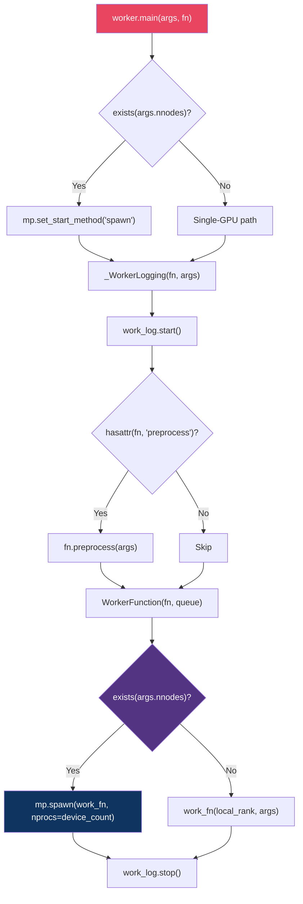
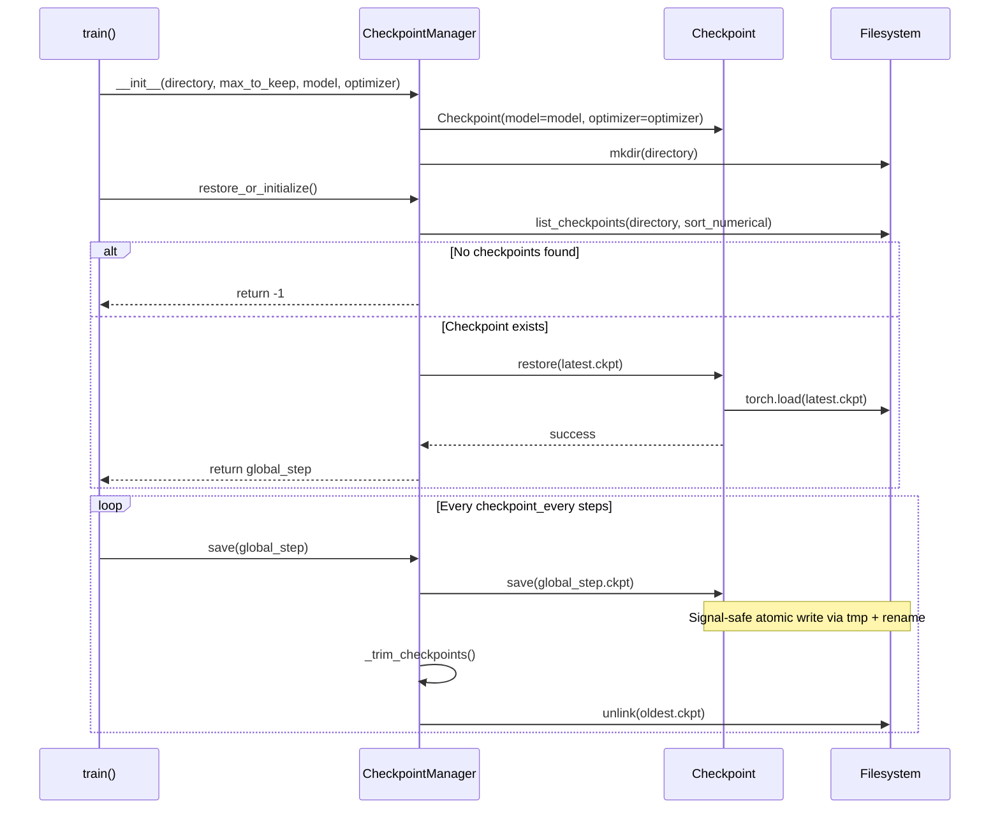

ProFOLD2's distributed training infrastructure is built around PyTorch's NCCL-backed `DistributedDataParallel` (DDP) with a layered abstraction that decouples device management, process orchestration, model wrapping, and checkpoint persistence. The design targets multi-node GPU clusters managed by SLURM while remaining transparently compatible with single-GPU workflows through a zero-configuration fallback path. This page dissects each layer—from process spawning to gradient synchronization—revealing the mechanisms that make large-scale protein structure model training tractable.

## Architecture Overview

The distributed stack is organized into four cooperating layers, each encapsulated in its own module. The `XPU` class in [accelerator.py](profold2/model/accelerator.py) abstracts device identity and process group lifecycle. The `worker` module in [worker.py](profold2/command/worker.py) orchestrates process spawning, per-rank logging, model wrapping, and state serialization. The training loop in [trainer.py](profold2/command/trainer.py) consumes these abstractions to implement gradient accumulation, mixed precision, and checkpoint management. Finally, utility modules ([snapshot.py](profold2/model/snapshot.py), [profiler.py](profold2/model/profiler.py), [utils.py](profold2/model/utils.py)) provide CUDA memory profiling, kernel-level instrumentation, and atomic checkpoint persistence.

```mermaid
flowchart TB
    subgraph Entry["Entry Point"]
        CLI["main.py → trainer.__main__"]
    end

    subgraph Orchestration["worker.main()"]
        CLI --> WL["_WorkerLogging"]
        CLI --> WF["WorkerFunction"]
        CLI --> MP["mp.spawn()"]
        MP -->|rank| WF
    end

    subgraph PerRank["Per-Rank Execution (WorkerFunction.__call__)"]
        WF --> XPU["XPU(rank, nnodes, node_rank)"]
        XPU -->|init_process_group| PG["NCCL ProcessGroup"]
        WF -->|wrap| WM["WorkerModel.wrap()"]
        WM -->|to(device)| GPU["CUDA Device"]
        WM --> DDP["DistributedDataParallel"]
        WF -->|TF32| TF32["torch_allow_tf32(True)"]
        WF -->|cleanup| DPG["destroy_process_group()"]
    end

    subgraph TrainingLoop["train(rank, args)"]
        DDP --> STEP["_step()"]
        STEP --> NSYNC["no_sync_ctx()"]
        STEP --> AMP["accelerator.amp()"]
        STEP --> GS["GradScaler"]
        STEP --> LOSS["loss_scaler = world_size / grad_accum"]
        STEP --> CM["CheckpointManager"]
    end

    subgraph Utilities["Infrastructure Utilities"]
        CM --> CKPT["Checkpoint (atomic save)"]
        CKPT --> SIG["signal-safe rename"]
        PROFILER["profiler.profile()"]
        SNAPSHOT["snapshot.memory_snapshot()"]
    end

    style Entry fill:#1a1a2e,stroke:#e94560,color:#fff
    style Orchestration fill:#16213e,stroke:#0f3460,color:#fff
    style PerRank fill:#0f3460,stroke:#e94560,color:#fff
    style TrainingLoop fill:#533483,stroke:#e94560,color:#fff
    style Utilities fill:#2b2d42,stroke:#e94560,color:#fff
```

Sources: [accelerator.py](profold2/model/accelerator.py#L61-L117), [worker.py](profold2/command/worker.py#L175-L266), [trainer.py](profold2/command/trainer.py#L75-L468), [utils.py](profold2/model/utils.py#L130-L242)

## Process Orchestration: `worker.main()`

The `worker.main()` function serves as the top-level entry point for all distributed commands. It decides whether to spawn multiple processes (multi-node) or invoke the work function directly (single-GPU), manages logging infrastructure, and coordinates lifecycle hooks. The branching logic hinges on the presence of the `--nnodes` argument: when provided, `mp.spawn()` creates one process per GPU; otherwise, the work function runs in-process with `local_rank` as the device identifier [worker.py](profold2/command/worker.py#L222-L266).



Two critical design decisions are worth noting. First, the spawn method is hardcoded to `spawn` rather than `fork`—this is essential for CUDA compatibility, as CUDA contexts cannot be safely forked [worker.py](profold2/command/worker.py#L224). Second, `WorkerLogging` uses a `QueueListener` only in multi-node mode, enabling rank-aware log prefixes while avoiding the overhead of queue-based logging for single-GPU runs [worker.py](profold2/command/worker.py#L75-L80).

### The `WorkerFunction` Per-Rank Wrapper

Once spawned, each rank enters `WorkerFunction.__call__()`, which performs the complete per-rank setup sequence: instantiates an `XPU` with the assigned rank, initializes the log record factory to safely serialize tensors in log messages, attaches a `QueueHandler` with a rank-aware filter, calls `xpu.init_process_group()`, enables TF32 via a context manager, invokes the actual work function, and finally tears down the process group [worker.py](profold2/command/worker.py#L182-L219).

> [!TIP]
> The `torch_allow_tf32(True)` context in `WorkerFunction.__call__` is critical for Ampere+ GPU performance—it allows the hardware's TF32 tensor cores to accelerate matmul and convolution operations, which dominate Evoformer compute [worker.py](profold2/command/worker.py#L213-L214). This can provide up to 2× throughput improvement on A100 GPUs with minimal numerical impact for training workloads.

Sources: [worker.py](profold2/command/worker.py#L222-L266), [worker.py](profold2/command/worker.py#L175-L219)

## Device Abstraction: `XPU` Class

The `XPU` class provides a unified abstraction over CUDA devices with distributed awareness. It encapsulates three identity dimensions—`local_rank` (GPU index within a node), `node_rank` (node index within the cluster), and the computed global `rank`—and manages the NCCL process group lifecycle [accelerator.py](profold2/model/accelerator.py#L61-L117).

| Property/Method | Behavior | Distributed Relevance |
|---|---|---|
| `device` | Returns `local_rank` as CUDA device index; falls back to `torch.device('cpu')` | Determines which GPU this rank binds to |
| `rank` | Computed as `device_count() * node_rank + local_rank`, overridable via `RANK` env var | Unique global identifier across all nodes |
| `is_master()` | True only when `node_rank == 0 and local_rank == 0` | Gates checkpoint saves, TensorBoard writes, and WandB init |
| `world_size()` | `device_count() * nnodes`, overridable via `WORLD_SIZE` env var | Used for loss scaling compensation |
| `init_process_group()` | Initializes NCCL with configurable `timeout` (default 1800s via `NCCL_TIMEOUT`) | The actual distributed backend bootstrap |
| `memory_summary()` | Delegates to `torch.cuda.memory_summary()` | Per-rank GPU memory diagnostics |

The `init_process_group` method hardcodes the `nccl` backend, which is the only viable option for multi-node GPU training in PyTorch. The timeout is configurable via the `NCCL_TIMEOUT` environment variable with a generous default of 1800 seconds, reflecting the reality that protein structure training iterations with large MSA inputs can be exceptionally slow [accelerator.py](profold2/model/accelerator.py#L96-L111).

Sources: [accelerator.py](profold2/model/accelerator.py#L61-L117)

## Model Wrapping and State Management: `WorkerModel`

`WorkerModel` encapsulates all model-level distributed concerns: device placement, DDP wrapping, state dictionary key migration, checkpoint loading, and checkpoint saving. It is instantiated in the training function with the rank-derived `XPU` instance [worker.py](profold2/command/worker.py#L91-L173).

### DDP Wrapping

The `wrap()` method constructs an `AlphaFold2` model, moves it to the assigned CUDA device, and wraps it in `nn.parallel.DistributedDataParallel` with three notable configuration choices:

1. **`find_unused_parameters=False`**: All parameters are expected to receive gradients every forward pass. Setting this to `False` avoids the extra communication overhead of an all-reduce to detect unused parameters [worker.py](profold2/command/worker.py#L145).
2. **`_set_static_graph()`**: This optimizes the DDP communication graph by assuming the model's computation graph does not change across iterations. Since the Evoformer architecture has a fixed topology (conditioned only on input dimensions), this is a safe and valuable optimization that reduces redundant bucket reconstruction [worker.py](profold2/command/worker.py#L147).
3. **`device_ids` and `output_device`**: Both are set to `xpu.device` (the local rank), ensuring correct device binding within each process [worker.py](profold2/command/worker.py#L143-L144).

### State Dictionary Key Migration

The `hook()` method registers a `load_state_dict_pre_hook` that performs backward-compatible key remapping. Two specific migration patterns are handled [worker.py](profold2/command/worker.py#L107-L113):

| Legacy Key Pattern | New Key Pattern | Component |
|---|---|---|
| `(.*)impl.token_emb.(.*)` | `\1impl.embedder.to_single_emb.\2` | Token embedding |
| `(.*)impl.to_pairwise_repr.(.*)` | `\1impl.embedder.to_pairwise_emb.\2` | Pairwise representation |

This allows loading checkpoints trained under an older naming convention without manual conversion.

### Checkpoint Serialization

The `save()` and `load()` methods handle the asymmetry between DDP-wrapped and bare models. On save, the DDP wrapper is unwrapped via `model.module` before serializing the state dict. On load, a bare `AlphaFold2` is reconstructed from the checkpoint config, the key migration hook is registered, and the state dict is applied. The serialized format includes both the model state dict and the full model configuration for reproducibility [worker.py](profold2/command/worker.py#L153-L173).

Sources: [worker.py](profold2/command/worker.py#L91-L173)

## Gradient Accumulation and Communication Control

ProFOLD2's training loop implements gradient accumulation with selective gradient synchronization, controlled via the `no_sync_ctx` context manager and a carefully computed `loss_scaler` [trainer.py](profold2/command/trainer.py#L60-L66).

### The `no_sync_ctx` Mechanism

The `no_sync_ctx` function conditionally wraps a code block in `module.no_sync()`, which prevents DDP from performing gradient all-reduce on every backward pass. The synchronization is deferred until the final accumulation step, where gradients from all micro-batches are reduced in a single all-reduce operation. This dramatically reduces communication volume—from `gradient_accumulate_every` all-reduces to just one per optimizer step [trainer.py](profold2/command/trainer.py#L60-L66).

The condition for skipping synchronization is: `it != global_step and jt + 1 != args.gradient_accumulate_every`. This means the very first training iteration after a checkpoint restore also skips `no_sync` (since `it == global_step`), ensuring that the first gradient accumulation window is fully synchronized—a correctness safeguard for the transition from checkpoint to training [trainer.py](profold2/command/trainer.py#L357-L359).

### Loss Scaling for Distributed Training

The `loss_scaler` compensates for the gradient averaging behavior of DDP across multiple nodes. When DDP averages gradients across `M` nodes, each with batch size `N`, the effective gradient is `M` times smaller than training on a single node with batch `M*N` (when loss is summed, not averaged). The formula implemented is [trainer.py](profold2/command/trainer.py#L330-L331):

```
loss_scaler = world_size(nnodes) / gradient_accumulate_every
```

This effectively scales the loss by the world size (to compensate for DDP gradient averaging) and divides by the accumulation count (since gradients are summed across micro-batches but only reduced once). The actual backward call applies this scaling: `grad_scaler.scale(r.loss * loss_scaler * length_scaler).backward()` [trainer.py](profold2/command/trainer.py#L368).

An additional `length_scaler` can be optionally enabled via `--train_apply_sqrt_length_scale`, which normalizes loss by the square root of the mean residue count relative to `max_crop_len`. This prevents longer proteins from dominating the gradient signal during variable-length training [trainer.py](profold2/command/trainer.py#L350-L354).

> [!TIP]
> The gradient accumulation pattern in `_step()` zeroes gradients once at the start, then accumulates over `gradient_accumulate_every` micro-batches with `no_sync` on all but the last step. Combined with the loss scaling formula, this achieves mathematically equivalent training to a single-GPU setup with batch size `world_size × gradient_accumulate_every × per_gpu_batch`—but with drastically reduced communication overhead [trainer.py](profold2/command/trainer.py#L333-L384).

Sources: [trainer.py](profold2/command/trainer.py#L60-L66), [trainer.py](profold2/command/trainer.py#L306-L384)

## Mixed Precision Training

ProFOLD2 integrates PyTorch's AMP (Automatic Mixed Precision) through the `accelerator` module, which provides a unified interface for device-agnostic autocast and gradient scaling [accelerator.py](profold2/model/accelerator.py#L28-L58).

### Autocast Configuration

The `accelerator.amp()` context manager wraps `torch.amp.autocast` with two important customizations. First, the device type is automatically detected via `device_type()`, defaulting to `cuda` when available. Second, the autocast dtype is resolved through `autocast_dtype()`, which follows a priority chain: the `profold2_amp_dtype` environment variable (accepting `float16`, `bfloat16`, or `float32`), then hardware BF16 support detection via `torch.cuda.is_bf16_supported()`, and finally falling back to `float16` [accelerator.py](profold2/model/accelerator.py#L32-L58).

A notable workaround disables `cache_enabled=True` for PyTorch ≥ 1.10.0, as the comment acknowledges this would crash—an unresolved issue likely related to the complex non-standard control flow in the Evoformer's attention patterns [accelerator.py](profold2/model/accelerator.py#L52-L54).

### Gradient Scaling

The `GradScaler` is partially applied with the detected device type and enabled conditionally via `--amp_enabled`. It wraps both the loss backward call and the optimizer step, preventing underflow in float16 gradients while automatically skipping steps with inf/nan gradients [trainer.py](profold2/command/trainer.py#L329-L383).

| AMP Component | Activation Flag | Config Path |
|---|---|---|
| `autocast` dtype selection | Always active when AMP enabled | `profold2_amp_dtype` env var → BF16 support → FP16 fallback |
| `GradScaler` | `--amp_enabled` | `accelerator.GradScaler(enabled=args.amp_enabled)` |
| TF32 matmul/cudnn | Always enabled in distributed mode | `torch_allow_tf32(True)` in `WorkerFunction` |

Sources: [accelerator.py](profold2/model/accelerator.py#L28-L58), [trainer.py](profold2/command/trainer.py#L329-L383)

## Checkpoint Management: `CheckpointManager`

The `CheckpointManager` class in [utils.py](profold2/model/utils.py#L130-L242) provides TensorFlow-style periodic checkpointing with automatic rotation, atomic writes, and signal-safe persistence.

### Architecture

The manager wraps a `Checkpoint` object, which stores references to any PyTorch object implementing `state_dict()` (model, optimizer, learning rate schedulers). On `save()`, it serializes all checkpointables to a numbered `.ckpt` file and trims older checkpoints beyond `max_to_keep`. On `restore_or_initialize()`, it finds the numerically largest checkpoint file, restores all checkpointables, and returns the global step as an integer [utils.py](profold2/model/utils.py#L130-L242).



### Atomic Checkpoint Writes

The `Checkpoint.save()` method implements atomic persistence through a two-step protocol: first, the state dict is written to a temporary file with a unique ID (`tmp-{unique_id()}`), then the temporary file is atomically renamed to the target path using `os.rename()` [utils.py](profold2/model/utils.py#L59-L93). On POSIX-compliant filesystems, `rename` is an atomic operation, ensuring that a crash during write never produces a corrupt checkpoint. A `SIGINT` handler is temporarily installed during the write to prevent Ctrl+C from interrupting the serialization [utils.py](profold2/model/utils.py#L68-L73).

### Distributed Checkpoint Behavior

Checkpoint saves are gated by `wm.is_master()`—only the rank-0 process on node-0 writes checkpoint files, preventing race conditions and redundant I/O. On restore, each rank independently loads the same checkpoint file (since `restore_or_initialize()` is called before DDP wrapping is complete in the training function's control flow). The `restore()` method applies `strict=False` for `nn.Module` objects, allowing partial checkpoint restoration when model architectures differ slightly between versions [utils.py](profold2/model/utils.py#L116-L117).

Sources: [utils.py](profold2/model/utils.py#L37-L242), [trainer.py](profold2/command/trainer.py#L307-L317)

## Distributed Logging Infrastructure

The logging system is designed around the challenge that multiple distributed processes must emit structured, rank-attributed logs to both console and per-rank files without interleaving corruption [worker.py](profold2/command/worker.py#L19-L89).

### Architecture

The `_WorkerLogging` class creates two handlers per worker: a `StreamHandler` for console output and a `FileHandler` for persistent logs named `{work_fn_name}_{node_rank}-{local_rank}.log`. In multi-node mode, a `QueueListener` is initialized with these handlers, and each spawned process attaches a `QueueHandler` that feeds into the central queue [worker.py](profold2/command/worker.py#L56-L89).

The `_WorkerLogFilter` prepends `"Rank {rank} | "` to every message from non-master ranks, making it trivial to trace distributed issues from a single aggregated log file. The `_WorkerLogRecordFactory` pre-processes log arguments to safely serialize PyTorch tensors—converting scalars to `.item()` and multi-dimensional tensors to `.tolist()`—preventing encoding errors when tensors appear in log messages [worker.py](profold2/command/worker.py#L19-L51).

| Component | Single-GPU | Multi-Node |
|---|---|---|
| File handler | `train_0.log` | `train_0-{local_rank}.log` per rank |
| Queue-based logging | Not used (no `QueueListener`) | `QueueListener` + per-rank `QueueHandler` |
| Rank prefix | Not applied | `Rank {global_rank} | ` prepended |
| Tensor serialization | Active | Active |

Sources: [worker.py](profold2/command/worker.py#L19-L89)

## Diagnostics Utilities

Two utility modules provide complementary observability into training: `profiler.py` for compute profiling and `snapshot.py` for CUDA memory debugging.

### Kernel Profiling: `profiler.profile()`

The `profile()` context manager wraps `torch.profiler.profile` with a global `_enabled` flag that also controls `record_function()` annotations scattered throughout the codebase. When enabled, all `record_function(name)` blocks in the Evoformer and structure module become visible in TensorBoard traces, providing kernel-level insight into attention compute, tensor contractions, and communication overhead [profiler.py](profold2/model/profiler.py#L12-L32).

### CUDA Memory Snapshots: `snapshot.memory_snapshot()`

The `memory_snapshot()` context manager leverages PyTorch ≥ 2.1's `torch.cuda.memory._record_memory_history()` API to capture a full memory allocation history during the wrapped code block. On exit, it dumps a pickle snapshot that can be loaded in the PyTorch memory visualizer for identifying allocation patterns, fragmentation, and peak memory sources [snapshot.py](profold2/model/snapshot.py#L15-L56). The snapshot filename auto-generates from hostname, timestamp, and device index, making it safe to collect snapshots from multiple ranks simultaneously without filename collisions.

Both utilities gracefully degrade when their requirements are not met (CUDA unavailable, PyTorch version too old) by logging a warning and passing through as a no-op context [snapshot.py](profold2/model/snapshot.py#L17-L22).

Sources: [profiler.py](profold2/model/profiler.py#L1-L33), [snapshot.py](profold2/model/snapshot.py#L1-L56)

## SLURM Launch Configuration

The [examples/train.job](examples/train.job) file demonstrates the canonical multi-node launch configuration, integrating SLURM scheduling with ProFOLD2's distributed arguments.

### Multi-Node vs. Local Launch Paths

The job script automatically detects the launch environment and configures the distributed arguments accordingly. Under SLURM, the master address is extracted from `SLURM_JOB_NODELIST` via `scontrol show hostnames`, and `srun` is used as the process launcher. Under local mode, `--nnodes` and `--node_rank` are set from environment variables with sensible defaults [examples/train.job](examples/train.job#L47-L63).

| Parameter | SLURM Mode | Local Mode |
|---|---|---|
| `--nnodes` | Inferred from SLURM allocation | `${nnodes:-1}` |
| `--node_rank` | Inferred from SLURM | `${node_rank:-0}` |
| `--init_method` | `tcp://{master_addr}:{master_port}` | `tcp://127.0.0.1:{port}` |
| Process launcher | `srun python` | `python` |
| `NCCL_SOCKET_FAMILY` | `AF_INET` | `AF_INET` |
| `NCCL_TIMEOUT` | `3600` | `3600` |

### Complete Launch Example

The following command launches a 2-node, 4-GPU training job with 24-step gradient accumulation, offline WandB tracking, and a 150M-parameter model configuration:

```bash
# SLURM multi-node launch
srun python main.py \
    --init_method=tcp://${master_addr}:23456 \
    train \
    --prefix=./150m.folding \
    --checkpoint_max_to_keep=10 \
    --num_batches=10000 \
    --batch_size=1 \
    --gradient_accumulate_every=24 \
    --learning_rate=0.0001 \
    --model_evoformer_depth=64 \
    --model_dim 384 256 128 \
    --model_evoformer_accept_msa \
    --wandb_mode=offline

# Local single-node multi-GPU launch
python main.py \
    --nnodes=1 --node_rank=0 \
    --init_method=tcp://127.0.0.1:23456 \
    train --prefix=./output ...
```

Sources: [examples/train.job](examples/train.job#L1-L131), [trainer.py](profold2/command/trainer.py#L814-L848)

## CLI Reference: Distributed Arguments

The following table summarizes all distributed-specific CLI arguments, defined in the `__main__` block of [trainer.py](profold2/command/trainer.py#L814-L831) and consumed throughout the worker infrastructure:

| Argument | Type | Default | Description |
|---|---|---|---|
| `--nnodes` | `int` | `None` | Number of nodes. When absent, runs in single-GPU mode |
| `--node_rank` | `int` | `0` | Rank of the current node (0-indexed) |
| `--local_rank` | `int` | `None` | GPU index within the node |
| `--init_method` | `str` | `file:///tmp/profold2.dist` | Process group init URL (file:// or tcp://) |
| `--gradient_accumulate_every` | `int` | `16` | Micro-batches per optimizer step |
| `--amp_enabled` | `flag` | `False` | Enable automatic mixed precision |
| `--checkpoint_every` | `int` | `100` | Save checkpoint every N steps |
| `--checkpoint_max_to_keep` | `int` | `5` | Maximum checkpoint files to retain |
| `--batch_size` | `int` | `1` | Per-GPU batch size (effective batch = `batch_size × world_size × grad_accum`) |

Environment variables that configure distributed behavior without CLI exposure:

| Variable | Used In | Purpose |
|---|---|---|
| `WORLD_SIZE` | `accelerator.world_size()` | Override world size calculation |
| `RANK` | `XPU.rank` | Override global rank calculation |
| `NCCL_TIMEOUT` | `XPU.init_process_group()` | Process group timeout in seconds |
| `profold2_amp_dtype` | `accelerator.amp()` | Force autocast dtype (f16/bf16/f32) |
| `NCCL_SOCKET_FAMILY` | External (job script) | Set to `AF_INET` for SLURM compatibility |

Sources: [trainer.py](profold2/command/trainer.py#L674-L686), [trainer.py](profold2/command/trainer.py#L810-L831), [accelerator.py](profold2/model/accelerator.py#L24-L25)

## Key Design Patterns and Trade-offs

The distributed training infrastructure embodies several deliberate design decisions that balance performance, correctness, and operational simplicity.

**Static graph optimization.** The `_set_static_graph()` call on the DDP wrapper is a significant performance optimization for the Evoformer, which has a deeply nested but structurally invariant computation graph. This avoids the overhead of DDP's automatic bucket rebuilding on every iteration, which can save seconds per step on large models [worker.py](profold2/command/worker.py#L147).

**Master-gated side effects.** Checkpoint saves, TensorBoard writes, WandB initialization, and evaluation all check `wm.is_master()` before executing. This is the simplest correct strategy for operations that should happen exactly once in a distributed run, though it means non-master ranks are idle during these phases [trainer.py](profold2/command/trainer.py#L199-L201), [trainer.py](profold2/command/trainer.py#L413-L417).

**Non-distributed data parallelism.** The `dataset.load()` function supports `DistributedSampler` when `num_replicas` and `rank` are provided, but the training loop does not pass these parameters. Instead, each rank runs an independent data loader with identical configuration. This works correctly because each rank uses different random seeds derived from its rank, producing different data ordering. However, it does not guarantee non-overlapping data partitions across ranks—a design choice that prioritizes simplicity over strict data partitioning [dataset.py](profold2/data/dataset.py#L2220-L2224).

**Signal-safe checkpoint persistence.** The atomic rename-based checkpoint writing, combined with SIGINT masking during serialization, ensures that training can be safely interrupted at any point without corrupting the latest checkpoint. This is essential for long-running protein structure training jobs that may be preempted by SLURM [utils.py](profold2/model/utils.py#L67-L93).

Sources: [worker.py](profold2/command/worker.py#L147), [trainer.py](profold2/command/trainer.py#L199-L201), [dataset.py](profold2/data/dataset.py#L2220-L2224), [utils.py](profold2/model/utils.py#L67-L93)

---

**Next steps**: To understand the model architecture that this infrastructure trains, see [AlphaFold2 Core Pipeline](5-alphafold2-core-pipeline). For the data pipeline that feeds the distributed training loop, see [Dataset Loading and Cropping](13-dataset-loading-and-cropping). For the CLI command that invokes this infrastructure, see [CLI Command Reference](21-cli-command-reference).