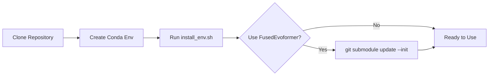
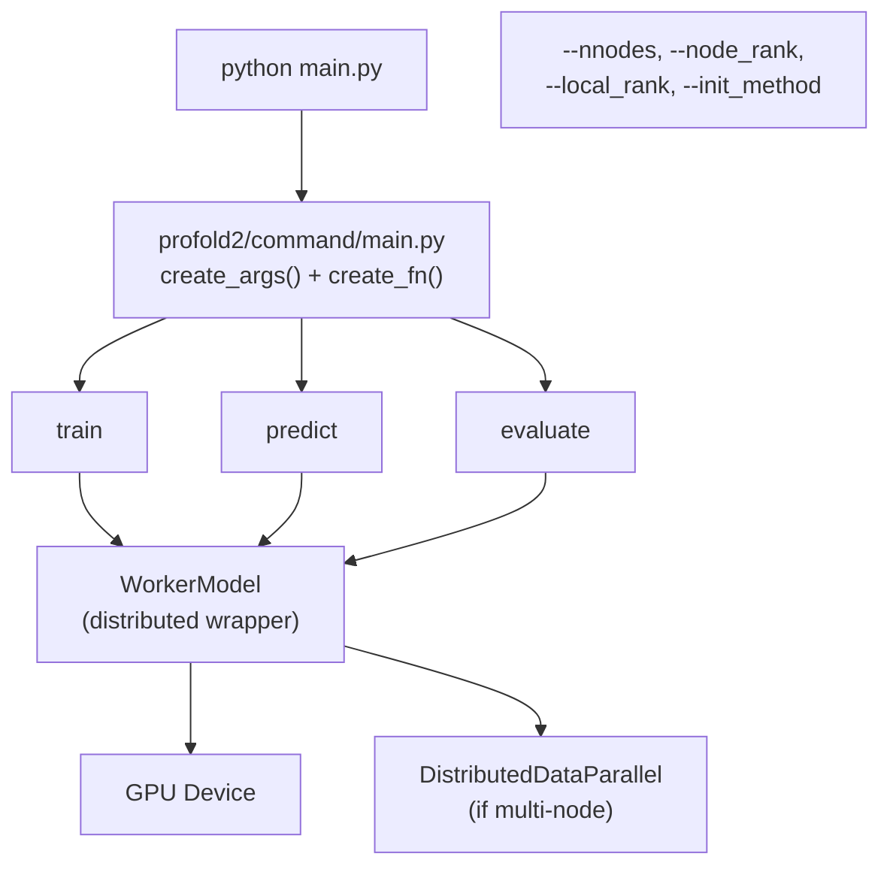

This guide walks you through installing, configuring, and running ProFOLD2 — a protein 3D structure prediction application built on the AlphaFold2 architecture — from a single-command prediction to a full multi-node training pipeline. By the end, you will have a working installation capable of predicting protein structures from FASTA sequences and a clear mental model of the system's command-line interface.

## Prerequisites

ProFOLD2 requires a CUDA-capable GPU and a specific stack of system-level and Python dependencies. The project targets **Python 3.11** and **CUDA 12.1.1** by default, with **PyTorch 2.3.1** as the deep learning runtime. The provided [install_env.sh](install_env.sh#L31-L34) codifies these version pins as shell variables, and the [setup.py](setup.py#L39) classifier enforces the Python version requirement.

| Dependency | Minimum Version | Purpose |
|---|---|---|
| Python | 3.11 | Runtime environment |
| PyTorch | ≥ 2.3.1 | Model training & inference |
| CUDA Toolkit | 12.1.1 | GPU compute backend |
| GCC/G++ | 12.4.0 | Custom CUDA kernel compilation (FusedEvoformer) |
| OpenMM | ≥ 8.0.0 | Amber structure relaxation |
| BioPython | — | PDB/FASTA parsing |
| TensorBoard | — | Training metric visualization |

> [!TIP]
> If you plan to use the **FusedEvoformer** (a performance-optimized variant with custom CUDA kernels), you must initialize the `cutlass/` git submodule after cloning. This is strongly recommended for production training workloads but optional for basic inference.

## Installation

ProFOLD2 follows a clone → environment → dependencies → build workflow. The entire process is automated by the provided shell script, which handles conda package installation, PyTorch CUDA variant selection, and CUDA development library setup in the correct order.



Start by cloning the repository and creating a conda environment:

```bash
git clone https://github.com/bigict/ProFOLD2.git
cd ProFOLD2
git submodule update --init  # Required for FusedEvoformer; recommended
conda create -n profold2 python=3.11
conda activate profold2
bash install_env.sh
```

The [install_env.sh](install_env.sh#L1-L71) script performs dependency installation in four stages: (1) the C++ compiler toolchain via `gxx` and `ninja`, (2) OpenMM and PDBFixer from conda-forge alongside the CUDA version, (3) PyTorch with the matching CUDA variant from the official PyTorch wheel index, and (4) CUDA development libraries (`cuda-cccl`, `cuda-libraries-dev`, `cuda-nvcc`, `libcurand-dev`) required for custom kernel compilation. A `--do-cleanup` flag (`-c`) is available to purge pip and conda caches after each stage.

## Understanding the CLI Architecture

ProFOLD2 exposes a unified command-line interface through [main.py](main.py#L1-L12), which delegates to [profold2/command/main.py](profold2/command/main.py#L72-L75). The CLI is structured as a subcommand router with three primary operations, plus distributed-training infrastructure arguments that are shared across all commands.



The [command router](profold2/command/main.py#L12-L16) registers three subcommands — `train`, `predict`, and `evaluate` — each with its own argument parser. All three share a common `-o/--prefix` argument for output directory and a `-v/--verbose` flag. Distributed arguments (`--nnodes`, `--node_rank`, `--local_rank`, `--init_method`) are parsed at the top level and consumed by the [WorkerModel](profold2/command/worker.py#L91-L94) class, which handles device placement, DDP wrapping, and SLURM environment variable auto-detection.

## Running Your First Prediction

Prediction is the fastest way to validate your installation. The `predict` subcommand accepts FASTA files as input and produces PDB structure files as output, optionally running Amber relaxation on the predicted structures.

### Minimal Prediction Command

```bash
python main.py predict \
    --prefix=./output \
    --models path/to/model.pth \
    --fasta_fmt=single \
    sequence.fasta
```

Let's break down each argument:

| Argument | Default | Description |
|---|---|---|
| `--models` | (required) | Path to a trained model checkpoint. Supports `[NAME=]PATH` format for multiple models |
| `--prefix` | `.` | Output directory prefix. Results are written to `<prefix>/<protein_name>/` |
| `--fasta_fmt` | `single` | Input format: `single` (one sequence per file) or `a3m` (MSA alignment format) |
| `--fasta_files` | (positional) | One or more FASTA file paths (supports glob patterns) |
| `--model_recycles` | `0` | Number of structure recycling iterations (higher = better quality, slower) |
| `--model_shard_size` | `None` | Memory optimization: shard the evoformer computation |
| `--no_relaxer` | `false` | Skip Amber relaxation (faster output, less refined structures) |
| `--amp_enabled` | `false` | Enable automatic mixed precision for reduced GPU memory usage |

Sources: [predictor.py](profold2/command/predictor.py#L298-L358)

### Input Format Options

The predictor supports two input paradigms through the [data loader factory](profold2/command/predictor.py#L47-L94):

**FASTA files** (default): Provide individual `.fasta` files or a list file via `--fasta_file_list`. Each file is parsed into a single sequence. The `--fasta_fmt=single` mode treats each file as one sequence, while `--fasta_fmt=a3m` treats multi-sequence files as MSA alignments (with random downsampling to `--max_msa_size` if needed).

**Pre-processed dataset**: Use `--data_dir` to load from a zipped dataset directory (the same format used for training), with optional `--data_idx` for filtering and `--add_pseudo_linker` for multi-chain complex prediction.

### Output Structure

For each input sequence, the predictor creates an output directory under `<prefix>/<protein_name>/` containing:

- `unrelaxed_<model_name>.pdb` — Raw model prediction
- `relaxed_<model_name>.pdb` — Amber-relaxed structure (unless `--no_relaxer`)
- `result.json` — Ranking scores and metadata (unless `--no_pth`)

## Training a Model

Training is the most configuration-heavy workflow. At minimum, you need a training dataset, model configuration JSON files (features and headers), and sufficient GPU memory. The [examples/train.job](examples/train.job#L92-L130) script demonstrates a complete training configuration for the "150m" model variant.

### Minimal Training Command

```bash
python main.py train \
    --prefix=./output \
    --train_data=./train.zip \
    --model_features=./model_features.json \
    --model_headers=./model_headers.json \
    --model_dim 384 256 128 \
    --model_evoformer_depth 64 \
    --model_evoformer_head_num 8 \
    --model_evoformer_head_dim 32 \
    --model_evoformer_accept_msa \
    --model_recycles=2 \
    --num_batches=10000
```

### Key Training Arguments

The training command exposes a large parameter surface through [add_arguments](profold2/command/trainer.py#L471-L813). The table below groups the most important ones by category:

| Category | Argument | Default | Purpose |
|---|---|---|---|
| **Data** | `--train_data` | `train.zip` | Training dataset (zipped directory) |
| | `--train_idx` | `None` | Optional index file for data filtering |
| | `--train_data_weights` | `None` | Per-sample weighting file for biased sampling |
| | `--max_msa_size` | `1024` | Maximum MSA depth per sample |
| | `--max_var_size` | `8192` | Maximum variant depth per sample |
| **Cropping** | `--min_crop_len` | `80` | Don't crop sequences shorter than this |
| | `--max_crop_len` | `255` | Crop sequences longer than this |
| | `--crop_algorithm` | `auto` | Crop strategy: `auto`, `random`, or `knn` |
| | `--train_crop_probability` | `0.0` | Probability of applying cropping |
| **Model** | `--model_features` | `model_features_main.json` | Feature configuration JSON |
| | `--model_headers` | `model_headers_main.json` | Prediction head configuration JSON |
| | `--model_dim` | `384 256 128` | Triplet: (s_dim, z_dim, extra_dim) |
| | `--model_evoformer_depth` | `1` | Number of Evoformer blocks |
| | `--model_evoformer_accept_msa_attn` | `false` | Enable MSATransformer blocks |
| | `--model_evoformer_accept_frame_attn` | `false` | Enable FrameTransformer blocks |
| **Optimization** | `--learning_rate` | `1e-3` | Adam optimizer learning rate |
| | `--gradient_accumulate_every` | `16` | Gradient accumulation steps |
| | `--batch_size` | `1` | Samples per batch |
| **Checkpointing** | `--checkpoint_every` | `100` | Save checkpoint every N steps |
| | `--checkpoint_max_to_keep` | `5` | Maximum retained checkpoints |
| **Monitoring** | `--eval_every` | `100` | Run evaluation every N steps |
| | `--tuning_every` | `10` | Run tuning every N steps |

Sources: [trainer.py](profold2/command/trainer.py#L471-L813)

> [!TIP]
> Training progress is automatically logged to TensorBoard. Run `tensorboard --logdir=./output` and open `http://localhost:6006` to monitor loss curves, TM-score metrics, and confidence predictions in real time. The training loop uses a [cycling data iterator](profold2/command/trainer.py#L137-L146) that cycles through epochs indefinitely until `--num_batches` steps are completed.

### Model Configuration Files

Two JSON files govern model architecture: **model_features** controls which input features are computed and how (MSA processing, template embedding, etc.), while **model_headers** defines which prediction heads are active (structure folding, confidence, fitness/variant prediction, coevolution). Example files are provided in [examples/](examples/model_features_150m.json) for the "150m" model variant. These files are loaded during [training initialization](profold2/command/trainer.py#L84-L84) and passed to the `FeatureBuilder` and model constructor.

## Evaluating a Model

The `evaluate` subcommand runs a trained model against a held-out test dataset, computing structural metrics including **TM-score** (via Kabsch alignment) and per-head losses. It requires a pre-trained checkpoint and a test dataset.

```bash
python main.py evaluate \
    --prefix=./eval_output \
    --model=path/to/model.pth \
    --eval_data=./test.zip \
    --crop_probability=0 \
    --min_crop_len=256 \
    --max_crop_len=256 \
    --model_recycles=2
```

The [evaluation loop](profold2/command/evaluator.py#L180-L198) iterates through the test dataset, running inference with `torch.no_grad()` and computing metrics against ground-truth coordinates when available. Results are logged per-sample and aggregated. When fitness/variant heads are configured, evaluation also outputs `.pkl` files containing variant predictions, coevolution weights, and gating values.

## Monitoring and Visualization

ProFOLD2 integrates two monitoring backends accessible during training:

**TensorBoard** is the primary metric visualization tool. The training function creates a [SummaryWriter](profold2/command/trainer.py#L270-L271) that logs per-head losses under `Loss/train@<head_name>` and evaluation metrics under corresponding eval prefixes. Launch with:

```bash
tensorboard --logdir=./output/runs
```

**Weights & Biases** (optional) can be enabled via `--wandb_enabled`, `--wandb_project`, `--wandb_name`, and `--wandb_mode=offline|online`. The [wandb_setup](profold2/command/trainer.py#L33-L45) function initializes the W&B run and logs both hyperparameters and per-step loss values.

## Running on a SLURM Cluster

ProFOLD2 provides production-ready [SLURM job scripts](examples/README.md#L7-L21) in the `examples/` directory. Each script supports both SLURM and local execution via the `-p {slurm,local}` flag:

```bash
# SLURM cluster
sbatch -D . -p <partition> examples/predict.job -- --verbose sequence.fasta

# Local machine (single node)
bash examples/predict.job -p local -- --verbose sequence.fasta
```

The job scripts handle distributed environment setup automatically: they detect SLURM node lists, derive the master address for NCCL initialization, set environment variables (`NCCL_SOCKET_FAMILY=AF_INET`, `NCCL_TIMEOUT=3600`), and activate the conda environment. The [distributed worker](profold2/command/worker.py#L222-L266) reads `SLURM_NNODES`, `SLURM_NODEID`, and `LOCAL_RANK` environment variables to configure PyTorch's process group without manual intervention.

Sources: [train.job](examples/train.job#L47-L63), [predict.job](examples/predict.job#L47-L63), [evaluate.job](examples/evaluate.job#L47-L63)

## Next Steps

Now that you have ProFOLD2 running, here's the recommended reading progression to deepen your understanding:

- **[Architecture Overview](4-architecture-overview)** — Understand the end-to-end pipeline from input features to predicted structures
- **[Docker Deployment](3-docker-deployment)** — Deploy ProFOLD2 in containerized environments for reproducible inference
- **[CLI Command Reference](21-cli-command-reference)** — Complete parameter reference for all subcommands and advanced options
- **[AlphaFold2 Core Pipeline](5-alphafold2-core-pipeline)** — Dive into the model's internal architecture and the Evoformer/Structure Module design