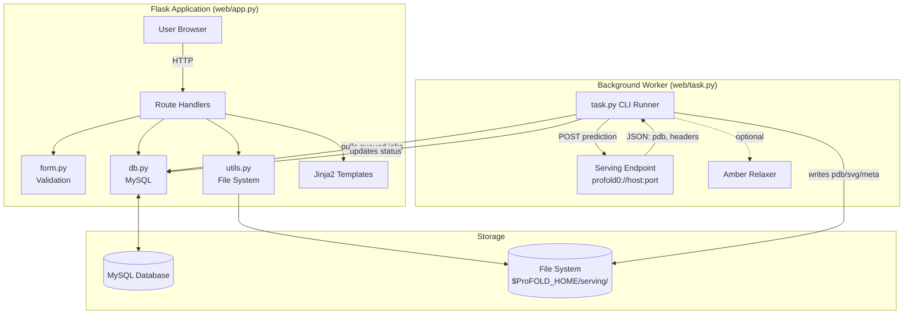
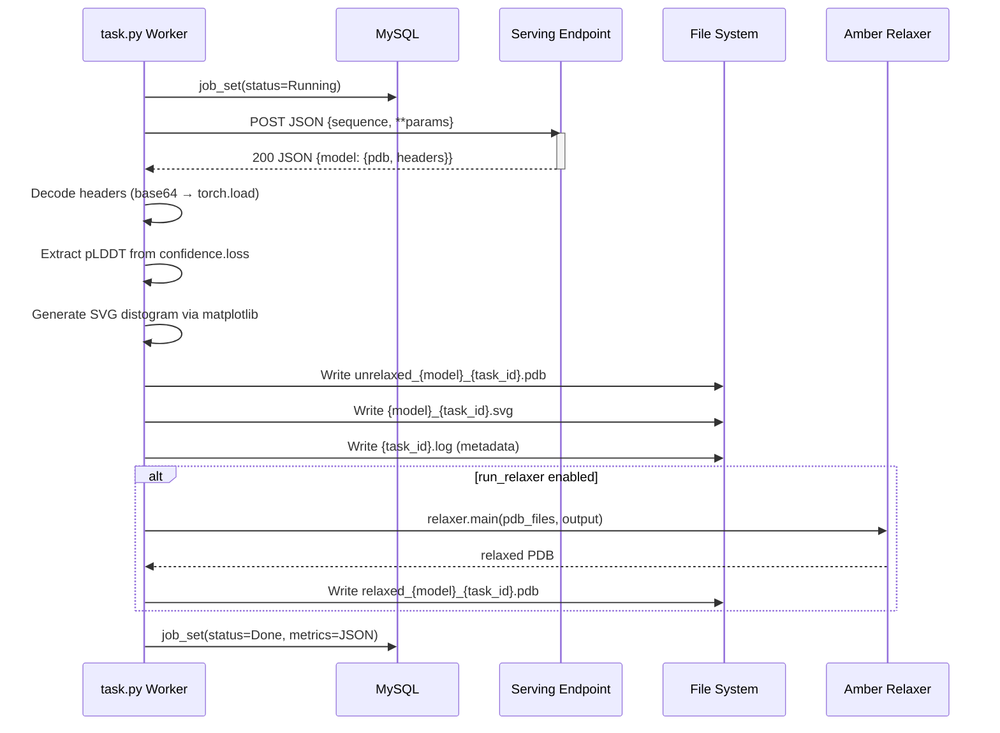
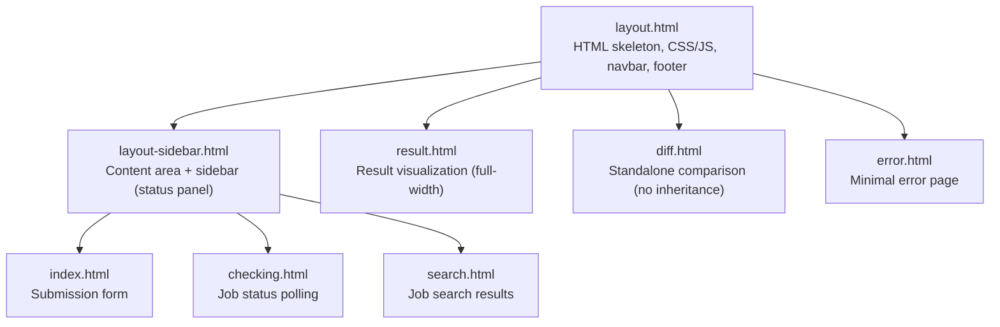

The ProFOLD2 web interface is a Flask-based front-end that transforms the protein structure prediction pipeline into an accessible, browser-based service. It provides a complete job lifecycle — from FASTA sequence submission through queued execution to interactive result visualization — backed by MySQL for persistence and a separate CLI task runner that consumes prediction results from a serving endpoint. Understanding this layer is essential for anyone deploying ProFOLD2 as a shared resource or integrating its prediction capabilities into a broader bioinformatics platform.

Sources: [app.py](web/app.py#L1-L13)

## Architecture Overview

The web module follows a classic request-response pattern with an asymmetric processing model: the Flask application handles user interaction and data persistence, while a separate `task.py` CLI worker performs the computationally expensive prediction orchestration against a remote serving endpoint. This decoupling means the web server remains lightweight and responsive even while predictions run for minutes or hours.



The serving directory layout produced by the task worker follows a deterministic path structure rooted at `$ProFOLD_HOME/serving/`, with separate subdirectories for logs and per-job data:

```
$ProFOLD_HOME/serving/
├── logs/
│   └── {job_id}.log          # Job-level execution log
└── data/
    └── {job_id}/
        ├── {task_id}.pdb      # Unrelaxed predicted structure
        ├── relaxed_{task_id}.pdb  # Amber-relaxed structure
        ├── {task_id}.svg      # Predicted distance/contact map
        └── {task_id}.log      # Task-level metadata + pLDDT
```

Sources: [utils.py](web/utils.py#L6-L31), [app.py](web/app.py#L9)

## Module Composition

The web interface is composed of five Python modules, each with a clearly defined responsibility within the overall architecture.

| Module | Responsibility | Key Dependencies |
|--------|---------------|-----------------|
| `web/app.py` | Flask application, route definitions, resource serving | Flask, `web.db`, `web.form`, `web.utils` |
| `web/db.py` | MySQL connection management, job/task CRUD operations | `mysql.connector`, `shortuuid`, `parse_fasta` |
| `web/form.py` | Input validation (FASTA, Job ID, email) | `residue_constants`, `parse_fasta` |
| `web/task.py` | Background job execution against serving endpoint | `requests`, `torch`, `matplotlib`, `relaxer` |
| `web/utils.py` | File system path resolution for serving artifacts | `os` |

Sources: [app.py](web/app.py#L1-L13), [db.py](web/db.py#L1-L10), [form.py](web/form.py#L1-L8), [task.py](web/task.py#L1-L27), [utils.py](web/utils.py#L1-L4)

## Database Layer

The persistence layer in `web/db.py` wraps a MySQL database named `profold` with two core tables: `jobs` (submission-level metadata) and `tasks` (individual protein sequences within a job). The connection uses a lazy singleton pattern with automatic reconnection via `ping(reconnect=True)` to handle long-running server deployments.

The `jobs` table tracks the overall submission lifecycle, including the app type, email, raw FASTA input, status, and three timestamps (creation, run start, completion). The `tasks` table stores each parsed protein entry with its own independent status, allowing granular progress tracking for multi-protein submissions.

Sources: [db.py](web/db.py#L14-L42)

### Status Machine

Jobs and tasks progress through four discrete states, each tracked as a `varchar(10)` column:

| Status Constant | String Value | Meaning |
|----------------|-------------|---------|
| `STATUS_QUEUING` | `"Queuing"` | Submitted but not yet picked up by the worker |
| `STATUS_RUNNING` | `"Running"` | Currently being processed |
| `STATUS_DONE` | `"Done"` | Successfully completed |
| `STATUS_ERROR` | `"Error"` | Failed during execution |

These constants are defined at module level and referenced uniformly across `db.py`, `task.py`, and the Jinja2 templates for status-color mapping.

Sources: [db.py](web/db.py#L47-L50)

### Key Database Operations

The `db.py` module exposes a focused set of functions that the rest of the web module depends on. `job_new()` is the entry point for submissions: it generates a short UUID via `shortuuid.uuid()[:10]` (unless a custom Job ID is provided), parses the FASTA string into individual sequences using `parse_fasta()`, and inserts both the job record and its child task records in a single transaction with rollback on failure. `job_get()` retrieves jobs with optional task inclusion and supports flexible querying via `**kwargs` with configurable `logic_op` (`'and'`/`'or'`). The `job_set()` function handles status transitions at both job and task granularity.

> [!TIP]
> The `job_get()` function returns a **single job dict** when called with a `job_id` kwarg using `logic_op='and'` (the default), but returns a **list** for any other query combination. This implicit return-type polymorphism means callers must be aware of the calling convention — the route handlers in `app.py` rely on this behavior consistently.

Sources: [db.py](web/db.py#L56-L179)

### Application Registry

The system supports multiple prediction backends through a simple dictionary registry. Two apps are currently defined:

```python
APP_LIST = {'profold0': 'ProFOLD zero', 'abfold': 'AbFOLD'}
```

The `app_id` is passed via the `?app=` query parameter on every request, defaulting to `'profold0'`. This value determines which app's job queue is displayed in the sidebar status panel and which jobs appear in search results, providing namespace isolation between different prediction services sharing the same database.

Sources: [db.py](web/db.py#L52-L53), [app.py](web/app.py#L18)

## Route Structure and Request Flow

The Flask application defines seven routes that cover the complete user journey. Each route is annotated with its HTTP methods and URL pattern, and most accept an optional `?app=` query parameter for multi-app switching.

### Submission Flow (`/`, `/index/`, `/submit/<job_id>/`)

These three URL patterns all map to the same `submit()` function. On `GET` requests, the form is rendered with optional pre-filled data (when resubmitting via `/submit/<job_id>/`). On `POST` requests, the form data flows through `form.validate()`, and if validation passes, `db.job_new()` persists the submission and redirects to the checking page. The form accepts FASTA sequences either as pasted text (`sequences` field) or as an uploaded file (`sequence_file` field), with file upload taking priority when both are present.

Sources: [app.py](web/app.py#L195-L235), [form.py](web/form.py#L19-L34)

### Checking Page (`/checking/<job_id>/`)

The checking page implements a classic server-polling pattern. It embeds a `<meta http-equiv="refresh" content="30">` tag when the job status is not `"Done"`, causing the browser to automatically reload every 30 seconds. The refresh interval is configurable via the `?refresh=` query parameter. Client-side JavaScript also maintains a countdown timer for the next refresh and persists recently viewed job IDs in `localStorage` for quick switching between jobs.

Sources: [app.py](web/app.py#L33-L53), [checking.html](web/templates/checking.html#L3-L13)

### Result Page (`/result/<job_id>/<task_id>/`)

The result page provides the primary output visualization. It loads the relaxed PDB structure into a **3Dmol.js** viewer for interactive 3D manipulation (cartoon rendering with spectrum coloring), displays the predicted distance matrix as an SVG image, and surfaces the pLDDT confidence metric. JavaScript-based selectors allow switching between tasks within a job and between historical jobs stored in `localStorage`.

Sources: [result.html](web/templates/result.html#L1-L158), [app.py](web/app.py#L56-L68)

### Resource Download (`/resource/<job_id>/<data>/` and `/resource/<job_id>/<task_id>/<data>/`)

The resource endpoint serves prediction artifacts for download. When no `task_id` is specified, it packages all tasks into a single ZIP file containing FASTA, unrelaxed PDB, relaxed PDB, and SVG for each protein. When a `task_id` is given, it supports downloading individual files (`pdb`, `relaxed_pdb`, `svg`) or a per-task ZIP archive. All ZIP generation happens in-memory using `io.BytesIO` to avoid temporary file system clutter.

Sources: [app.py](web/app.py#L71-L137)

### Complete Route Map

| Route | Methods | Purpose |
|-------|---------|---------|
| `/`, `/index/` | GET, POST | Main submission form |
| `/submit/<job_id>/` | GET, POST | Resubmit with pre-filled form |
| `/search/` | POST | Search jobs by ID or email |
| `/checking/<job_id>/` | GET | Poll job status with auto-refresh |
| `/result/<job_id>/<task_id>/` | GET | View prediction results with 3D viewer |
| `/resource/<job_id>/<data>/` | GET | Download job-level or task-level resources |
| `/resource/<job_id>/<task_id>/<data>/` | GET | Download specific task artifact |
| `/diff/<exp_name>/` | GET | Side-by-side experiment comparison |
| `/error/` | GET | Generic error page |

Sources: [app.py](web/app.py#L16-L192)

## Input Validation

The `form.py` module implements thorough input sanitization through the `validate()` function, returning a list of human-readable error strings that the template renders as red list items. The `var_get()` helper function abstracts the dual-source pattern (form field or file upload) used throughout the submission flow, with an optional `func` parameter for post-processing (e.g., `parse_fasta`).

Validation rules are applied in three stages:

1. **Job ID** — Must be 4–20 characters, alphanumeric plus underscore only, and unique across the database.
2. **FASTA sequences** — Parsed via `parse_fasta()`, each sequence must be 1–1024 residues, each description must be under 1024 characters, every residue must exist in `residue_constants.restype_order`, and total input size must be under 64KB.
3. **Email** — Optional, but if provided must match a standard email regex pattern.

When a sequence contains an invalid residue, the error message highlights the offending character in blue with 20 residues of context on each side, making it straightforward for users to locate the problem in long sequences.

Sources: [form.py](web/form.py#L37-L86)

## Background Task Execution

The `task.py` module operates as a standalone CLI tool (invoked via `python web/task.py run`) that bridges the MySQL job queue and a remote prediction serving endpoint. This separation means the web server never blocks on prediction requests — it simply writes jobs to the database, and the worker picks them up asynchronously.

### Task Lifecycle

Each task within a job follows a precise execution sequence orchestrated by `do_task()`. The function POSTs the FASTA string as JSON to the serving URI with a 7200-second (2-hour) timeout. The serving endpoint returns a JSON response keyed by model name, where each result contains a base64-encoded header (PyTorch tensor with confidence scores and distogram logits) and a raw PDB string.



The pLDDT metric is extracted from `header['confidence']['loss']` (a design choice that reuses the loss channel as a per-residue confidence score), and the distogram visualization is generated by taking the argmax of the distogram logits and rendering the resulting matrix as an SVG heatmap. If the serving endpoint returns a non-200 status code, the task is immediately marked as `STATUS_ERROR`.

> [!TIP]
> The URI format uses a custom scheme — e.g., `profold0://127.0.0.1:8080/predictions/profold0_0` — where the scheme identifies the app and the remainder is rewritten to HTTP for the actual request. This convention in `run_jobs()` means the app identifier is embedded in the URI itself, not passed separately.

Sources: [task.py](web/task.py#L39-L151), [task.py](web/task.py#L184-L196)

### Relaxation Integration

When `--run_relaxer` is enabled, each predicted PDB undergoes Amber relaxation after the initial prediction. The relaxer runs in a retry loop (default 2 attempts) to handle transient failures gracefully. If all retry attempts are exhausted, the task is marked as `STATUS_ERROR`. The `--use_gpu_relax` flag controls whether relaxation runs on GPU or CPU.

Sources: [task.py](web/task.py#L115-L142)

### CLI Interface

The task runner supports two subcommands:

```bash
# Run queued jobs (or specific jobs by ID)
python web/task.py run [job_ids...] \
    --uri profold0://127.0.0.1:8080/predictions/profold0_0 \
    --dump_pdb --dump_contact --run_relaxer \
    --use_gpu_relax --relax_retry 2 --skip_task_done

# List/filter jobs from the database
python web/task.py list [--logic_op {and,or}] key=value ...
```

The `run` subcommand can either process all jobs with `STATUS_QUEUING` for the specified app, or target specific job IDs when provided as positional arguments. The `--skip_task_done` flag enables incremental processing, allowing resumed runs after interruption.

Sources: [task.py](web/task.py#L214-L256)

## Template System

The Jinja2 template hierarchy follows a three-level inheritance chain that provides consistent branding and navigation while allowing page-specific content injection.



The base `layout.html` provides the FALCON2 branded navigation bar with a dropdown for switching between registered apps, a global job search input, and includes all CSS (Bootstrap, Font Awesome, custom stylesheets) and JavaScript (jQuery, 3Dmol.js, custom scripts). The `layout-sidebar.html` extends this with a two-column layout: the main content block on the left and a sidebar on the right showing real-time server status (queued/running/done/error counts) and partner logos.

The `diff.html` template is notable for being a standalone page that doesn't inherit from the base layout. It uses Bootstrap 5 loaded from CDN, jQuery from CDN, and 3Dmol.js from cdnjs to render a side-by-side comparison grid of predicted structures versus ground truth, with lazy loading via `IntersectionObserver` to avoid initializing all 3D viewers simultaneously.

Sources: [layout.html](web/templates/layout.html#L1-L152), [layout-sidebar.html](web/templates/layout-sidebar.html#L1-L79), [diff.html](web/templates/diff.html#L1-L100), [error.html](web/templates/error.html#L1-L12)

## Configuration and Deployment

The web server launches on `0.0.0.0:9090` with threading enabled when run directly via `python web/app.py`. The serving module path is controlled by the `ProFOLD_MODULE` environment variable, defaulting to `/serving`, which prefixes all static asset and API URLs in the templates. The data root is determined by `ProFOLD_HOME`, defaulting to the current working directory.

| Environment Variable | Default | Purpose |
|---------------------|---------|---------|
| `ProFOLD_MODULE` | `/serving` | URL prefix for static assets and route mounting |
| `ProFOLD_HOME` | `.` | Base directory for serving data and logs |

The MySQL connection parameters are hardcoded in `db.py` (user: `protein`, password: `folding`, host: `127.0.0.1`, database: `profold`), which means the database must be initialized with these credentials before the web interface can operate. The application does not include automatic database migration — the `jobs` and `tasks` table schemas documented in the module's docstring must be created manually.

Sources: [app.py](web/app.py#L11-L13), [app.py](web/app.py#L238-L240), [utils.py](web/utils.py#L6-L7), [db.py](web/db.py#L56-L72)

## Running the Web Server

To start the web interface in development mode:

```bash
# Set environment variables as needed
export ProFOLD_MODULE=/serving
export ProFOLD_HOME=/path/to/data

# Launch the Flask server
python web/app.py
```

In a production deployment, the web server should be placed behind a reverse proxy (e.g., Nginx) with a WSGI server (e.g., Gunicorn), while the task runner operates as a separate process or cron job:

```bash
# Start the task worker to process queued submissions
python web/task.py run --uri profold0://127.0.0.1:8080/predictions/profold0_0 \
    --run_relaxer --dump_contact -v
```

The two-process architecture means you can scale the web front-end and the prediction worker independently, and the web server remains available even when no predictions are running.

Sources: [app.py](web/app.py#L238-L240), [task.py](web/task.py#L184-L196)

---

For deployment details covering containerized setups, see [Docker Deployment](3-docker-deployment). To understand the prediction serving endpoint that the task worker communicates with, refer to [CLI Command Reference](21-cli-command-reference). For a broader understanding of the prediction pipeline that produces the results visualized in this interface, see [Architecture Overview](4-architecture-overview).