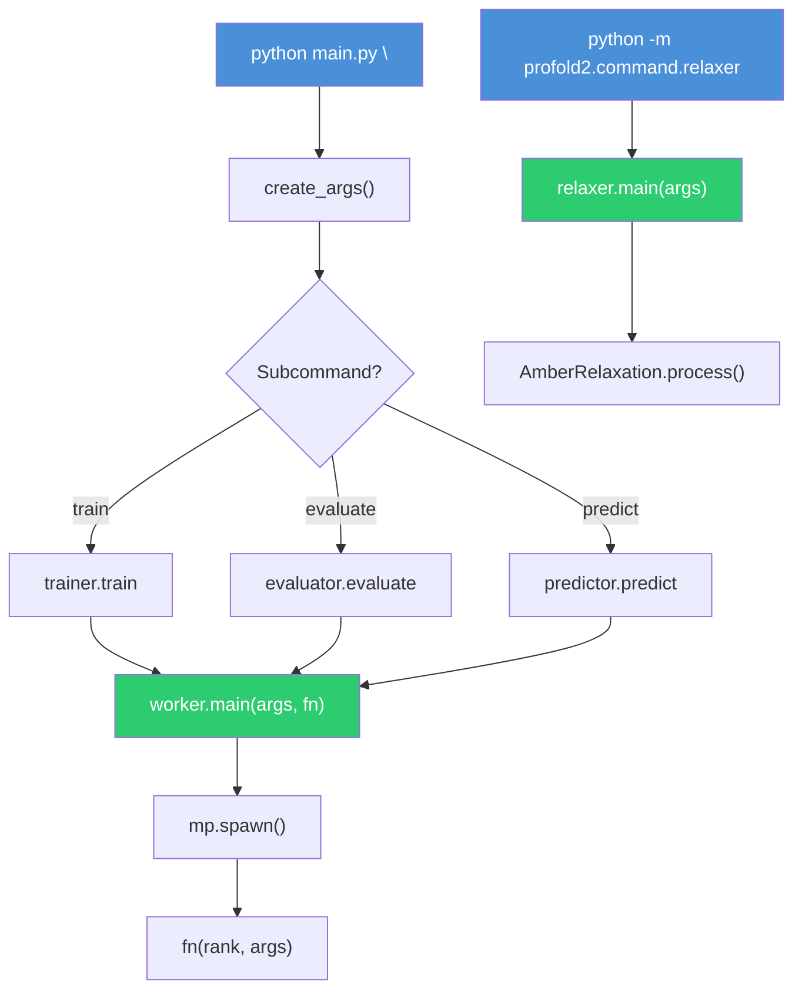

ProFOLD2 exposes its full capabilities through a unified command-line interface built on Python's `argparse`. The CLI supports three primary subcommands—**train**, **evaluate**, and **predict**—alongside a standalone relaxation tool. Every subcommand rides on a common distributed-execution layer that transparently handles single-GPU, multi-GPU, and multi-node configurations through PyTorch's `mp.spawn` mechanism. This page catalogs every flag, its default value, and the semantics that govern its interaction with the training, evaluation, and prediction pipelines.

Sources: [main.py](main.py#L1-L11), [command/main.py](profold2/command/main.py#L1-L80)

## Entry Point and Invocation Flow

The top-level entry point lives in [main.py](main.py#L7-L11) and delegates to `profold2.command.main.main()`. That function parses arguments, resolves the correct handler function, and passes both into `worker.main()`, which orchestrates distributed process spawning, logging setup, and resource cleanup. The relaxer tool is an exception—it defines its own `argparse` logic and runs independently without the worker infrastructure.



Sources: [command/main.py](profold2/command/main.py#L72-L75), [command/worker.py](profold2/command/worker.py#L222-L265), [command/relaxer.py](profold2/command/relaxer.py#L46-L67)

## Global Arguments

Every subcommand inherits the following top-level flags before its own specialized arguments are parsed. Distributed arguments read from environment variables when not explicitly provided, enabling seamless integration with SLURM and torchrun launchers.

| Flag | Type | Default | Environment Fallback | Description |
|------|------|---------|---------------------|-------------|
| `--nnodes` | `int` | `None` | `SLURM_NNODES` | Number of nodes in the distributed job. When `None`, runs in single-process mode. |
| `--node_rank` | `int` | `0` | `SLURM_NODEID` | Rank of the current node within the job. |
| `--local_rank` | `int` | `0` | `LOCAL_RANK` | Local rank of the accelerator on this node. |
| `--init_method` | `str` | `None` | — | Process group initialization URL (e.g., `tcp://...` or `file:///...`). |
| `-o`, `--prefix` | `str` | `.` | — | Output directory prefix for checkpoints, logs, and results. |
| `-v`, `--verbose` | flag | `False` | — | Enable debug-level logging. |

Sources: [command/main.py](profold2/command/main.py#L19-L62)

> [!TIP]
> When `--nnodes` is set, the worker switches to `mp.spawn` with `start_method='spawn'`. The number of processes spawned equals `accelerator.device_count()` (falling back to 1). Omitting `--nnodes` runs the function directly on the local rank, which is the typical mode for single-GPU inference.

## `train` Command

The training command is the most parameter-rich subcommand. It orchestrates a full training loop with cyclical data loading, gradient accumulation, periodic evaluation, checkpointing, optional tuning steps, and experiment tracking via TensorBoard and Weights & Biases. The function is decorated with a `preprocess` hook that validates model architecture flags and creates the checkpoint directory at [trainer.py#L69-L73](profold2/command/trainer.py#L69-L73).

```bash
python main.py train [global args] [training args]
```

### Data Configuration

| Flag | Type | Default | Description |
|------|------|---------|-------------|
| `-t`, `--train_data` | `str` | `train.zip` | Path to the training dataset archive or directory. |
| `--train_idx` | `str` | `None` | Optional index file for the training dataset. |
| `--train_chain` | `str` | `None` | Chain index file for multi-chain training data. |
| `--train_attr` | `str` | `None` | Attribute index file for protein attributes. |
| `--train_data_weights` | `str` | `None` | File containing per-sample weights for weighted sampling. |
| `-n`, `--num_batches` | `int` | `100000` | Total number of training iterations. |
| `-e`, `--eval_data` | `str` | `None` | Evaluation dataset path. When set, periodic eval runs. |
| `--eval_idx` | `str` | `None` | Index file for the eval dataset. |
| `--eval_chain` | `str` | `None` | Chain index for eval data. |
| `--eval_attr` | `str` | `None` | Attribute index for eval data. |
| `--tuning_data` | `str` | `None` | Tuning dataset path (co-trains on a secondary objective). |
| `--tuning_idx` | `str` | `None` | Index file for tuning dataset. |
| `--tuning_chain` | `str` | `None` | Chain index for tuning data. |
| `--tuning_attr` | `str` | `None` | Attribute index for tuning data. |
| `--tuning_data_weights` | `str` | `None` | Per-sample weights for tuning dataset. |
| `--tuning_with_coords` | flag | `False` | Include coordinate labels during tuning steps. |

### Protein and Cropping Filters

| Flag | Type | Default | Description |
|------|------|---------|-------------|
| `--min_protein_len` | `int` | `50` | Filter out proteins shorter than this. |
| `--max_protein_len` | `int` | `1024` | Filter out proteins longer than this. |
| `--max_msa_size` | `int` | `1024` | Cap the number of MSA sequences per sample. |
| `--max_var_size` | `int` | `8192` | Cap the number of variants per sample. |
| `--num_var_task` | `int` | `1` | Number of tasks within variants. |
| `--min_crop_len` | `int` | `80` | Do not crop proteins shorter than this. |
| `--max_crop_len` | `int` | `255` | Target maximum length after cropping. |
| `--train_apply_sqrt_length_scale` | flag | `False` | Scale loss by √(cropped_length / max_crop_len). |
| `--crop_algorithm` | `str` | `auto` | Cropping strategy: `auto`, `random`, or `knn`. |

### Data Augmentation and Sampling

| Flag | Type | Default | Description |
|------|------|---------|-------------|
| `--train_crop_probability` | `float` | `0.0` | Probability of cropping a protein during training. |
| `--train_pseudo_linker_prob` | `float` | `0.0` | Probability of loading complex (multi-chain) data with pseudo linkers. |
| `--data_rm_mask_prob` | `float` | `0.0` | Probability of removing masked amino acids. |
| `--train_msa_as_seq_prob` | `float` | `0.0` | Probability of treating an MSA row as the query sequence. |
| `--train_msa_as_seq_topn` | `int` | `None` | Restrict MSA-as-seq to the top-N rows by identity. |
| `--train_msa_as_seq_clustering` | flag | `False` | Sample MSA-as-seq from cluster representatives. |
| `--train_msa_as_seq_min_alr` | `float` | `None` | Minimum alignment length ratio for MSA-as-seq. |
| `--train_msa_as_seq_min_ident` | `float` | `None` | Minimum sequence identity for MSA-as-seq. |
| `--tuning_crop_probability` | `float` | `0.0` | Cropping probability for tuning data. |
| `--tuning_pseudo_linker_prob` | `float` | `0.0` | Pseudo linker probability for tuning data. |
| `--tuning_msa_as_seq_prob` | `float` | `0.0` | MSA-as-seq probability for tuning data. |
| `--tuning_msa_as_seq_topn` | `int` | `None` | Top-N restriction for tuning MSA-as-seq. |
| `--tuning_msa_as_seq_clustering` | flag | `False` | Clustering-based sampling for tuning. |
| `--tuning_msa_as_seq_min_alr` | `float` | `None` | Min ALR for tuning MSA-as-seq. |
| `--tuning_msa_as_seq_min_ident` | `float` | `None` | Min identity for tuning MSA-as-seq. |
| `--random_seed` | `int` | `None` | Global random seed for reproducibility. |

### Training Loop and Checkpointing

| Flag | Type | Default | Description |
|------|------|---------|-------------|
| `--checkpoint_max_to_keep` | `int` | `5` | Maximum number of checkpoint files to retain. |
| `--checkpoint_every` | `int` | `100` | Save a checkpoint every N iterations. |
| `--tuning_every` | `int` | `10` | Run a tuning step every N iterations. |
| `--eval_every` | `int` | `100` | Run evaluation every N iterations. |
| `--gradient_accumulate_every` | `int` | `16` | Number of micro-batches per optimizer step. |
| `-b`, `--batch_size` | `int` | `1` | Micro-batch size per GPU. |
| `--num_workers` | `int` | `1` | DataLoader worker count. |
| `--prefetch_factor` | `int` | `2` | Batches prefetched per worker. |
| `-l`, `--learning_rate` | `float` | `1e-3` | Base learning rate for Adam optimizer. |

The training loop runs from `global_step` to `num_batches` [trainer.py#L396](profold2/command/trainer.py#L396). Gradient accumulation divides effective batch size by the accumulation count, and the loss scaler accounts for distributed world size to keep gradient magnitudes consistent. Checkpoints restore the global step counter, so training resumes seamlessly after interruption.

### Model Architecture Flags

| Flag | Type | Default | Description |
|------|------|---------|-------------|
| `--model_features` | `str` | `model_features_main.json` | JSON file defining feature computation. |
| `--model_headers` | `str` | `model_headers_main.json` | JSON file defining prediction heads. |
| `--model_recycles` | `int` | `2` | Number of structure recycling iterations. |
| `--model_recycling_frames` | flag | `False` | Enable frame recycling between recycles. |
| `--model_recycling_pos` | flag | `False` | Enable backbone position recycling. |
| `--model_dim` | `int ×3` | `384 256 128` | Model dimensions (single, pair, trash). |
| `--model_num_tokens` | `int` | 33 | Vocabulary size (residue types with X). |
| `--model_evoformer_depth` | `int` | `1` | Number of Evoformer blocks. |
| `--model_evoformer_head_num` | `int` | `48` | Attention heads in Evoformer. |
| `--model_evoformer_head_dim` | `int` | `32` | Per-head dimension in Evoformer. |
| `--model_shard_size` | `int` | `None` | Shard size for memory-efficient Evoformer computation. |
| `--model_dropout` | `float ×2` | `0.15 0.25` | Dropout rates (single representation, pair representation). |
| `--model_evoformer_accept_msa_attn` | flag | `False` | Enable MSATransformer in Evoformer. |
| `--model_evoformer_accept_frame_attn` | flag | `False` | Enable FrameTransformer in Evoformer. |
| `--model_evoformer_accept_frame_update` | flag | `False` | Enable FrameUpdater in Evoformer. |

At least one of `--model_evoformer_accept_msa_attn` or `--model_evoformer_accept_frame_attn` must be enabled—the preprocess hook asserts this [trainer.py#L70](profold2/command/trainer.py#L70). This ensures the model has a valid attention pathway through the Evoformer. For more on these architectural choices, see [Evoformer and Pairformer Blocks](6-evoformer-and-pairformer-blocks).

### Fine-Grained Parameter Control

| Flag | Type | Default | Description |
|------|------|---------|-------------|
| `--model_params_requires_grad` | `str` | `None` | Regex pattern; only matching parameters receive gradients. |
| `--model_params_requires_hook` | `str` | `None` | Regex pattern; matching parameters get backward hooks (for W&B logging). |
| `--model_params_optim_option` | `str` | `None` | Per-group optimizer options as URL-encoded string (see note below). |

> [!TIP]
> The `--model_params_optim_option` flag uses a custom URL scheme (`optim://pattern?lr=value&...#regex`) to define parameter groups with individual learning rates. Multiple groups are comma-separated. This is particularly useful for differential learning rates between the Evoformer and structure module heads.

Sources: [command/trainer.py](profold2/command/trainer.py#L471-L813), [command/trainer.py](profold2/command/trainer.py#L69-L467)

### Experiment Tracking

| Flag | Type | Default | Description |
|------|------|---------|-------------|
| `--wandb_enabled` | flag | `False` | Enable Weights & Biases experiment tracking. |
| `--wandb_project` | `str` | `profold2` | W&B project name. |
| `--wandb_dir` | `str` | `None` | Local directory for W&B artifacts. |
| `--wandb_name` | `str` | `None` | Custom W&B run name. |
| `--wandb_mode` | `str` | `online` | W&B mode: `online`, `offline`, or `disabled`. |
| `--amp_enabled` | flag | `False` | Enable automatic mixed precision (AMP). |

When W&B is enabled, the model's feature and header configurations are automatically logged to the run config [trainer.py#L200-L201](profold2/command/trainer.py#L200-L201). TensorBoard logs are written to `{prefix}/runs/eval` by the master rank only [trainer.py#L270-L271](profold2/command/trainer.py#L270-L271).

## `evaluate` Command

The evaluate command loads a saved model checkpoint, runs inference over an evaluation dataset, and reports structural quality metrics. It supports distributed evaluation across multiple nodes with automatic dataset sharding. When the model includes a folding head, it computes TM-scores via Kabsch alignment. For fitness and coevolution heads, it serializes per-sample predictions to pickle files.

```bash
python main.py evaluate [global args] [evaluate args]
```

| Flag | Type | Default | Description |
|------|------|---------|-------------|
| `--map_location` | `str` | `None` | Device mapping for loading the checkpoint. |
| `--model` | `str` | `model.pth` | Path to the saved model checkpoint. |
| `--eval_data` | `str` | `None` | Evaluation dataset directory or archive. |
| `--eval_idx` | `str` | `None` | Index file for the eval dataset. |
| `--eval_attr` | `str` | `None` | Attribute index for eval data. |
| `--eval_without_pdb` | flag | `False` | Skip loading ground-truth PDB coordinates. |
| `--min_protein_len` | `int` | `0` | Minimum protein length filter (default: no filter). |
| `--max_protein_len` | `int` | `1024` | Maximum protein length filter. |
| `--max_msa_size` | `int` | `1024` | Maximum MSA depth. |
| `--max_var_size` | `int` | `None` | Maximum variant count. |
| `--num_var_task` | `int` | `1` | Variant task count. |
| `--min_crop_len` | `int` | `None` | Minimum crop length. |
| `--max_crop_len` | `int` | `None` | Maximum crop length. |
| `--crop_algorithm` | `str` | `random` | Crop strategy: `random`, `domain`, or `knn`. |
| `--crop_probability` | `float` | `0.0` | Cropping probability. |
| `--pseudo_linker_prob` | `float` | `0.0` | Complex data loading probability. |
| `--msa_as_seq_prob` | `float` | `0.0` | MSA-as-seq augmentation probability. |
| `--msa_as_seq_topn` | `int` | `None` | Top-N restriction for MSA-as-seq. |
| `--msa_as_seq_clustering` | flag | `False` | Cluster-based MSA-as-seq sampling. |
| `--msa_as_seq_min_alr` | `float` | `None` | Min ALR for MSA-as-seq. |
| `-b`, `--batch_size` | `int` | `1` | Batch size for evaluation. |
| `--num_workers` | `int` | `1` | DataLoader workers. |
| `--model_recycles` | `int` | `0` | Recycling iterations (default: 0 for eval speed). |
| `--model_shard_size` | `int` | `None` | Evoformer shard size for memory efficiency. |
| `--amp_enabled` | flag | `False` | Enable AMP for evaluation. |
| `--enable_profiler` | flag | `False` | Enable PyTorch profiler output. |
| `--enable_memory_snapshot` | flag | `False` | Enable CUDA memory snapshot. |

The evaluator writes fitness predictions as pickle files (`{prefix}/{pid}_var.pkl`) containing variant predictions, coevolution parameters, and optionally ground-truth labels [evaluator.py#L133-L134](profold2/command/evaluator.py#L133-L134). When folding heads are present, it reports per-protein and average TM-scores across the evaluation set [evaluator.py#L202-L203](profold2/command/evaluator.py#L202-L203).

Sources: [command/evaluator.py](profold2/command/evaluator.py#L25-L205), [command/evaluator.py](profold2/command/evaluator.py#L206-L323)

## `predict` Command

The predict command is the primary inference interface for structure prediction. It accepts FASTA files (single-sequence or A3M format) or pre-built datasets, runs one or more models on each input, applies Amber relaxation, and produces ranked output structures. This is the command used in production for de novo structure prediction.

```bash
python main.py predict [global args] [predict args]
```

### Input Specification

| Flag | Type | Default | Description |
|------|------|---------|-------------|
| `fasta_files` | `str[]` | required | One or more FASTA file paths (positional, supports globs). |
| `--fasta_file_list` | `str` | `None` | Text file listing FASTA paths (one per line). |
| `--fasta_fmt` | `str` | `single` | Format: `single` for single-sequence, `a3m` for MSA input. |
| `--data_dir` | `str` | `None` | Load pre-built dataset instead of FASTA files. |
| `--data_idx` | `str` | `None` | Dataset index file. |
| `--add_pseudo_linker` | flag | `False` | Enable complex/multi-chain prediction. |

### Model Loading

| Flag | Type | Default | Description |
|------|------|---------|-------------|
| `--models` | `str[]` | required | Model paths in `[NAME=]PATH` format (space-separated). |
| `--model_recycles` | `int` | `0` | Number of recycling iterations. |
| `--model_shard_size` | `int` | `None` | Evoformer shard size. |
| `--max_msa_size` | `int` | `1024` | Maximum MSA depth for A3M input. |

The `--models` flag supports a flexible `[NAME=]PATH` syntax: when no `=` is present, the model name is derived from the filename [predictor.py#L111-L117](profold2/command/predictor.py#L111-L117). Multiple models can be specified to produce an ensemble, with outputs ranked by per-model confidence.

### Inference Options

| Flag | Type | Default | Description |
|------|------|---------|-------------|
| `--num_workers` | `int` | `1` | DataLoader worker count. |
| `--no_relaxer` | flag | `False` | Skip Amber relaxation entirely. |
| `--no_pth` | flag | `False` | Skip saving the raw prediction `.pth` file. |
| `--no_gpu_relax` | flag | `False` | Force relaxation on CPU. |
| `--amp_enabled` | flag | `False` | Enable AMP during inference. |
| `--enable_profiler` | flag | `False` | Enable PyTorch profiler. |
| `--enable_memory_snapshot` | flag | `False` | Enable CUDA memory snapshot. |

### Output Structure

For each input sequence, the predictor creates a directory at `{prefix}/{fasta_name}/` containing:

| File | Description |
|------|-------------|
| `unrelaxed_{model_name}.pdb` | Raw model output before relaxation. |
| `relaxed_{model_name}.pdb` | Structure after Amber refinement (if enabled). |
| `ranked_{i}.pdb` | Models sorted by confidence (best first). |
| `ranking_debug.json` | Confidence scores and ranking order. |
| `timings.json` | Per-stage timing breakdown. |
| `result_{model_name}.pdb` | Full prediction tensors (unless `--no_pth`). |

The ranking system uses the mean pLDDT confidence score from each model's confidence head [predictor.py#L240](profold2/command/predictor.py#L240). Models are sorted in descending order and the ranked PDBs reflect either relaxed or unrelaxed structures depending on whether relaxation was enabled [predictor.py#L244-L255](profold2/command/predictor.py#L244-L255).

Sources: [command/predictor.py](profold2/command/predictor.py#L29-L360), [command/predictor.py](profold2/command/predictor.py#L131-L296)

## Standalone Relaxer Tool

The relaxer operates outside the main CLI dispatcher as a standalone utility. It reads PDB files, applies Amber energy minimization, and writes relaxed structures to a specified output directory. It invokes the same `AmberRelaxation` class used internally by the predictor but can process arbitrary PDB files from any source.

```bash
python -m profold2.command.relaxer <pdb_files...> [relaxer args]
```

| Flag | Type | Default | Description |
|------|------|---------|-------------|
| `pdb_files` | `str[]` | required | PDB file paths (positional, supports globs). |
| `-o`, `--output` | `str` | `.` | Output directory for relaxed PDB files. |
| `--prefix` | `str` | `''` | Filename prefix for output files. |
| `-g`, `--use_gpu_relax` | flag | `False` | Run relaxation on GPU. |
| `-v`, `--verbose` | flag | `False` | Enable debug-level logging. |

The relaxer uses a retry mechanism (2 attempts) to handle transient Amber failures, falling back to the unrelaxed structure if relaxation fails [relaxer.py#L183-L196](profold2/command/relaxer.py#L183-L196). For full details on the Amber relaxation parameters and chemistry, see [Amber Relaxation](18-amber-relaxation).

Sources: [command/relaxer.py](profold2/command/relaxer.py#L1-L68)

## Common Patterns and Examples

### Basic Structure Prediction

```bash
python main.py predict \
  -o ./results \
  protein1.fasta protein2.fasta \
  --models model_1.pth model_2.pth \
  --model_recycles 3 \
  --amp_enabled
```

### Distributed Multi-Node Training

```bash
torchrun --nnodes=4 --nproc_per_node=8 main.py train \
  -o ./training_run \
  -t /data/train.zip \
  -e /data/eval.zip \
  --model_evoformer_accept_msa_attn \
  --model_evoformer_depth 48 \
  --model_recycles 2 \
  --num_batches 500000 \
  --gradient_accumulate_every 8 \
  --learning_rate 1e-3 \
  --checkpoint_every 1000 \
  --wandb_enabled
```

### Evaluation with Profiling

```bash
python main.py evaluate \
  -o ./eval_output \
  --model model.pth \
  --eval_data /data/eval.zip \
  --model_recycles 0 \
  --enable_profiler \
  --enable_memory_snapshot \
  -v
```

### Standalone Relaxation

```bash
python -m profold2.command.relaxer \
  predictions/*.pdb \
  -o ./relaxed \
  -g \
  -v
```

## Performance and Diagnostics Flags

Three diagnostic flags are shared across `predict` and `evaluate` for profiling production workloads:

| Flag | Effect |
|------|--------|
| `--enable_profiler` | Wraps the inference loop with `torch.profiler.profile()`, emitting a CUDA-time-sorted table at completion. |
| `--enable_memory_snapshot` | Captures CUDA memory snapshots via `snapshot.memory_snapshot()` at each inference step. |
| `--amp_enabled` | Activates `accelerator.amp()` context for automatic mixed precision inference, reducing GPU memory by approximately 30-50%. |

The profiler and memory snapshot can be used simultaneously. When enabled, profiling output is written to debug-level logs and memory summaries are printed at task completion [predictor.py#L293-L295](profold2/command/predictor.py#L293-L295).

For deeper architectural context on how these commands interact with the model components discussed here, proceed to [AlphaFold2 Core Pipeline](5-alphafold2-core-pipeline). For distributed training infrastructure details, see [Distributed Training Infrastructure](19-distributed-training-infrastructure).