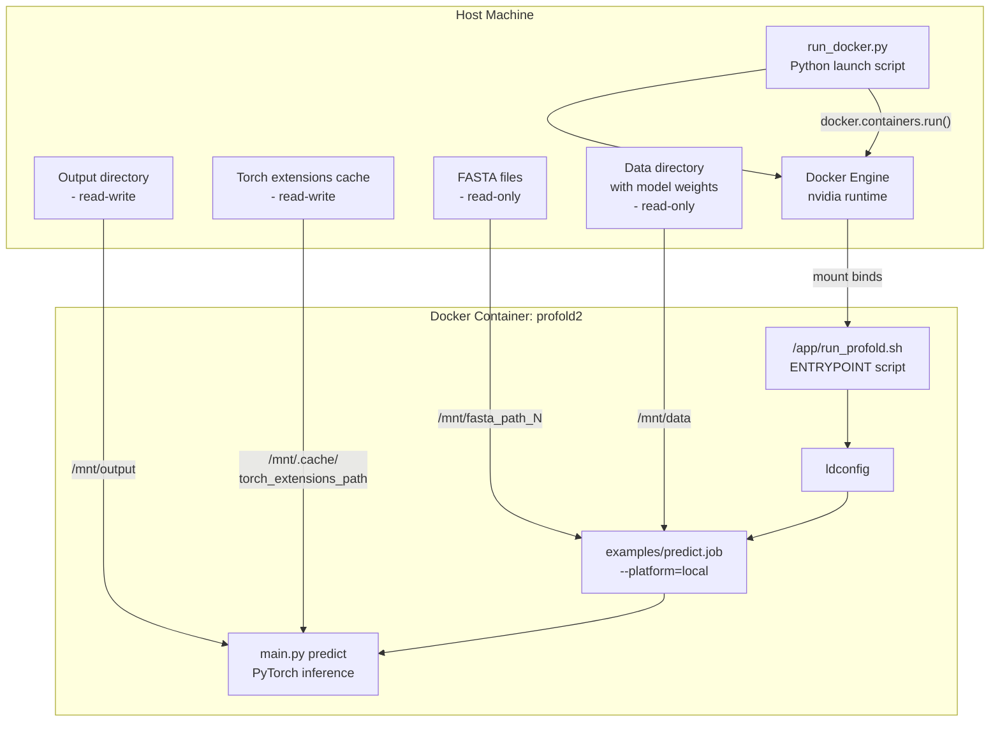
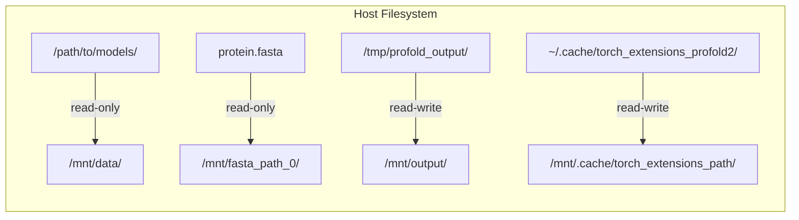
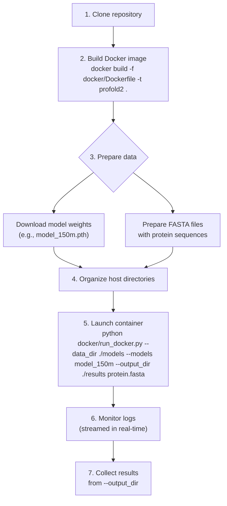

ProFOLD2 provides a fully containerized deployment path that eliminates the need to manually configure CUDA toolchains, conda environments, or bioinformatics dependencies. This page walks you through every layer of the Docker setup — from how the image is assembled, to how volumes are mounted, to how prediction jobs are orchestrated at runtime. By the end, you will be able to build the image, launch a prediction container, and interpret the mounting and execution model without surprises.

## Architecture Overview

The Docker deployment system consists of three cooperating components: the **Dockerfile** that builds a self-contained GPU runtime image, the **`run_docker.py`** launch script that translates host-side arguments into container invocations, and the **`predict.job`** entrypoint inside the container that actually executes ProFOLD2's prediction pipeline. Understanding how these layers connect is the key to customizing and troubleshooting your deployments.



The diagram above shows the full lifecycle: `run_docker.py` on the host constructs bind-mounts for your data and output directories, launches the container with the `nvidia` runtime, and streams logs back to your terminal. Inside the container, a small shell wrapper calls `ldconfig` (to make GPU libraries visible, a known NVIDIA Docker quirk) and then hands off to [predict.job](examples/predict.job) in local mode.

Sources: [Dockerfile](docker/Dockerfile#L1-L57), [run_docker.py](docker/run_docker.py#L29-L101), [predict.job](examples/predict.job#L1-L94)

## Prerequisites

Before building or running the Docker image, ensure your host system meets the following requirements:

| Requirement | Minimum Version | Purpose |
|---|---|---|
| NVIDIA Driver | 525+ (Linux) | GPU compute support |
| NVIDIA Container Toolkit | ≥ 1.14 | `--runtime=nvidia` support |
| Docker Engine | ≥ 24.0 | Build and run containers |
| Python | 3.9+ | For `run_docker.py` launcher only |
| Docker SDK for Python | latest | `pip install docker` |
| Disk Space | ~15 GB | Image build + CUDA toolchain |
| CUDA Version | 12.1.1 | Match the default `ARG` in Dockerfile |

Verify your NVIDIA Container Toolkit is working:

```bash
docker run --rm --gpus all nvidia/cuda:12.1.1-base-ubuntu22.04 nvidia-smi
```

If you see a GPU listing, your runtime is correctly configured.

Sources: [Dockerfile](docker/Dockerfile#L1-L5), [requirements.txt](docker/requirements.txt#L1-L3)

## Building the Docker Image

The Dockerfile lives at [`docker/Dockerfile`](docker/Dockerfile) and is designed to be built from the **project root directory** — this is critical because it uses `COPY . ${profold_home}` to transfer the entire repository into the image at line 35. The base image is `nvidia/cuda:12.1.1-cudnn8-runtime-ubuntu22.04`, selected via a build argument so you can swap CUDA versions if needed.

### Build Steps

```bash
# From the project root directory
cd ProFOLD2
docker build -f docker/Dockerfile -t profold2 .
```

To build with a different CUDA version:

```bash
docker build -f docker/Dockerfile --build-arg CUDA=12.4.0 -t profold2:cu124 .
```

### What Happens During the Build

The build process executes these stages sequentially:

1. **System packages** — installs `cuda-command-line-tools`, `hmmer`, `kalign`, `tzdata`, and `wget` via `apt-get` ([Dockerfile#L12-L18](docker/Dockerfile#L12-L18)). HMMER and Kalign are bioinformatics tools used by AlphaFold-style pipelines for sequence alignment.
2. **Miniconda** — downloads and installs Miniconda3 into `/opt/conda`, then adds it to `PATH` and `LD_LIBRARY_PATH` ([Dockerfile#L21-L31](docker/Dockerfile#L21-L31)).
3. **Project copy** — the entire repository is copied into `/app/profold2` ([Dockerfile#L34-L35](docker/Dockerfile#L34-L35)).
4. **Dependency installation** — runs [`install_env.sh -c`](install_env.sh) inside the container. The `-c` flag triggers cache cleanup after each conda/pip stage to minimize layer size ([Dockerfile#L38-L39](docker/Dockerfile#L38-L39)).
5. **ldconfig permission** — sets the SETUID bit on `/sbin/ldconfig.real` so that non-root users inside the container can run it ([Dockerfile#L42-L42](docker/Dockerfile#L42-L42)).
6. **Entrypoint script** — creates `/app/run_profold.sh`, a thin wrapper that calls `ldconfig` and then invokes `examples/predict.job` with all forwarded arguments ([Dockerfile#L50-L56](docker/Dockerfile#L50-L56)).

> [!TIP]
> The build context must be the **project root**, not the `docker/` directory. The Dockerfile references `install_env.sh` and `examples/predict.job` using paths relative to the build context. Running `docker build -f docker/Dockerfile .` from the root is the only supported approach.

Sources: [Dockerfile](docker/Dockerfile#L1-L57), [install_env.sh](install_env.sh#L1-L71)

## Dependency Stack Inside the Image

The [`install_env.sh`](install_env.sh) script orchestrates a layered dependency installation. Here is the complete stack with versions, exactly as configured in the build:

| Layer | Package(s) | Version | Source |
|---|---|---|---|
| C++ Compiler | `gxx`, `ninja` | GCC 12.4.0 | conda-forge |
| Molecular Dynamics | `openmm`, `pdbfixer` | 8.0.0 | conda-forge |
| CUDA Runtime | `cuda-version`, `cuda-cccl`, `cuda-libraries-dev`, `cuda-nvcc`, `libcurand-dev` | 12.1 | nvidia channels |
| Deep Learning | `torch` | 2.3.1+cu121 | PyPI (with CUDA index) |
| Bioinformatics | `biopython`, `einops` | latest | conda-forge |
| Monitoring | `tensorboard`, `tqdm` | latest | conda-forge |

The script uses `cleanup()` function calls between each installation stage to purge pip and conda caches, keeping the final image as compact as possible ([install_env.sh#L24-L29](install_env.sh#L24-L29)). All versions are controlled by environment variables at the top of the script (lines 31-34), making them straightforward to override.

Sources: [install_env.sh](install_env.sh#L31-L71)

## Running Predictions with `run_docker.py`

The recommended way to launch ProFOLD2 inside Docker is via [`docker/run_docker.py`](docker/run_docker.py), a Python script that handles volume mounting, GPU configuration, and container lifecycle. It requires only the `docker` Python package ([docker/requirements.txt](docker/requirements.txt#L1-L3)).

### Basic Usage

```bash
python docker/run_docker.py \
    --data_dir /path/to/model_weights \
    --models model_150m \
    --output_dir /tmp/profold_output \
    protein1.fasta protein2.fasta
```

### Complete Command-Line Reference

The script exposes these arguments ([run_docker.py#L103-L142](docker/run_docker.py#L103-L142)):

| Argument | Type | Default | Description |
|---|---|---|---|
| `--docker_image_name` | str | `profold2` | Name of the pre-built Docker image |
| `--gpu_list` | list | `all` | Specific GPU IDs to expose (e.g., `0 1`) |
| `--output_dir` | str | `/tmp/profold` | Host directory for prediction results |
| `--data_dir` | str | `None` | Host directory containing model weights |
| `--models` | list | — | Model files (names or paths, `.pth` auto-appended) |
| `--model_recycles` | int | `2` | Number of structure recycles in inference |
| `--model_shard_size` | int | `256` | Shard size for the Evoformer model |
| `--add_pseudo_linker` | flag | off | Enable loading protein complex data |
| `--no_relaxer` | flag | off | Skip AMBER relaxation of predicted structures |
| `--no_gpu_relax` | flag | off | Run AMBER relaxation on CPU instead of GPU |
| `fasta_files` | list | — (required) | One or more FASTA files to predict |
| `-v, --verbose` | flag | off | Enable debug-level logging |

### How Volume Mounting Works

The launcher creates four categories of bind-mounts, each with a specific purpose ([run_docker.py#L13-L76](docker/run_docker.py#L13-L76)):



| Mount | Host Source | Container Target | Mode | Purpose |
|---|---|---|---|---|
| Data directory | `--data_dir` | `/mnt/data/` | read-only | Model weights and datasets |
| FASTA files | positional args | `/mnt/fasta_path_N/` | read-only | Input sequences (one mount per file) |
| Output directory | `--output_dir` | `/mnt/output/` | read-write | Prediction results (PDB files, metrics) |
| Torch extensions | `~/.cache/torch_extensions_profold2/` | `/mnt/.cache/torch_extensions_path/` | read-write | JIT-compiled CUDA kernels |

The torch extensions cache is **read-write** because PyTorch compiles custom CUDA kernels on first use and caches them for subsequent runs. By mounting this directory out of the container, you avoid recompilation on every launch ([run_docker.py#L49-L54](docker/run_docker.py#L49-L54)).

### GPU Configuration

GPU visibility is controlled via the `NVIDIA_VISIBLE_DEVICES` environment variable, which the launcher sets from `--gpu_list` ([run_docker.py#L90-L90](docker/run_docker.py#L90-L90)). The container uses the `nvidia` runtime ([run_docker.py#L84-L84](docker/run_docker.py#L84-L84)), which is essential for CUDA access.

```bash
# Use specific GPUs
python docker/run_docker.py --gpu_list 0 2 --data_dir ... model1.fasta

# Use all available GPUs (default)
python docker/run_docker.py --data_dir ... model1.fasta
```

### Container Isolation and Permissions

The container runs with the **same UID and GID as your host user** ([run_docker.py#L88-L88](docker/run_docker.py#L88-L88)), which means output files are written with your ownership — no root permission issues. The container is configured with `remove=True` ([run_docker.py#L85-L85](docker/run_docker.py#L85-L85)), so it cleans itself up after execution. A signal handler catches `SIGINT` (Ctrl+C) and kills the container gracefully ([run_docker.py#L97-L97](docker/run_docker.py#L97-L97)).

Sources: [run_docker.py](docker/run_docker.py#L1-L147)

## Understanding the Container Entrypoint

When the container starts, it executes `/app/run_profold.sh` ([Dockerfile#L56-L56](docker/Dockerfile#L56-L56)). This script, generated at build time, does two things:

```bash
#!/bin/bash
cd /app/profold2
ldconfig
/app/profold2/examples/predict.job "$@"
```

The `ldconfig` call resolves a known NVIDIA Docker issue where GPU devices are not visible until shared library caches are refreshed ([nvidia-docker#1399](https://github.com/NVIDIA/nvidia-docker/issues/1399)). The `ldconfig` binary has its SETUID bit set during the build ([Dockerfile#L42-L42](docker/Dockerfile#L42-L42)), enabling it to run as non-root.

The `predict.job` script then runs with `--platform=local` (passed as the first argument by `run_docker.py` at [line 30](docker/run_docker.py#L30-L30)), which tells it to bypass SLURM scheduling and execute directly. Inside the script, it activates the conda environment and invokes:

```bash
python /app/profold2/main.py predict \
    --platform=local \
    -- \
    --map_location=cpu \
    --models /mnt/data/model_150m.pth \
    --prefix=/mnt/output \
    --model_recycles=2 \
    --model_shard_size=256 \
    /mnt/fasta_path_0/protein.fasta
```

The `--map_location=cpu` argument ([run_docker.py#L32-L32](docker/run_docker.py#L32-L32)) ensures that model weights are loaded into CPU memory first before being transferred to GPU, preventing OOM errors during weight loading.

Sources: [Dockerfile](docker/Dockerfile#L50-L56), [predict.job](examples/predict.job#L84-L93), [run_docker.py](docker/run_docker.py#L30-L76)

## Step-by-Step Deployment Walkthrough

This flowchart captures the complete end-to-end process from cloning the repository to receiving prediction results:



### Concrete Example: Predicting a Single Protein

Assuming you have cloned the repository and placed your model weights and FASTA file:

```bash
# Directory structure on the host
# /home/user/profold2_run/
# ├── models/
# │   └── model_150m.pth          # Pre-trained model weights
# └── input/
#     └── 1CRN.fasta              # Protein sequence file

# Build the image (one-time, from project root)
cd ProFOLD2
docker build -f docker/Dockerfile -t profold2 .

# Run prediction
python docker/run_docker.py \
    --docker_image_name profold2 \
    --data_dir /home/user/profold2_run/models \
    --models model_150m \
    --model_recycles 3 \
    --model_shard_size 256 \
    --output_dir /home/user/profold2_run/results \
    /home/user/profold2_run/input/1CRN.fasta
```

### Example: Batch Prediction with Multiple Proteins

```bash
python docker/run_docker.py \
    --data_dir /home/user/profold2_run/models \
    --models model_150m \
    --output_dir /home/user/profold2_run/results \
    --no_relaxer \
    --verbose \
    /home/user/profold2_run/input/protein_A.fasta \
    /home/user/profold2_run/input/protein_B.fasta \
    /home/user/profold2_run/input/protein_C.fasta
```

### Example: Using Specific GPUs

```bash
python docker/run_docker.py \
    --gpu_list 0 1 \
    --data_dir /home/user/profold2_run/models \
    --models model_150m \
    --output_dir /home/user/profold2_run/results \
    /home/user/profold2_run/input/1CRN.fasta
```

Sources: [run_docker.py](docker/run_docker.py#L103-L147), [predict.job](examples/predict.job#L84-L93)

## Troubleshooting

| Symptom | Likely Cause | Resolution |
|---|---|---|
| `Could not select GPU device` | NVIDIA Container Toolkit not installed or `nvidia` runtime unavailable | Install [NVIDIA Container Toolkit](https://docs.nvidia.com/datacenter/cloud-native/container-toolkit/latest/install-guide.html) and verify with `docker run --rm --gpus all nvidia/cuda:12.1.1-base-ubuntu22.04 nvidia-smi` |
| `Permission denied` on output files | Container writes as root (UID mismatch) | The launcher maps your UID/GID by default. If running raw `docker run`, add `--user $(id -u):$(id -g)` |
| `Failed to find source directory to mount` | FASTA or data path doesn't exist on host | Verify all paths with `ls` before passing them to `run_docker.py` |
| Slow first run, then fast | CUDA kernel JIT compilation | Normal behavior. Torch extensions are cached in `~/.cache/torch_extensions_profold2/` after first run |
| `ldconfig` permission error inside container | Older Dockerfile without SETUID bit | Rebuild the image — the current Dockerfile sets `chmod u+s /sbin/ldconfig.real` |
| Model weights not found | `--models` path mismatch | When using `--models model_name` (without path), the launcher looks in `{data_target_path}/model_name.pth` ([run_docker.py#L41-L44](docker/run_docker.py#L41-L44)) |

> [!TIP]
> If you encounter CUDA version mismatches between your host driver and the container's CUDA toolkit, override the build argument: `docker build --build-arg CUDA=12.4.0 -f docker/Dockerfile -t profold2 .`. The `install_env.sh` script automatically extracts the major.minor CUDA version for dependency resolution at [line 35](install_env.sh#L35-L35).

Sources: [Dockerfile](docker/Dockerfile#L41-L46), [install_env.sh](install_env.sh#L35-L35), [run_docker.py](docker/run_docker.py#L41-L44)

## File Structure Summary

Here is the complete layout of Docker-related files within the repository, annotated with their roles:

```
ProFOLD2/
├── docker/
│   ├── Dockerfile              # Image definition (CUDA 12.1.1 + cuDNN 8)
│   ├── requirements.txt        # Host-side: just 'docker' Python package
│   └── run_docker.py           # Container orchestration launcher
├── install_env.sh              # Shared by Docker & bare-metal installation
├── examples/
│   ├── predict.job             # Container entrypoint (also used via SLURM)
│   ├── train.job               # SLURM-only (not exposed via Docker)
│   └── evaluate.job            # SLURM-only (not exposed via Docker)
├── main.py                     # CLI entry point (train/evaluate/predict)
└── requirements.txt            # Bare-metal Python dependencies
```

Note that the Docker entrypoint is wired specifically to [`predict.job`](examples/predict.job), meaning the current Docker setup is optimized for **inference only**. Training and evaluation require SLURM scheduling or manual local execution — see [CLI Command Reference](21-cli-command-reference) for those workflows.

Sources: [Dockerfile](docker/Dockerfile#L1-L57), [run_docker.py](docker/run_docker.py#L1-L147), [predict.job](examples/predict.job#L84-L93)

## Next Steps

With Docker deployment working, you have several paths forward depending on your goals:

- **[Architecture Overview](4-architecture-overview)** — understand the internal model architecture that powers the predictions running inside your container.
- **[AlphaFold2 Core Pipeline](5-alphafold2-core-pipeline)** — dive into the prediction pipeline that executes when `predict.job` runs.
- **[CLI Command Reference](21-cli-command-reference)** — explore the full set of commands (train, evaluate, predict) available via `main.py`, including options not exposed through the Docker launcher.
- **[Quick Start](2-quick-start)** — if you prefer bare-metal installation without Docker, this guide covers conda-based setup as an alternative.