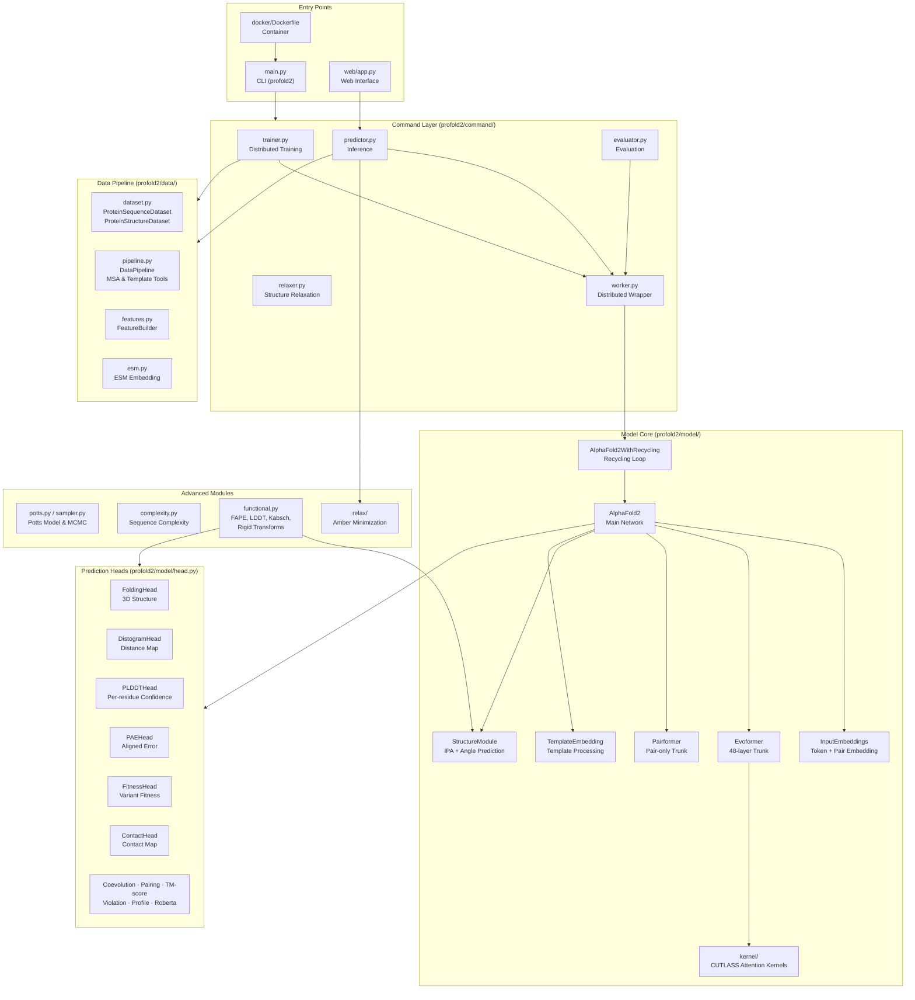
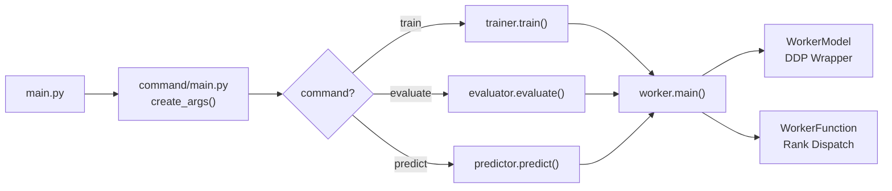
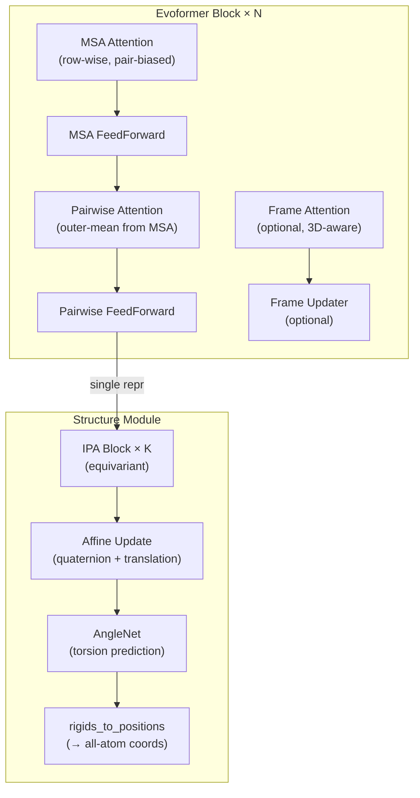
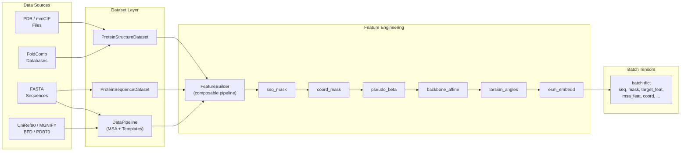

ProFOLD2 is a PyTorch-based protein 3D structure prediction framework built upon the AlphaFold2 paradigm, extended with multi-task heads, Potts model-based sequence design, distributed training infrastructure, and a web interface for interactive prediction. This page maps the high-level architecture, module responsibilities, and data flow that power the entire system.

## System Architecture

The architecture follows a layered design: a CLI entry point dispatches to domain-specific command handlers, each orchestrating a data pipeline, a model inference/training loop, and post-processing. The core neural architecture — `AlphaFold2WithRecycling` — sits at the center, wrapped by distributed training utilities and surrounded by task-specific prediction heads.

## Package Structure

The `profold2/` package is organized into five logical domains, each mapped to a specific concern in the prediction pipeline.

| Package | Responsibility | Key Files |
|---------|---------------|-----------|
| `profold2/command/` | CLI dispatch, distributed orchestration | `main.py`, `trainer.py`, `predictor.py`, `evaluator.py`, `worker.py`, `relaxer.py` |
| `profold2/model/` | Neural network architecture, loss functions, geometry | `alphafold2.py`, `evoformer.py`, `folding.py`, `head.py`, `functional.py`, `potts.py` |
| `profold2/data/` | Dataset loading, MSA processing, feature engineering | `dataset.py`, `pipeline.py`, `features.py` (via FeatureBuilder) |
| `profold2/common/` | Protein constants, residue type definitions | `protein.py`, `residue_constants.py` |
| `profold2/relax/` | Amber-based structure relaxation | `relax.py`, `amber_minimize.py`, `cleanup.py` |

Supporting tooling lives in `tools/` (PDB manipulation, dataset construction, TM-score calculation), `tests/` (unit and benchmark tests), and `web/` (Flask-based prediction server).

Sources: [setup.py](setup.py#L8-L47), [profold2/command/main.py](profold2/command/main.py#L12-L66)

## CLI Entry Point and Command Dispatch

The root `main.py` delegates immediately to `profold2.command.main:main`, which registers three subcommands — `train`, `evaluate`, and `predict` — each backed by a dedicated function and argument parser. Every command passes through `worker.main()`, which initializes the distributed environment (via PyTorch `DistributedDataParallel`) before invoking the actual work function on each rank.

The `WorkerModel` class handles model wrapping with `DistributedDataParallel`, weight loading with legacy key remapping hooks, and checkpoint serialization. It is the single point of truth for device placement and distributed model lifecycle management. The `WorkerFunction` wraps the rank-aware work function and integrates with `WorkerLogging` for rank-filtered log output.

Sources: [profold2/command/main.py](profold2/command/main.py#L19-L80), [profold2/command/worker.py](profold2/command/worker.py#L91-L186)

## Core Model Architecture

The neural model centers on two classes: `AlphaFold2` (the single-pass network) and `AlphaFold2WithRecycling` (the recycling wrapper). The recycling wrapper runs the core network multiple times under `torch.no_grad()`, feeding outputs back as `Recyclables` (MSA first-row representation, pairwise representation, coordinates, and optionally frames) before a final training-enabled pass that computes losses.

The `AlphaFold2` constructor accepts a 3-tuple `dim = (dim_single, dim_msa, dim_pairwise)` controlling the representation dimensions throughout the network. Its `forward` pass follows this sequence:

1. **Input Embedding** — `InputEmbeddings` produces MSA embeddings (`m`) and pairwise embeddings (`x`) from sequence features, residue indices, chain color/entity/symmetry tokens, and optional MSA features.
2. **Recycling Injection** — If `Recyclables` are present, pairwise distograms from previous-cycle coordinates and normalized MSA/pair representations are injected via additive connections.
3. **Evoformer Trunk** — A configurable-depth stack of `EvoformerBlock` layers iteratively refines the MSA representation `m`, pairwise representation `x`, and structural frames `t`.
4. **Single Representation Extraction** — The first row of the MSA output is projected to `dim_single` via a linear layer.
5. **Prediction Heads** — The `HeaderBuilder` dynamically instantiates heads from a declarative configuration list, each receiving the shared representation dictionary and batch.

> [!TIP]
> The model supports two distinct trunk variants: **Evoformer** (MSA + pairwise co-evolution, AlphaFold2-style) and **Pairformer** (pairwise-only, AlphaFold3-style). This is controlled by the `evoformer_depth` parameter — setting it to 0 disables the Evoformer, allowing the `Pairformer` block to operate on single/pair representations alone. The `accept_frame_attn` and `accept_frame_update` flags further extend the trunk with 3D-aware frame attention blocks.

Sources: [profold2/model/alphafold2.py](profold2/model/alphafold2.py#L128-L322), [profold2/model/alphafold2.py](profold2/model/alphafold2.py#L323-L422)

## Evoformer and Structure Module

Each `EvoformerBlock` interleaves three attention operations — **MSA attention** (rows attend over columns using pairwise bias), **pairwise attention** (outer product mean pooling from MSA to pairs), and optionally **frame attention** (3D frame-conditioned attention) — with corresponding feedforward transitions. The blocks operate in a configurable checkpoint segmentation mode to trade compute for memory.

The `StructureModule` implements the Invariant Point Attention (IPA) mechanism: it iteratively refines rotation quaternions and translations using equivariant transformer blocks, then decodes torsion angles via `AngleNet` to produce all-atom coordinates. A critical design choice is that rotations are detached between IPA iterations (except the last) to stabilize training, and the entire structure module runs in `float32` regardless of the upstream precision.

Sources: [profold2/model/evoformer.py](profold2/model/evoformer.py#L199-L306), [profold2/model/folding.py](profold2/model/folding.py#L99-L216)

## Prediction Head System

The `HeaderBuilder` registry maps string names to head classes, allowing the model configuration to declaratively specify which prediction tasks to enable. Each head receives a shared `representations` dictionary (containing `single`, `pair`, `msa`, and `frames`) and a `batch` dictionary (containing ground truth and masks), and optionally returns computed losses weighted by per-head configuration.

| Head | Purpose | Key Dimensions |
|------|---------|----------------|
| `FoldingHead` | 3D coordinate prediction via StructureModule + FAPE loss | `structure_module_depth`, `structure_module_heads` |
| `DistogramHead` | Pairwise distance histogram classification | `buckets_first_break`, `buckets_last_break`, `buckets_num` |
| `PLDDTHead` | Per-residue confidence (pLDDT) via binned distance error | `buckets_num`, `max_resolution` |
| `PAEHead` | Predicted aligned error for inter-chain assessment | `buckets_num`, `buckets_first_break`, `buckets_last_break` |
| `ConfidenceHead` | Aggregate confidence score | single scalar |
| `ContactHead` | Binary contact map prediction | `cutoff`, `diagonal` |
| `CoevolutionHead` | MSA co-evolution / residue recovery | `num_states`, `gating`, `apc` |
| `FitnessHead` | Variant fitness prediction (multi-task) | `task_num`, `task_weight`, `shard_size` |
| `PairingHead` | Nucleic acid base pairing prediction | `alpha`, `focal_loss` |
| `SequenceProfileHead` | Sequence profile prediction | `input_dim`, `single_repr` |
| `TMscoreHead` | TM-score prediction | `num_atoms` |
| `ViolationHead` | Structure violation penalty | — |
| `RobertaLMHead` | Masked language modeling | — |
| `MetricDictHead` | Composite evaluation metrics | — |

The head system is designed so that a single model configuration can support multiple simultaneous objectives — for example, jointly training on structure prediction (FoldingHead), distogram prediction (DistogramHead), and variant fitness prediction (FitnessHead) with independent loss weighting.

Sources: [profold2/model/head.py](profold2/model/head.py#L1662-L1692), [profold2/model/head.py](profold2/model/head.py#L91-L1065)

## Data Pipeline Architecture

The data layer provides two primary dataset classes. `ProteinStructureDataset` loads protein structures from filesystems or FoldComp databases, supporting both monomer and multimer inputs with configurable cropping algorithms (random, spatial-interface-aware), MSA depth sampling, and variant feature construction. `ProteinSequenceDataset` provides a simpler sequence-only loader for inference scenarios.

Feature engineering is handled by the `FeatureBuilder` class, which chains composable feature functions (registered via the `@take1st` decorator pattern) into a single callable pipeline. Feature functions cover sequence masking, coordinate processing, pseudo-beta construction, backbone affine frames, torsion angle computation, ESM embedding injection, and device transfer. The `DataPipeline` class orchestrates external alignment tools (JackHMMER, HHblits, HHsearch) against biological databases (UniRef90, MGNIFY, BFD, PDB70) for MSA and template generation.

Sources: [profold2/data/dataset.py](profold2/data/dataset.py#L1165-L1252), [profold2/model/features.py](profold2/model/features.py#L19-L375), [profold2/data/pipeline.py](profold2/data/pipeline.py#L83-L124)

## Computational Infrastructure

ProFOLD2 includes two layers of performance optimization. At the **kernel level**, the `profold2/model/kernel/` package ships custom CUTLASS-based CUDA attention kernels (`attention.cpp`, `attention_cu.cu`, `attention_back.cu`) for memory-efficient Evoformer attention. The `evoformer_attn.py` module provides the Python interface to these fused kernels. At the **memory level**, `profold2/model/snapshot.py` implements a `memory_snapshot` context manager wrapping PyTorch's memory snapshot API for peak memory tracing during long training runs.

Distributed training uses PyTorch native `DistributedDataParallel` with static graph mode (`_set_static_graph()`), supporting multi-node SLURM-managed clusters via environment variables (`SLURM_NNODES`, `SLURM_NODEID`, `LOCAL_RANK`). The `no_sync_ctx` context manager conditionally disables gradient synchronization for gradient accumulation scenarios.

> [!TIP]
> The `profold2_relative_pos_s_max` and `profold2_evoformer_checkpoint_segment_size` environment variables control relative positional encoding maximum sequence-entity distance and gradient checkpointing granularity respectively, allowing runtime tuning without code changes.

Sources: [profold2/command/worker.py](profold2/command/worker.py#L134-L145), [profold2/model/alphafold2.py](profold2/model/alphafold2.py#L139-L140)

## End-to-End Data Flow

Putting all layers together, a typical training iteration proceeds as follows: the `ProteinStructureDataset` yields a raw feature dictionary, `FeatureBuilder` transforms it into model-ready tensors, `AlphaFold2WithRecycling` runs multiple inference-only recycling passes followed by one training pass, prediction heads compute forward outputs and losses, and the weighted total loss is backpropagated through the distributed model. For prediction, the flow is similar but skips loss computation and optionally runs Amber relaxation as a post-processing step.

| Stage | Component | Key Output |
|-------|-----------|------------|
| Data Loading | `ProteinStructureDataset` | Raw feature dict (seq, coord, msa) |
| Feature Engineering | `FeatureBuilder` | Model tensors (target_feat, mask, emb_seq, ...) |
| Model Forward | `AlphaFold2WithRecycling` | Headers dict with predictions + total loss |
| Post-Processing | `relax/` (prediction only) | Energy-minimized PDB structures |

Sources: [profold2/command/trainer.py](profold2/command/trainer.py#L75-L468), [profold2/command/predictor.py](profold2/command/predictor.py#L131-L298)

## Where to Go Next

This overview has mapped the structural skeleton of ProFOLD2. The following pages provide progressively deeper dives into specific subsystems:

- **[AlphaFold2 Core Pipeline](5-alphafold2-core-pipeline)** — Detailed walkthrough of the `AlphaFold2.forward()` data flow from input embedding to head outputs
- **[Evoformer and Pairformer Blocks](6-evoformer-and-pairformer-blocks)** — Attention mechanisms, triangular multiplicative updates, and the two trunk variants
- **[Structure Module and IPA](7-structure-module-and-ipa)** — Invariant point attention, quaternion algebra, and equivariant coordinate generation
- **[Prediction Heads](9-prediction-heads)** — Per-head loss functions, architectures, and configuration patterns
- **[Feature Engineering](12-feature-engineering)** — The composable feature function pipeline and decorator registration system
- **[Dataset Loading and Cropping](13-dataset-loading-and-cropping)** — Multimer assembly, cropping algorithms, and FoldComp integration
- **[Potts Model and Sequence Design](16-potts-model-and-sequence-design)** — Potts energy functions, MCMC samplers (Gibbs / DLMC), and sequence design workflows