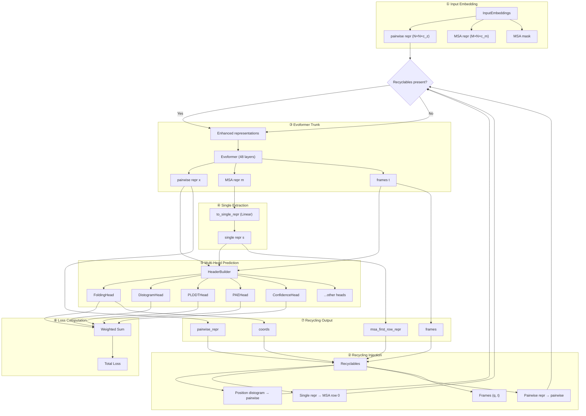

This page dissects the end-to-end computational path that transforms raw sequence and structural features into predicted 3D coordinates and auxiliary outputs. ProFOLD2's core pipeline faithfully reimplements the AlphaFold2 architecture while extending it with configurable recycling strategies, a modular header system, and optional frame-based attention mechanisms.

## Pipeline Architecture Overview

The pipeline is organized into four sequential stages — input embedding, recycling injection, the Evoformer trunk, and multi-head prediction — all orchestrated by two primary classes. `AlphaFold2` implements a single forward pass, while `AlphaFold2WithRecycling` wraps it with an iterative recycling loop that progressively refines structural predictions.

## The Two Model Classes

ProFOLD2 splits the pipeline into a composable inner model and a recycling-aware outer wrapper. This separation allows `AlphaFold2` to be invoked in isolation for feature extraction or single-pass inference, while `AlphaFold2WithRecycling` manages the full iterative protocol used during both training and prediction.

`AlphaFold2` ([alphafold2.py#L128-L320](profold2/model/alphafold2.py#L128-L320)) accepts a rich set of configuration parameters. The most architecturally significant are the **dimension tuple** `dim`, which unpacks to `(dim_single, dim_msa, dim_pairwise)`, and the `evoformer_depth` (default 48), which controls the number of trunk iterations. Additional flags such as `accept_frame_attn` and `accept_frame_update` toggle ProFOLD2-specific extensions that inject frame-aware attention into the Evoformer blocks.

`AlphaFold2WithRecycling` ([alphafold2.py#L323-L422](profold2/model/alphafold2.py#L323-L422)) delegates all model logic to an inner `AlphaFold2` instance via `self.impl`. Its `forward` method runs a configurable number of recycling iterations (`num_recycle`) under `torch.no_grad()`, then performs a final forward pass with gradient computation and loss evaluation enabled. During training, the actual number of recycling rounds is randomized between 0 and `num_recycle` to regularize the model ([alphafold2.py#L380-L381](profold2/model/alphafold2.py#L380-L381)).

Sources: [alphafold2.py](profold2/model/alphafold2.py#L128-L422)

## Stage 1: Input Embeddings

The `InputEmbeddings` module ([alphafold2.py#L62-L125](profold2/model/alphafold2.py#L62-L125)) converts raw integer-encoded residue features into dense tensor representations along three parallel tracks: single representation, MSA representation, and pairwise representation.

The **single embedding** uses a standard `nn.Embedding` layer mapping residue types (21 standard amino acids plus an extra token) into the MSA dimension `c_m`. When explicit MSA features are provided via `msa_feat`, a separate linear projection (`to_msa_emb`) maps additional per-position features into the same `c_m` space. When MSA features are absent, the single embedding is broadcast to create a pseudo-MSA of depth 1 — effectively treating the target sequence as its own single-sequence "MSA" ([alphafold2.py#L107-L109](profold2/model/alphafold2.py#L107-L109)). In both cases, the single representation is added to the first row of the MSA representation via `tensor_add`, ensuring the target sequence signal is always present at `m[..., 0, :, :]`.

The **pairwise embedding** is constructed by `PairwiseEmbedding` ([commons.py#L1266-L1315](profold2/model/commons.py#L1266-L1315)), which computes a symmetric outer product of single representations and concatenates relative positional encodings. These relative encodings are produced by `RelativePositionEmbedding` ([commons.py#L1180-L1265](profold2/model/commons.py#L1180-L1265)), which operates on sequence indices, chain colors, symmetry groups, and entity IDs — enabling the model to distinguish intra-chain from inter-chain residue pairs in multimer inputs.

| Component | Input Shape | Output Shape | Purpose |
|---|---|---|---|
| `to_single_emb` | `(..., N)` | `(..., N, c_m)` | Residue type embedding |
| `to_msa_emb` | `(..., M, N, feat)` | `(..., M, N, c_m)` | Optional MSA feature projection |
| `PairwiseEmbedding` | `(..., N, c_m)` | `(..., N, N, c_z)` | Symmetric pairwise features |

Sources: [alphafold2.py](profold2/model/alphafold2.py#L62-L125), [commons.py](profold2/model/commons.py#L1266-L1315)

## Stage 2: Recycling Injection

Recycling is AlphaFold2's mechanism for iterative self-refinement: the model's own predictions from a previous forward pass are fed back as additional input signals. ProFOLD2 implements this through the `Recyclables` dataclass ([alphafold2.py#L24-L37](profold2/model/alphafold2.py#L24-L37)), which packages four tensors for cross-iteration communication.

The injection logic ([alphafold2.py#L248-L268](profold2/model/alphafold2.py#L248-L268)) merges recyclables into the freshly computed embeddings via additive fusion, each pathway gated by a LayerNorm:

- **Pairwise recycling**: The previous iteration's pairwise representation is normalized and added directly to the new pairwise embeddings.
- **MSA single-row recycling**: The first MSA row receives the previous single representation (optionally projected via `recycling_to_msa_repr` from `dim_single` to `dim_msa`).
- **Position recycling**: When enabled, predicted 3D coordinates are converted to a distance histogram (distogram) via linearly spaced bins from 3.25Å to 20.75Å (15 bins default), then projected into the pairwise dimension and added as a structural prior.

> [!TIP]
> Position recycling converts predicted 3D coordinates into a binned distogram (15 bins spanning 3.25–20.75Å) before injection, not the raw coordinates themselves. This discretization prevents the recycling pathway from memorizing exact coordinate values and instead forces the model to reason about relative distance geometry.

When no recyclables are available (first iteration or no recycling), the `AlphaFold2WithRecycling.forward` method initializes zero-filled tensors of the correct shapes ([alphafold2.py#L373-L378](profold2/model/alphafold2.py#L373-L378)). Frame initialization uses identity quaternions `[1, 0, 0, 0]` and zero translations — these "black hole frames" represent an uninformative starting geometry ([alphafold2.py#L264-L268](profold2/model/alphafold2.py#L264-L268)).

| Recycling Signal | Condition | Target | Transformation |
|---|---|---|---|
| `pairwise_repr` | Always (when recycling) | Pairwise embeddings | LayerNorm → add |
| `msa_first_row_repr` | `recycling_single_repr=True` | MSA row 0 | Optional Linear → LayerNorm → add |
| `coords` | `recycling_pos=True` | Pairwise embeddings | Distogram bins → Linear → add |
| `frames` | `recycling_frames=True` | Evoformer frames | Direct passthrough |

Sources: [alphafold2.py](profold2/model/alphafold2.py#L24-L37), [alphafold2.py](profold2/model/alphafold2.py#L248-L268), [alphafold2.py](profold2/model/alphafold2.py#L373-L378)

## Stage 3: The Evoformer Trunk

With enriched embeddings in hand, the pipeline enters the Evoformer — the central computational engine of the AlphaFold2 architecture. The Evoformer is constructed as a stacked sequence of `EvoformerBlock` modules via `layer_stack` ([evoformer.py#L304-L307](profold2/model/evoformer.py#L304-L307)), repeated `evoformer_depth` times (default 48).

Each `EvoformerBlock` ([evoformer.py#L199-L301](profold2/model/evoformer.py#L199-L301)) performs four distinct operations in sequence, operating on the MSA representation `m`, pairwise representation `x`, and optionally the frame representation `t`:

1. **MSA attention** (`msa_attn`): Row-wise and column-wise attention over the MSA, bias-injected by the pairwise representation. Controlled by `accept_msa_attn` flag.
2. **Frame attention** (`frame_attn`, optional): Invariant Point Attention operating on the first MSA row, using frame quaternions and translations for SE(3)-equivariant geometry reasoning. Enabled by `accept_frame_attn`.
3. **Frame update** (`frame_update`, optional): Directly updates quaternions and translations based on the first MSA row. Enabled by `accept_frame_update`.
4. **Pairwise attention** (`pair_attn`): Triangle multiplication and attention over the pairwise matrix, with outer product mean from the MSA providing an additional update pathway.

The block's forward pass always executes pairwise attention as the final operation, ensuring the pairwise representation receives information from all active pathways before being passed to the next layer. Profiling instrumentation wraps each sub-operation for performance monitoring ([evoformer.py#L262-L299](profold2/model/evoformer.py#L262-L299)).

After the trunk completes, the MSA representation's first row `m[..., 0, :, :]` is extracted and projected to the single representation dimension via `to_single_repr`, a single linear layer ([alphafold2.py#L277](profold2/model/alphafold2.py#L277)). This `single` representation becomes the primary input to all downstream prediction heads.

> [!TIP]
> The Evoformer interleaves MSA-space and pairwise-space operations rather than processing them in isolation. The outer product mean in `PairwiseAttentionBlock` compresses MSA information into pairwise updates, while pairwise bias injection in `MsaAttentionBlock` propagates structural signals back into the MSA. This cross-pollination is the core architectural innovation that enables joint reasoning about co-evolution and 3D geometry.

The full forward signature is `forward(self, x, m, t, mask=None, msa_mask=None, shard_size=None)`, returning updated `(x, m, t)` where `x` is pairwise, `m` is MSA, and `t` is the frame tuple `(quaternions, translations)`.

Sources: [evoformer.py](profold2/model/evoformer.py#L199-L307), [alphafold2.py](profold2/model/alphafold2.py#L169-L184), [alphafold2.py](profold2/model/alphafold2.py#L272-L277)

## Stage 4: Multi-Head Prediction

The final stage leverages the `HeaderBuilder` system to invoke a configurable set of prediction heads. Each head consumes some combination of the `single`, `pair`, `msa`, and `frames` representations from the Evoformer trunk and produces both predictions and (during training) loss values.

The header invocation loop ([alphafold2.py#L284-L305](profold2/model/alphafold2.py#L284-L305)) iterates over registered `(name, module, options)` tuples. Each head receives the accumulated `headers` dict (allowing heads to reference prior heads' outputs), the `representations` dict, and the raw `batch`. A head may also inject new representations back into the `representations` dict via its return value. After all forward passes, the loop re-enters each head's `loss` method and accumulates a weighted total loss.

The following table summarizes the key heads relevant to the core structure prediction pipeline:

| Head | Input Representation | Output | Loss |
|---|---|---|---|
| `FoldingHead` | single + pair + frames | 3D coordinates, frames | FAPE structural loss |
| `DistogramHead` | pair | Distance histogram logits | Cross-entropy on binned distances |
| `PLDDTHead` | single | Per-residue confidence | Cross-entropy on binned lDDT |
| `PAEHead` | single + pair | Predicted alignment error | Cross-entropy on binned PAE |
| `ConfidenceHead` | (computed from lDDT/PAE) | pLDDT, PTM, iPTM metrics | (metric only, no trainable loss) |
| `TMscoreHead` | single + folding coords | Predicted TM-score | MSE against true TM-score |

The `FoldingHead` ([head.py#L403-L694](profold2/model/head.py#L403-L694)) is architecturally the most complex: it wraps the `StructureModule` from [folding.py](profold2/model/folding.py), which iteratively applies Invariant Point Attention (IPA) blocks to refine backbone frames, then predicts torsion angles via `AngleNet` and reconstructs all-atom coordinates through rigid body transformations. Notably, the structure module forces float32 precision for SE(3) equivariance and detaches rotation gradients between iterations for training stability ([folding.py#L147-L190](profold2/model/folding.py#L147-L190)).

After the `FoldingHead` produces coordinates, the pipeline applies `multi_chain_permutation_alignment` ([alphafold2.py#L293](profold2/model/alphafold2.py#L293)) to handle chain ordering ambiguity — a critical step for multimer prediction that is explored further in [Multi-Chain and Multimer Handling](15-multi-chain-and-multimer-handling).

Sources: [alphafold2.py](profold2/model/alphafold2.py#L284-L305), [head.py](profold2/model/head.py#L403-L694), [folding.py](profold2/model/folding.py#L99-L213)

## Stage 5: Recycling Output Preparation

When `return_recyclables=True`, the pipeline prepares a `Recyclables` package from the current forward pass for the next recycling iteration ([alphafold2.py#L307-L318](profold2/model/alphafold2.py#L307-L318)). This involves selective extraction and optional transformation:

- `msa_first_row_repr`: Taken from `m[..., 0, :, :]` (the target sequence row), optionally projected from `dim_single` to `dim_msa` via `recycling_to_msa_repr`.
- `pairwise_repr`: Taken directly from `representations['pair']` (the final pairwise output of the Evoformer).
- `coords`: Extracted from the `FoldingHead` output if available, otherwise `None`.
- `frames`: Passed through if `recycling_frames` is enabled, otherwise `None`.

Both `msa_first_row_repr` and `pairwise_repr` are detached from the computation graph (`torch.detach`) before packaging, ensuring that recycling iterations do not accumulate gradients across rounds. This is critical: the recycling loop in `AlphaFold2WithRecycling` runs under `torch.no_grad()`, and only the final iteration computes gradients for backpropagation.

The complete forward return value is serialized via `ReturnValues.asdict()` ([alphafold2.py#L53-L59](profold2/model/alphafold2.py#L53-L59)), which converts the `Recyclables` dataclass to a plain dict alongside the computed `headers` and `loss`.

Sources: [alphafold2.py](profold2/model/alphafold2.py#L307-L318), [alphafold2.py](profold2/model/alphafold2.py#L365-L398)

## Configuration Parameters Summary

The `AlphaFold2.__init__` method exposes a comprehensive set of hyperparameters. The following table documents the most impactful ones:

| Parameter | Default | Description |
|---|---|---|
| `dim` | *(required)* | Tuple `(dim_single, dim_msa, dim_pairwise)` defining channel widths |
| `evoformer_depth` | `48` | Number of Evoformer blocks in the trunk |
| `evoformer_head_num` | `8` | Attention heads (or `[msa_heads, pair_heads]` list) |
| `evoformer_head_dim` | `32` | Per-head dimension (or `[msa_dim, pair_dim]` list) |
| `relative_pos_r_max` | `32` | Max residue separation for relative position encoding |
| `recycling_single_repr` | `True` | Enable single repr → MSA recycling pathway |
| `recycling_pos` | `False` | Enable coordinate distogram recycling |
| `recycling_frames` | `False` | Enable frame passthrough recycling |
| `accept_frame_attn` | `False` | Enable IPA-based frame attention in Evoformer |
| `accept_frame_update` | `False` | Enable direct frame updates in Evoformer |
| `headers` | `None` | Dict of header configurations for `HeaderBuilder` |

Sources: [alphafold2.py](profold2/model/alphafold2.py#L131-L154)

## Navigating Further

This page covered the end-to-end flow from raw features to predicted structures. The following pages examine individual components in depth:

- **[Evoformer and Pairformer Blocks](6-evoformer-and-pairformer-blocks)** — Detailed analysis of the attention mechanisms, triangle operations, and outer product mean that power each trunk iteration.
- **[Structure Module and IPA](7-structure-module-and-ipa)** — How Invariant Point Attention and rigid body algebra produce SE(3)-equivariant 3D coordinates.
- **[Prediction Heads](9-prediction-heads)** — Full specification of every header type, including distogram, FAPE, pLDDT, PAE, fitness, and coevolution heads.
- **[FAPE and Structural Losses](10-fape-and-structural-losses)** — Mathematical foundations of the Frame-Aligned Point Error loss and its clamping strategies.