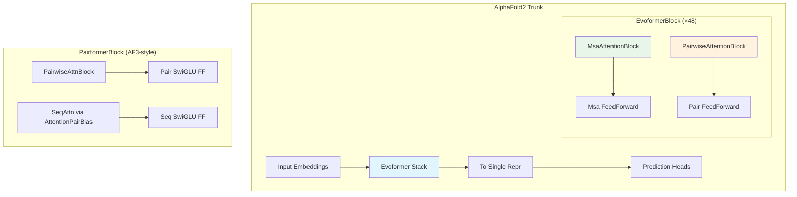

The Evoformer and Pairformer are the computational engines that transform raw sequence and structural embeddings into the rich internal representations used for structure prediction. While they share a common architectural DNA rooted in triangular pair geometry, they differ fundamentally in how they handle the multiple sequence alignment dimension — a distinction that separates the AlphaFold2 lineage from the AlphaFold3-style approach implemented in ProFOLD2. This page dissects both architectures from the inside out, tracing data flow through each sub-module and explaining the key design decisions that govern their behavior.

## Architectural Context

Both the Evoformer and Pairformer sit inside the main `AlphaFold2` module trunk, executed after input embeddings are computed and before prediction heads consume the representations [alphafold2.py](profold2/model/alphafold2.py#L271-L275). The Evoformer operates on a 4D MSA tensor and a 3D pairwise tensor simultaneously, while the Pairformer replaces the MSA dimension with a compact single representation, yielding a lighter architecture suited for scenarios without deep MSA data.



## The Evoformer Block

The `EvoformerBlock` is the fundamental repeating unit of the AlphaFold2 trunk, defined as a PyTorch module in [evoformer.py](profold2/model/evoformer.py#L199-L301). Each block receives three tensors — the pairwise representation `x` of shape `(batch, N, N, dim_pairwise)`, the MSA representation `m` of shape `(batch, M, N, dim_msa)`, and an optional frame tuple `t` — and returns updated versions of all three. The block's internal execution follows a strict ordering: MSA attention first, then frame attention (if enabled), then frame update (if enabled), and finally pairwise attention. This ordering matters because pairwise attention consumes the updated MSA representation through the OuterProductMean pathway.

### Configuration Parameters

Each `EvoformerBlock` accepts a rich set of configuration flags that control which sub-modules are instantiated:

| Parameter | Type | Default | Purpose |
|-----------|------|---------|---------|
| `dim_msa` | int | — | Channel dimension of the MSA representation |
| `dim_pairwise` | int | — | Channel dimension of the pairwise representation |
| `heads` | int / list | 8 | Attention heads; supports per-stream via list of length 2 |
| `dim_head` | int / list | 32 | Per-head dimension; supports per-stream via list of length 2 |
| `global_column_attn` | bool | False | Enable global query attention on the MSA column dimension |
| `accept_msa_attn` | bool | True | Instantiate MSA attention and transition blocks |
| `accept_frame_attn` | bool | False | Instantiate frame attention using Invariant Point Attention |
| `accept_frame_update` | bool | False | Instantiate frame quaternion and translation update |

The `default_list_get` utility at [commons.py](profold2/model/commons.py#L58-L66) handles the case where `heads` and `dim_head` are passed as single integers or as two-element lists, distributing different values to the MSA stream (`heads_msa`) and pairwise stream (`heads_pair`) respectively [evoformer.py](profold2/model/evoformer.py#L219-L220).

### Forward Pass Execution Order

The forward method at [evoformer.py](profold2/model/evoformer.py#L257-L301) enforces a specific execution pipeline, with each major step wrapped in a profiler region for instrumentation:

1. **MSA Attention and Transition** — The MSA representation is updated using both pairwise bias (from the pairwise tensor) and row/column attention patterns. The result is then passed through a feed-forward network with residual addition.

2. **Frame Attention (optional)** — When `accept_frame_attn` is enabled, the first row of the MSA representation (`m[..., 0, :, :]`) attends to all residues using Invariant Point Attention, which is coordinate-aware via the frame data (`t`). Autocast is explicitly disabled for numerical stability. The updated single-row representation replaces the first row via concatenation.

3. **Frame Update (optional)** — When `accept_frame_update` is enabled, the first MSA row is used to predict updates to the backbone frames (quaternions and translations). This is also executed in full precision.

4. **Pairwise Attention and Transition** — The pairwise representation is updated using triangle multiplicative modules, triangle attention, and (when MSA data is available) the OuterProductMean from the updated MSA representation.

> [!TIP]
> The frame attention and frame update pathways are disabled by default (`accept_frame_attn=False`, `accept_frame_update=False`) in the standard AlphaFold2 configuration. They become active in extended variants that incorporate iterative structural refinement within the evoformer trunk itself.

## The Pairformer Block

The `PairformerBlock`, defined at [evoformer.py](profold2/model/evoformer.py#L310-L371), represents the AlphaFold3-style evolution of the architecture. Instead of maintaining a full MSA tensor, it operates on a compact single sequence representation `s` of shape `(batch, N, dim_single)` alongside the pairwise representation `x`. This yields significant memory savings and faster computation at the cost of losing explicit multiple-sequence co-evolution signals.

### Key Architectural Differences from EvoformerBlock

| Aspect | EvoformerBlock | PairformerBlock |
|--------|---------------|-----------------|
| MSA dimension | Full 4D tensor `(B, M, N, D)` | Replaced by single repr `(B, N, D)` |
| MSA-to-pair bridge | OuterProductMean (enabled) | OuterProductMean (disabled) |
| Sequence attention | MsaAttentionBlock (row + col axial) | AttentionPairBias (single-head bias from pair) |
| Activation function | GEGLU (default) | SwiGLU |
| Bias usage | Enabled | Explicitly disabled (`use_bias=False`) |
| Frame support | Optional frame attn + update | Not supported |

The pairwise attention sub-block in the Pairformer explicitly disables the OuterProductMean via `disabled_outer_mean=True` [evoformer.py](profold2/model/evoformer.py#L333), since there is no MSA dimension to project from. Additionally, all biases are disabled in the Pairformer's attention and feed-forward layers (`q_use_bias=False, kv_use_bias=False, g_use_bias=False, o_use_bias=False`) [evoformer.py](profold2/model/evoformer.py#L335-L338), reflecting the AlphaFold3 convention.

The sequence attention pathway uses `AttentionPairBias` [evoformer.py](profold2/model/evoformer.py#L343-L353), which converts the pairwise tensor into per-head attention biases before performing standard multi-head attention on the single representation. This allows pairwise structural information to influence the sequence-level update without the overhead of full MSA processing.

## Core Sub-Modules

Both the Evoformer and Pairformer delegate to a shared library of primitive modules defined in [commons.py](profold2/model/commons.py). Understanding these building blocks is essential for grasping how information flows within and between the two representation streams.

### PairwiseAttentionBlock — Triangle Geometry

The `PairwiseAttentionBlock` at [commons.py](profold2/model/commons.py#L714-L847) is the heart of pairwise representation processing. It assembles four distinct operations, with an ordering controlled by the `multiplication_first` flag:

When `multiplication_first=True` (Evoformer default), the execution order is:
1. **OuterProductMean** — Projects information from the MSA stream into the pairwise stream
2. **Triangle Multiply Outgoing** — Triangular multiplicative update along rows
3. **Triangle Multiply Ingoing** — Triangular multiplicative update along columns
4. **Triangle Attention Outgoing** — Axial attention along rows (with edge bias)
5. **Triangle Attention Ingoing** — Axial attention along columns (with edge bias)

When `multiplication_first=False` (TemplatePairBlock), attention precedes multiplication. This flag is set to `True` for the standard Evoformer and `False` for template pair stacks.

### TriangleMultiplicativeModule

The `TriangleMultiplicativeModule` at [commons.py](profold2/model/commons.py#L559-L650) implements the triangular update that is unique to pairwise representation processing. It operates on symmetric `(N × N × D)` tensors and comes in two variants controlled by the `mix` parameter:

- **`outgoing`**: Uses the einsum equation `'... i k d, ... j k d -> ... i j d'`, where position `k` broadcasts information to the `(i, j)` pair
- **`ingoing`**: Uses the einsum equation `'... k j d, ... k i d -> ... i j d'` (note: the code comments document a discrepancy with AlphaFold3's ordering at [commons.py](profold2/model/commons.py#L595-L599))

Both variants employ a gated mechanism with three learned gates (`left_gate`, `right_gate`, `out_gate`) initialized to identity transformations via `init_linear_(gate, b=1.)` [commons.py](profold2/model/commons.py#L588-L589). The module also applies masked computation using the `sharded_apply` utility for memory-efficient inference, with sharding along the appropriate dimension based on the mix direction (`shard_dim=-3` for outgoing, `-2` for ingoing) [commons.py](profold2/model/commons.py#L636-L650).

### OuterProductMean

The `OuterProductMean` at [commons.py](profold2/model/commons.py#L656-L711) bridges the MSA and pairwise representation streams. It performs the following steps:

1. Layer-normalize the MSA input
2. Project left and right via separate linear layers to a hidden dimension
3. Compute the outer product via `torch.einsum('... m i c, ... m j d -> ... i j c d', left, right)`
4. Flatten the channel dimensions and project to `dim_pairwise`
5. Normalize by the masked sum of MSA positions (or raw count if no mask)

The epsilon value for normalization is configurable via the `OuterProductMean_eps` environment variable, defaulting to `1e-5` (ProFOLD) versus `1e-3` in the original AlphaFold [commons.py](profold2/model/commons.py#L662-L663).

> [!TIP]
> The OuterProductMean is disabled in the PairformerBlock (`disabled_outer_mean=True`) because there is no MSA tensor to project from. This is the primary architectural difference that enables the Pairformer's reduced memory footprint.

### AxialAttention

The `AxialAttention` module at [commons.py](profold2/model/commons.py#L463-L556) decomposes 2D attention over the `(seq_len × seq_len)` pairwise matrix into row-wise and column-wise 1D attention operations. Each instantiation performs either row or column attention (controlled by `row_attn`/`col_attn`, asserted to be mutually exclusive at [commons.py](profold2/model/commons.py#L508)).

When edge bias is accepted (`accept_edges=True`), the pairwise tensor is projected to per-head attention biases through a `LayerNorm → Linear` pathway [commons.py](profold2/model/commons.py#L491-L495). For column attention, the bias matrix is transposed to align dimensions correctly [commons.py](profold2/model/commons.py#L547-L548).

The module supports optional custom kernel acceleration via `evoformer_attn` [commons.py](profold2/model/commons.py#L136-L152), which converts to float16 and uses a CUTLASS-based kernel for faster inference. This is gated by the `AxialAttention_accept_kernel_fn` environment variable. Fallback uses PyTorch's `scaled_dot_product_attention` via `pytorch_attn` [commons.py](profold2/model/commons.py#L155-L172).

### MsaAttentionBlock

The `MsaAttentionBlock` at [commons.py](profold2/model/commons.py#L850-L905) performs axial attention on the MSA tensor, which has shape `(batch, M, N, dim_msa)`:

- **Row attention** (`MSARowAttention`): Attends across the sequence dimension `N` for each MSA row, using pairwise representations as edge bias. This allows pairwise structural information to modulate which residues attend to each other within each sequence.
- **Column attention** (`MSAColumnAttention`): Attends across the MSA depth dimension `M` for each residue position, without edge bias. This enables information exchange between different sequences at the same residue position — the mechanism that captures co-evolutionary signals.

Row attention uses shared dropout across the broadcast dimension `-3`, and column attention does not apply additional dropout [commons.py](profold2/model/commons.py#L883-L884).

### FeedForward Networks

Both the Evoformer and Pairformer use the `FeedForward` module at [commons.py](profold2/model/commons.py#L271-L305), which wraps a LayerNorm, linear expansion, gated activation, dropout, and linear contraction. The activation function is selectable via the `FeedForward_activation` environment variable:

- **GEGLU** (default in ProFOLD): Gated GELU with a 2× amplifier for the hidden dimension
- **ReLU** (original AlphaFold2): Standard ReLU with 1× amplifier
- **SwiGLU** (used in Pairformer): Gated SiLU with 2× amplifier

The hidden dimension computes as `dim × mult × amplifier`, so with `mult=4` and `SwiGLU`, the intermediate size is `dim × 8` before the gating split halves it back to `dim × 4` [commons.py](profold2/model/commons.py#L278-L294).

## Gradient Checkpointing and Layer Stacking

Both `Evoformer` and `Pairformer` are constructed using the `layer_stack` factory function at [commons.py](profold2/model/commons.py#L1460-L1483). This function creates a `_LayerStack` module that wraps the requested number of block instances inside `nn.ModuleList` and applies gradient checkpointing via `checkpoint_sequential_nargs`.

The checkpoint segment size is configurable per-module. For the Evoformer, it is controlled by the `profold2_evoformer_checkpoint_segment_size` environment variable, defaulting to 1 (meaning each layer is an individual checkpoint boundary) [alphafold2.py](profold2/model/alphafold2.py#L172-L174). The `checkpoint_sequential_nargs` function at [commons.py](profold2/model/commons.py#L1421-L1457) handles the complexity of gradient checkpointing with multiple tensor arguments, including compatibility with both legacy and modern PyTorch checkpoint APIs.

## Integration with the AlphaFold2 Pipeline

The `AlphaFold2` module at [alphafold2.py](profold2/model/alphafold2.py#L128-L310) wires everything together. During initialization, the evoformer is instantiated with depth controlled by `evoformer_depth` (defaulting to 48) and head configuration from `evoformer_head_num` and `evoformer_head_dim` [alphafold2.py](profold2/model/alphafold2.py#L170-L184). The optional template embedding system, which uses its own stack of `TemplatePairBlock` layers, feeds into the pairwise representation before the evoformer begins.

During the forward pass, after input embeddings and recycling are resolved, the evoformer trunk executes as a single call [alphafold2.py](profold2/model/alphafold2.py#L272-L275):

```python
x, m, t = self.evoformer(
    x, m, t, mask=x_mask, msa_mask=msa_mask, shard_size=shard_size
)
```

The output pairwise representation `x` and the first row of the MSA representation `m[..., 0, :, :]` are then projected to single representations and passed to the prediction heads. The shard_size parameter enables memory-efficient inference by processing the sequence dimension in chunks when GPU memory is constrained.

## Summary

The Evoformer and Pairformer blocks embody a carefully orchestrated dual-stream architecture where MSA (or single) representations and pairwise representations co-evolve through each layer. The Evoformer maintains the full MSA dimension for maximum co-evolutionary signal extraction, while the Pairformer replaces it with a compact single representation and SwiGLU activations for efficiency. Both rely on triangle-shaped operations — the TriangleMultiplicativeModule and triangle axial attention — to respect and exploit the symmetric structure of the pairwise representation matrix. The entire stack is wrapped in gradient checkpointing for memory efficiency, with configurable checkpoint granularity and optional custom CUDA kernels for accelerated attention computation.

Sources: [evoformer.py](profold2/model/evoformer.py#L199-L378), [commons.py](profold2/model/commons.py#L463-L847), [commons.py](profold2/model/commons.py#L1380-L1419), [commons.py](profold2/model/commons.py#L1460-L1483), [alphafold2.py](profold2/model/alphafold2.py#L128-L310)

---

**Next Steps**: To understand how the pairwise representation produced by these blocks is consumed for 3D structure prediction, continue to [Structure Module and IPA](7-structure-module-and-ipa). To see how these blocks integrate with template information, see [Template Embedding System](8-template-embedding-system). For the broader pipeline context, revisit [AlphaFold2 Core Pipeline](5-alphafold2-core-pipeline).