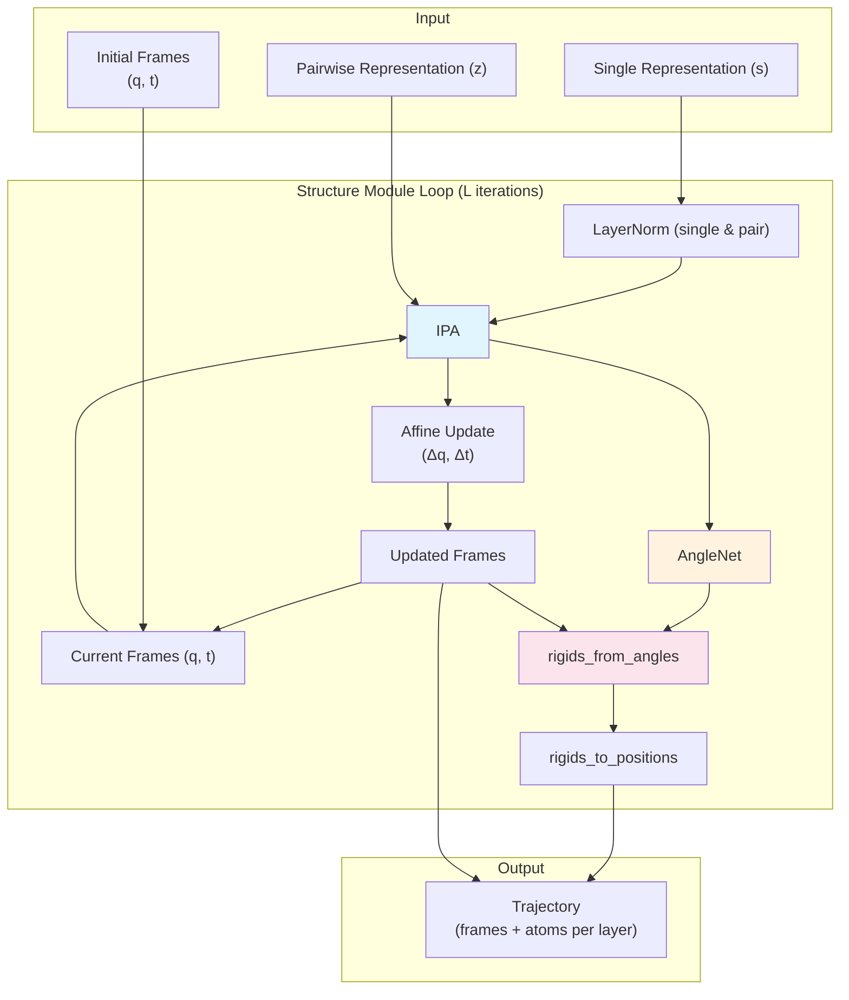
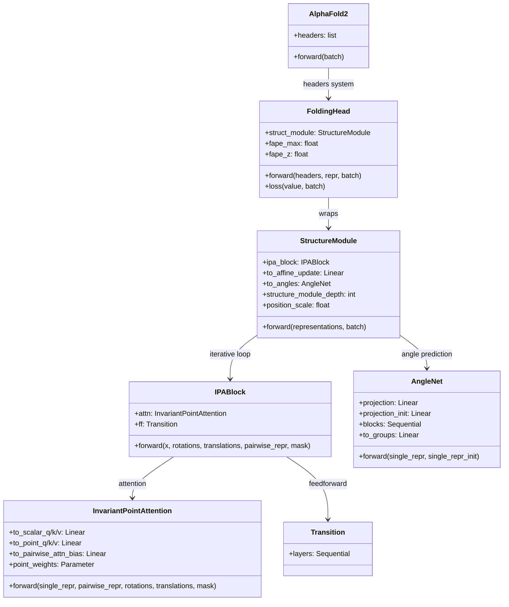

The Structure Module is the culmination of the ProFOLD2 inference pipeline — the stage where learned pairwise and single representations are distilled into explicit three-dimensional atomic coordinates. At its core lies **Invariant Point Attention (IPA)**, an SE(3)-equivariant attention mechanism that reasons over 3D geometry while preserving rotational and translational invariance. This page dissects the architectural composition of the Structure Module, the mathematical machinery of IPA, the rigid-body algebra that underpins frame updates, and the torsion angle network that bridges internal representations to atom-level geometry.

## Architectural Overview

The Structure Module operates as an iterative refinement loop: a shared `IPABlock` is applied multiple times (controlled by `structure_module_depth`), with each iteration updating the per-residue rigid frames (quaternions + translations) and producing progressively refined torsion angle predictions. Only the final iteration (and all iterations during training) materializes full atomic coordinates.



Sources: [folding.py](profold2/model/folding.py#L99-L211)

## Invariant Point Attention (IPA)

IPA is the equivariant attention mechanism at the heart of the Structure Module. Unlike standard softmax attention that operates purely in representation space, IPA introduces a **dual-pathway** architecture: a scalar pathway (standard Q/K/V) and a **point pathway** that explicitly reasons about 3D coordinates through the current rigid frames.

### Dual Attention Pathways

IPA computes attention logits from three additive contributions, each scaled by the inverse square root of the effective key dimension and the number of attention pathways (`num_attn_logits = 3`):

| Pathway | Key Projection | Logit Computation | Role |
|---------|---------------|-------------------|------|
| **Scalar** | `to_scalar_q/k` → `(heads, scalar_key_dim=16)` | `Q·K^T / √(3·16)` | Standard feature-level attention |
| **Point** | `to_point_q/k` → `(heads, point_key_dim=4, 3)` | `-½ · w · d²(q_p, k_p) / √(3·4·9/2)` | 3D distance-aware attention |
| **Pairwise** | `to_pairwise_attn_bias` → `(heads,)` per (i,j) pair | Linear projection of `z_ij` | Explicit pair geometry bias |

The point pathway is the distinguishing feature. Query, key, and value vectors are defined in the **local residue frame** (shape `(..., heads, point_dim, 3)`), then rotated into the **global frame** using the per-residue rotation matrices and translated by the per-residue translation vectors ([commons.py#L1017-L1025](profold2/model/commons.py#L1017-L1025)):

```
q_point_global = R_i · q_point_local + t_i
```

Point attention logits are computed via negative squared Euclidean distance in global 3D space, weighted by learnable per-head parameters through a softplus activation ([commons.py#L1057-L1062](profold2/model/commons.py#L1057-L1062)):

```
point_logits = -½ · softplus(w_h) · Σ_d ||q_h^d - k_h^d||² · scale
```

This formulation ensures that residues with similar 3D local structure attend more strongly to each other, regardless of absolute position — a critical property for equivariance.

### Value Aggregation and Frame-Equivariance

After softmax attention, the value aggregation must preserve equivariance. Scalar values follow standard attention pooling. Point values, however, require a **frame-restore step**: aggregated point values in global coordinates are translated back by the query residue's translation and rotated back into the **local frame** using the transpose of the rotation matrix ([commons.py#L1092-L1096](profold2/model/commons.py#L1092-L1096)):

```
v_point_local = R_i^T · (v_point_global - t_i)
```

The output then concatenates three components: scalar values, point values (flattened across heads and 3D coordinates), point value norms (providing magnitude information), and optionally the attended pairwise representations ([commons.py#L1099-L1116](profold2/model/commons.py#L1099-L1116)). A final linear projection maps the concatenated representation back to the single representation dimension.

Sources: [commons.py](profold2/model/commons.py#L909-L1117)

### IPA Hyperparameter Configuration

| Parameter | Default | Description |
|-----------|---------|-------------|
| `heads` | 12 | Number of attention heads |
| `scalar_key_dim` / `scalar_value_dim` | 16 / 16 | Dimensions for scalar Q/K/V per head |
| `point_key_dim` / `point_value_dim` | 4 / 8 | Dimensions for point Q/K/V per head (×3 for 3D) |
| `require_pairwise_repr` | `True` | Whether pairwise bias is added to logits |
| `gating` | `False` | Optional sigmoid gating on scalar output |
| `point_weight_init` | 1.0 | Initial weight for point attention (softplus-transformed) |
| `qkv_use_bias` | `False` | Bias in Q/K/V linear projections |

Sources: [commons.py](profold2/model/commons.py#L912-L927)

## IPABlock: The Transformer Block

`IPABlock` wraps IPA with pre-normalization residual connections and a Transition (feedforward) block, following the standard transformer residual pattern but with SE(3)-aware attention ([folding.py#L31-L53](profold2/model/folding.py#L31-L53)):

```
x → LayerNorm → IPA(x, rotations, translations, pairwise_repr) → Dropout → +x → LayerNorm → Transition(x) → Dropout → +x
```

The Transition block is a configurable-depth MLP (default 3 layers, as in the AlphaFold2 paper) with ReLU activations ([folding.py#L18-L28](profold2/model/folding.py#L18-L28)). Critically, the `IPABlock` passes through all frame-related keyword arguments (`rotations`, `translations`, `pairwise_repr`, `mask`) to the underlying IPA, making the block itself a transparent wrapper for the equivariant computation.

> [!TIP]
> The Structure Module uses a **single shared** `IPABlock` instance across all `structure_module_depth` iterations. This is an architectural choice that reduces parameter count compared to stacking independent blocks, while the iterative frame updates provide the necessary expressiveness through the evolving geometry rather than through deeper networks.

Sources: [folding.py](profold2/model/folding.py#L31-L53)

## Rigid Body Frame Updates

After each IPA iteration, the module produces an affine update — a 6-dimensional vector split equally between a **quaternion update** (Δq, padded with a leading 1) and a **translation update** (Δt) ([folding.py#L176-L186](profold2/model/folding.py#L176-L186)).

### Quaternion Composition

The quaternion update is L2-normalized before composition to ensure unit quaternions ([folding.py#L181](profold2/model/folding.py#L181)), then composed with the current quaternion via Hamilton product:

```
q_new = q_old ⊗ Δq
```

This composition in quaternion space ensures smooth, continuous rotation updates that naturally avoid gimbal lock and maintain the SO(3) manifold structure.

### Translation in Current Frame

The translation update is applied in the **current rotational frame** — not in global coordinates. This is critical for equivariance: the update vector is expressed in the residue's local coordinate system, then transformed to global space via `rigids_apply`:

```
t_new = t_old + R_old · Δt
```

Sources: [folding.py](profold2/model/folding.py#L176-L187)

### Training Stabilization: Gradient Detachment

Between iterations, the rotation matrices are **detached from the computation graph** ([folding.py#L189-L190](profold2/model/folding.py#L189-L190)). This prevents gradient explosion through the quaternion composition chain while still allowing the affine update network to receive gradients from the loss. The final iteration retains gradients for end-to-end backpropagation.

> [!TIP]
> The entire iterative loop executes in **forced float32 precision** via `torch_default_dtype(torch.float32)` ([folding.py#L152](profold2/model/folding.py#L152)) and `autocast(enabled=False)` ([folding.py#L167](profold2/model/folding.py#L167)). Additionally, TF32 matrix multiplication is disabled inside IPA's point operations ([commons.py#L1077](profold2/model/commons.py#L1077)). This precision discipline is essential because SE(3) equivariance breaks under the numerical noise of lower-precision floating-point arithmetic, particularly in quaternion normalization and rotation composition.

## AngleNet: Torsion Angle Prediction

`AngleNet` converts the single representation into torsion angles — specifically, the sine and cosine of 7 rigid group angles per residue (the backbone frame uses identity rotation, so only the 7 remaining groups produce angle predictions, yielding `7 × 2 = 14` outputs) ([folding.py#L68-L96](profold2/model/folding.py#L68-L96)).

The network uses a **dual-input projection**: both the current single representation and the initial (pre-iteration) single representation are projected and summed ([folding.py#L85-L88](profold2/model/folding.py#L85-L88)). This skip-connection from the initial representation helps preserve residue identity information through the iterative geometry refinement. Two `AngleNetBlock` residual layers (ReLU → Linear → ReLU → Linear → add) process the projected representation before the final linear mapping to angle pairs.

The output angles are L2-normalized before use in frame construction, ensuring that the (sin, cos) pairs lie on the unit circle ([folding.py#L197](profold2/model/folding.py#L197)).

Sources: [folding.py](profold2/model/folding.py#L56-L96)

## From Angles to All-Atom Coordinates

The pipeline from predicted angles to full atomic coordinates involves two key transformations in `functional.py`:

### `rigids_from_angles` — Building Local Frames from Torsion Angles

Given backbone frames and predicted angles, this function constructs rigid frames for all 8 rigid groups per residue ([functional.py#L770-L855](profold2/model/functional.py#L770-L855)). The process:

1. **Gather default frames** from residue constants (pre-defined idealized geometries)
2. **Construct rotation matrices** from sin/cos angle pairs for each group
3. **Apply rotations** to the default frames
4. **Chain dependent frames**: χ₂, χ₃, χ₄ frames transform relative to their parent frames (not the backbone), following the dependency graph defined in residue constants. This chaining is implemented via `rigids_multiply` composition
5. **Compose with backbone**: all atom frames are finally composed with the predicted backbone frames

### `rigids_to_positions` — Extracting Atom Positions

Each of the 14 atom positions per residue is defined relative to one of the 8 rigid group frames, using pre-computed local offsets from residue constants ([functional.py#L710-L735](profold2/model/functional.py#L710-L735)). The function gathers the appropriate rigid frame for each atom via the `restype_atom14_to_rigid_group` mapping, applies the rigid transformation to the local offset positions, and masks out non-existent atoms.

Sources: [functional.py](profold2/model/functional.py#L710-L855)

## StructureModule: End-to-End Forward Pass

The `StructureModule.forward` method orchestrates the complete folding process ([folding.py#L134-L211](profold2/model/folding.py#L134-L211)):

1. **Normalize** single and pairwise representations via LayerNorm
2. **Project** single representation through a linear layer, saving the pre-projection version as `single_repr_init`
3. **Cast** to float32 and establish initial frames (identity quaternions + zero translations, unless recycled frames are provided)
4. **Iterate** `structure_module_depth` times:
   - Apply `IPABlock` with current frames and pairwise representations
   - Compute affine update → update quaternions and translations
   - Detach rotations (except last iteration)
   - Predict angles and construct frames/coordinates (during training or at last layer)
5. **Return** a trajectory list containing frames, activations, and atom data for each materialized layer

Sources: [folding.py](profold2/model/folding.py#L99-L211)

## Integration: FoldingHead and the Loss Landscape

The `StructureModule` is wrapped by `FoldingHead`, which bridges the structure module's output to the model's loss computation ([head.py#L403-L692](profold2/model/head.py#L403-L692)).

### FoldingHead Configuration

| Parameter | Default | Role |
|-----------|---------|------|
| `structure_module_depth` | — | Number of iterative refinement layers |
| `structure_module_heads` | — | IPA attention heads |
| `fape_max` | 15.0 | Clamping distance for FAPE computation |
| `fape_z` | 15 | Normalization factor for FAPE loss |
| `fape_backbone_clamp_ratio` | 1.0 | Backbone FAPE inter-chain clamping |
| `fape_sidechain_clamp_ratio` | 1.0 | Sidechain FAPE inter-chain clamping |
| `position_scale` | 1.0 | Scaling factor applied to predicted frames |

### Multi-Component Loss

The `FoldingHead.loss` method ([head.py#L455-L692](profold2/model/head.py#L455-L692)) computes a composite loss with three components:

| Loss Component | Weight (configurable) | Scope | Description |
|----------------|----------------------|-------|-------------|
| **Backbone FAPE** | `1 - sidechain_w` | All trajectory layers (averaged) | Frame-aligned point error on backbone frames; supports pLDDT-weighted and inter-chain clamped variants |
| **Sidechain FAPE** | `sidechain_w` (default 0.5) | Final layer only | FAPE on all 8 rigid group frames with atom14 positions |
| **Torsion angle loss** | `angle_norm_w` (0.01) + `angle_pred_w` (0.5) | All trajectory layers (averaged) | Angle normalization penalty + angle prediction MSE (χ angles only, mask excludes backbone φ/ψ/ω) |

The backbone FAPE loss is computed across **all** trajectory layers and averaged, providing supervision at every refinement step. The sidechain FAPE loss applies only to the final prediction. Both components support **symmetric ground truth renaming** via `symmetric_ground_truth_find_optimal` for residues with interchangeable atom groups ([head.py#L603-L606](profold2/model/head.py#L603-L606)).

Sources: [head.py](profold2/model/head.py#L403-L692)

## Frame Attention and Frame Updater in the Evoformer

Beyond the Structure Module, IPA also powers two components within the Evoformer trunk — `FrameAttentionBlock` and `FrameUpdater` — which are conditionally enabled by `accept_frame_attn` and `accept_frame_update` flags ([alphafold2.py#L145-L146](profold2/model/alphafold2.py#L145-L146)).

**FrameAttentionBlock** ([commons.py#L1119-L1148](profold2/model/commons.py#L1119-L1148)) applies IPA to MSA representations using backbone frames, allowing the MSA rows to attend with 3D geometric awareness. Like the Structure Module's frame updates, it detaches rotation gradients between iterations.

**FrameUpdater** ([commons.py#L1151-L1177](profold2/model/commons.py#L1151-L1177)) independently updates quaternions and translations from single representations — the same affine update mechanism used in the Structure Module's iterative loop, but as a standalone module.

These components allow the Evoformer to progressively refine geometric priors alongside its pairwise and MSA representation updates, creating a richer information flow into the Structure Module.

Sources: [commons.py](profold2/model/commons.py#L1119-L1177), [alphafold2.py](profold2/model/alphafold2.py#L145-L146)

## Recycling and Downstream Heads

The Structure Module's output feeds directly into the recycling mechanism and downstream prediction heads within the `AlphaFold2.forward` pass ([alphafold2.py#L282-L318](profold2/model/alphafold2.py#L282-L318)):

- **Recyclables**: The final coordinates are detached and passed as `Recyclables` to the next recycling iteration. When `recycling_frames=True`, the predicted frames (quaternions + translations) are also recycled, providing the Structure Module with an initial geometry estimate on subsequent passes.
- **Representation propagation**: The `FoldingHead.forward` returns updated single representations (`act`), which other heads (e.g., `PLDDTHead`, `PAEHead`, `ViolationHead`) consume for confidence prediction.
- **Multi-chain alignment**: After folding, `multi_chain_permutation_alignment` permutes chains with identical sequences to best align with the prediction ([alphafold2.py#L293](profold2/model/alphafold2.py#L293)).

Sources: [alphafold2.py](profold2/model/alphafold2.py#L282-L318)

## Summary: Component Interaction Map



---

Having explored the Structure Module and IPA in detail, the natural next step is to understand how the predicted structures are evaluated: proceed to [Prediction Heads](9-prediction-heads) for the full head architecture, or to [FAPE and Structural Losses](10-fape-and-structural-losses) for a deeper treatment of the FAPE loss function and its variants. For context on how representations reach the Structure Module, revisit [Evoformer and Pairformer Blocks](6-evoformer-and-pairformer-blocks).