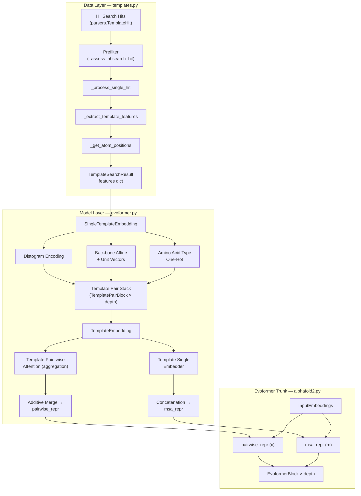

The Template Embedding System is the subsystem within ProFOLD2 that bridges raw structural homologs — identified by HHSearch against the PDB70 database — into learned pairwise and single representations consumed by the Evoformer trunk. It operates across two distinct layers: a **data-level featurization pipeline** that parses mmCIF structures and aligns them to the query, and a **model-level embedding network** that transforms these features through a learned pair stack and attention-based aggregation. This page documents both layers, their exception hierarchies, and the precise channels through which template information flows into the main model.

## Architectural Overview

The template subsystem spans from HHSearch hit processing all the way into the Evoformer's pairwise representation. The following diagram illustrates the end-to-end data flow:



This two-layer architecture enforces a clean separation: the data layer is stateless and operates on NumPy arrays, while the model layer is a pure PyTorch module graph that shares weights across all templates in a batch.

## Data-Level Featurization: TemplateHitFeaturizer

The `TemplateHitFeaturizer` class in [templates.py](profold2/data/templates.py#L813-L947) is the orchestrator for converting HHSearch alignment hits into structured NumPy feature arrays. It is instantiated by the `DataPipeline` ([pipeline.py](profold2/data/pipeline.py#L96)) and receives pre-filtered, sorted hits from the HHSearch step.

### Template Feature Schema

The featurizer produces a dictionary of six feature arrays, all padded and stacked along the template dimension (axis 0). The canonical feature set is defined by the `TEMPLATE_FEATURES` constant:

Sources: [templates.py](profold2/data/templates.py#L90-L97)

| Feature Key | Dtype | Shape | Description |
|---|---|---|---|
| `template_aatype` | `float32` | `[num_templates, num_res, 22]` | One-hot encoded amino acid type per query residue, using HHBLITS_AA_TO_ID mapping |
| `template_all_atom_positions` | `float32` | `[num_templates, num_res, atom_type_num, 3]` | 3D atom coordinates indexed to query residues via alignment mapping; zero-filled for unaligned positions |
| `template_all_atom_masks` | `float32` | `[num_templates, num_res, atom_type_num]` | Binary mask indicating valid atom positions per residue |
| `template_sequence` | `object` | `[num_templates]` | Byte-encoded aligned template sequence (gaps filled with '-') |
| `template_domain_names` | `object` | `[num_templates]` | Byte-encoded string of form `{pdb_id}_{chain_id}` |
| `template_sum_probs` | `float32` | `[num_templates]` | HHSearch probability score used for hit ranking |

### Prefiltering and Hit Selection

Before feature extraction, each HHSearch hit passes through `_assess_hhsearch_hit` ([templates.py](profold2/data/templates.py#L170-L243)), which enforces multiple rejection criteria. Hits are sorted by `sum_probs` in descending order, and processing halts once `max_hits` valid templates have been collected ([templates.py](profold2/data/templates.py#L901-L903)).

The prefilter maintains a strict exception hierarchy rooted in `PrefilterError`. Each subclass corresponds to a specific rejection reason:

| Exception | Condition | Default Behavior |
|---|---|---|
| `DateError` | Template PDB release date > `max_template_date` | Warning (skipped) |
| `PdbIdError` | Template PDB ID identical to query | Warning (skipped) |
| `AlignRatioError` | Alignment coverage < `min_align_ratio` (0.1) | Warning (skipped) |
| `DuplicateError` | Hit is exact subsequence of query (ratio > `max_subsequence_ratio` = 0.95) | Warning (skipped) |
| `LengthError` | Aligned hit length < 10 residues | Warning (skipped) |

The `strict_error_check` flag promotes any `PrefilterError` to a hard error instead of a warning, useful for validation pipelines.

Sources: [templates.py](profold2/data/templates.py#L66-L87), [templates.py](profold2/data/templates.py#L842-L846)

### Atom Position Extraction and Alignment Mapping

The core extraction logic lives in `_extract_template_features` ([templates.py](profold2/data/templates.py#L496-L628)). Given an mmCIF object and a query-to-template residue mapping, it:

1. **Locates the template chain** in the mmCIF via `_find_template_in_pdb` ([templates.py](profold2/data/templates.py#L245-L307)), which resolves the chain ID and computes a `mapping_offset` if the mmCIF uses different residue numbering than the alignment.

2. **Handles sequence mismatches** by falling back to `_realign_pdb_template_to_query` ([templates.py](profold2/data/templates.py#L309-L426)) when the PDB70 sequence is not found verbatim in the mmCIF structure. This uses an external `kalign` binary to produce a new alignment against the actual structure sequence.

3. **Extracts atom positions** via `_get_atom_positions` ([templates.py](profold2/data/templates.py#L450-L493)), which parses Biopython `Residue` objects and validates inter-residue Cα distances against `max_ca_ca_distance` (150.0 Å — effectively permissive, reserved for genuinely broken structures).

4. **Maps to query indices**: Unmapped query positions receive zero-filled coordinates and masks ([templates.py](profold2/data/templates.py#L593-L603)). A minimum of 5 valid atom mask entries (one alanine equivalent) is required to accept the template ([templates.py](profold2/data/templates.py#L606-L612)).

Sources: [templates.py](profold2/data/templates.py#L496-L628)

> [!TIP]
> The `mapping_offset` parameter is critical for correctness. The HHSearch alignment indices reference PDB70 sequence positions, which may differ from the actual mmCIF SEQRES numbering. The offset bridges this gap — without it, atom positions would be assigned to the wrong query residues, producing silently corrupted template features.

## Model-Level Embedding: TemplateEmbedding and SingleTemplateEmbedding

The model-side template processing is defined in [evoformer.py](profold2/model/evoformer.py#L13-L197). It consists of two nested modules: `SingleTemplateEmbedding`, which processes one template at a time through a shared-weight pair stack, and `TemplateEmbedding`, which aggregates across the template dimension and injects information into both the pairwise and MSA representations.

### SingleTemplateEmbedding: Per-Template Feature Encoding

`SingleTemplateEmbedding` ([evoformer.py](profold2/model/evoformer.py#L36-L122)) constructs a 2D feature tensor for each template by concatenating five components, then processes it through a depth-parameterized stack of `TemplatePairBlock` modules.

The concatenated input features, prior to the linear projection, have dimensionality that varies by configuration:

| Component | Contribution | Dimension | Description |
|---|---|---|---|
| Distogram | `templ_dgram_breaks_num` | 39 (default) | Histogram of pseudo-β pairwise distances binned over `[3.25, 50.57]` Å |
| Pseudo-β mask | 1 | 1 | Outer product of per-residue pseudo-β validity masks |
| Amino acid type (row) | 22 | 22 | One-hot template aatype, broadcast along residue j |
| Amino acid type (col) | 22 | 22 | One-hot template aatype, broadcast along residue i |
| Unit vector | 3 or 0 | 3 (conditional) | Backbone affine direction vector; zeroed if `use_template_unit_vector=False` |
| Backbone mask | 1 | 1 | Outer product of C+CA+N backbone atom masks |

The **total raw feature dimension** is `39 + 1 + 22 + 22 + 3 + 1 = 88` (default), matching the `dim_templ_feat=88` parameter ([evoformer.py](profold2/model/evoformer.py#L44)).

The **backbone affine computation** ([evoformer.py](profold2/model/evoformer.py#L79-L89)) extracts rotation matrices `R` and translation vectors `t` from the N-CA-C atom triad of each residue. The local relative direction between residue pairs is computed as `R_i · (t_j - t_i)`, then normalized to a unit vector (with a safety `rsqrt` operation to prevent division by zero). The `use_template_unit_vector` flag gates whether this geometric information is active; when `False`, a zero tensor is substituted ([evoformer.py](profold2/model/evoformer.py#L104-L105)).

After concatenation, the raw features are multiplied by the 2D mask ([evoformer.py](profold2/model/evoformer.py#L111)) to zero out non-template regions, projected to `dim` via a linear layer, and processed through the pair stack with weights shared across all templates in the batch:

```python
x = rearrange(x, 'b m ... -> (b m) ...')  # merge batch and template dims
x, *_ = self.pair_stack(x, mask_2d_expanded)
x = rearrange(x, '(b m) ... -> b m ...', m=m)  # restore template dim
```

Sources: [evoformer.py](profold2/model/evoformer.py#L36-L122)

### TemplatePairBlock: The Template Pair Stack Layer

`TemplatePairBlock` ([evoformer.py](profold2/model/evoformer.py#L13-L33)) is the fundamental repeating unit within the template pair stack. Unlike the `PairwiseAttentionBlock` used in the Evoformer (which includes triangle multiplicative modules, outer product mean, and MSA-to-pair communication), the template pair block is deliberately minimal:

1. **Pairwise attention** via `PairwiseAttentionBlock` with `disabled_outer_mean=True` and `multiplication_first=False` — this strips out the outer product mean pathway and the triangle multiplicative starting point, leaving only attention over the pair representation.
2. **Feed-forward** via a standard 2× expansion `FeedForward` with residual connection.

This architectural simplification reflects the template pair stack's role as a feature encoder rather than a full iterative refinement engine. The template features are already geometrically grounded (distograms, unit vectors), so the stack's job is to learn a useful nonlinear projection rather than to perform the complex triangular communication patterns seen in the Evoformer's pair stack.

Sources: [evoformer.py](profold2/model/evoformer.py#L13-L33), [evoformer.py](profold2/model/evoformer.py#L19-L27)

### TemplateEmbedding: Cross-Template Aggregation and Injection

`TemplateEmbedding` ([evoformer.py](profold2/model/evoformer.py#L125-L196) is the top-level module that coordinates per-template encoding, cross-template aggregation, and injection into the main representation tensors.

#### Pairwise Representation Injection (Pointwise Attention)

The per-template pairwise representations from `SingleTemplateEmbedding` are aggregated into the running pairwise representation `x` via a **pointwise (1D) attention** mechanism ([evoformer.py](profold2/model/evoformer.py#L173-L177)):

1. The running pairwise representation `x` of shape `[batch, n_res, n_res, dim]` is flattened to `[batch, n_res², 1, dim]` and serves as the query.
2. The template representations of shape `[batch, num_templates, n_res, n_res, dim_templ]` are flattened to `[batch, n_res², num_templates, dim_templ]` and serve as key-value context.
3. A cross-attention step produces an output of shape `[batch, n_res², 1, dim]` (with `heads` heads and `dim_head` dimensions), which is then reshaped to `[batch, n_res, n_res, heads × dim_head]`.
4. The result is **additively merged** into the running pairwise representation: `x += t`.

The attention uses `template_mask` as the context mask, so templates with fewer valid residues receive appropriately reduced influence. The additive merge (rather than concatenation) is consistent with the AlphaFold2 design, ensuring the pairwise dimension remains fixed regardless of template count.

Sources: [evoformer.py](profold2/model/evoformer.py#L150-L177)

#### MSA Representation Injection (Single Embedder)

When `dim_msa` is provided, the `TemplateEmbedding` additionally constructs a **template single representation** that is concatenated to the MSA representation ([evoformer.py](profold2/model/evoformer.py#L159-L196)):

The input to the single embedder concatenates:
- **Amino acid type** one-hot: 22 dimensions
- **Torsion angles** (φ, ψ, ω, plus alternative): `14 × 2 = 28` dimensions (7 angles × 2 for sin/cos)
- **Torsion angle mask**: 7 dimensions (one per backbone/sidechain angle)

Total input: `22 + 28 + 7 = 57` dimensions, projected through a two-layer MLP (`Linear → ReLU → Linear`) to `dim_msa`.

The template single representation is concatenated along the MSA depth dimension (axis 1), appending template "rows" below the query and MSA sequences. The corresponding mask is derived from the ψ angle mask (index 2), which depends only on single-residue backbone atoms and is thus the most reliable per-residue indicator.

Sources: [evoformer.py](profold2/model/evoformer.py#L159-L196)

> [!TIP]
> The concatenation of template single representations to the MSA tensor is the mechanism by which templates contribute to the MSA attention pathway in the Evoformer. During MSA attention, these template rows are treated identically to sequence rows — they participate in both row attention (query-to-template communication) and column attention (cross-residue communication within a template). This design allows the Evoformer's MSA attention blocks to extract patterns from template structures without requiring a separate attention pathway.

### Configuration Parameter Reference

The following table summarizes all configurable parameters across the template embedding modules:

| Parameter | Module | Default | Scope |
|---|---|---|---|
| `depth` | `SingleTemplateEmbedding` | — | Number of `TemplatePairBlock` layers in the template pair stack |
| `dim` | `TemplateEmbedding` | — | Pairwise representation dimension (Evoformer dim_pairwise) |
| `dim_templ` | `TemplateEmbedding` | — | Template pairwise intermediate dimension |
| `dim_msa` | `TemplateEmbedding` | `None` | If set, enables template-to-MSA single representation injection |
| `heads` | `TemplateEmbedding` | 4 | Attention heads for pointwise attention and pair stack |
| `dim_head` | `TemplateEmbedding` | 16 | Per-head dimension |
| `dim_templ_feat` | `SingleTemplateEmbedding` | 88 | Raw input feature dimension (39 disto + 1 mask + 22 aa × 2 + 3 unit + 1 bb mask) |
| `templ_dgram_breaks_min` | `SingleTemplateEmbedding` | 3.25 | Minimum distogram bin edge (Å) |
| `templ_dgram_breaks_max` | `SingleTemplateEmbedding` | 50.57 | Maximum distogram bin edge (Å) |
| `templ_dgram_breaks_num` | `SingleTemplateEmbedding` | 39 | Number of distogram bins |
| `use_template_unit_vector` | `SingleTemplateEmbedding` | `False` | Whether to include backbone direction vectors |

## Integration with the Evoformer Trunk

Template embeddings are injected into the model's forward pass at a specific point in the `AlphaFold2` pipeline ([alphafold2.py](profold2/model/alphafold2.py#L128-L320)). The flow is:

1. **Input embeddings** are constructed by `InputEmbeddings` from the query sequence and optional MSA features, producing initial `x` (pairwise) and `m` (MSA) tensors ([alphafold2.py](profold2/model/alphafold2.py#L235-L245)).

2. **Recycling information** from the previous iteration is injected if present ([alphafold2.py](profold2/model/alphafold2.py#L248-L258)).

3. **Template embeddings** are computed by the Evoformer's internal template pathway. The `Evoformer` function ([evoformer.py](profold2/model/evoformer.py#L304-L307)) builds a stack of `EvoformerBlock` modules via `layer_stack`, and the template injection occurs within each block's forward pass at the template integration point.

4. The modified `x` (with template-derived pairwise additions) and `m` (with concatenated template single rows) then flow through the standard Evoformer attention and transition operations: MSA attention, frame attention, frame update, and pairwise attention within each `EvoformerBlock` ([evoformer.py](profold2/model/evoformer.py#L257-L301)).

The `template_depth` configuration key ([alphafold2.py](profold2/model/alphafold2.py#L348)) propagates directly to the `SingleTemplateEmbedding`'s depth parameter, controlling how many pair stack layers process each template. The `dim_msa` parameter controls whether the MSA injection pathway is active.

Sources: [alphafold2.py](profold2/model/alphafold2.py#L128-L275), [evoformer.py](profold2/model/evoformer.py#L304-L307)

## Error Handling Architecture

The template system employs a two-tier exception hierarchy that cleanly separates recoverable conditions from fatal pipeline failures. Understanding this hierarchy is essential for debugging template-related issues in production runs.

**Tier 1 — Featurization Errors** (derive from `Error`): These indicate structural problems with individual templates that make feature extraction impossible. They are caught per-hit in `_process_single_hit` ([templates.py](profold2/data/templates.py#L693-L805)) and converted to error strings in the `SingleHitResult`.

| Error | Trigger |
|---|---|
| `NoChainsError` | mmCIF object has no chains |
| `SequenceNotInTemplateError` | Template sequence not found in mmCIF (triggers realignment fallback) |
| `NoAtomDataInTemplateError` | Atom positions cannot be parsed or Cα distances exceed 150 Å |
| `TemplateAtomMaskAllZerosError` | Fewer than 5 valid atom mask entries |
| `QueryToTemplateAlignError` | Kalign realignment fails |
| `CaDistanceError` | Inter-residue Cα distance exceeds threshold during validation |
| `MultipleChainsError` | Ambiguous chain identification |

**Tier 2 — Prefilter Errors** (derive from `PrefilterError`): These reject hits before any mmCIF parsing occurs. Their severity is controlled by `strict_error_check`.

Sources: [templates.py](profold2/data/templates.py#L33-L87), [templates.py](profold2/data/templates.py#L693-L805)

## Key Design Decisions

The ProFOLD2 template embedding system makes several deliberate architectural choices that distinguish it from a naïve template incorporation strategy:

**Weight sharing across templates**: The `SingleTemplateEmbedding` processes each template independently but with identical weights. The batch-template merge (`'b m ... -> (b m) ...'`) ensures that gradients flow uniformly across all templates regardless of their structural quality, letting the pointwise attention mechanism learn to weight high-quality templates more heavily.

**Additive pairwise injection vs. concatenation**: Template information is additively merged into the pairwise representation rather than concatenated. This keeps the pairwise tensor dimension invariant to the number of templates, avoiding the need for dynamic padding strategies and ensuring that downstream modules (triangle multiplicative, outer product mean) operate on a fixed-width channel.

**Conditional unit vector inclusion**: The `use_template_unit_vector` flag defaults to `False`, which zeroes out the backbone direction component. This acts as a form of structural information gating — unit vectors carry precise 3D directional information that may be overly constraining when template quality is uncertain. The default of `False` lets the model rely primarily on the distogram (distance-only) signal.

Sources: [evoformer.py](profold2/model/evoformer.py#L104-L105), [evoformer.py](profold2/model/evoformer.py#L115-L119)

## Next Steps

For a complete understanding of how template-modified representations propagate through the model, see [Evoformer and Pairformer Blocks](6-evoformer-and-pairformer-blocks), which documents the attention mechanisms that consume the template-enriched pairwise and MSA tensors. To understand how templates interact with the broader feature pipeline at the data level, refer to [Feature Engineering](12-feature-engineering). For the full input embedding construction that precedes template injection, consult [AlphaFold2 Core Pipeline](5-alphafold2-core-pipeline).