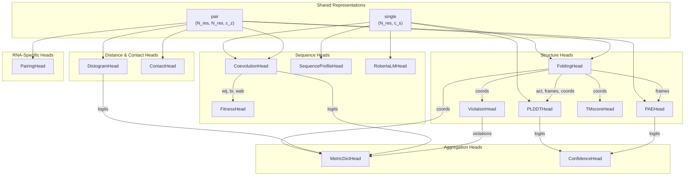
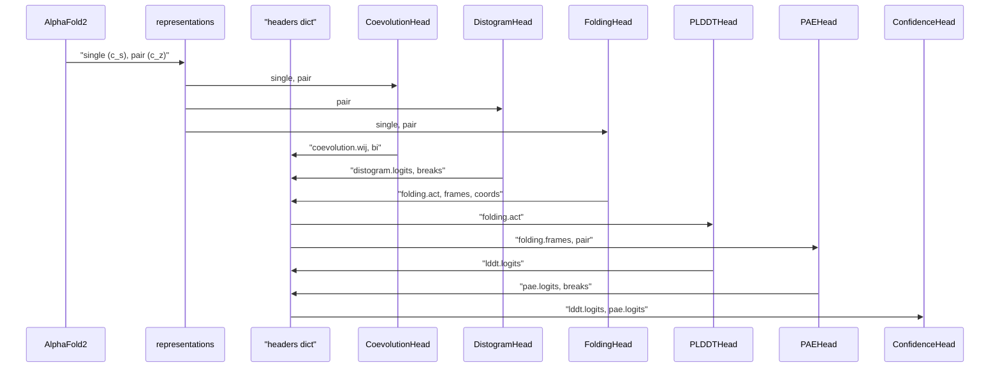

ProFOLD2 employs a modular prediction head architecture where specialized neural network modules consume shared intermediate representations (single and pair embeddings) and produce task-specific outputs. The entire head subsystem is governed by the `HeaderBuilder` factory, which instantiates and registers heads declaratively from a JSON configuration, enabling flexible composition of training objectives without modifying model code.

## Architectural Overview

All prediction heads follow a uniform contract: each head class implements `forward()` to produce outputs from representations and (optionally) `loss()` to compute training signals. The heads consume either the **single representation** (per-residue features) or the **pair representation** (per-residue-pair features), or both, depending on the task. Some heads also tap into the outputs of *other* heads — creating an implicit dependency graph that determines execution order.



This dependency graph reveals a critical design insight: the `FoldingHead` sits at the center of the architecture, feeding its 3D coordinate outputs to five downstream heads. Heads that depend on other heads' outputs must execute in the correct order — a sequencing constraint managed implicitly by the model's forward pass through the `headers` dictionary.

Sources: [head.py](profold2/model/head.py#L1662-L1692), [alphafold2.py](profold2/model/alphafold2.py#L213-L216)

## The HeaderBuilder Factory

The `HeaderBuilder` is a static registry that maps string names to head classes. It is the sole entry point for constructing prediction heads during model initialization. The `build()` method iterates over a configuration list of `(name, args, options)` tuples, instantiates each head with the shared `dim` parameter and head-specific keyword arguments, and optionally registers it as a submodule of a parent `nn.Module`.

```python
class HeaderBuilder:
  _headers = dict(
      coevolution=CoevolutionHead, confidence=ConfidenceHead,
      contact=ContactHead, distogram=DistogramHead,
      fitness=FitnessHead, folding=FoldingHead,
      lddt=PLDDTHead, metric=MetricDictHead,
      pae=PAEHead, pairing=PairingHead,
      profile=SequenceProfileHead, roberta=RobertaLMHead,
      tmscore=TMscoreHead, violation=ViolationHead
  )
```

Each tuple in the configuration carries three elements: the head name, a dictionary of constructor arguments, and an `options` dictionary that typically contains a `weight` key controlling the loss contribution during training. This separation of construction arguments from training options provides clean configuration management.

Sources: [head.py](profold2/model/head.py#L1662-L1681)

## Structure Prediction Heads

### FoldingHead — 3D Coordinate Generation

The `FoldingHead` is the most architecturally complex head. It wraps the `StructureModule` from [folding.py](profold2/model/folding.py#L99) — an iterative Invariant Point Attention (IPA) network — and produces full 3D atomic coordinates as its primary output. Its forward pass returns backbone frames (rotation + translation pairs), all-atom coordinates, updated single representations, and the complete trajectory of intermediate structures across all IPA layers.

The loss function decomposes into two weighted components: **backbone FAPE loss** and **sidechain FAPE loss**, plus an auxiliary **torsion angle loss**. The backbone FAPE is computed across all trajectory timesteps and averaged, while sidechain FAPE uses only the final layer's atom frames. A `sidechain_w` parameter (default 0.5) balances backbone versus sidechain contributions. The torsion angle loss further splits into a norm-regularization term (penalizing deviation from unit-length angle vectors) and a prediction term (comparing predicted χ angles to ground truth), with weights `angle_norm_w` (0.01) and `angle_pred_w` (0.5) respectively.

> [!TIP]
> The FoldingHead supports **symmetric ground truth handling**: when multiple equivalent coordinate frames exist (e.g., due to crystallographic symmetry), it selects the optimal alignment via `symmetric_ground_truth_find_optimal` before computing sidechain loss. This prevents the model from being penalized for correct predictions that happen to align with an alternative symmetric frame.

Key configuration parameters include `structure_module_depth`, `structure_module_heads`, `fape_max` (clamping distance, default 15Å), and `fape_z` (normalization divisor). The `position_scale` parameter controls the scale of initial position embeddings fed into the structure module.

Sources: [head.py](profold2/model/head.py#L403-L694), [folding.py](profold2/model/folding.py#L99-L213)

### PLDDTHead — Per-Residue Confidence

The `PLDDTHead` predicts per-residue local confidence by discretizing the lDDT (local Distance Difference Test) score into 50 bins and performing classification. It consumes either the structure module's single activation (when a `folding` head is present) or the raw single representation as a fallback. The network is a four-layer MLP with ReLU activations and LayerNorm.

During training, it computes the true lDDT by comparing predicted Cα pairwise distances against ground truth Cα distances, using a sequence-aware cutoff function (`lddt_cutoff`) that applies 15Å for protein residues and 30Å for nucleic acid residues. The discretized lDDT values become classification labels for a softmax cross-entropy loss. A resolution filter (`min_resolution` / `max_resolution`) allows excluding low-quality training examples.

Sources: [head.py](profold2/model/head.py#L695-L793)

### PAEHead — Predicted Aligned Error

The `PAEHead` predicts the **Predicted Aligned Error** matrix — a per-residue-pair estimate of positional error after optimal superposition. It operates on the pair representation and also requires the predicted backbone frames from the `FoldingHead`. The output is a 64-bin histogram of squared alignment errors ranging from 0 to 31Ų.

The loss computation is instructive: it converts both predicted and true backbone frames to local coordinate frames (via rotation of translation differences), computes the per-frame squared error, bins it against the bucket boundaries, and applies softmax cross-entropy. This design directly encodes the geometric intuition that alignment error depends on the *relative* orientation between residue frames, not their absolute positions.

Sources: [head.py](profold2/model/head.py#L795-L891)

### ViolationHead and TMscoreHead

The `ViolationHead` is a **loss-only head** (it performs no learned computation) that detects structural violations in predicted coordinates: Cα-Cα distance outliers, improper bond lengths and angles between residues, and steric clashes both within and between residues. It delegates to four `functional.*` helper methods and sums their losses.

The `TMscoreHead` similarly performs no learning — it computes the TM-score by Kabsch-aligning predicted coordinates to ground truth and evaluating the template modeling score. Both heads serve purely as training monitors and are registered with zero or negligible loss weight in the default configuration.

Sources: [head.py](profold2/model/head.py#L1568-L1661), [head.py](profold2/model/head.py#L1605-L1661)

## Distance and Contact Prediction

### DistogramHead

The `DistogramHead` maps pair representations to a distance histogram via a simple `LayerNorm → Linear` projection. The pair representation is first symmetrized by averaging with its transpose. Bucket boundaries are linearly spaced between `buckets_first_break` and `buckets_last_break`.

The loss compares predicted distance bins against ground truth pseudo-β (Cβ for proteins, equivalent for nucleic acids) pairwise squared distances. It supports **focal loss** modulation (`gammar` parameter) and an optional **coord_plddt weighting** scheme: if `coord_plddt_use_weighted_mask` is true, low-confidence residue pairs are down-weighted in the loss; otherwise, the pLDDT scores become a multiplicative weight on the error. A `loss.distogram.w` batch field enables per-sample loss scaling.

Sources: [head.py](profold2/model/head.py#L323-L402)

### ContactHead

The `ContactHead` is a passthrough head — it does not contain any learned parameters. Instead, it extracts precomputed contact logits from the MLM (masked language model) representations (`representations['mlm']['contacts']`), applying binary cross-entropy loss against ground-truth contacts defined as residues within 8Å Cβ distance. Like the DistogramHead, it supports diagonal exclusion, pLDDT weighting, and loss clamping.

Sources: [head.py](profold2/model/head.py#L121-L184)

## Sequence-Level Prediction Heads

### CoevolutionHead — Potts Model

The `CoevolutionHead` implements a **Potts model** for co-evolutionary analysis — the most parameter-rich sequence head. It produces both a single-residue bias term `bi` (via an MLP on single representations) and a pairwise coupling matrix `wij` (via a projection on pair representations).

Two operating modes exist based on the `gating` flag. With **gating enabled** (default), the pairwise projection produces a scalar gating vector per residue pair, which sigmoid-activates and modulates a learnable `states` parameter tensor of shape `(num_states, num_class, num_class)` — yielding a multi-state Potts model. The `num_states` parameter controls the number of coupling states (default 8), and optional **Average Product Correction** (`apc=True`) removes background bias from the coupling matrix. With gating disabled, the head directly projects to a flat `num_class²` output (native Potts).

The forward pass constructs effective fields `hi` for each MSA position by contracting the coupling matrix with the one-hot encoded MSA sequences. The loss uses softmax cross-entropy with a **dynamic error selection** mechanism (`_make_dynamic_errors` with `num_pivot`) that subsamples difficult positions for more efficient gradient computation.

> [!TIP]
> The CoevolutionHead symmetrizes the pair representation (`zij + zij^T) / 2`) before processing, and the `states` tensor is also kept symmetric. This symmetry enforcement is critical for the Potts model's thermodynamic consistency — the coupling between residues *i* and *j* must equal that between *j* and *i*.

Sources: [head.py](profold2/model/head.py#L185-L322)

### RobertaLMHead — Masked Language Modeling

The `RobertaLMHead` performs masked language modeling as a self-supervised pretraining objective. It projects single representations through a four-layer MLP (`Linear → GELU → LayerNorm → Linear`) to predict the masked residue identity. During training, positions selected by `bert_mask` are evaluated against the true sequence via softmax cross-entropy. This head supports loss clamping but carries no loss weight in the default 150M configuration, suggesting it is used primarily during pretraining phases.

Sources: [head.py](profold2/model/head.py#L1005-L1041)

### FitnessHead — Variant Effect Prediction

The `FitnessHead` is the most architecturally distinctive head, implementing a **statistical mechanics-inspired** approach to variant effect prediction. It computes the **Hamiltonian** (log-unnormalized probability) of each variant sequence using the coupling matrices from the `CoevolutionHead`:

$$H(\mathbf{s}) = \sum_i b_i(s_i) + \sum_{i<j} w_{ij}(s_i, s_j)$$

The head runs this Hamiltonian computation over variant sequences (or the wild-type sequence as a single-element MSA), producing per-variant logit vectors. During inference, it computes the **logit difference** between each variant and a reference (wild-type or sampled reference), pools across positions, and scales by a learnable `sigma` parameter to produce a fitness prediction.

The loss function uses **pairwise logistic regression**: it computes sigmoid cross-entropy between logit differences and signed binary labels derived from experimental fitness measurements. A `num_var_as_ref` parameter enables sampling multiple variants as pseudo-references for more robust training. The head also supports multi-task learning via an optional MMoE gating network and per-task weights.

Sources: [head.py](profold2/model/head.py#L1231-L1516)

### SequenceProfileHead

The `SequenceProfileHead` predicts per-residue amino acid frequency profiles. It can source its input from either the structure module's single activations (`single_repr='struct_module'`) or MLM representations. The loss uses KL divergence between predicted logits and ground truth profiles, with dynamic error selection support.

Sources: [head.py](profold2/model/head.py#L1517-L1567)

## RNA-Specific: PairingHead

The `PairingHead` predicts **nucleic acid base pairing** — a task unique to RNA/protein-nucleic-acid complexes. It classifies each residue pair into pairing types (including unpaired) using a softmax over the pair representation. A critical structural constraint is enforced: residue pairs within a sequence distance of 4 are masked out, preventing the model from predicting physiologically impossible sharp loops.

The loss uses a sophisticated formulation combining **independence probability** (the probability that at least one pairing type exists, computed via inclusion-exclusion on log-softmax outputs) with **type-specific** classification loss. When ground-truth pairing annotations (`sta`) are available, a weighted combination (`alpha=0.5`) balances these objectives; otherwise, a KL-divergence self-regularization is applied.

Sources: [head.py](profold2/model/head.py#L892-L1004)

## Aggregation and Metric Heads

### ConfidenceHead

The `ConfidenceHead` is a **pure inference head** — it contains no trainable parameters and computes no loss. It aggregates confidence metrics from other heads' outputs into a single dictionary, producing: `plddt` (scaled to 0–100), `pae`, `mae` (mean absolute error component of PAE), `ptm` (predicted TM-score), and `iptm` (interface PTM for multimer predictions using `seq_color` chain identifiers). All computation runs under `torch.no_grad()`.

Sources: [head.py](profold2/model/head.py#L91-L120)

### MetricDictHead

The `MetricDictHead` is the model's comprehensive **evaluation dashboard**. Like the ConfidenceHead, it performs no learning — it computes a rich set of metrics from head outputs and ground truth:

| Metric Category | Computed Values |
|---|---|
| **Contact** | Precision at various sequence ranges and ratios |
| **Profile** | Cosine similarity between predicted and true profiles |
| **Coevolution** | Cosine similarity, identity, perplexity against MSA |
| **Structure** | lDDT (Cα), CA-CA distance error, bond/angle violations, steric clashes |

The `MetricDict` class extends Python's `dict` with arithmetic operator overloading (`+`, `*`, `/`), enabling clean metric aggregation across recycling iterations or batch elements.

Sources: [head.py](profold2/model/head.py#L1042-L1230)

## Configuration Reference

The following table summarizes the default 150M model's head configuration, showing how heads are composed through the JSON config:

| Head | Key Parameters | Loss Weight | Depends On |
|---|---|---|---|
| `coevolution` | gating=True, num_states=8, apc=True, focal_loss=2.0 | 1.0 | single, pair, msa |
| `profile` | single_repr=struct_module, num_pivot=1024 | 1.0 | single (from folding), pair |
| `distogram` | 64 bins [2.31, 21.69]Å, focal_loss=2.0 | 1.0 | pair |
| `folding` | depth=8, heads=12, fape_max=15, position_scale=10 | 0.4 | single, pair |
| `lddt` | 50 bins, max_resolution=5Å | 0.01 | single (from folding), coords |
| `violation` | *(none)* | 0.0 | coords |
| `metric` | contact_cutoff=8Å | — *(no loss)* | multiple heads |
| `tmscore` | *(none)* | — *(no loss)* | coords |
| `confidence` | *(none)* | — *(no loss)* | lddt, pae outputs |

The `weight` in `options` scales each head's loss contribution. Heads with empty options (like `metric`, `tmscore`, `confidence`) are evaluation-only. The `loss_max` and `loss_min` clamping on heads like `coevolution` (512.0) prevents gradient explosions from outlier training examples.

Sources: [model_headers_150m.json](examples/model_headers_150m.json#L1-L25)

## Representation Flow and Cross-Head Dependencies

Understanding representation flow is essential for debugging and extending the head system. The AlphaFold2 model's forward pass populates two shared dictionaries: `representations` (containing `single` and `pair` tensors) and `headers` (containing each head's forward output). The execution order respects implicit dependencies:



Heads that consume other heads' outputs access them via the `headers` dictionary passed as the first argument to `forward()`. The model iterates through heads in configuration order, so dependent heads must appear *after* their dependencies in the JSON config.

Sources: [alphafold2.py](profold2/model/alphafold2.py#L213-L216), [head.py](profold2/model/head.py#L1662-L1681)

## Custom Head Development

To add a new prediction head, three steps are required:

1. **Implement the head class** in [head.py](profold2/model/head.py) with `__init__(self, dim, **kwargs)`, `forward(self, headers, representations, batch)`, and optionally `loss(self, value, batch)`.
2. **Register it** in `HeaderBuilder._headers` with a string key.
3. **Add it to the configuration JSON** as a `["name", {args}, {options}]` tuple.

The `dim` parameter passed to every head is a tuple `(dim_single, dim_pair)` resolved by `commons.embedd_dim_get()`. Heads extract the dimensionality they need from this tuple. The `options` dictionary must at minimum contain a `weight` key for training heads; evaluation-only heads may use an empty dict.

For heads that depend on other heads' outputs, use the `headers` parameter in `forward()` to access upstream results. Ensure the dependent head appears later in the configuration list to guarantee that upstream heads have already executed.

---

For the structural loss functions (FAPE) used by the FoldingHead in depth, see [FAPE and Structural Losses](10-fape-and-structural-losses). For how confidence metrics are aggregated and interpreted, see [Confidence Metrics](11-confidence-metrics). To understand how the shared representations feeding these heads are produced, refer to [Evoformer and Pairformer Blocks](6-evoformer-and-pairformer-blocks) and [Structure Module and IPA](7-structure-module-and-ipa).