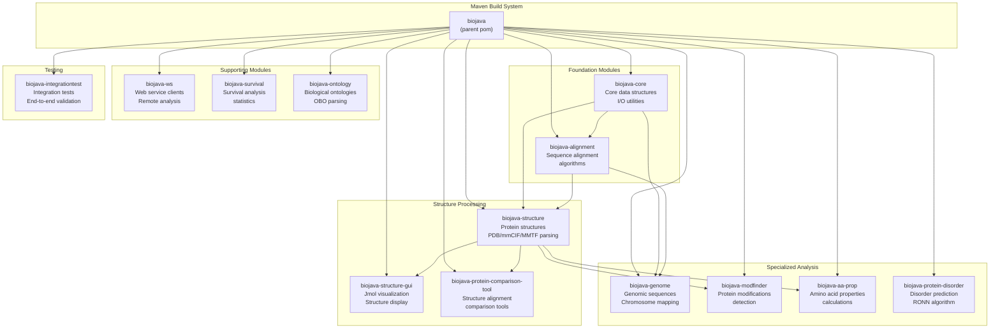
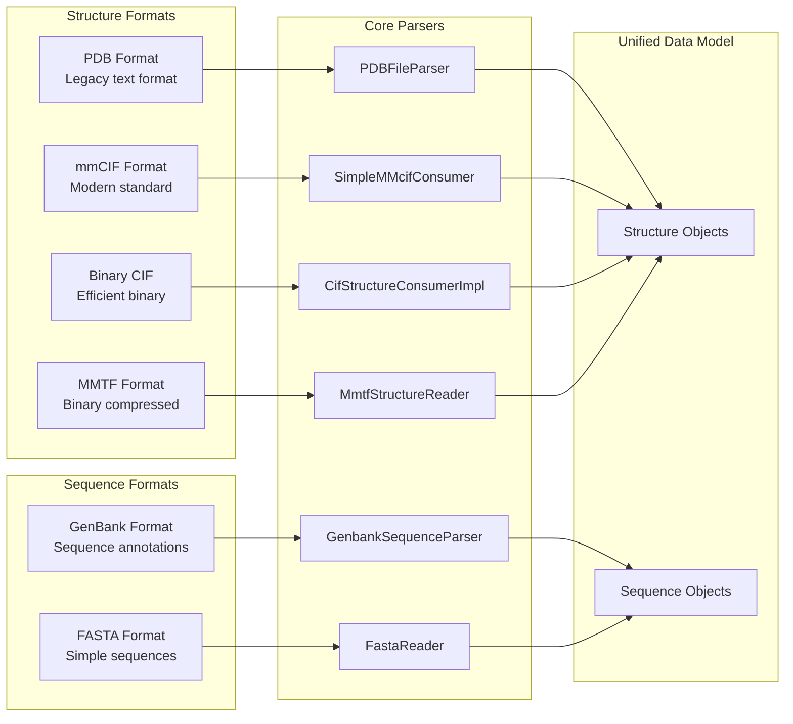

# BioJava Overview

Relevant source files

The following files were used as context for generating this wiki page:

- [.github/workflows/master.yml](.github/workflows/master.yml)
- [.github/workflows/pull_request.yml](.github/workflows/pull_request.yml)
- [CHANGELOG.md](CHANGELOG.md)
- [README.md](README.md)
- [biojava-aa-prop/pom.xml](biojava-aa-prop/pom.xml)
- [biojava-alignment/pom.xml](biojava-alignment/pom.xml)
- [biojava-core/pom.xml](biojava-core/pom.xml)
- [biojava-genome/pom.xml](biojava-genome/pom.xml)
- [biojava-integrationtest/pom.xml](biojava-integrationtest/pom.xml)
- [biojava-modfinder/pom.xml](biojava-modfinder/pom.xml)
- [biojava-ontology/pom.xml](biojava-ontology/pom.xml)
- [biojava-protein-disorder/pom.xml](biojava-protein-disorder/pom.xml)
- [biojava-structure-gui/pom.xml](biojava-structure-gui/pom.xml)
- [biojava-structure/pom.xml](biojava-structure/pom.xml)
- [biojava-structure/src/test/java/org/biojava/nbio/structure/io/TestURLBasedFileParsing.java](biojava-structure/src/test/java/org/biojava/nbio/structure/io/TestURLBasedFileParsing.java)
- [biojava-survival/pom.xml](biojava-survival/pom.xml)
- [biojava-ws/pom.xml](biojava-ws/pom.xml)
- [pom.xml](pom.xml)

## Purpose and Scope

This document provides a high-level introduction to the BioJava framework, its modular architecture, and core capabilities for processing biological data in Java applications. BioJava is a comprehensive bioinformatics library that handles sequences, 3D protein structures, genomic data, and various biological file formats.

For detailed information about specific subsystems, see:
- Core data structures and I/O systems: [Core Architecture](#2)
- Structural analysis algorithms: [Structural Analysis Tools](#3) 
- Graphical components and visualization: [User Interfaces and Visualization](#5)
- Build system and development workflow: [Development and Deployment](#6)

## What is BioJava

BioJava is an open-source Java framework designed for processing biological data. It provides analytical and statistical routines, parsers for common biological file formats, reference implementations of popular algorithms, and tools for manipulating sequences and 3D molecular structures. The project aims to facilitate rapid application development in bioinformatics by offering a comprehensive, well-documented API.

The framework supports multiple biological data types including protein sequences, DNA/RNA sequences, 3D protein structures, genomic annotations, and phylogenetic data. BioJava handles industry-standard file formats such as PDB, mmCIF, MMTF, GenBank, and FASTA, making it easy to integrate with existing bioinformatics workflows.

**Sources:** [pom.xml:17-21](), [README.md:7-7]()

## Module Architecture

BioJava follows a modular architecture where specialized modules handle different aspects of biological data processing. The Maven-based build system coordinates compilation and dependency management across all modules.

### Core Module Structure

**Sources:** [pom.xml:721-737](), [biojava-structure/pom.xml:9-11](), [biojava-core/pom.xml:8-10](), [biojava-structure-gui/pom.xml:8-10]()

### Module Dependencies and Key Technologies

| Module | Primary Dependencies | Key Technologies |
|--------|---------------------|------------------|
| `biojava-core` | slf4j, log4j, JAXB | Base data structures, I/O utilities |
| `biojava-structure` | ciftools-java, mmtf-api, vecmath, jgrapht | Structure parsing, 3D geometry, graph algorithms |
| `biojava-structure-gui` | jmol, jcolorbrewer | 3D visualization, color schemes |
| `biojava-alignment` | forester | Sequence alignment, phylogenetic trees |
| `biojava-genome` | guava | Genomic coordinate mapping, sequence analysis |

**Sources:** [biojava-structure/pom.xml:20-84](), [biojava-structure-gui/pom.xml:20-71](), [biojava-alignment/pom.xml:41-76]()

## File Format Support Ecosystem

BioJava provides comprehensive support for biological file formats through dedicated parsing and writing components. The framework emphasizes modern, efficient formats while maintaining backward compatibility with legacy formats.

### Format Support Matrix

**Sources:** [biojava-structure/pom.xml:22-50](), [CHANGELOG.md:7-8](), [biojava-structure/src/test/java/org/biojava/nbio/structure/io/TestURLBasedFileParsing.java:38-44]()

## Core Capabilities

### Structural Biology
- **3D Structure Processing**: Parse and manipulate PDB, mmCIF, and MMTF files
- **Structure Alignment**: Pairwise and multiple structure alignment algorithms
- **Symmetry Analysis**: Internal symmetry detection using CE-Symm algorithm
- **Surface Analysis**: Accessible surface area (ASA) calculation and interface detection
- **Visualization**: Integration with Jmol for interactive 3D structure display

### Sequence Analysis
- **Sequence Alignment**: Pairwise and multiple sequence alignment algorithms
- **File Format Support**: GenBank, FASTA, and other sequence formats
- **Genomic Analysis**: Chromosome mapping and coordinate transformations
- **Phylogenetic Analysis**: Tree construction and analysis using Forester library

### Specialized Tools
- **Protein Properties**: Amino acid property calculations and aromaticity analysis
- **Disorder Prediction**: RONN algorithm for predicting disordered regions
- **Modification Detection**: Identification of post-translational modifications
- **Web Services**: Integration with remote bioinformatics analysis services

**Sources:** [README.md:7-7](), [CHANGELOG.md:200-315](), [biojava-aa-prop/pom.xml:8-10](), [biojava-protein-disorder/pom.xml:8-11]()

## Technical Architecture

### Runtime Requirements
- **Java Version**: Java 11 or higher (JDK 11 compilation target)
- **Logging**: SLF4J facade with Log4j2 implementation
- **XML Processing**: Jakarta XML Binding (JAXB) for XML serialization
- **Distribution**: Available through Maven Central Repository

### Key Design Patterns
- **Modular Architecture**: Independent modules with clear separation of concerns
- **Factory Pattern**: `StructureIO` factory for format-agnostic structure loading
- **Strategy Pattern**: Multiple algorithm implementations behind common interfaces
- **Caching Layer**: `AtomCache` for efficient structure retrieval and storage

**Sources:** [pom.xml:36-36](), [pom.xml:443-469](), [pom.xml:17-21](), [README.md:21-36]()

## Development and Release Process

BioJava follows standard Maven conventions for building, testing, and releasing. The project uses GitHub Actions for continuous integration, running tests across multiple Java versions and operating systems.

### Build Configuration
- **Build Tool**: Apache Maven with parent POM structure
- **Testing**: JUnit 4 and JUnit 5 with separate integration test module
- **Code Quality**: Checkstyle integration and SonarQube analysis
- **Release**: Automated release to Maven Central via OSS Sonatype

### Continuous Integration
- **Pull Request Testing**: Multi-platform testing on Ubuntu and Windows
- **Java Version Matrix**: Tests run on Java 11, 17, and 21
- **Integration Tests**: Comprehensive end-to-end testing in dedicated module

**Sources:** [pom.xml:169-413](), [.github/workflows/pull_request.yml:15-58](), [.github/workflows/master.yml:12-37](), [README.md:40-46]()

---