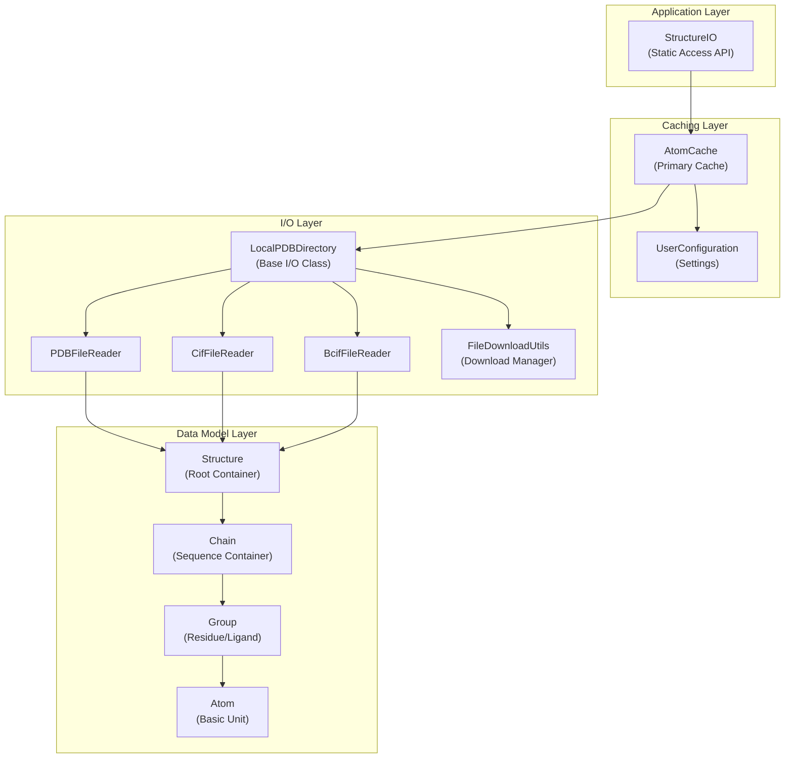
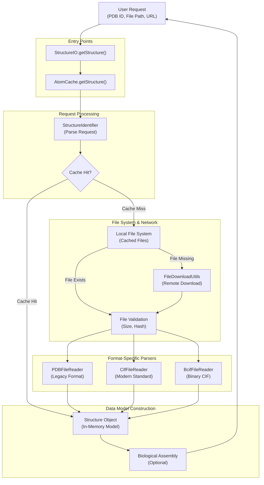
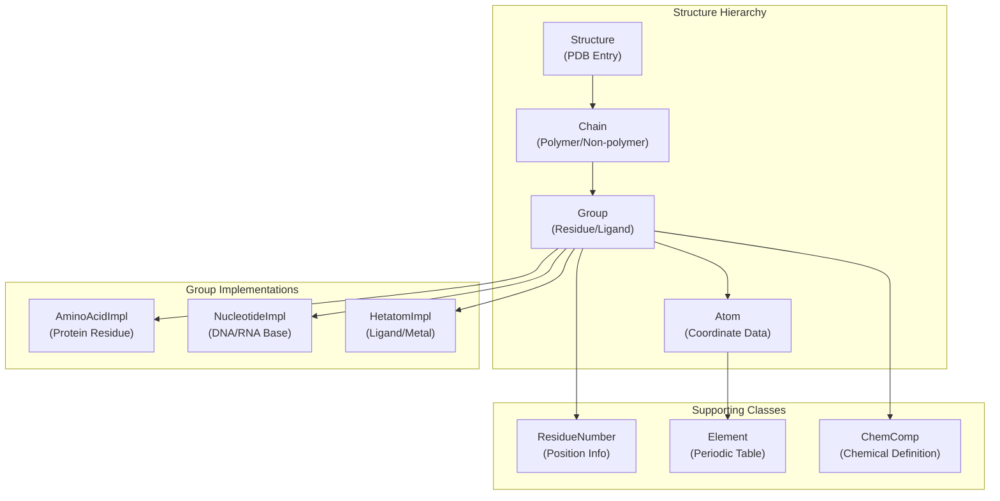

# Core Architecture

Relevant source files

The following files were used as context for generating this wiki page:

- [biojava-core/src/main/java/org/biojava/nbio/core/util/FileDownloadUtils.java](biojava-core/src/main/java/org/biojava/nbio/core/util/FileDownloadUtils.java)
- [biojava-core/src/test/java/org/biojava/nbio/core/util/FileDownloadUtilsTest.java](biojava-core/src/test/java/org/biojava/nbio/core/util/FileDownloadUtilsTest.java)
- [biojava-integrationtest/src/test/java/org/biojava/nbio/structure/test/ecod/EcodInstallationTest.java](biojava-integrationtest/src/test/java/org/biojava/nbio/structure/test/ecod/EcodInstallationTest.java)
- [biojava-integrationtest/src/test/java/org/biojava/nbio/structure/test/ecod/EcodParseTest.java](biojava-integrationtest/src/test/java/org/biojava/nbio/structure/test/ecod/EcodParseTest.java)
- [biojava-integrationtest/src/test/java/org/biojava/nbio/structure/test/io/TestAtomCachePerformance.java](biojava-integrationtest/src/test/java/org/biojava/nbio/structure/test/io/TestAtomCachePerformance.java)
- [biojava-structure/src/main/java/org/biojava/nbio/structure/AminoAcid.java](biojava-structure/src/main/java/org/biojava/nbio/structure/AminoAcid.java)
- [biojava-structure/src/main/java/org/biojava/nbio/structure/AminoAcidImpl.java](biojava-structure/src/main/java/org/biojava/nbio/structure/AminoAcidImpl.java)
- [biojava-structure/src/main/java/org/biojava/nbio/structure/Atom.java](biojava-structure/src/main/java/org/biojava/nbio/structure/Atom.java)
- [biojava-structure/src/main/java/org/biojava/nbio/structure/AtomImpl.java](biojava-structure/src/main/java/org/biojava/nbio/structure/AtomImpl.java)
- [biojava-structure/src/main/java/org/biojava/nbio/structure/Group.java](biojava-structure/src/main/java/org/biojava/nbio/structure/Group.java)
- [biojava-structure/src/main/java/org/biojava/nbio/structure/HetatomImpl.java](biojava-structure/src/main/java/org/biojava/nbio/structure/HetatomImpl.java)
- [biojava-structure/src/main/java/org/biojava/nbio/structure/NucleotideImpl.java](biojava-structure/src/main/java/org/biojava/nbio/structure/NucleotideImpl.java)
- [biojava-structure/src/main/java/org/biojava/nbio/structure/StructureIO.java](biojava-structure/src/main/java/org/biojava/nbio/structure/StructureIO.java)
- [biojava-structure/src/main/java/org/biojava/nbio/structure/align/ce/OptimalCECPMain.java](biojava-structure/src/main/java/org/biojava/nbio/structure/align/ce/OptimalCECPMain.java)
- [biojava-structure/src/main/java/org/biojava/nbio/structure/align/util/AtomCache.java](biojava-structure/src/main/java/org/biojava/nbio/structure/align/util/AtomCache.java)
- [biojava-structure/src/main/java/org/biojava/nbio/structure/align/util/UserConfiguration.java](biojava-structure/src/main/java/org/biojava/nbio/structure/align/util/UserConfiguration.java)
- [biojava-structure/src/main/java/org/biojava/nbio/structure/ecod/EcodDatabase.java](biojava-structure/src/main/java/org/biojava/nbio/structure/ecod/EcodDatabase.java)
- [biojava-structure/src/main/java/org/biojava/nbio/structure/ecod/EcodDomain.java](biojava-structure/src/main/java/org/biojava/nbio/structure/ecod/EcodDomain.java)
- [biojava-structure/src/main/java/org/biojava/nbio/structure/ecod/EcodFactory.java](biojava-structure/src/main/java/org/biojava/nbio/structure/ecod/EcodFactory.java)
- [biojava-structure/src/main/java/org/biojava/nbio/structure/ecod/EcodInstallation.java](biojava-structure/src/main/java/org/biojava/nbio/structure/ecod/EcodInstallation.java)
- [biojava-structure/src/main/java/org/biojava/nbio/structure/io/LocalPDBDirectory.java](biojava-structure/src/main/java/org/biojava/nbio/structure/io/LocalPDBDirectory.java)
- [biojava-structure/src/main/java/org/biojava/nbio/structure/io/sifts/SiftsChainToUniprotMapping.java](biojava-structure/src/main/java/org/biojava/nbio/structure/io/sifts/SiftsChainToUniprotMapping.java)
- [biojava-structure/src/main/java/org/biojava/nbio/structure/io/sifts/SiftsMappingProvider.java](biojava-structure/src/main/java/org/biojava/nbio/structure/io/sifts/SiftsMappingProvider.java)
- [biojava-structure/src/main/java/org/biojava/nbio/structure/io/sifts/SiftsXMLParser.java](biojava-structure/src/main/java/org/biojava/nbio/structure/io/sifts/SiftsXMLParser.java)
- [biojava-structure/src/main/java/org/biojava/nbio/structure/scop/ScopInstallation.java](biojava-structure/src/main/java/org/biojava/nbio/structure/scop/ScopInstallation.java)
- [biojava-structure/src/main/java/org/biojava/nbio/structure/xtal/SymoplibParser.java](biojava-structure/src/main/java/org/biojava/nbio/structure/xtal/SymoplibParser.java)
- [biojava-structure/src/test/java/org/biojava/nbio/structure/TestCloning.java](biojava-structure/src/test/java/org/biojava/nbio/structure/TestCloning.java)
- [biojava-structure/src/test/java/org/biojava/nbio/structure/align/util/AtomCacheTest.java](biojava-structure/src/test/java/org/biojava/nbio/structure/align/util/AtomCacheTest.java)
- [biojava-structure/src/test/java/org/biojava/nbio/structure/io/TestSiftsParsing.java](biojava-structure/src/test/java/org/biojava/nbio/structure/io/TestSiftsParsing.java)
- [biojava-structure/src/test/java/org/biojava/nbio/structure/io/sifts/SiftsChainToUniprotMappingTest.java](biojava-structure/src/test/java/org/biojava/nbio/structure/io/sifts/SiftsChainToUniprotMappingTest.java)
- [biojava-structure/src/test/java/org/biojava/nbio/structure/test/util/GlobalsHelper.java](biojava-structure/src/test/java/org/biojava/nbio/structure/test/util/GlobalsHelper.java)
- [biojava-structure/src/test/resources/atp.cif.gz](biojava-structure/src/test/resources/atp.cif.gz)
- [biojava-structure/src/test/resources/org/biojava/nbio/structure/io/4dou.sifts.xml.gz](biojava-structure/src/test/resources/org/biojava/nbio/structure/io/4dou.sifts.xml.gz)
- [biojava-structure/src/test/resources/org/biojava/nbio/structure/io/sifts/mock_sifts.tsv](biojava-structure/src/test/resources/org/biojava/nbio/structure/io/sifts/mock_sifts.tsv)

## Purpose and Scope

This document provides an overview of BioJava's fundamental data structures, I/O systems, and caching mechanisms that form the foundation of the framework. The core architecture enables efficient loading, parsing, and manipulation of biological structure data from various file formats.

For detailed information about specific data structures, see [Data Model and Structure Representation](#2.1). For file format handling details, see [File Format Support and Parsing](#2.2). For caching system implementation, see [Structure Caching and Retrieval](#2.3). For modern CIF format processing, see [CIF Data Processing](#2.4).

## Core Architecture Overview

BioJava's core architecture is built around three primary pillars: **data models** for representing biological structures, **I/O systems** for reading various file formats, and **caching mechanisms** for efficient data access. These components work together to provide a unified interface for structural bioinformatics applications.

### Core Architecture Components

**Core Architecture Components Diagram**

Sources: [biojava-structure/src/main/java/org/biojava/nbio/structure/StructureIO.java:1-265](), [biojava-structure/src/main/java/org/biojava/nbio/structure/align/util/AtomCache.java:1-896](), [biojava-structure/src/main/java/org/biojava/nbio/structure/io/LocalPDBDirectory.java:1-805]()

## Data Flow Architecture

The following diagram illustrates how data flows through BioJava's core systems, from initial requests to final Structure objects:

**Data Flow Through Core Systems**

Sources: [biojava-structure/src/main/java/org/biojava/nbio/structure/StructureIO.java:94-98](), [biojava-structure/src/main/java/org/biojava/nbio/structure/align/util/AtomCache.java:481-503](), [biojava-core/src/main/java/org/biojava/nbio/core/util/FileDownloadUtils.java:93-134]()

## Key Class Relationships

The core architecture is implemented through several key classes that work together:

| Component | Primary Class | Purpose | Key Methods |
|-----------|---------------|---------|-------------|
| **Static API** | `StructureIO` | Entry point for structure access | `getStructure()`, `getBiologicalAssembly()` |
| **Caching** | `AtomCache` | Manages structure caching and retrieval | `getStructure()`, `getStructureForPdbId()` |
| **I/O Management** | `LocalPDBDirectory` | Base class for file operations | `getStructureById()`, `downloadStructure()` |
| **File Downloads** | `FileDownloadUtils` | Handles remote file retrieval | `downloadFile()`, `validateFile()` |
| **Configuration** | `UserConfiguration` | System configuration management | `getPdbFilePath()`, `getCacheFilePath()` |

### Core Data Model Hierarchy

**Core Data Model Class Hierarchy**

Sources: [biojava-structure/src/main/java/org/biojava/nbio/structure/HetatomImpl.java:51-646](), [biojava-structure/src/main/java/org/biojava/nbio/structure/AtomImpl.java:41-320](), [biojava-structure/src/main/java/org/biojava/nbio/structure/AminoAcidImpl.java:35-175](), [biojava-structure/src/main/java/org/biojava/nbio/structure/NucleotideImpl.java:34-121]()

## Core Subsystems

### Structure Caching System

The `AtomCache` class serves as the primary caching mechanism for structure data. It implements soft caching to prevent memory issues while maintaining performance benefits:

- **Thread-safe design** with synchronized collections for concurrent access
- **Configurable file types** supporting PDB, CIF, and BCIF formats  
- **Biological assembly support** with automatic transformation handling
- **Fetch behavior control** for online/offline operation modes

Key configuration options include cache paths, obsolete behavior handling, and fetch behavior settings defined in [biojava-structure/src/main/java/org/biojava/nbio/structure/align/util/AtomCache.java:81-89]().

### File I/O Framework

The I/O system is built around the abstract `LocalPDBDirectory` class, which provides common functionality for file management:

- **Download management** with automatic retry and validation
- **Directory organization** using PDB-style two-character subdirectories
- **File validation** through size and hash checking mechanisms
- **Obsolete structure handling** with configurable behaviors

The system supports multiple fetch behaviors defined in [biojava-structure/src/main/java/org/biojava/nbio/structure/io/LocalPDBDirectory.java:98-119]().

### Data Model Framework

BioJava's data model provides a hierarchical representation of biological structures:

- **Structure objects** represent complete PDB entries with metadata
- **Chain objects** contain sequences of residues or collections of ligands
- **Group objects** represent individual residues, nucleotides, or heteroatoms
- **Atom objects** contain coordinate data and chemical properties

The model supports alternative locations, chemical component definitions, and bonds between atoms as described in [biojava-structure/src/main/java/org/biojava/nbio/structure/Group.java:55-387]().

### Configuration Management

The `UserConfiguration` class manages system-wide settings including:

- **Cache directory paths** for structure and utility files
- **Download behavior** settings for online resources
- **File format preferences** and parsing parameters
- **Performance tuning** options for memory vs. speed trade-offs

Configuration can be set programmatically or through system properties as detailed in [biojava-structure/src/main/java/org/biojava/nbio/structure/align/util/UserConfiguration.java:1-396]().

Sources: [biojava-structure/src/main/java/org/biojava/nbio/structure/align/util/AtomCache.java:53-155](), [biojava-structure/src/main/java/org/biojava/nbio/structure/io/LocalPDBDirectory.java:50-240](), [biojava-core/src/main/java/org/biojava/nbio/core/util/FileDownloadUtils.java:44-386]()

---