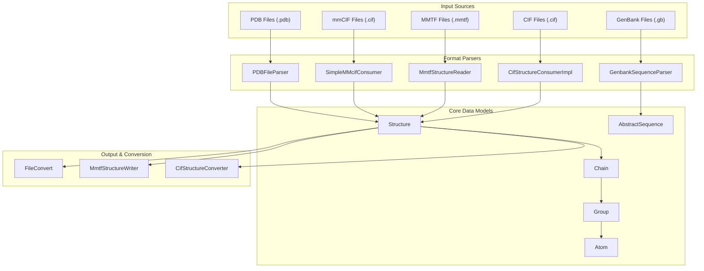
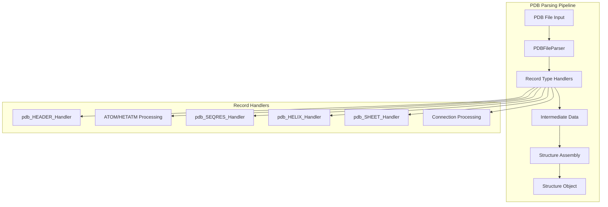
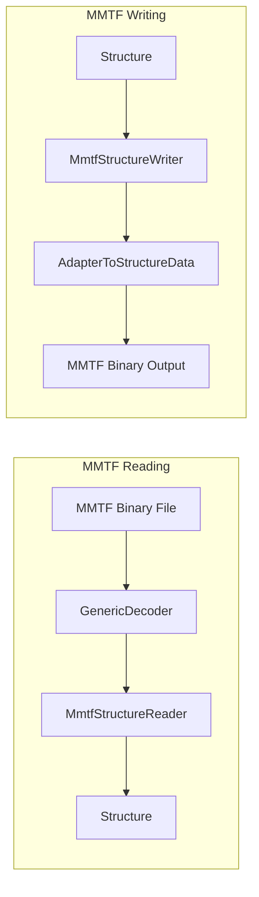
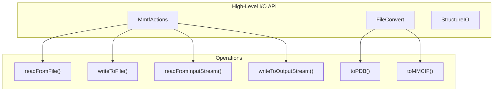
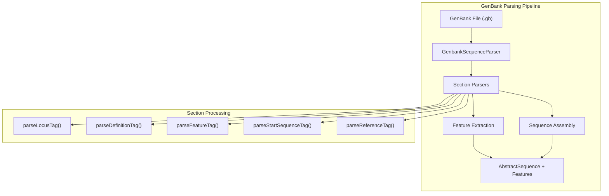
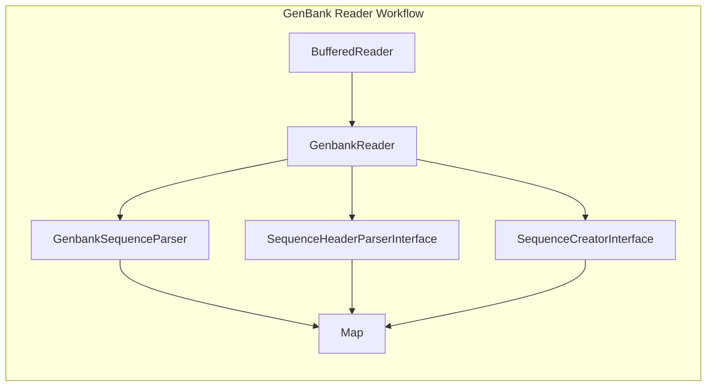
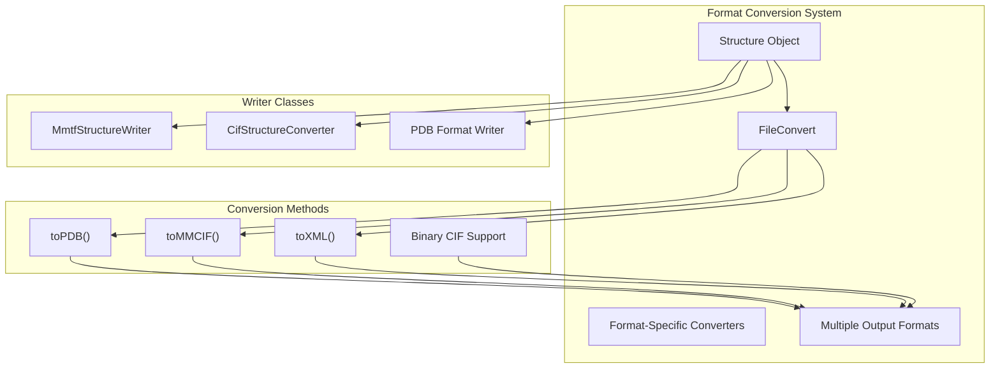

# File Format Support and Parsing

Relevant source files

The following files were used as context for generating this wiki page:

- [biojava-alignment/src/test/java/org/biojava/nbio/alignment/TestDNAAlignment.java](biojava-alignment/src/test/java/org/biojava/nbio/alignment/TestDNAAlignment.java)
- [biojava-core/src/main/java/org/biojava/nbio/core/sequence/AccessionID.java](biojava-core/src/main/java/org/biojava/nbio/core/sequence/AccessionID.java)
- [biojava-core/src/main/java/org/biojava/nbio/core/sequence/ChromosomeSequence.java](biojava-core/src/main/java/org/biojava/nbio/core/sequence/ChromosomeSequence.java)
- [biojava-core/src/main/java/org/biojava/nbio/core/sequence/ProteinSequence.java](biojava-core/src/main/java/org/biojava/nbio/core/sequence/ProteinSequence.java)
- [biojava-core/src/main/java/org/biojava/nbio/core/sequence/features/DatabaseReferenceInterface.java](biojava-core/src/main/java/org/biojava/nbio/core/sequence/features/DatabaseReferenceInterface.java)
- [biojava-core/src/main/java/org/biojava/nbio/core/sequence/features/FeatureRetriever.java](biojava-core/src/main/java/org/biojava/nbio/core/sequence/features/FeatureRetriever.java)
- [biojava-core/src/main/java/org/biojava/nbio/core/sequence/features/FeaturesKeyWordInterface.java](biojava-core/src/main/java/org/biojava/nbio/core/sequence/features/FeaturesKeyWordInterface.java)
- [biojava-core/src/main/java/org/biojava/nbio/core/sequence/io/GenbankReader.java](biojava-core/src/main/java/org/biojava/nbio/core/sequence/io/GenbankReader.java)
- [biojava-core/src/main/java/org/biojava/nbio/core/sequence/io/GenbankSequenceParser.java](biojava-core/src/main/java/org/biojava/nbio/core/sequence/io/GenbankSequenceParser.java)
- [biojava-core/src/main/java/org/biojava/nbio/core/sequence/io/GenbankWriter.java](biojava-core/src/main/java/org/biojava/nbio/core/sequence/io/GenbankWriter.java)
- [biojava-core/src/main/java/org/biojava/nbio/core/sequence/io/GenbankWriterHelper.java](biojava-core/src/main/java/org/biojava/nbio/core/sequence/io/GenbankWriterHelper.java)
- [biojava-core/src/main/java/org/biojava/nbio/core/sequence/io/GenericGenbankHeaderFormat.java](biojava-core/src/main/java/org/biojava/nbio/core/sequence/io/GenericGenbankHeaderFormat.java)
- [biojava-core/src/main/java/org/biojava/nbio/core/sequence/io/GenericGenbankHeaderParser.java](biojava-core/src/main/java/org/biojava/nbio/core/sequence/io/GenericGenbankHeaderParser.java)
- [biojava-core/src/main/java/org/biojava/nbio/core/sequence/loader/GenbankProxySequenceReader.java](biojava-core/src/main/java/org/biojava/nbio/core/sequence/loader/GenbankProxySequenceReader.java)
- [biojava-core/src/main/java/org/biojava/nbio/core/sequence/location/InsdcParser.java](biojava-core/src/main/java/org/biojava/nbio/core/sequence/location/InsdcParser.java)
- [biojava-core/src/main/java/org/biojava/nbio/core/util/InputStreamProvider.java](biojava-core/src/main/java/org/biojava/nbio/core/util/InputStreamProvider.java)
- [biojava-core/src/test/java/org/biojava/nbio/core/sequence/io/GenbankReaderTest.java](biojava-core/src/test/java/org/biojava/nbio/core/sequence/io/GenbankReaderTest.java)
- [biojava-core/src/test/java/org/biojava/nbio/core/sequence/io/GenbankWriterTest.java](biojava-core/src/test/java/org/biojava/nbio/core/sequence/io/GenbankWriterTest.java)
- [biojava-core/src/test/java/org/biojava/nbio/core/sequence/loader/GenbankProxySequenceReaderTest.java](biojava-core/src/test/java/org/biojava/nbio/core/sequence/loader/GenbankProxySequenceReaderTest.java)
- [biojava-core/src/test/java/org/biojava/nbio/core/sequence/loader/SimpleGenbankProxySequenceReaderTest.java](biojava-core/src/test/java/org/biojava/nbio/core/sequence/loader/SimpleGenbankProxySequenceReaderTest.java)
- [biojava-core/src/test/java/org/biojava/nbio/core/sequence/location/LocationParserTest.java](biojava-core/src/test/java/org/biojava/nbio/core/sequence/location/LocationParserTest.java)
- [biojava-core/src/test/java/org/biojava/nbio/core/sequence/location/LocationTest.java](biojava-core/src/test/java/org/biojava/nbio/core/sequence/location/LocationTest.java)
- [biojava-core/src/test/java/org/biojava/nbio/core/sequence/location/TargetedLocationParserTest.java](biojava-core/src/test/java/org/biojava/nbio/core/sequence/location/TargetedLocationParserTest.java)
- [biojava-core/src/test/resources/with_joins.gb](biojava-core/src/test/resources/with_joins.gb)
- [biojava-integrationtest/src/test/java/org/biojava/nbio/structure/test/io/TestLongPdbVsMmCifParsing.java](biojava-integrationtest/src/test/java/org/biojava/nbio/structure/test/io/TestLongPdbVsMmCifParsing.java)
- [biojava-structure/src/main/java/demo/DemoMmtfWriter.java](biojava-structure/src/main/java/demo/DemoMmtfWriter.java)
- [biojava-structure/src/main/java/org/biojava/nbio/structure/Model.java](biojava-structure/src/main/java/org/biojava/nbio/structure/Model.java)
- [biojava-structure/src/main/java/org/biojava/nbio/structure/Structure.java](biojava-structure/src/main/java/org/biojava/nbio/structure/Structure.java)
- [biojava-structure/src/main/java/org/biojava/nbio/structure/StructureImpl.java](biojava-structure/src/main/java/org/biojava/nbio/structure/StructureImpl.java)
- [biojava-structure/src/main/java/org/biojava/nbio/structure/StructureTools.java](biojava-structure/src/main/java/org/biojava/nbio/structure/StructureTools.java)
- [biojava-structure/src/main/java/org/biojava/nbio/structure/SubstructureIdentifier.java](biojava-structure/src/main/java/org/biojava/nbio/structure/SubstructureIdentifier.java)
- [biojava-structure/src/main/java/org/biojava/nbio/structure/align/util/ResourceManager.java](biojava-structure/src/main/java/org/biojava/nbio/structure/align/util/ResourceManager.java)
- [biojava-structure/src/main/java/org/biojava/nbio/structure/io/EntityFinder.java](biojava-structure/src/main/java/org/biojava/nbio/structure/io/EntityFinder.java)
- [biojava-structure/src/main/java/org/biojava/nbio/structure/io/FileConvert.java](biojava-structure/src/main/java/org/biojava/nbio/structure/io/FileConvert.java)
- [biojava-structure/src/main/java/org/biojava/nbio/structure/io/PDBFileParser.java](biojava-structure/src/main/java/org/biojava/nbio/structure/io/PDBFileParser.java)
- [biojava-structure/src/main/java/org/biojava/nbio/structure/io/mmtf/MmtfActions.java](biojava-structure/src/main/java/org/biojava/nbio/structure/io/mmtf/MmtfActions.java)
- [biojava-structure/src/main/java/org/biojava/nbio/structure/io/mmtf/MmtfStructureReader.java](biojava-structure/src/main/java/org/biojava/nbio/structure/io/mmtf/MmtfStructureReader.java)
- [biojava-structure/src/main/java/org/biojava/nbio/structure/io/mmtf/MmtfStructureWriter.java](biojava-structure/src/main/java/org/biojava/nbio/structure/io/mmtf/MmtfStructureWriter.java)
- [biojava-structure/src/main/java/org/biojava/nbio/structure/io/mmtf/MmtfSummaryDataBean.java](biojava-structure/src/main/java/org/biojava/nbio/structure/io/mmtf/MmtfSummaryDataBean.java)
- [biojava-structure/src/main/java/org/biojava/nbio/structure/io/mmtf/MmtfUtils.java](biojava-structure/src/main/java/org/biojava/nbio/structure/io/mmtf/MmtfUtils.java)
- [biojava-structure/src/test/java/org/biojava/nbio/structure/io/TestDifficultMmCIFFiles.java](biojava-structure/src/test/java/org/biojava/nbio/structure/io/TestDifficultMmCIFFiles.java)
- [biojava-structure/src/test/java/org/biojava/nbio/structure/io/TestNonDepositedFiles.java](biojava-structure/src/test/java/org/biojava/nbio/structure/io/TestNonDepositedFiles.java)
- [biojava-structure/src/test/java/org/biojava/nbio/structure/io/TestParseMmCIFFeatures.java](biojava-structure/src/test/java/org/biojava/nbio/structure/io/TestParseMmCIFFeatures.java)
- [biojava-structure/src/test/java/org/biojava/nbio/structure/io/TestTitleParsing.java](biojava-structure/src/test/java/org/biojava/nbio/structure/io/TestTitleParsing.java)
- [biojava-structure/src/test/java/org/biojava/nbio/structure/io/mmtf/TestBondFinding.java](biojava-structure/src/test/java/org/biojava/nbio/structure/io/mmtf/TestBondFinding.java)
- [biojava-structure/src/test/java/org/biojava/nbio/structure/io/mmtf/TestMmtfRoundTrip.java](biojava-structure/src/test/java/org/biojava/nbio/structure/io/mmtf/TestMmtfRoundTrip.java)
- [biojava-structure/src/test/java/org/biojava/nbio/structure/io/mmtf/TestMmtfStructureReader.java](biojava-structure/src/test/java/org/biojava/nbio/structure/io/mmtf/TestMmtfStructureReader.java)
- [biojava-structure/src/test/java/org/biojava/nbio/structure/io/mmtf/TestMmtfStructureWriter.java](biojava-structure/src/test/java/org/biojava/nbio/structure/io/mmtf/TestMmtfStructureWriter.java)
- [biojava-structure/src/test/java/org/biojava/nbio/structure/io/mmtf/TestMmtfUtils.java](biojava-structure/src/test/java/org/biojava/nbio/structure/io/mmtf/TestMmtfUtils.java)
- [biojava-structure/src/test/resources/org/biojava/nbio/structure/io/3zyb_truncated.pdb.gz](biojava-structure/src/test/resources/org/biojava/nbio/structure/io/3zyb_truncated.pdb.gz)
- [biojava-structure/src/test/resources/org/biojava/nbio/structure/io/difficult_mmcif_quoting.cif](biojava-structure/src/test/resources/org/biojava/nbio/structure/io/difficult_mmcif_quoting.cif)
- [biojava-structure/src/test/resources/org/biojava/nbio/structure/io/mmtf/4CUP.cif](biojava-structure/src/test/resources/org/biojava/nbio/structure/io/mmtf/4CUP.cif)

This document covers BioJava's comprehensive file format support and parsing capabilities for biological data. BioJava provides parsers for multiple structural and sequence file formats, with a unified API for accessing parsed data through common data models.

For information about the core data structures used to represent parsed data, see [Data Model and Structure Representation](#2.1). For details about structure caching and retrieval mechanisms, see [Structure Caching and Retrieval](#2.3).

## Supported File Formats

BioJava supports parsing and writing for the following major biological data formats:

| Format | Type | Parser Class | Writer Support | Description |
|--------|------|--------------|----------------|-------------|
| PDB | Structure | `PDBFileParser` | Yes (`FileConvert`) | Legacy Protein Data Bank format |
| mmCIF | Structure | `SimpleMMcifConsumer` | Yes (`CifStructureConverter`) | Modern crystallographic format |
| MMTF | Structure | `MmtfStructureReader` | Yes (`MmtfStructureWriter`) | Binary compressed format |
| CIF | Structure | `CifStructureConsumerImpl` | Yes | Text-based crystallographic format |
| GenBank | Sequence | `GenbankSequenceParser` | Yes (`GenbankWriter`) | NCBI sequence format |

## Parser Architecture Overview

The following diagram shows the high-level architecture of BioJava's file format parsing system:

Sources: [biojava-structure/src/main/java/org/biojava/nbio/structure/io/PDBFileParser.java:85-137](), [biojava-structure/src/main/java/org/biojava/nbio/structure/io/mmtf/MmtfStructureReader.java:76-138](), [biojava-core/src/main/java/org/biojava/nbio/core/sequence/io/GenbankSequenceParser.java:61-84]()

## Structure File Format Parsers

### PDB Format Parser

The `PDBFileParser` handles the legacy PDB text format, which remains widely used despite its limitations. The parser processes all standard PDB record types including HEADER, ATOM, HETATM, SEQRES, and metadata records.

Key features of the PDB parser:
- **Legacy format detection**: Automatically detects older PDB format versions [biojava-structure/src/main/java/org/biojava/nbio/structure/io/PDBFileParser.java:393-401]()
- **Flexible atom parsing**: Handles both standard and non-standard atom records [biojava-structure/src/main/java/org/biojava/nbio/structure/io/PDBFileParser.java:1845-1920]()
- **Secondary structure**: Parses HELIX, SHEET, and TURN records [biojava-structure/src/main/java/org/biojava/nbio/structure/io/PDBFileParser.java:468-653]()
- **Connection handling**: Processes CONECT records for bond information [biojava-structure/src/main/java/org/biojava/nbio/structure/io/PDBFileParser.java:3119-3156]()

Sources: [biojava-structure/src/main/java/org/biojava/nbio/structure/io/PDBFileParser.java:85-300]()

### MMTF Format Support

MMTF (MacroMolecular Transmission Format) is a binary format designed for efficient storage and transmission of structural data. BioJava provides comprehensive MMTF support through the `MmtfStructureReader` and `MmtfStructureWriter` classes.

The MMTF reader implements the `StructureAdapterInterface` and provides callbacks for processing structural data:
- **Initialization**: `initStructure()` sets up containers for bonds, atoms, groups, and chains [biojava-structure/src/main/java/org/biojava/nbio/structure/io/mmtf/MmtfStructureReader.java:167-175]()
- **Hierarchical building**: Processes models, chains, groups, and atoms in sequence [biojava-structure/src/main/java/org/biojava/nbio/structure/io/mmtf/MmtfStructureReader.java:180-260]()
- **Bond reconstruction**: Handles both intra-group and inter-group bonds [biojava-structure/src/main/java/org/biojava/nbio/structure/io/mmtf/MmtfStructureReader.java:338-363]()

Sources: [biojava-structure/src/main/java/org/biojava/nbio/structure/io/mmtf/MmtfStructureReader.java:76-166](), [biojava-structure/src/main/java/org/biojava/nbio/structure/io/mmtf/MmtfStructureWriter.java:51-129]()

### High-Level I/O Operations

BioJava provides convenient high-level classes for common file operations:

The `MmtfActions` class provides static methods for common MMTF operations:
- Reading from files and streams [biojava-structure/src/main/java/org/biojava/nbio/structure/io/mmtf/MmtfActions.java:48-55]()
- Writing to files and streams [biojava-structure/src/main/java/org/biojava/nbio/structure/io/mmtf/MmtfActions.java:63-86]()

Sources: [biojava-structure/src/main/java/org/biojava/nbio/structure/io/mmtf/MmtfActions.java:40-101](), [biojava-structure/src/main/java/org/biojava/nbio/structure/io/FileConvert.java:53-89]()

## Sequence File Format Parsers

### GenBank Format Parser

The `GenbankSequenceParser` handles NCBI GenBank format files, which contain sequence data along with extensive annotations and metadata. The parser supports both nucleotide and protein sequences.

Key parsing capabilities:
- **LOCUS detection**: Determines sequence type (DNA, RNA, protein) and length [biojava-core/src/main/java/org/biojava/nbio/core/sequence/io/GenbankSequenceParser.java:308-378]()
- **Feature annotation**: Parses FEATURES section with qualifiers and locations [biojava-core/src/main/java/org/biojava/nbio/core/sequence/io/GenbankSequenceParser.java:192-254]()
- **Reference handling**: Extracts publication information [biojava-core/src/main/java/org/biojava/nbio/core/sequence/io/GenbankSequenceParser.java:260-272]()
- **Sequence reconstruction**: Assembles sequence data from ORIGIN section [biojava-core/src/main/java/org/biojava/nbio/core/sequence/io/GenbankSequenceParser.java:179-190]()

The parser uses regular expressions for structured data extraction:
- Locus line parsing with multiple patterns [biojava-core/src/main/java/org/biojava/nbio/core/sequence/io/GenbankSequenceParser.java:113-115]()
- Version information extraction [biojava-core/src/main/java/org/biojava/nbio/core/sequence/io/GenbankSequenceParser.java:117]()
- Database cross-reference parsing [biojava-core/src/main/java/org/biojava/nbio/core/sequence/io/GenbankSequenceParser.java:122]()

Sources: [biojava-core/src/main/java/org/biojava/nbio/core/sequence/io/GenbankSequenceParser.java:61-500]()

### GenBank Reader Integration

The `GenbankReader` class provides a high-level interface for processing GenBank files, integrating the parser with sequence creation and header processing:

Sources: [biojava-core/src/main/java/org/biojava/nbio/core/sequence/io/GenbankReader.java:56-150]()

## Format Conversion and Interoperability

BioJava provides extensive format conversion capabilities through the `FileConvert` class and format-specific converters:

The conversion system supports:
- **PDB output**: Complete PDB format writing with all record types [biojava-structure/src/main/java/org/biojava/nbio/structure/io/FileConvert.java:137-200]()
- **Connection handling**: CONECT record generation from bond information [biojava-structure/src/main/java/org/biojava/nbio/structure/io/FileConvert.java:115-132]()
- **Header preservation**: Maintains metadata across format conversions [biojava-structure/src/main/java/org/biojava/nbio/structure/io/FileConvert.java:149-171]()

Sources: [biojava-structure/src/main/java/org/biojava/nbio/structure/io/FileConvert.java:53-200](), [biojava-structure/src/main/java/org/biojava/nbio/structure/io/mmtf/MmtfStructureWriter.java:51-129]()

## Parser Configuration and Parameters

Most parsers support extensive configuration through parameter classes:

### File Parsing Parameters

The `FileParsingParameters` class controls parsing behavior across different formats:

| Parameter | Default | Description |
|-----------|---------|-------------|
| `alignSeqRes` | `true` | Align SEQRES and ATOM records |
| `headerOnly` | `false` | Parse only header information |
| `maxAtoms` | `1000000` | Maximum atoms to parse |
| `atomCaThreshold` | `50000` | Switch to CA-only above this limit |
| `parseSecStruc` | `true` | Include secondary structure |
| `createAtomBonds` | `true` | Generate chemical bonds |

These parameters affect memory usage and parsing speed, allowing optimization for different use cases.

Sources: [biojava-structure/src/main/java/org/biojava/nbio/structure/io/PDBFileParser.java:245-296]()

## Error Handling and Validation

BioJava's parsers include comprehensive error handling and validation:

- **Format validation**: Automatic detection of file format issues
- **Graceful degradation**: Continue parsing when encountering minor errors
- **Detailed logging**: Extensive debug information for troubleshooting
- **Exception hierarchy**: Structured exception types for different error conditions

The parsers log warnings for recoverable issues while throwing exceptions for critical parsing failures, ensuring robust handling of real-world data files that may contain format variations or errors.

Sources: [biojava-structure/src/main/java/org/biojava/nbio/structure/io/PDBFileParser.java:141-142](), [biojava-core/src/main/java/org/biojava/nbio/core/sequence/io/GenbankSequenceParser.java:76]()

---