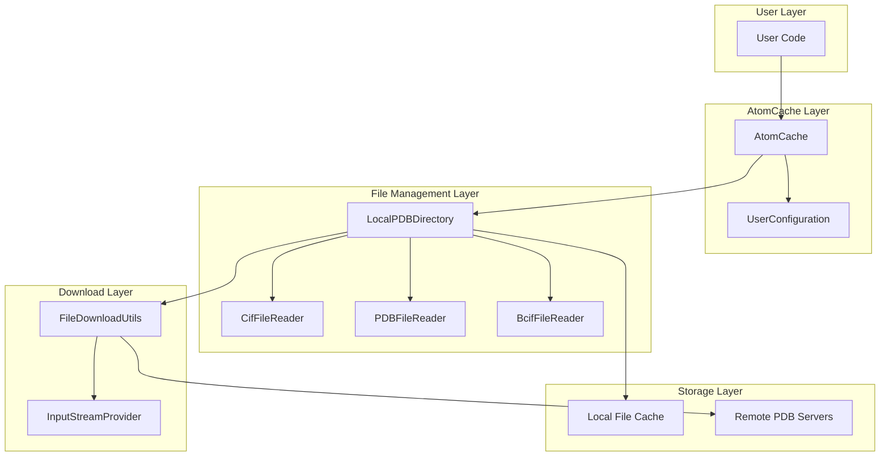
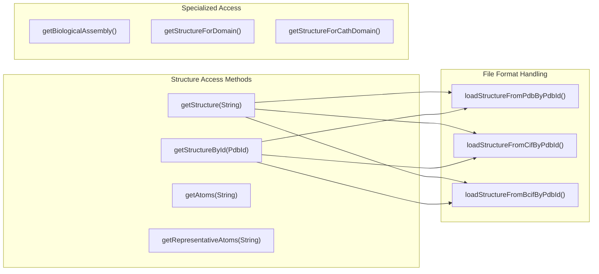
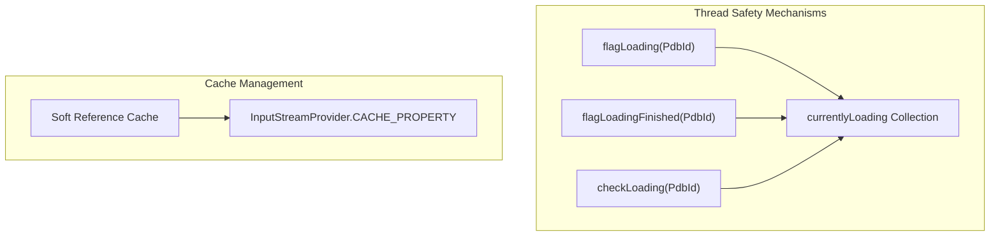
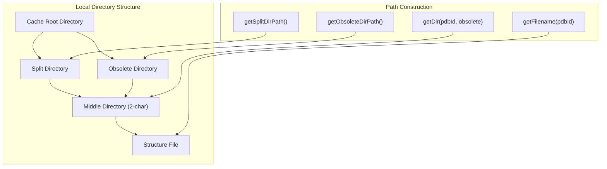
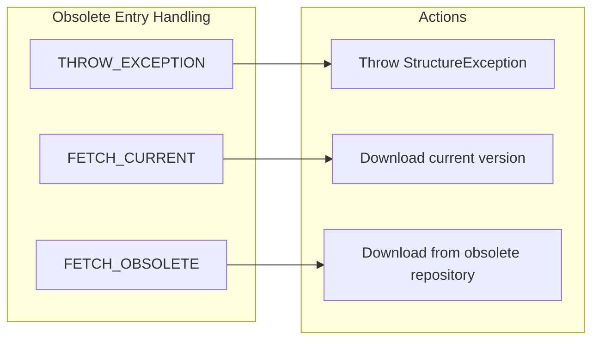
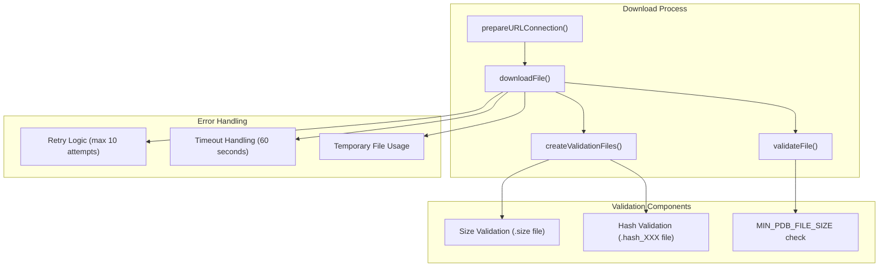
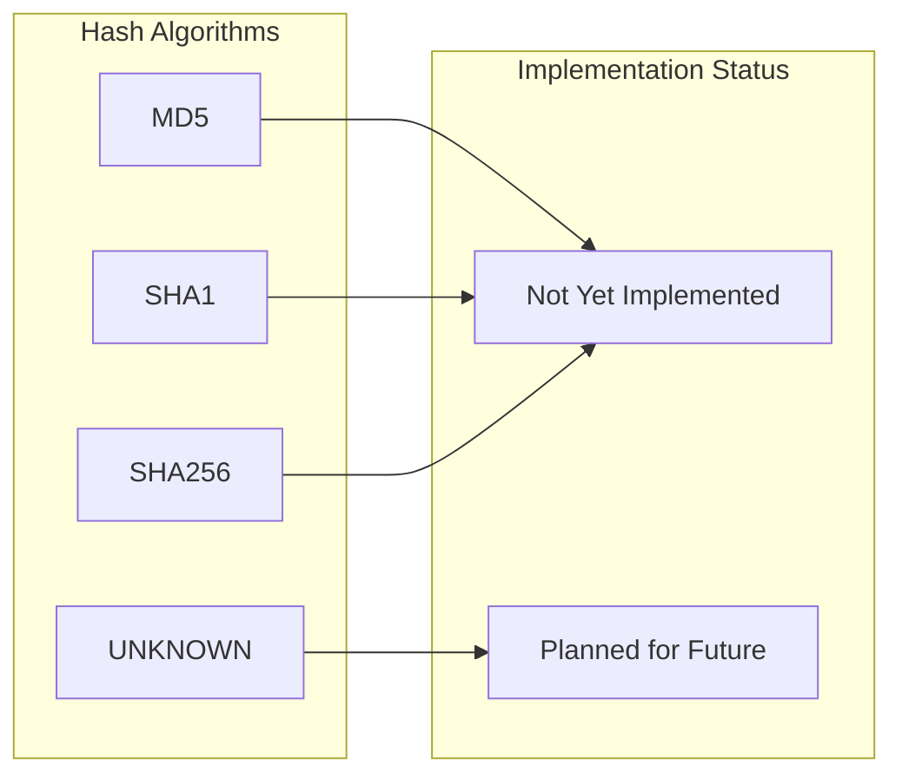
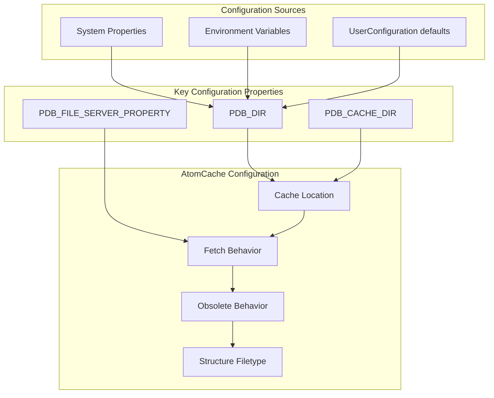
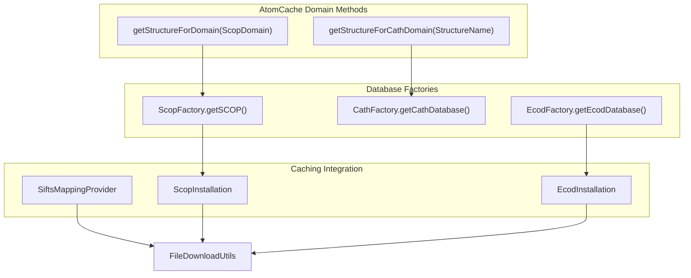

# Structure Caching and Retrieval

Relevant source files

The following files were used as context for generating this wiki page:

- [biojava-core/src/main/java/org/biojava/nbio/core/util/FileDownloadUtils.java](biojava-core/src/main/java/org/biojava/nbio/core/util/FileDownloadUtils.java)
- [biojava-core/src/test/java/org/biojava/nbio/core/util/FileDownloadUtilsTest.java](biojava-core/src/test/java/org/biojava/nbio/core/util/FileDownloadUtilsTest.java)
- [biojava-integrationtest/src/test/java/org/biojava/nbio/structure/test/ecod/EcodInstallationTest.java](biojava-integrationtest/src/test/java/org/biojava/nbio/structure/test/ecod/EcodInstallationTest.java)
- [biojava-integrationtest/src/test/java/org/biojava/nbio/structure/test/ecod/EcodParseTest.java](biojava-integrationtest/src/test/java/org/biojava/nbio/structure/test/ecod/EcodParseTest.java)
- [biojava-integrationtest/src/test/java/org/biojava/nbio/structure/test/io/TestAtomCachePerformance.java](biojava-integrationtest/src/test/java/org/biojava/nbio/structure/test/io/TestAtomCachePerformance.java)
- [biojava-structure/src/main/java/org/biojava/nbio/structure/align/util/AtomCache.java](biojava-structure/src/main/java/org/biojava/nbio/structure/align/util/AtomCache.java)
- [biojava-structure/src/main/java/org/biojava/nbio/structure/ecod/EcodDatabase.java](biojava-structure/src/main/java/org/biojava/nbio/structure/ecod/EcodDatabase.java)
- [biojava-structure/src/main/java/org/biojava/nbio/structure/ecod/EcodDomain.java](biojava-structure/src/main/java/org/biojava/nbio/structure/ecod/EcodDomain.java)
- [biojava-structure/src/main/java/org/biojava/nbio/structure/ecod/EcodFactory.java](biojava-structure/src/main/java/org/biojava/nbio/structure/ecod/EcodFactory.java)
- [biojava-structure/src/main/java/org/biojava/nbio/structure/ecod/EcodInstallation.java](biojava-structure/src/main/java/org/biojava/nbio/structure/ecod/EcodInstallation.java)
- [biojava-structure/src/main/java/org/biojava/nbio/structure/io/LocalPDBDirectory.java](biojava-structure/src/main/java/org/biojava/nbio/structure/io/LocalPDBDirectory.java)
- [biojava-structure/src/main/java/org/biojava/nbio/structure/io/sifts/SiftsChainToUniprotMapping.java](biojava-structure/src/main/java/org/biojava/nbio/structure/io/sifts/SiftsChainToUniprotMapping.java)
- [biojava-structure/src/main/java/org/biojava/nbio/structure/io/sifts/SiftsMappingProvider.java](biojava-structure/src/main/java/org/biojava/nbio/structure/io/sifts/SiftsMappingProvider.java)
- [biojava-structure/src/main/java/org/biojava/nbio/structure/io/sifts/SiftsXMLParser.java](biojava-structure/src/main/java/org/biojava/nbio/structure/io/sifts/SiftsXMLParser.java)
- [biojava-structure/src/main/java/org/biojava/nbio/structure/scop/ScopInstallation.java](biojava-structure/src/main/java/org/biojava/nbio/structure/scop/ScopInstallation.java)
- [biojava-structure/src/test/java/org/biojava/nbio/structure/align/util/AtomCacheTest.java](biojava-structure/src/test/java/org/biojava/nbio/structure/align/util/AtomCacheTest.java)
- [biojava-structure/src/test/java/org/biojava/nbio/structure/io/TestSiftsParsing.java](biojava-structure/src/test/java/org/biojava/nbio/structure/io/TestSiftsParsing.java)
- [biojava-structure/src/test/java/org/biojava/nbio/structure/io/sifts/SiftsChainToUniprotMappingTest.java](biojava-structure/src/test/java/org/biojava/nbio/structure/io/sifts/SiftsChainToUniprotMappingTest.java)
- [biojava-structure/src/test/java/org/biojava/nbio/structure/test/util/GlobalsHelper.java](biojava-structure/src/test/java/org/biojava/nbio/structure/test/util/GlobalsHelper.java)
- [biojava-structure/src/test/resources/atp.cif.gz](biojava-structure/src/test/resources/atp.cif.gz)
- [biojava-structure/src/test/resources/org/biojava/nbio/structure/io/4dou.sifts.xml.gz](biojava-structure/src/test/resources/org/biojava/nbio/structure/io/4dou.sifts.xml.gz)
- [biojava-structure/src/test/resources/org/biojava/nbio/structure/io/sifts/mock_sifts.tsv](biojava-structure/src/test/resources/org/biojava/nbio/structure/io/sifts/mock_sifts.tsv)

This document covers BioJava's structure caching and retrieval system, which provides efficient access to biological structure files through local caching, automatic downloading, and intelligent file management. The system handles multiple file formats, manages download behaviors, and provides thread-safe access to structure data.

For information about the actual structure data models and parsing, see [Data Model and Structure Representation](#2.1) and [File Format Support and Parsing](#2.2). For details about modern CIF format handling, see [CIF Data Processing](#2.4).

## System Overview

The structure caching system centers around the `AtomCache` class, which provides a unified interface for accessing biological structures while managing local file caching, automatic downloads, and format-specific parsing.

### Architecture Overview

**Sources:** [biojava-structure/src/main/java/org/biojava/nbio/structure/align/util/AtomCache.java:1-896](), [biojava-structure/src/main/java/org/biojava/nbio/structure/io/LocalPDBDirectory.java:1-805](), [biojava-core/src/main/java/org/biojava/nbio/core/util/FileDownloadUtils.java:1-386]()

## AtomCache - Main Interface

The `AtomCache` class serves as the primary entry point for structure retrieval, providing both caching capabilities and a simplified API for accessing structures by various identifiers.

### Core Functionality

**Sources:** [biojava-structure/src/main/java/org/biojava/nbio/structure/align/util/AtomCache.java:430-503](), [biojava-structure/src/main/java/org/biojava/nbio/structure/align/util/AtomCache.java:820-895]()

### Supported Naming Conventions

The `AtomCache` supports multiple naming conventions for accessing structures:

| Format | Example | Description |
|--------|---------|-------------|
| PDB ID | `1TIM` | Whole structure |
| Chain-specific | `4HHB.C` | Single chain |
| Range-specific | `4GCR.A_1-83` | Residue range |
| Multi-chain | `3AA0.A,B` | Multiple chains |
| Extended format | `PDB_00001TIM` | Extended PDB format |
| SCOP domain | `d2bq6a1` | SCOP domain identifier |
| Biological assembly | `BIO:1TIM` | Biological assembly |

**Sources:** [biojava-structure/src/main/java/org/biojava/nbio/structure/align/util/AtomCache.java:430-479]()

### Thread Safety and Caching

The `AtomCache` implements thread-safe access through synchronized collections and loading flags:

**Sources:** [biojava-structure/src/main/java/org/biojava/nbio/structure/align/util/AtomCache.java:85-86](), [biojava-structure/src/main/java/org/biojava/nbio/structure/align/util/AtomCache.java:127-128](), [biojava-structure/src/main/java/org/biojava/nbio/structure/align/util/AtomCache.java:740-787]()

## LocalPDBDirectory - File Management

The `LocalPDBDirectory` abstract class provides the foundation for managing local PDB file storage, download behaviors, and file organization.

### File Organization Structure

**Sources:** [biojava-structure/src/main/java/org/biojava/nbio/structure/io/LocalPDBDirectory.java:629-650](), [biojava-structure/src/main/java/org/biojava/nbio/structure/io/LocalPDBDirectory.java:750-780](), [biojava-structure/src/main/java/org/biojava/nbio/structure/io/LocalPDBDirectory.java:787-804]()

### Fetch Behaviors

The system supports multiple fetch behaviors for controlling when files are downloaded:

| Behavior | Description | Use Case |
|----------|-------------|----------|
| `LOCAL_ONLY` | Never download, use only local files | Offline environments |
| `FETCH_FILES` | Download missing files only | Standard usage |
| `FETCH_IF_OUTDATED` | Check server timestamps and update old files | Ensure latest versions |
| `FETCH_REMEDIATED` | Force download of files older than remediation date | Data quality assurance |
| `FORCE_DOWNLOAD` | Always download fresh copies | Development/testing |

**Sources:** [biojava-structure/src/main/java/org/biojava/nbio/structure/io/LocalPDBDirectory.java:98-119]()

### Obsolete Behavior Handling

**Sources:** [biojava-structure/src/main/java/org/biojava/nbio/structure/io/LocalPDBDirectory.java:82-91](), [biojava-structure/src/main/java/org/biojava/nbio/structure/io/LocalPDBDirectory.java:253-288]()

## Download Utilities and Validation

The `FileDownloadUtils` class provides robust file downloading with validation capabilities and cross-platform compatibility.

### Download and Validation Flow

**Sources:** [biojava-core/src/main/java/org/biojava/nbio/core/util/FileDownloadUtils.java:93-134](), [biojava-core/src/main/java/org/biojava/nbio/core/util/FileDownloadUtils.java:147-196](), [biojava-core/src/main/java/org/biojava/nbio/core/util/FileDownloadUtils.java:212-250]()

### Supported Hash Algorithms

The validation system supports multiple hash algorithms for file integrity checking:

**Sources:** [biojava-core/src/main/java/org/biojava/nbio/core/util/FileDownloadUtils.java:50-52](), [biojava-core/src/main/java/org/biojava/nbio/core/util/FileDownloadUtils.java:238-246]()

## Configuration and User Settings

The caching system integrates with BioJava's configuration system to provide customizable behaviors and paths.

### Configuration Hierarchy

**Sources:** [biojava-structure/src/main/java/org/biojava/nbio/structure/align/util/AtomCache.java:143-154](), [biojava-structure/src/main/java/org/biojava/nbio/structure/io/LocalPDBDirectory.java:174-196](), [biojava-structure/src/main/java/org/biojava/nbio/structure/io/LocalPDBDirectory.java:728-742]()

### Default Server Configuration

| Server Type | Default URL | Property |
|-------------|-------------|----------|
| PDB Files | `https://files.wwpdb.org` | `PDB_FILE_SERVER_PROPERTY` |
| BCIF Files | `https://models.rcsb.org/` | Hard-coded |

**Sources:** [biojava-structure/src/main/java/org/biojava/nbio/structure/io/LocalPDBDirectory.java:69-76]()

## Integration with Domain Databases

The caching system seamlessly integrates with structural domain classification databases like SCOP, CATH, and ECOD.

### Domain Database Integration

**Sources:** [biojava-structure/src/main/java/org/biojava/nbio/structure/align/util/AtomCache.java:514-615](), [biojava-structure/src/main/java/org/biojava/nbio/structure/align/util/AtomCache.java:748-776](), [biojava-structure/src/main/java/org/biojava/nbio/structure/ecod/EcodInstallation.java:401-419](), [biojava-structure/src/main/java/org/biojava/nbio/structure/io/sifts/SiftsMappingProvider.java:87-94]()

## Performance and Best Practices

### Memory Management

The system uses soft references for caching to prevent `OutOfMemoryError` while maintaining performance:

- Soft-cache implementation allows garbage collection under memory pressure
- `InputStreamProvider.CACHE_PROPERTY` enables binary file caching
- Thread-safe loading prevents duplicate downloads

**Sources:** [biojava-structure/src/main/java/org/biojava/nbio/structure/align/util/AtomCache.java:53-57](), [biojava-structure/src/main/java/org/biojava/nbio/structure/align/util/AtomCache.java:127-128]()

### File Validation and Corruption Handling

The system includes robust validation to handle corrupted downloads:

- Minimum file size validation (`MIN_PDB_FILE_SIZE = 40 bytes`)
- Optional hash validation for integrity checking
- Automatic cleanup of corrupted files
- Retry mechanisms for failed downloads

**Sources:** [biojava-structure/src/main/java/org/biojava/nbio/structure/io/LocalPDBDirectory.java:142](), [biojava-structure/src/main/java/org/biojava/nbio/structure/io/LocalPDBDirectory.java:694-697](), [biojava-core/src/main/java/org/biojava/nbio/core/util/FileDownloadUtils.java:116-118]()

---